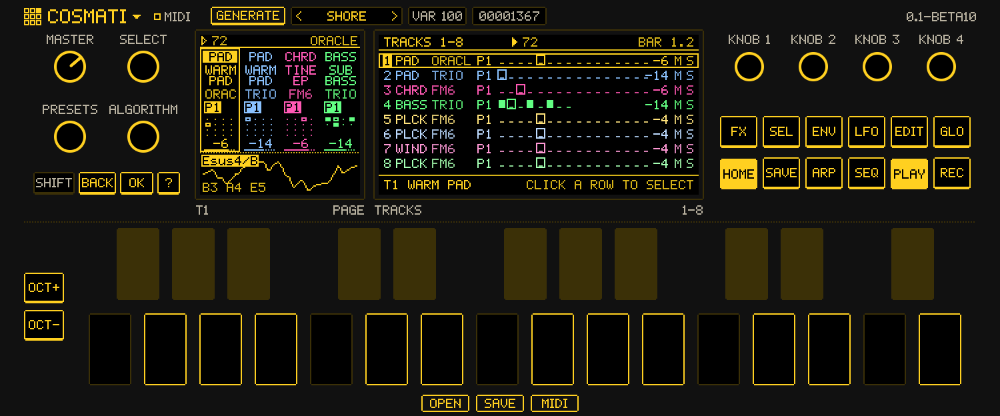

# The Cosmati manual

**Cosmati** is Tessera in your DAW: the same generative sequencer and sound engines the FM-1 plays, as a **CLAP**,
**VST3** or **Audio Unit** instrument and a standalone app, with eight tracks, a window you can resize, and the mouse
and computer keyboard in charge. This is its own manual. It covers the window, the mouse, the keyboard and the DAW,
and it points to the [FM-1 manual](MANUAL.md) for what each page and generator does, because those are the same.

> **In short:** open Cosmati, press **GENERATE**, and a new piece plays. Use the nine **section buttons** (GEN, SOUND,
> MOD, FX, SHAPE, PIECE, MIX, SCALE, SETUP) to reach every page, the mouse to turn, drag and paint, and the DAW for
> tempo, automation and saving. **Right-click** anything for its help and its menu.

*EXPANDED: the FM-1's screen and, beside it, TRACKS with all eight tracks (the latest beta, playing STILL TIDE).*

**To get started,** read [Getting started](#getting-started). To have something at your side while you work, print the
**[Quick reference](docs/cheatsheet/cosmati-cheatsheet.pdf)**: the mouse, keys and sections on two pages
([the same as a table](#shortcut-reference)).

**Basics:** the window and how to move around it.

- [Getting started](#getting-started)
- [The window](#the-window)
- [Finding your way: sections, tabs and the page map](#finding-your-way-sections-tabs-and-the-page-map)
- [Using the mouse](#using-the-mouse)
- [The computer keyboard](#the-computer-keyboard)

**Making music:** a piece, its sounds, notes and modulation.

- [Making a piece](#making-a-piece)
- [The sounds](#the-sounds)
- [Notes, steps and chords](#notes-steps-and-chords)
- [Modulation](#modulation)

**The whole song:** the long form, the mix, tracks, and trying things out.

- [The long form: PIECE, ENTRIES and the song](#the-long-form-piece-entries-and-the-song)
- [Mixing and performing](#mixing-and-performing)
- [Working with tracks](#working-with-tracks)
- [Trying things: dice, locks, A / B and MORPH](#trying-things-dice-locks-a--b-and-morph)

**Files and the DAW:** transport, automation, outputs, saving and the FM-1.

- [In the DAW](#in-the-daw)
- [Saving, and project files](#saving-and-project-files)
- [Playing it from an FM-1, and a MIDI keyboard](#playing-it-from-an-fm-1-and-a-midi-keyboard)
- [Sounds only the plugin has](#sounds-only-the-plugin-has)

**Reference and troubleshooting:**

- [CPU, and when something goes wrong](#cpu-and-when-something-goes-wrong)
- [Shortcut reference](#shortcut-reference)
- [Where each page is explained](#where-each-page-is-explained)

## Getting started

**Install.** Copy the plugin where your DAW looks for plugins and rescan. The steps for each system, the macOS
quarantine command and the downloads are on the [plugin's page](PLUGIN.md#install). In the DAW's list Cosmati is an
instrument from **Rastapopolix**. The standalone app needs no DAW: start it, pick an audio output, and it plays at once.

**First sound.** A new Cosmati opens on a new project: each track has its power-on sound, the patterns are empty and
no generator runs. Three ways to hear something:

1. **Press GENERATE** (the strip at the top of the window). It makes a whole new piece in the style shown beside it:
   sounds, notes, form and mix, from a new seed. Press it again for another. The style (click its name, or use the
   arrows) and **VAR** (how wide each choice may roam, 0 to 100) steer it; the seed is the piece's number, and the
   mouse wheel over it brings back pieces made before. Hold GENERATE half a second to swap the current piece with the
   one before it (BEFORE / AFTER).
2. **Open a demo**: **OPEN** under the keys loads a `.tsp` project, for instance one from the `demos/` folder.
3. **Play it**: press a key on a keyboard routed to Cosmati, or click the on-screen keys. Notes go to the selected
   track, on any MIDI channel.

Then press **PLAY** in the DAW (or in the standalone app). New to Tessera's ideas? Read
[Getting started with Tessera](GETTING_STARTED.md): its first half hour applies here, the buttons simply have other names.

## The window

Cosmati's window is the FM-1's panel redrawn for the mouse: the same screen, knobs and keys, with the screen
reaching everything the mouse can touch. It comes in two layouts:

- **FM-1** is the panel alone, 1000 px wide at 100%.
- **EXPANDED** is wider: a second screen, **TRACKS**, sits beside the FM-1's, showing all eight tracks at once
  (their role, engine, pattern, the bar's 16 steps, level, **M** and **S**), and the header has room for GENERATE,
  **A / B** and **MORPH**. A new Cosmati opens in EXPANDED when your screen is wide enough (about 1600 px) and in FM-1
  otherwise. Once you pick a MODE, every new window follows it.

**Click the Tessera mark** at the top left for the menu:

| Row | What it does |
|---|---|
| **SKIN** | **NIGHT** (dark) or **DAY** (light). The sun and moon switch in the header does the same. DAY also sets the screen's GROUND to LIGHT, and leaving DAY sets it back (MENU > GROUND can change it again). |
| **INK** | The screen's ink: nine single colours, then MOSAIC, SUNSET, OCEAN and NEON, which colour each track. Hover a swatch for its name. |
| **MODE** | FM-1 or EXPANDED. |
| **SIZE** | The window at 75, 100, 150 or 200% (EXPANDED: 75, 100, 125 or 150%). |
| **FM-1 USB** | Lets an FM-1 on USB play this Cosmati: [see below](#playing-it-from-an-fm-1-and-a-midi-keyboard). |
| **KEYS** | Whether the computer keyboard plays Cosmati when its window has focus. OFF leaves every key to the DAW. |
| **HOVER HELP** | ON shows a value's help text under the screen when the mouse rests on it. |
| **LISTEN** and **SPLIT** | A MIDI channel whose notes steer Cosmati ([below](#a-midi-keyboard-that-steers-the-piece-listen)). |
| **TRACK** | The selected track's COPY, PASTE ONTO, PASTE SOUND ONTO, MOVE UP and MOVE DOWN. |
| **OUTPUTS** | Track outputs as STEREO or MONO pairs ([below](#track-outputs-and-midi-out)). |
| **ABOUT** | The plugin's version. |

Esc or a click outside closes it. These are your settings, not the project's: Cosmati remembers the skin, ink, mode and
size for every new window, in any DAW, and a project opens in *your* skin and ink.

**Size.** Pick a SIZE, or **drag the window's corner** for any size from 75% up: a size you dragged to shows lit at the
left of the SIZE row. A HiDPI host's scale (say 125% or 175%) is used as it is. Until you pick one, the window opens no
wider than your screen less room for the DAW's frame, so a small laptop gets a window that fits.

**The strip at the top** (EXPANDED, and GENERATE in both): GENERATE with its style, VAR and seed, then **A**, **MORPH**
and **B**, then the DAY / NIGHT switch. The **MIDI** lamp beside the mark lights when notes arrive from the DAW.

**The line under the screen** shows the page you are on and, for a few seconds, **toasts**: short notes about things
that happened, such as `LOADED STILL TIDE`, `PASTED T2 ONTO T6`, `CLIP SAVED: <name>`, `DICE: 3 VALUES`,
`SONG PUT BACK BY THE DAW`, `LISTEN: <style>` or `COPIED <value>`.

**Under the keys:** **OPEN**, **SAVE**, **MIDI** (the clip button), PLAY, REC and the 1-4 / 5-8 switch (FM-1 mode only;
EXPANDED shows all eight tracks). **OCT+** over **OCT-** at the left of the keys moves them up or down by an octave, up to
three each way, and both together put them back. They light while the keys are shifted. **SHIFT**, **BACK**, **OK**
and **?** sit under the left knobs and stand for the FM-1's OCT- and OCT+ roles (see [the keyboard](#the-computer-keyboard)).

Cosmati stops moving only while the DAW isn't processing audio: if the window looks frozen, check the audio engine is on.

## Finding your way: sections, tabs and the page map

The FM-1 has a few group buttons with long lists of pages behind them. Cosmati has **nine section buttons**, each named
for what its pages do. Tessera's pages are the same ones, grouped:

| Section | Pages |
|---|---|
| **GEN** | the generator, NOTES, ARP, PATTERN, MOTION |
| **SOUND** | the engine's own pages, then ENV |
| **MOD** | MODS, MATRIX, the LFOs, ORGANIC |
| **FX** | the effects |
| **SHAPE** | EVOLVE, FORM, TWEAK, LENGTH, TIMING, ENERGY |
| **PIECE** | PIECE, CHAIN, ENTRIES, LANDSCAPE, PATTERNS, SONG |
| **MIX** | MIXER, PERF |
| **SCALE** | SCALES, SCL, KEY, CHORD |
| **SETUP** | SETTINGS (the MENU's list), TEMPO, SYSTEM, MIDI IN, MIDI OUT |

Then HOME, SAVE, PLAY and REC as before.

- **A press** opens the page you last used in that section. **Press again** to step to the next page; after the last
  it wraps to the first, as the FM-1's group buttons do. The section of the page on screen is lit.
- **The footer's tabs** list the section's own pages, so PIECE shows PIECE, CHAIN and ENTRIES, not a mixed list. Click
  a tab for that page, an arrow for the page just past it, or turn the **mouse wheel over the tabs**. The page's place
  (for instance `2/3`) is shown at the header's left.
- **Sideways scroll** (a trackpad swipe, a tilt wheel) steps the page too. It stops at the first and last page.
- **Right-click a section button** to latch the FM-1 button it stands for, so the FM-1's held gestures stay reachable:
  GLO + a key to mute, ARP + a knob for help, and so on.
- **SETUP** opens on SETTINGS, the old MENU: a list with SETUP's tabs under it. Press SETUP again or click a tab and
  the list closes and moves on to TEMPO. BACK goes HOME.
- Keys **1** to **9** are the sections, **0** is HOME, **-** is SAVE and **=** is REC.

**The page map.** Press **Ctrl+M** (Cmd+M on a Mac) for a card with every section's pages by name: GEN to SHAPE on the
first row, PIECE to SETUP on the second, the page you're on lit and the one under the mouse outlined. Click a page to
go there. Esc or a click outside closes it. It works while the section buttons are on, which is Cosmati's own look.

**The arrow keys** move without the mouse (click the window first):

- **Shift+Left / Right**: the previous or next section.
- **Up / Down**: the rows of a list, or SELECT when the page has none.
- **Shift+Up / Down**: the previous or next track.
- **Alt+Up / Down**: move the track ([working with tracks](#working-with-tracks)).
- **Left / Right**: ALGORITHM.

**Mouse back and forward** buttons are BACK and OK. **HOLD: MORE** under OK appears where the page has a sheet: hold
OK to open it. The buttons beside the knobs are named for what they open, with the FM-1's name small under it.

**Your first knobs.** The four columns of a page are KNOB 1 to 4. **SHIFT** (a click latches it) reaches the second set
on pages that have one. The knob labels on the panel follow the page and the SHIFT layer.

## Using the mouse

Hover over something you can use and it gets a thin outline, with its name and value in a box under the screen.

### Values

- **Drag** a value up and down, or **turn the wheel**, as you would turn its knob. **Double-click** puts it back to its default.
- **Shift** with a drag or the wheel turns it in **fine steps**: one detent every 32 px, one per wheel notch, and never sped up.
- **Ctrl-click** (Cmd-click on a Mac) a value to **type it**: a box opens under the screen. Names and numbers both work
  ("-6dB", "1/8", "saw", "440"); Enter sets, Esc closes.
- **Right-click** a value for its menu:

  | | |
  |---|---|
  | **HELP** | its help card (stays until you click) |
  | **DEFAULT** | the default value |
  | **COPY VALUE** and **PASTE VALUE** | paste works across parameters where the copied value fits |
  | **RANDOM** | a random value in its range |
  | **TYPE A VALUE** | the box above |
  | **LOCK** / **UNLOCK** | keeps DICE and MUTATE away from it (a padlock shows) |
  | **DICE THE PAGE**, **PUT BACK** | see [Trying things](#trying-things-dice-locks-a--b-and-morph) |

- Around each **knob ring** a short tick shows where the page's setting sits in its range. When a mod reaches that
  setting, a thin white arc runs from the tick to where the mods have it right now, and moves as they do.

### Lists, sheets and pictures

- **A list** (SCL, the MENU, a list that opens over a page): the wheel scrolls a row a notch, a click moves there,
  dragging up or down changes the row's value, a double-click moves there and presses OK.
- **Click away** with a list, sheet or help card open and it closes, as BACK would. A YES / NO question waits for you.
- **ABOUT and long help cards:** the wheel scrolls the text.
- **The tempo** in a header: drag it or turn the wheel, a BPM a step; double-click for 120. While a DAW plays Cosmati,
  the DAW sets the tempo.
- **Pictures are handles.** The envelopes, filter curves and chart pages are drawn so you can grab them: FM6's envelope
  corners (rates across, levels up and down), a filter's resonant peak (across for CUT, up and down for RES), the
  algorithm chart (click an operator, double-click for its pages), ATLAS's cross-hair, CONSTELLATION's ship and its
  top and bottom brackets (SIZE), MORPH's POS bar (click or drag it), and BOUNCE's ball.
- **Boxed values** (a choice, not a dial): a click steps to the next choice and round again.
- **Home:** click a track's column to select it, double-click to open its sounds. **PATTERNS** and **SONG**:
  click a cell, a letter or a block. **PERF**: click a MACRO's row and, when it drives nothing, a new mod from that macro is
  made in the first free slot (SOURCE MCRn, amount 25%, destination OFF) and MODS opens on it; if it already has one,
  MODS opens on that.

### Drag and drop

- **A sound onto a track** (EXPANDED): in SAVE > PRESETS, press a sound and drag. Its name follows the mouse, the
  TRACKS row under it is framed (`INIT ORACLE > T6`), and letting go loads it onto that track. The selected track and the
  browser stay as they were.
- **A mod in MATRIX:** press a cell and drag it onto another. Letting go makes a mod from the first cell's track to the
  second's, in a free MODS slot, with that track's shortcut source (its LFO, unless FX + SELECT picked another) onto
  CUTOFF at 25%, and MODS opens on it so you set the real source and destination. BACK returns to MATRIX.
- **The MIDI clip out into the DAW:** press and drag the **MIDI** button under the keys 8 px or more and the clip
  goes as a `.mid` file onto a DAW track or a folder (Windows and macOS; on Linux a drag saves it as a click does). A
  plain click saves it in Documents/Tessera/MIDI. The clip is the notes played since PLAY while playing, or the first bars
  rendered when stopped.

### The sound browser

SAVE > PRESETS (the sound browser) has a **list** on the left (ALL, FAVES, a category, an engine) and the **sounds** on
the right. Click a name to go there; double-click a sound to keep it (OK); BACK puts the track's old sound back.

- **Audition:** with the transport stopped, a sound you pick (a click, the wheel, or turning LIST or SOUND) plays a
  short phrase on its track so you hear it: root, fifth, octave, root (a drum track plays kick, hat, snare, hat).
  Pressing PLAY, playing a key or loading another sound ends it. While playing, the pattern is what you hear.
- **FIND:** click the count at the top right ("177 SOUNDS") and type. Each key narrows the list to names containing the
  text; the header shows the text and the number of matches. Enter keeps the filter, Esc clears it.
- **Drag a sound** onto a TRACKS row, as above.

### Notes and the drum grid

See [Notes, steps and chords](#notes-steps-and-chords).

## The computer keyboard

Click the window first; keys reach Cosmati only while it has focus. Keys go by where they sit, so any layout works.

- **Z** to **'** and **Q** to **O**: the keys. **1** to **9**, **0**, **-**, **=**: the sections and HOME, SAVE, REC.
- **[** and **]**, or **Esc** and **Enter**: BACK and OK. **Page Up / Page Down**: OCT+ and OCT-. **Shift**: SHIFT, held
  while you hold it (a click on the SHIFT button latches it instead).
- **F1**: the help card of the value under the mouse. **Tab**: the 1-4 / 5-8 switch.
- **Space** (standalone): PLAY / STOP. **Ctrl+O** and **Ctrl+S** (Cmd on a Mac): OPEN and SAVE. In a DAW these stay the DAW's.
- **Ctrl+R**: DICE THE PAGE. **Ctrl+Shift+R**: MUTATE the selected track. **Ctrl+M**: the page map.
- **Ctrl+C**, **Ctrl+V**, **Ctrl+Shift+V**, **Alt+Up**, **Alt+Down**: copy, paste, paste the sound, move the track.
- Arrow keys: see [Finding your way](#finding-your-way-sections-tabs-and-the-page-map).
- **Naming** a project or preset: just type. Letters, digits, space and `- . _ / # +` go in; Backspace and Delete
  remove, Left / Right move the cursor, Enter is OK, Esc cancels. While NAME is open the keyboard types instead of playing.

With **Ctrl** or **Alt** held, other keys go to the DAW, and to leave every key to the DAW, set **KEYS** to OFF in the menu.

**Key labels.** Where a page gives the keys a job of their own, each key shows it in a tiny label, and hovering says it
in full: MIXER, PERF, LANDSCAPE and GLO held (M1..M8 mute, S1..S8 solo, then ALL, HOLD, FILL, TAP), SEL held (the key
sets the ROOT), SEQ held (PATTERN 1..8), the DRUM grid, AWAKE's steps, CHORD USER and ATLAS's PART 4 with SHIFT held,
a USER scale (each note IN or out) and NAME.

**The scale on the keys.** Where the keys play the selected track's notes, keys that give no new note in the track's
scale fade (silent keys, keys out of the scale, keys that snap to the note below), keys on the **root** carry a dot, and
a CHORD track's current chord is named above OCT+ ("Am7"). It follows QUANTIZE, TRANSPOSE and the octave.

**Button combos with the mouse.** Right-click a button or key (Ctrl-click on a Mac) to latch it: it stays held while
you click the second one, so GLO + a key works with one mouse. Click it again or press Esc to let go.

## Making a piece

Everything that decides what a track plays is in **GEN**: pick a generator, set its knobs, and a pattern appears. The
[generators](MANUAL.md#the-generators) are the same as on the FM-1, and so are [the GEN layer](MANUAL.md#the-gen-layer),
[EVOLVE](MANUAL.md#evolve), [FORM](MANUAL.md#form) and [TWEAK](MANUAL.md#tweak). Cosmati adds three things:

- **GENERATE** makes a whole piece in one press ([Getting started](#getting-started)). Its styles include **WILD**.
- **Seeds replay**: the same seed and style make the same piece, so a piece you like can be made again.
- **LISTEN** lets a MIDI keyboard steer it ([below](#a-midi-keyboard-that-steers-the-piece-listen)).

**SHAPE** holds what turns a pattern into music over time: EVOLVE, FORM, TWEAK, LENGTH, TIMING (swing, humanise) and
ENERGY (how busy the piece is, and the tracks coming in and out). See their chapters in the [manual](MANUAL.md).

## The sounds

**SOUND** shows the selected track's engine pages and then ENV. The engines, FM6 (the six-operator FM synth),
the subtractive and sampled ones, drums and ORACLE, are the manual's [Sounds](MANUAL.md#sounds). Cosmati also has
[engines the FM-1 can't fit](#sounds-only-the-plugin-has).

- **Pick a sound** in the browser (SAVE > PRESETS), with audition, FIND and drag onto a track ([above](#the-sound-browser)).
- **Right-click a track** for MUTATE, which nudges its sound a little ([Trying things](#trying-things-dice-locks-a--b-and-morph)).
- **FM6's** STORE page is the last of its EDIT pages, after VOICE.
- The **ENV** and filter pages are drawn so the picture is the control ([Pictures are handles](#lists-sheets-and-pictures)).

## Notes, steps and chords

**NOTES** (a STEP track) is a piano roll. All of it is mouse-first:

- **Click a step** to put a note there, at the pitch under the mouse (in key when the track quantises). Click the same
  step at another height for a **chord** (up to 4 notes); chord notes are drawn at their own pitch, so each can be picked.
- **Drag up or down** on a note to re-pitch it (it steps over the chord's other notes); **Shift-drag** moves the whole chord.
- **Paint:** drag across empty steps to draw a run of notes at the mouse's pitch. Start the drag on a note and it
  **erases** the notes it crosses, ties included. One stroke is one undo step.
- **Alt-drag** across a note sets its **length** (it grows over empty steps only); **Alt-drag** up or down sets its
  **velocity**, four to a detent.
- **Right-click** a note removes it (a chord's tick: that note). The wheel on a note moves it too.
- **The drum grid** (a DRUM track's NOTES): click toggles a hit, right-click clears it, a drag across a lane paints or
  erases hits (by where the drag starts), and dragging up or down on a hit, or the wheel, accents it. An accent is a
  hit's only dynamics in the grid.

**CHORD tracks.** With PROG set to USER, each chord card on GEN is yours to edit with the mouse: drag a card, or use the
wheel, to move that chord's root a scale degree; click the **+** card after the last to add one (up to 8); right-click a
card to remove it (one always stays). Each card has a **quality** (AUTO, maj, min, 7, sus and so on): click the card's
quality to come round to the next, back to AUTO. The quality plays wherever the chord is built, and its name shows on
the card. These are saved in the project, in a part older firmware and the FM-1 skip (they open there with every USER
chord on AUTO). [Harmony](MANUAL.md#harmony-one-key-chord-and-qnt-chrd) explains CHORD and QNT CHRD.

## Modulation

**MOD** holds the 16 mods, the MATRIX, the LFOs and ORGANIC; the [manual's MODS chapter](MANUAL.md#mods-the-modulation-cords)
explains sources and destinations. In Cosmati:

- **MODS:** the wheel scrolls the 16 mods; click one to pick it, drag up or down to change its amount, double-click for
  its type (+-, +, GATE, HOLD). Click a mod's source or destination for its list; it stays open until you click one.
- **MATRIX:** click a cell to open its mod, or **drag one cell onto another** to make a mod ([above](#drag-and-drop)).
- **Live motion:** knob rings show the modulated value moving ([above](#values)); MATRIX cells move with their mods.
- **MPE:** each note keeps its own pressure and slide. On MODS, **AT** is each note's pressure and **SLIDE** (the
  plugin only) its slide, e.g. AT onto CUTOFF and SLIDE onto SHAPE. Use ROUT SEL, the plugin's default, so every channel
  plays the selected track. Each note also bends by its own channel's bend (48 semitones, as MPE controllers expect);
  FM6 is the exception: it bends a whole track by its own range.

## The long form: PIECE, ENTRIES and the song

**PIECE** holds the shape over minutes: PIECE (a length and a shape), CHAIN (one form for the project), ENTRIES
(which tracks play where), LANDSCAPE, PATTERNS and SONG. The ideas are in the manual's
[PIECE](MANUAL.md#piece-a-length-and-a-shape) chapters; here is what the mouse adds.

- **PATTERNS:** click a cell to queue that pattern on its track; click a track's number to select it.
- **SONG:** click a section's letter to pick it, or a block to pick its section and track.
- **ENTRIES grid.** The ENTRIES page shows all 8 tracks (1-4 left, 5-8 right), each with a cell for the FORM's letters
  A, B and C, heads under them, and the letter playing bright. A cell is:

  | Cell | Meaning |
  |---|---|
  | the letter (**AUTO**) | ENTRIES decides, as before |
  | filled (**IN**) | always plays there |
  | empty box (**OUT**) | never plays there |
  | half filled (**FADE**) | plays there, fading in over the section's first phrase (when it was out) and out over the last |

  A click cycles AUTO, IN, OUT, FADE (quick clicks each step on); a right-click sets AUTO. Click a letter's head to set
  the whole column, right-click it to clear the column. OUT beats ANCHOR; hand mutes still win; one track always
  plays. The grid also works with ENTRIES at 0, so you can arrange by hand. With FORM OFF, A's column holds for the whole
  piece. A track's number is dim while it is out and blinks before a change. With every cell AUTO the piece plays exactly
  as it did before. The grid is saved in the project (in a part the FM-1 skips: it opens there with plain ENTRIES).
- **PERF:** four MACROs; click a MACRO's row to open or make its mod ([above](#lists-sheets-and-pictures)).

## Mixing and performing

**MIX** is MIXER and PERF.

- **MIXER** (FM-1 mode): drag or turn the wheel on a strip's level or pan (double-click: default, centre); click the word
  under a strip to mute it, right-click it (or double-click) to solo.
- **MIXER in EXPANDED** turns the TRACKS screen into an **8-strip mixer**, and the FM-1's screen into the selected
  track's **inspector**. Each strip has the track's number and role, a fader with a meter, the level in dB, PAN, its
  FX send or sends (one bar in CHAIN mode, three in SPLIT), **M** and **S**. Faders, sends and PAN take a drag or the wheel;
  double-click for the default; click a strip's head to select the track; M mutes, S latches a solo. The knobs turn the
  selected track's level, pan and first two sends.
- **Keys mute and solo all eight** while MIXER, PERF, LANDSCAPE or GLO is held:

  | Keys | Job |
  |---|---|
  | F#3 G#3 A#3 C#4 (black) | mute T1 to T4 |
  | F3 G3 A3 B3 (white, held) | solo T1 to T4 |
  | C4 D4 E4 F4 | ALL, HOLD, FILL, TAP |
  | F#4 G#4 A#4 C#5 (black) | mute T5 to T8 |
  | G4 A4 B4 C5 (white, held) | solo T5 to T8 |

- **TRACKS rows** (EXPANDED): each has a level meter at its left edge, and its role name flashes when a note starts.
  Click a row to select; double-click to open its EDIT page. **M** mutes (with MENU > MUTES on BAR or PHRASE it blinks
  until the mute happens); **S** solos and stays soloed until clicked again; the wheel on a level turns it. A solo isn't saved.
- **The tempo:** a DAW sets it while playing, and a TEMPO mod has no effect then.
- **LIGHTS OFF:** with MENU > LIGHTS at OFF, the keys' can-be-pressed blink on MIXER and PERF stays off.

## Working with tracks

Cosmati has **eight tracks**; the FM-1-size window works on four at a time (the 1-4 / 5-8 switch, or Tab), EXPANDED shows all.
TWEAK's FOLLOW and HOLD and TWEAK 2's TO and WITH can name any of the eight.

**Copy, paste and move.** From MENU > TRACK, a track's right-click menu (on HOME's column or a TRACKS row), or the keys:

| | Key | Does |
|---|---|---|
| **COPY TRACK** | Ctrl+C | the track whole: sound, patterns, settings, mods onto it, timed notes and motion, chord qualities and ENTRIES cells |
| **PASTE TRACK** | Ctrl+V | replaces the track with the copy. It keeps its own MIDI OUT channel, and **pasted mods and references keep their track numbers** |
| **PASTE SOUND** | Ctrl+Shift+V | only the engine, sound settings and the FM6, ORACLE and DRUM patches |
| **MOVE UP / DOWN** | Alt+Up / Down | swaps with the neighbour and renumbers every reference to them: mods, FOLLOW, BRANCH, LOGIC, HOLD, SOURCE, QUAD LINK, SECTION PC, timed notes, motion |

The copy is shared by every Cosmati in the DAW, so a track copied in one pastes into another. Each paste or move is one
DAW undo step ("PASTE TRACK", "PASTE SOUND", "MOVE TRACK"), and a toast says what happened.

## Trying things: dice, locks, A / B and MORPH

- **LOCK** a value (right-click it): a padlock shows, and DICE and MUTATE leave it alone.
- **DICE THE PAGE** (value menu or **Ctrl+R**): rolls the page's four columns around their defaults, up to 40% of each
  range either way. It never rolls MUTE, LEVEL, LENGTH or global settings. A toast says how many changed.
- **MUTATE** (a track's menu, or **Ctrl+Shift+R**): nudges that track's sound by up to 8% of each range: envelope,
  filter, pitch and shape depths, LFO rate and depths, detune, spread, ENGINE 1-8, FX 1's mix, rate and character, and FM6's
  operators.
- **PUT BACK** undoes the last DICE or MUTATE.
- **A / B** (EXPANDED's header): two whole-project snapshots. Click **A** or **B** to switch; you always edit the lit one,
  and it keeps your edits when you switch away. Clicking an empty slot copies the project into it (so A then B gives two
  equal copies to edit apart). **Right-click** (or Shift-click) stores the current project there. A recall is one DAW undo step.
- **MORPH** (once both are stored): drag the handle from A's end to B's end to blend **every setting** on every track and
  globally. Settings shown as words (waveforms, engines, modes) switch to B's at the halfway point; the notes and structure
  stay. While MORPH is in use neither A nor B is lit. A / B shows only in EXPANDED, but the snapshots are kept either way.

**Saved with the DAW song:** locks (state tail `TLCK`) and A / B (`TSNP`), each only once used. A song saved with locks or
A / B stored **won't load in an older plugin build**. Neither is in a `.tsp`.

## In the DAW

### Transport and tempo

- **PLAY** starts every track where it would be if the song had played from the DAW's zero: starting at bar 9 sounds like
  eight bars have passed.
- **The DAW's tempo** drives the clock, changes included; the BPM shown is the DAW's, rounded. The MIDI page reads **DAW**
  where the FM-1 reads INT, **CLK** stays INT and CLOCK OUT off.
- **A loop or a jump** moves Cosmati to that point. **STOP** stops it.

### Program Change steers the piece

A Program Change from a MIDI clip, on any channel:

| Program | Does |
|---|---|
| **0, 1, 2** | the CHAIN goes to section **A, B or C** at the next phrase line. Sent while stopped, the next PLAY starts on it |
| **8 to 15** | every track goes to pattern bank **1 to 8**, each when its pattern comes round (at once while stopped, not while a SONG runs) |

Other numbers do nothing, and nothing is saved: put the changes in a clip. To land on a phrase line, send the change
during the phrase before it.

### Automation

Almost every project setting is a DAW parameter, about 1,700 in all: **MASTER** and PERF's **MACRO 1 to 4** first, then each
track's settings (`T1 LEVEL`, `T3 TURING LENGTH`, grouped under *Track 1/Sound and sequence* and *Track 1/Generator*) and the
song's, under *Song*. Values read as the FM-1 shows them ("SAW", "1/16", "-6dB") and you can type them that way. When a
setting changes on the panel, by loading a project or by Cosmati itself, the DAW hears: MASTER and the MACROs at once, the
rest within a fraction of a second. Not parameters: the device's own settings (A4, MIDI routing) and the MOD cords; the DAW
project saves them.

### Track outputs and MIDI out

- **Track outputs:** besides the stereo mix, eight more outputs, TRACK 1 to TRACK 8, after each track's level and before pan
  and the bus effects. **MENU > OUTPUTS** picks **STEREO** or **MONO** pairs. In CLAP, hosts that switch layouts themselves
  see "Tracks stereo" and "Tracks mono"; VST3 and AU read the setting when loaded.
- **MIDI out:** every track's notes, each on its own channel (GLO > MIDI OUT; by default 1 to 8), so Tessera's generators
  can play other instruments. NOTES OUT starts at ALL in the plugin; MENU can set it to KEYS or OFF. Only notes go out. When
  the DAW stops or bypasses Cosmati, every note it left on gets its note-off. Not every DAW takes MIDI from an instrument.
- **MIDI clip:** the **MIDI** button under the keys saves, or drags out ([above](#drag-and-drop)), the clip.

### Several Cosmati

Up to **8 Cosmati** in one song, each wholly its own: project, transport, window and parameters. A ninth won't open.

### A MIDI keyboard that steers the piece (LISTEN)

**LISTEN** (menu) sets a MIDI channel (1 to 16, or OFF) whose notes steer Tessera instead of playing it. **SPLIT** (the row
under it) is the first note that sets the key (a C, 12 to 108, given as a note number since DAWs name octaves differently;
48 by default).

- From SPLIT up: what is held sets the key. One note sets the ROOT and keeps the scale; a chord sets its root, and a
  major or minor third above it turns the scale to its major or minor twin.
- Under SPLIT: a note **GENERATES**, with its velocity and pitch as the seed, so a clip that plays the same note makes the
  same piece each time. A white key picks the style (the octave under SPLIT gives styles 1 to 7, the one below 8 to 14, and
  so on); a black key uses the style the strip shows. A toast says `LISTEN: <style>`.

### Echoes on the beat

FX's **SYNC ECHO** repeats on a note value (1/32 to 1/1, triplets and dotted) at the DAW's tempo. The plugin's echo holds
about 3 s, so a 1/2 or a 1/1 rings as set; the FM-1's holds 371 ms.

## Saving, and project files

**The DAW saves Cosmati with your song.** The saved state is the Tessera project (the same bytes SAVE > PROJECT writes on
the FM-1) plus MASTER, locks and A / B. Open the song again and everything comes back, each Cosmati with its own project. When
the DAW loads a preset, a toast names it, and when the DAW puts the song back (undo / redo) it says so.

**OPEN** and **SAVE**, under the keys:

- **OPEN** loads a `.tsp` project (from the editor, `demos/`, or another Cosmati) or an **FM-1 backup** (the `.json` from the
  backup page or the Hub): slots A to D go into the plugin's slots, then the music it was playing loads. On Windows and
  macOS you can also drop a file on the window.
- **SAVE** writes a `.tsp` under its name, ready for the FM-1's editor or another Cosmati. It offers
  **Documents/Tessera/Presets**: what you save there shows in the DAW's list of presets beside the demos (the VST3 and AU read
  the folder once, when the DAW first loads Cosmati, so a new file shows after the DAW restarts).
- **A `.tsp` from Cosmati opens on the FM-1.** Tracks 5 to 8, the ENTRIES grid and CHORD USER qualities are in parts the FM-1
  skips, so it plays the first four tracks with plain ENTRIES; tracks on the plugin-only sounds play a stand-in.
- On Linux the file dialogs need `zenity` or `kdialog`.

**MENU (HOME held)** is the FM-1's, less the rows for the device itself: KNOBS, LARGE VALUE, SCREEN OFF, PANEL GAMMA, CLOCK OUT,
the USB rows, SIM CONTROL and CALIBRATION.

## Playing it from an FM-1, and a MIDI keyboard

An FM-1 running Tessera 3.5.1 or later can play Cosmati from its own knobs, buttons and keys. Connect it by USB and turn on **FM-1
USB** (menu). When it answers, the menu says **FM-1 CONNECTED**.

- **Turn on SIM CONTROL** on the FM-1 so it plays only the plugin. FX and GLO together turn it off again.
- **Windows:** only one program can use the FM-1's MIDI port. Turn the FM-1 off in the DAW's MIDI settings and close the
  editor if it's open. Otherwise the menu says **PORT IN USE**.
- **macOS:** the DAW can keep the FM-1 on, but then its keys reach whatever track the DAW sends them to. Turning it off in the DAW is simplest.
- **Several Cosmati:** the FM-1 plays one at a time; the others say **IN ANOTHER TESSERA**.
- **NO FM-1 FOUND** means none is plugged in or its port has another name. **UPDATE THE FM-1** means it doesn't answer (3.5 or older).
- While an FM-1 plays the instance, its own buttons and groups stay, and the section buttons give way to them.

## Sounds only the plugin has

- **SID**: a whole MOS 6581 or 8580 chip per note, with 32 presets. **SID KIT** and **SID DIGI** are drums from one chip.
- **MACRO**: a macro-oscillator with many synthesis models.
- **PHASE**: phase distortion, two lines of bent-phase waves (saw, square, pulse, double sine, saw-pulse and three resonant
  ones), mixed or ring-modulated, with 33 presets of its own. EDIT 2's EG at SPLIT gives DCW 1, DCW 2, DCA 2 and pitch their
  own envelopes.

The Daisy build (Andamento) has them too. On the FM-1 a SID, MACRO or PHASE track plays FM6's INIT sound instead and a SID kit
plays the 909, so a project still opens and plays there.

## CPU, and when something goes wrong

On average one Cosmati takes about 2% of one core of a 2.1 GHz desktop processor at 48 kHz; eight take about 20%, less where
the DAW spreads them over cores. There's no shared voice budget as on the FM-1: every track plays as many voices as its engine
has (FM6 16, most 8). If you hear clicks with several Cosmati, raise the audio buffer to 256.

| If | Then |
|---|---|
| The window looks frozen | The DAW's audio engine is off: the window moves only while audio is processed |
| The DAW's list shows Cosmati twice | Delete the old Tessera.clap, .vst3, .component and app from before beta 4 |
| macOS says "damaged" | The beta isn't signed yet: clear the download's quarantine ([install steps](PLUGIN.md#install)) |
| No sound on PLAY | A new project has empty patterns: press GENERATE or open a demo |
| An FM-1 doesn't connect | See [Playing it from an FM-1](#playing-it-from-an-fm-1-and-a-midi-keyboard) |
| A song won't open in an older Cosmati | It was saved with locks or A / B stored: update the plugin |

**Not there yet:** no standalone app on Linux; no Linux drag-out of the MIDI clip; not signed on macOS or Windows; EXPANDED
has no tall layout for square screens.

## Shortcut reference

The printable version of this table, with the mouse as well: the [Quick reference](docs/cheatsheet/cosmati-cheatsheet.pdf).

| Keys | Does |
|---|---|
| Z to ' and Q to O | play the keys |
| 1 to 9, 0, -, = | sections GEN to SETUP, HOME, SAVE, REC |
| [ ] or Esc Enter | BACK, OK |
| Page Up / Down | OCT+, OCT- |
| Shift | SHIFT, while held |
| F1 | help for the value under the mouse |
| Tab | 1-4 / 5-8 |
| Space | PLAY / STOP (standalone) |
| Ctrl+O, Ctrl+S | OPEN, SAVE (standalone; the DAW's in a DAW) |
| Ctrl+M | the page map |
| Ctrl+R, Ctrl+Shift+R | DICE THE PAGE, MUTATE the track |
| Ctrl+C, Ctrl+V, Ctrl+Shift+V | copy, paste, paste sound |
| Alt+Up / Down | move the track |
| Shift+Left / Right | previous or next section |
| Up / Down | rows of a list, or SELECT |
| Shift+Up / Down | previous or next track |
| Left / Right | ALGORITHM |
| Ctrl-click a value | type it |
| Shift-drag a value | fine steps |
| Right-click | help and menus |
| Right-click a button or key | latch it |

On a Mac Ctrl is **Cmd** for the shortcuts above, except Ctrl-click, which stays the right-click.

## Where each page is explained

Cosmati's pages are the FM-1's. For what a page's knobs do, the manual's chapter:

| Section | Chapters |
|---|---|
| **GEN** | [The generators](MANUAL.md#the-generators), [the GEN layer](MANUAL.md#the-gen-layer), [SEQ](MANUAL.md#seq-the-mode-and-its-pages) |
| **SOUND** | [Sounds](MANUAL.md#sounds) |
| **MOD** | [MODS](MANUAL.md#mods-the-modulation-cords), [MATRIX](MANUAL.md#matrix), [ORGANIC](MANUAL.md#organic-tide-and-swarm) |
| **SHAPE** | [EVOLVE](MANUAL.md#evolve), [FORM](MANUAL.md#form), [TWEAK](MANUAL.md#tweak), [LENGTH](MANUAL.md#length), [TIMING](MANUAL.md#timing), [ENERGY](MANUAL.md#energy) |
| **PIECE, MIX** | [FORM, PIECE, CHAIN, ENTRIES, PERF, LANDSCAPE](MANUAL.md#form) |
| **SCALE** | [Harmony](MANUAL.md#harmony-one-key-chord-and-qnt-chrd) |
| **SETUP** | [Menu and settings](MANUAL.md#menu-and-settings) |
| Saving | [Saving and older projects](MANUAL.md#saving-and-older-projects) |
| Words | [Glossary](MANUAL.md#glossary), [what a knob does](MANUAL.md#what-a-knob-does) |

Also: [Recipes](RECIPES.md), [the plugin's install and download page](PLUGIN.md), and the
[simulator](https://rastapopolix.github.io/tessera/webapp/sim/).

*Cosmati is free software (GPL-3.0). Credits are in the [manual](MANUAL.md#credits).*
