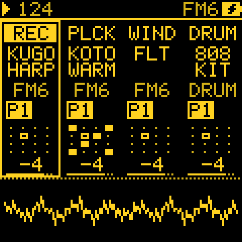
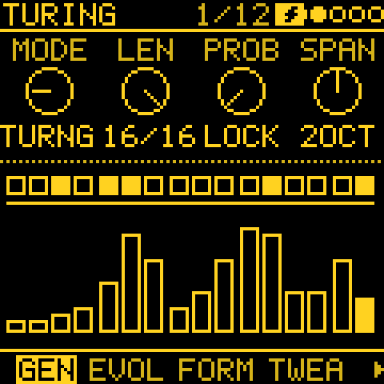
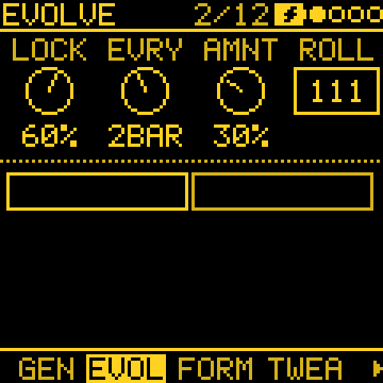
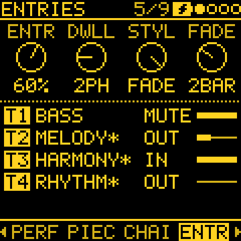
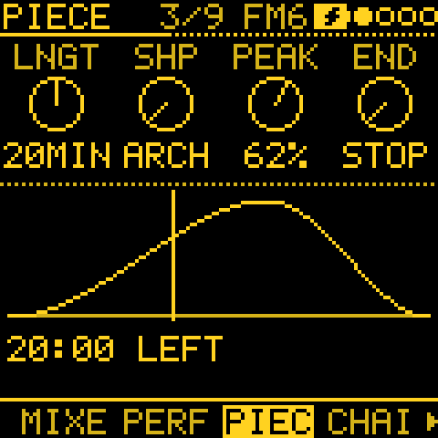
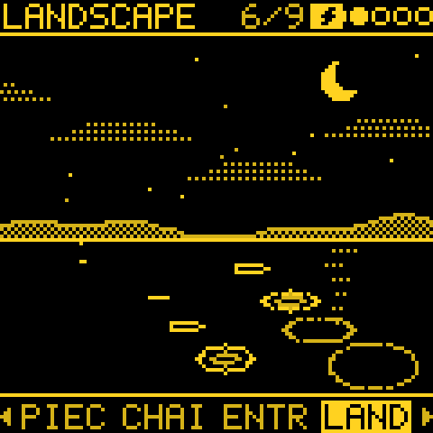
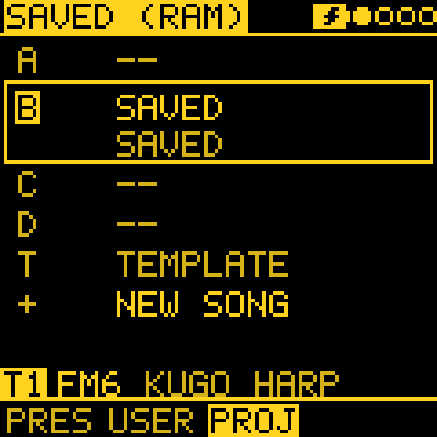

# Getting started with Tessera

Your first half hour: from a fresh install to a piece that plays itself, one step at a time. Each step takes a minute
or two, and you can stop after any of them. The [manual](MANUAL.md) has every detail when you want it.

**No FM-1 to hand?** The [web simulator](https://rastapopolix.github.io/tessera/webapp/sim/) runs the same firmware
in your browser, so you can follow along there.

**Three things to know first.** **ALGORITHM** picks the track (1 to 4) on every page. **KNOB 1 to 4** are the four knobs from left
to right, and each page shows what they do along the top of the screen. A page button (SEQ, ARP, GLO...) opens its
first page, and tapping it again steps through the rest.

## 1. Install

You need the FM-1, a USB cable and Chrome or Edge on a computer.

1. Connect the FM-1 directly by USB (not through a hub).
2. Open the **[web installer](https://rastapopolix.github.io/tessera/webapp/installer/)** and follow it. Choose the
   standard build; the single-core one is for the few FM-1s that crash with it.
3. Don't unplug the FM-1 while it is writing.

The installer can also take you back to the official firmware later, with a backup first.

## 2. Hear it

Power on. Tessera starts with four sounds: **KUGO HARP** on track 1, **KOTO WARM** on track 2, **FLUTE** on track 3
and the **808 KIT** on track 4, in the KUMOI scale on E. Play the keys: you hear the selected track.

 HOME: the four tracks at a glance. SELECT sets the tempo here.

**Try:** turn **ALGORITHM** to each track in turn and play a few notes.

## 3. Let a generator play

A generator writes the notes for you, always in the project's scale.

1. Track 1 (KUGO HARP). Tap **SEQ**: this is GEN, the page that says what the track plays.
2. Turn **MODE** (KNOB 1) to **TURING**, then press **PLAY**. A melody loops.
3. Turn **PROB** to about 20: the loop changes a little each time round. At 0 it holds still.

 GEN with MODE on TURING.

**Try:** track 4 (the 808 KIT), MODE **ATLAS**, **DENS** at 50: a drum groove underneath.

## 4. Find a line you like

Every generator line comes from a seed: a number you can come back to.

1. Track 1, tap **ARP**: this is EVOLVE.
2. Turn **ROLL** (KNOB 4) one click at a time. Each click is a new line; turn back for the last one.
3. When you like it, note the number. That line is yours.
4. Set **EVERY** to 4 and **AMOUNT** to about 30: now the line changes a little every four bars, so it never wears
   out.

 EVOLVE: how often the line changes, how much, and its seed.

**Try:** tap **SEL** on track 1 to change the scale. Every generator follows at once.

## 5. Let it play itself

Three pages turn a loop into a piece that changes over minutes or hours. Each one starts switched off.

1. **ARP**, tap to **ENERGY**, and turn **ARC** to about 50: the tracks get sparser and busier in a slow tide.
2. **GLO**, tap to **ENTRIES**, and turn **ENTRIES** to about 50: tracks drop out and come back in on the phrase
   lines, like a band arranging itself.
3. **GLO**, tap to **PIECE**: **10** minutes, shape **ARCH**, END **STOP**. Now it has a beginning, a peak and an
   end, and stops by itself.

  ENTRIES shows which tracks are in and out; PIECE shows the shape of the whole piece.

**Try:** press **PLAY** and leave it for ten minutes.

## 6. Watch it

**GLO**, tap to **LANDSCAPE**: a night sea drawn by the music. Notes fall as rain, the moon crosses the sky as the
piece goes on. The keys are the mixer's: the black keys mute tracks 1 to 4,
**C4** brings them all back.

 LANDSCAPE while the music plays.

## 7. Save it

Hold **SAVE** to save the project. Everything is kept: the sounds, the generators and their seeds, and every page you
set.

To start afresh: tap **SAVE** to the **PROJECT** page, turn **KNOB 1** to **New song** and press **OCT+**. Tessera
asks for a key, a scale and a tempo, then a role for each track (drums, bass, chords, lead or pad).

 PROJECT" width="240"> SAVE > PROJECT: your projects, and New song.

## Where next

- **[First steps: you have a loop, what next?](RECIPES.md#first-steps-you-have-a-loop-what-next)**: the next six
  moves, from live mutes to song sections.
- **[Tessera in plain words](MANUAL.md#tessera-in-plain-words)**: what every page is for, and which generator to
  reach for.
- **[RECIPES](RECIPES.md)**: drones, chords that lead, pieces that play for hours, driving other synths.
- **[The cheat sheet](https://github.com/Rastapopolix/tessera/blob/HEAD/docs/cheatsheet/tessera-cheatsheet.pdf)**:
  every button and combination on one printable page.
- **[The manual as a PDF](https://rastapopolix.github.io/tessera/manual/tessera-manual.pdf)**: the whole manual, to
  print or read offline.
