

# Tessera manual

Tessera is a generative firmware for the M-Vave FM-1. It grew out of Melodee (Tess), a fork of
[Melodee](https://github.com/keremimo/melodee) by keremimo (itself built on *Felucca* by Leo Kuroshita / Hügelton
Instruments). Each of the four tracks can play its own steps, an arpeggio, or one of thirteen generators, and the
pages around them evolve the phrases, build song forms, pass hits between tracks and modulate anything from
anything.

This manual covers what Tessera adds and changes. The step sequencer, the effects and the song pages work as in
upstream Melodee. For recipes and tips, see **[RECIPES.md](RECIPES.md)**; every button and combination on one
sheet, **[CHEATSHEET.md](CHEATSHEET.md)** (and [a printable PDF](docs/cheatsheet/tessera-cheatsheet.pdf)). Every
setting, with its range and default, is listed in [docs/PARAMETERS.md](docs/PARAMETERS.md).

Page and knob names are the ones on the screen. KNOB 1 to KNOB 4 are the four knobs from left to right, and each
page's four settings sit along the top of the screen in the same order.

- [The panel at a glance](#the-panel-at-a-glance)
- [Shortcuts](#shortcuts)
- [Sounds](#sounds)
- [SEQ: the MODE and its pages](#seq-the-mode-and-its-pages)
- [The generators](#the-generators)
- [OCT+ layers on GEN](#oct-layers-on-gen)
- [EVOLVE](#evolve)
- [FORM](#form)
- [TWEAK](#tweak)
- [TWEAK 2](#tweak-2)
- [LENGTH](#length)
- [TIMING](#timing)
- [ENERGY](#energy)
- [Print and keep](#print-and-keep)
- [Harmony: one key, CHORD and QNT CHRD](#harmony-one-key-chord-and-qnt-chrd)
- [MODS: the modulation cords](#mods-the-modulation-cords)
- [MATRIX](#matrix)
- [ORGANIC: TIDE and SWARM](#organic-tide-and-swarm)
- [Mod shortcut](#mod-shortcut)
- [Help card](#help-card)
- [Menu and settings](#menu-and-settings)
- [Saving and older projects](#saving-and-older-projects)
- [If something goes wrong](#if-something-goes-wrong)
- [Credits](#credits)

---

## The panel at a glance

| Button | Tap | Hold |
|---|---|---|
| **HOME** | The home page: four tracks, their sounds and knobs | The menu |
| **SEQ** | GEN, then the pages of the track's MODE | PATTERNS (the song under it) |
| **ARP** | ARP's MODE and its page (again: ARP 2) | The help card for any knob you turn |
| **LFO** | MODS, MATRIX, LFO, LFO 2, ORGANIC, LFO DEST (an FM6 track: then FM LFO) | |
| **ENV** | ENV, ENV DEST (an FM6 track: EG RATE, EG LVL, PITCH EG, PITCH LV) | |
| **SCL** | SCALES, SCL, CHORD | Quick SET: a key sets ROOT; KNOB 1 to 4 set ROOT, SCL, CHRD, VOIC |
| **EDIT** | The sound's EDIT pages; on an EDIT page, the map | With OCT- / OCT+: undo / redo |
| **FX** | The insert and send effects | The mod amount of any knob you turn |
| **GLO** | MIXER, GLOBAL, SYSTEM, MIDI OUT | Quick SET: the black keys mute T1 to T4, the white keys solo while held, E4 holds [FILL](#a-steps-condition-and-fill), KNOB 1 to 4 the levels, SELECT turns the tempo, F4 taps it, PRESETS browses the sounds; with PLAY, restart from the top |
| **SAVE** | USER (ready to save the sound), PROJECT, PRESETS | Save the project to its slot (as SAVE + REC) |
| **REC** | Records the selected track until REC again (see [Recording live](#recording-live)) | Capture or print the last bars (see [Print and keep](#print-and-keep)) |
| **OCT+** | Octave up; on some pages, an action (shown on screen) | A page's extra layer (see [OCT+ layers](#oct-layers-on-gen)) |

On the home page each track's tile shows its sound and engine. **ALGORITHM** picks the track on every page (or
the left knob, with MENU > TRACK KNOB set to LEFT), and **SELECT** turns the pages of the section shown (on the home
page, the tempo). When a section has more pages than the footer's tabs show, the header gives the page's place (4/10:
SEQ counts GEN's pages and the sequencer's together, the way the button goes through them) and arrows at the footer's
ends say more pages lie that way. The four sounds a new project starts with are an ambient set: **GLASS PAD**
and **BELLS** on FM6, **STRING MACH** on TRIO, and the **808 KIT** on DRUM. (Track 2 is a TRIO pad so that
generators on both pads stay within what the FM-1 can play: see [How many voices at once](#how-many-voices-at-once).) A new project has no mods, so nothing moves until
you patch it.

 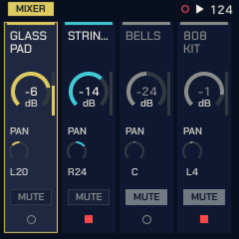

**MIXER** (tap GLO) is the four tracks as a mixer: **KNOB 1 to 4** set the levels of tracks 1 to 4, and with
**OCT+** held they set the pans. The keys are the mixer's while it is shown: the **black keys** F#3 G#3 A#3 C#4 mute
and unmute tracks 1 to 4, the **white keys** F3 G3 A3 B3 solo a track while held, **C4** unmutes them all, **E4**
holds FILL and **F4** taps the tempo, the same as with GLO held on any other page. Each strip shows MUTE or SOLO; a track silenced by
another's solo dims. Any page button leaves the mixer, and the keys play notes again.

**Lists** (the HOME menu, SCL, VOICE, the sheets and the sound designer): KNOB 1 picks the row, KNOB 2 changes its
value.

**The look.** Tessera draws every screen in one ink on black, with a 5 x 7 pixel font: the selected item is
inverted, and quieter things are drawn in a dimmer ink. MENU > COLOR picks the ink: **YELLOW** (the default),
WHITE, GREEN, BLUE, RED, and ORANGE, PINK, HOT PINK and LILAC to match the FM-1's shells. In these the tracks are told
apart by their numbers, not by colours. **MOSAIC** gives each track a colour of its own (T1 yellow, T2 blue, T3 hot pink,
T4 green): the screen takes the selected track's, the pages that show all four (HOME, MIXER, PATTERNS, SONG, QUAD,
FOLLOW, MATRIX, MIDI OUT, the cords) draw each in its own, and the value you turn and the row you pick show in white.

<table>
<tr>
<td align="center"> <b>YELLOW</b></td>
<td align="center">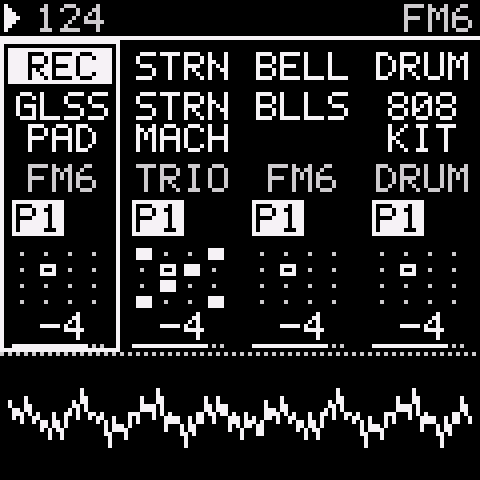 <b>WHITE</b></td>
<td align="center">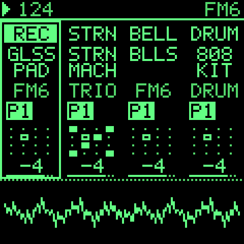 <b>GREEN</b></td>
<td align="center">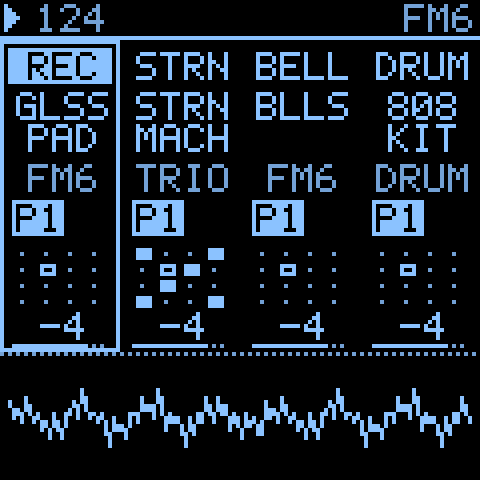 <b>BLUE</b></td>
</tr>
<tr>
<td align="center">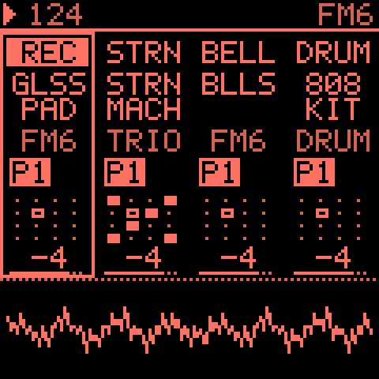 <b>RED</b></td>
<td align="center"> <b>ORANGE</b></td>
<td align="center">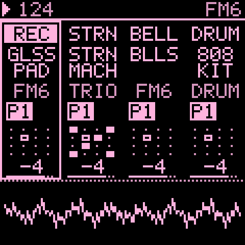 <b>PINK</b></td>
<td align="center"> <b>HOT PINK</b></td>
<td align="center"> <b>LILAC</b></td>
<td align="center">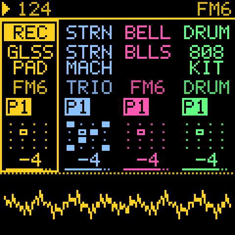 <b>MOSAIC</b></td>
</tr>
</table>

**At power-on** the Tessera mark is laid tile by tile, held for a moment, then breaks into grains that a wind sweeps away. Any button or
key skips it.

---

## Shortcuts

| Do this | And this happens |
|---|---|
| Tap **SEQ** | **GEN** first: KNOB 1 (**MODE**) picks what the track plays. SEQ then shows only that mode's pages. |
| Tap **ARP** | Switches a STEP track to ARP and opens **ARP**; tap again for **ARP 2**. On a generator track it opens GEN instead ("MODE IS ON GEN"), so a playing generator never goes quiet by accident. |
| Hold **OCT+** on GEN | The generator's second layer, for TURING, EUCLID, MARKOV, MORPH, QUAD, CHORD, ATLAS, CONSTELLATION and ANSWER (see [OCT+ layers](#oct-layers-on-gen)). |
| Hold **OCT+** on EVOLVE | A generator's GRAVITY; on a STEP track, STEP EVOLVE's HOW (see [EVOLVE](#evolve)). |
| Turn **SELECT** on HOME, or with **GLO** held | Sets the tempo (BPM), as SEQ > TEMPO does; F4 with GLO held taps it. With CLK on USB or TRS the tempo is the clock's. |
| Turn **PRESETS** with **GLO** held, on any page | Browses the selected track's sounds as PRESETS does on HOME. The GLO map gives way to the sound: the track, the list and the place in it, the sounds before and after, the sound's name large and its engine (a fast turn: the name the knob will load when it stops, with its speed, X4). It stays while GLO is held; a GLO key or knob brings the map back. Without GLO, PRESETS keeps the page's own job (or does nothing), so a stray turn never changes the sound. GLO + OCT- does not put the sound back. |
| **GLO** + **E4** (on MIXER, E4) | Holds [FILL](#a-steps-condition-and-fill) for the steps whose condition is FILL or !FILL. |
| **GEN** on an AWAKE track, a white key | Picks that step: KNOB 1 sets its A, KNOB 2 its B. The same key lets it go. |
| Hold **ARP**, turn a knob | The [help card](#help-card) for that knob. Turn the same knob further to scroll a long text. |
| Hold **FX**, turn a knob | Sets how far a cord moves that knob's parameter (see [Mod shortcut](#mod-shortcut)). |
| Hold **REC** | On a generator track: prints its last bars into STEP. On STEP EVOLVE: keeps the changes. On a STEP track: captures what you just played. |
| Hold **EDIT**, press **OCT-** / **OCT+** | Undo / redo. |
| **SAVE** + **REC**, or hold **SAVE** | Saves the project to its slot (stops playback first). |
| **EVOLVE**, KNOB 4 (**ROLL**) | Each click is a new seed (1 to 128), so a new line; turn back for the last one, note for note. |
| **FORM**, KNOB 3 (**CLEAR**) | Forgets B and C: the section playing becomes A. |
| **MODS**, **OCT+** | Switches the picked mod between **+-** (both ways) and **+** (one way). |
| **MATRIX**, **OCT+** | Opens the picked mod in MODS. |
| **EDIT** on an EDIT page | The map of the sound's pages: KNOB 1 across a row, KNOB 2 between rows, OCT+ opens the page, OCT- or EDIT closes it. Any other page button leaves it for its page. |
| **PLAY** | Every generator starts its random choices from the top of its seed, and TIDE and SWARM restart: with EVOLVE's EVERY off, a project plays the same way each time. |

---

## Sounds

Tessera has four engines on the device:

| Engine | What it is |
|---|---|
| **FM6** | Six-operator FM in the manner of the DX7: 32 algorithms, operator envelopes and scaling, pitch EG, LFO and the function settings (bend, porta, wheel, foot, breath, aftertouch). Its ENGINE setting picks MODERN, MARK I (the DX7's own tables) or OPL. The main melodic voice. |
| **ORACLE** | Two oscillators, POLY MOD and a four-pole low-pass filter: a classic polyphonic analogue voice. Warm pads, brass, sync leads, basses, plucks. 24 sounds of its own; the sound is kept in the project. |
| **TRIO** | Three oscillators: WAVE, INT2, INT3 (intervals) and DETUNE. Basses and leads. |
| **PHYS** | Physical models: MODAL (bars, bells, plates), STRNG (a plucked or bowed string), MEMB (drum heads) and SYMP (a string with three more ringing along). Bells, mallets, plucks, bowed pads and drones; 17 sounds. |
| **DRUM** | Drum kits: **808** and **909**. Eight lanes: BD, SD, CP, CH, OH, TM, RS, CB. The 808 has six tom pitches. |

 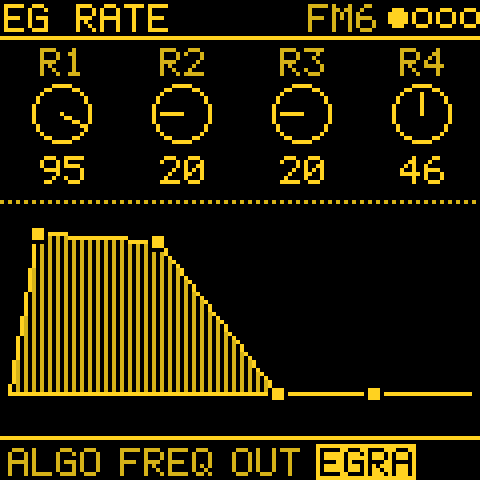 

**PHYS** is back. Its knobs each cover only their musical range now, with wide sweet spots: STRC keeps
MODAL's overtones in tune from 16 to 48, a chime's near 84 and a marimba's at the top (the picture names where it
is); a dull, short or bowed sound is as loud as a bright one. An old project's PHYS track (one not saved again
since 2.0, which turned it into FM6) plays PHYS again, a little differently towards the ends of the knobs. **SID** is no longer in the device build, and neither is CZ-1: a track saved
with SID loads FM6's INIT. DRUM's SID KIT
and SID DIGI are out too (2.2, for flash room): a track saved with KIT SID loads as the 909. FM6 and TRIO presets have
releases that ring out, so short sequenced notes are not cut off. The slow pads (GLASS PAD, SOFT PAD, DEEP PAD, PAD,
STRINGS) swell in slowly: they speak on long notes and drones, and stay quiet on short steps.

**FM6's amp envelope.** FM6 has no ADSR of its own, as the DX7 had none: each carrier's envelope (ENV: EG RATE, EG
LVL, an operator at a time) is the sound's volume. **AEG** (EDIT 2, KNOB 4) moves them all at once: turned right a
slower attack and a longer release, left a shorter one, 0 the patch as it is.

**A filter for FM6.** FM6 has no filter of its own, as the DX7 had none: its brightness is **MLVL** (EDIT 1, KNOB 3),
the level of the operators that are not carriers, and the track's CUTOFF cords move it. For a resonant low-pass, put
the **FILTER** effect on the track (FX, an insert's TYPE **FILTER**): **CUT** is its cutoff, **RES** its resonance,
and both are cord destinations (FX1 RTE, FX1 CHR). It works on any track, and as a send effect.

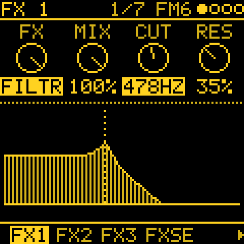

**ORACLE.** Oscillator A (saw, pulse) and B (saw, triangle, pulse) and noise go through a resonant four-pole
low-pass filter and the amp, each with its own envelope. **POLY MOD** lets the filter envelope and oscillator B bend
A's pitch, A's pulse width or the cutoff, note by note: B at audio rate into A's pitch gives bells and metal, the
filter envelope into A's pitch a sweep on each note. Its pages, on **EDIT**:

| Page | KNOB 1 to 4 |
|---|---|
| **MACRO**, **MACRO 2** | CUT, RES, TUNE A, TUNE B; PW A, PW B, LVL A, LVL B: offsets on the sound, the ones the HOME knobs, cords and motion move |
| **OSC A** | FREQ A (semitones), WAVE A (SAW, PLS, S+P), PW A, SYNC (A restarts with B) |
| **OSC B** | FREQ B, FINE B (a little sharp, for beating), WAVE B (SAW, TRI, PLS and their mixes), PW B |
| **OSC MIX** | the levels of OSC A, OSC B and NOISE; B MODE: KEY (follows the notes), FIXED, LO KEY / LO FIX (B as a slow LFO for POLY MOD) |
| **FILTER** | CUTOFF, RES, ENV AMT (how far FILT ENV opens it), KEY (OFF, HALF, FULL: brighter as notes go up) |
| **POLY MOD** | FENV and OSC B (how much each moves), TO (FREQ, PW, FILT or a mix), VEL (what playing harder opens) |
| **CHARACTER** | MODEL (EARLY or LATE filter: each colours the resonance its own way), VINTAGE (each voice drifts a little), GLIDE |
| **FILT ENV**, **AMP ENV** | ATK, DEC, SUS, REL |
| **LFO MOD** | RATE, AMOUNT, WAVE (SAW, TRI, SQR and mixes), NOISE (random movement mixed in) |
| **LFO ROUTE** | PITCH (A, B, A+B: vibrato), PW, FILT |

As on FM6, **ENV** goes to FILT ENV and AMP ENV (ORACLE has no use for the track's ENV), and **LFO** to MODS and the
track's LFO pages, then LFO MOD and LFO ROUTE. The sound lives in the project, a patch per track: a turned knob is
saved with it, but an ORACLE sound cannot go to a USER slot, so keep one you like in a project. ORACLE takes more of the FM-1 than an FM6 voice (about
one and a half times): one ORACLE track of pads or chords is fine; with two busy ones, keep BUDGET in mind (below).

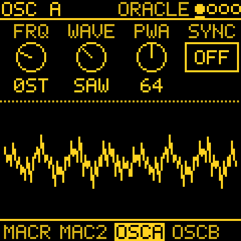 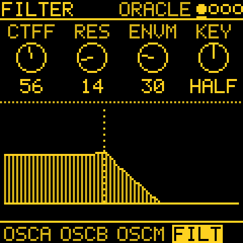 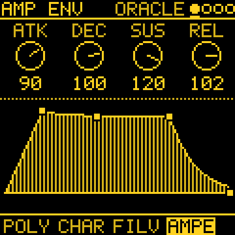

**PRESETS** (SAVE) browses the sounds. Its LIST knob picks ALL, the favourites, RECENT or a category, and it starts
on ALL at power-on. The PRESETS knob browses the same list on HOME and on PRESETS; on any other page, hold GLO and
turn it.

### How many voices at once

All the tracks share one pool of voices, set by **GLO > GLOBAL > BUDGET** (16 by default). A note that rings on in
its release still holds a voice, so a busy generator on a sound with a long release can keep most of the pool
ringing on its own: TINE EP under MARKOV at 100 % density and 1/16 holds about 15. When the pool is full, a new note
takes the oldest released voice; when the FM-1 has more six-operator voices to work out than it has time for, you
hear a faint crackle.

One busy FM6 track like that is fine; two or more of them at full density is past the FM-1's limit. To keep it
clean:

- thin one of them (DENSITY, DROP, or a slower DIV);
- give one a shorter note (LENGTH) or a sound with a shorter release, such as a TRIO voice or DRUM;
- lower **BUDGET** (12, say): fewer voices ring at once, which leaves the FM-1 headroom; higher allows more, and
  crackles sooner.

---

## SEQ: the MODE and its pages

Tap **SEQ** for **GEN**, where **KNOB 1, MODE** picks what the selected track plays:

- **STEP**: the step sequencer.
- **ARP**: the arpeggiator over the keys held (the ARP button gets here too).
- One of thirteen generators, in the knob's order: **CHORD** first, then **TURING**, **EUCLID**, **MARKOV**,
  **MORPH**, **ATLAS**, **BOUNCE**, **AWAKE**, **POLY**, **QUAD**, **CONSTL** (Constellation), **SERIES** and
  **ANSWER**.

SEQ then shows only that mode's pages:

| MODE | SEQ's pages |
|---|---|
| **STEP** | GEN, NOTES, EVOLVE (STEP EVOLVE), TWEAK (its HUMAN), TIMING (its SHAPE and HUMAN), TEMPO, PATTERNS, SONG |
| **ARP** | GEN, NOTES, ARP, ARP 2, TEMPO, PATTERNS, SONG |
| a generator | GEN, EVOLVE, FORM, TWEAK, TWEAK 2, LENGTH, TIMING, ENERGY, PATTERN, TEMPO, PATTERNS, SONG |

MOTION and DRUM HIT appear as in upstream. With STEP or ARP, GEN is also the pattern's page: KNOB 2 to 4 are
LENGTH, DIVISION and GATE, and the track's SWING is a row of the pattern's sheet (OCT+ held). A generator track has
these on PATTERN instead. The generators run at the track's DIV and play in the track's scale (SCL). Choosing STEP or a
generator turns the arpeggiator off; choosing ARP again brings back its last setting.

A generator picked (or a track unmuted) while the others play **joins in time**: it starts where it would be had it
played since PLAY, on the same steps and bars, so an ATLAS groove picked under a playing chord lands on the beat.
BOUNCE, QUAD, CONSTELLATION and SERIES run free and simply carry on.

On NOTES, **KNOB 2** sets the picked note's pitch. With **QNT OFF** it moves a semitone a detent. With QNT on
(SNAP, WHITE, ALL, MPC) it moves a note of the scale a detent; a note off the scale goes to the next scale note in
the turn's direction first. With **QNT CHRD** and a CHORD track playing it moves through that chord's notes. Hold
**ENV** while turning for a semitone at a time. A microtonal scale moves a degree a detent, as before.

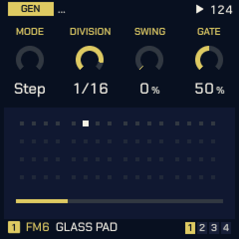

### Recording live

Tap **REC** to arm the selected track. With the sequencer playing, it waits for the pattern's start (**WAIT FOR
LOOP**), then records what you play on the keys (or MIDI IN) over every pass, each pass on top of the last, until
you tap **REC** again. Stopped, the first key you play starts the sequencer and the take at once; **REC** +
**PLAY** starts both together. QNT (TEMPO) snaps the take when it ends.

- **EDIT** + **REC** on NOTES (either first): **CLEAR PATTERN?** OCT+ clears it and REC stays on, so the next
  pass records a new take. With REC off, EDIT held undoes the clear.
- **EDIT** held while recording on NOTES erases as the steps pass.
- **OCT-** / **OCT+** on NOTES with REC on move the keys an octave down / up, as on HOME (both together: back to
  the middle). The header shows it (**KEYS OCT +1**). OCT+ held still opens the pattern's sheet.

### The pattern's sheet: Double, Half, Euclid, Accumulate

Hold **OCT+** on GEN (STEP, ARP), NOTES, PATTERN or the drum grid for the pattern's sheet. Besides Quantize,
Swing (the track's, KNOB 2), Clear pattern and Clear motion it has:

- **Double**: the pattern twice as long (up to 64 steps). Its steps, recorded notes and motion are copied after
  themselves; a playing pattern carries on into the copy.
- **Half**: LEN halved (15 steps become 8). The steps past it stay, hidden, as when LEN is turned down.
- **Euclid**: KNOB 2 sets the hits ("5 of 16 BD"), and OCT+ spreads them over LEN as evenly as they go, the first
  on step 1. On the drum grid it writes the selected lane. On NOTES it writes one note row: the note at the
  cursor, else the pattern's first note, else ROOT. A step with a hit gets the note, and a step without one loses
  it. Other lanes and notes stay as they are. **Euclid turn** (KNOB 2) starts the hits that many steps later.
  It does not work on a pattern with recorded notes.

Each one is undone with **EDIT** held, one at a time.

Two rows set the track's pitch accumulator (a step's Accumulate, below):

- **Accum limit** (1–14, 7): how far a step's notes go, in scale degrees from the notes as written. 7 is an octave
  of a 7-note scale.
- **Accum mode**: what they do there. **Wrap** goes back to the notes as written and climbs again, **Ping** turns
  round and comes back, **Clamp** stays at the limit.

---

## The generators

Each generator's three settings are on GEN, KNOB 2 to 4, and the panel under them shows what it plays. Every
generator is also a mod source: its **GATE**, its **NOTE** and a **CV** (see [MODS](#mods-the-modulation-cords)).

| MODE | KNOB 2 | KNOB 3 | KNOB 4 | What it plays |
|---|---|---|---|---|
| **TURING** | LENGTH (2–16) | PROB (0–100 %) | SPAN (1–3 oct) | A looping shift register, as a Turing Machine. PROB is the chance a step changes as it comes round: 0 locks the loop (the knob reads Lock), 100 is new every pass. |
| **EUCLID** | STEPS (1–32) | PULSE | ROT | Hits spread as evenly as they go over STEPS, turned round by ROT, on pitches picked by the seed. |
| **MARKOV** | LEAP (0–100 %) | DENS (5–100 %) | SPAN (1–3 oct) | A random walk over eight scale degrees. LEAP 0 moves to neighbours, 100 leaps widely. DENS is the chance a step plays. |
| **MORPH** | POS (0–127) | SNP A (1–8) | SNP B (1–8) | A rhythm blended from preset A into preset B. POS starts halfway. |
| **ATLAS** | X (0–255) | Y (0–255) | DENS (0–100 %) | Inspired by Émilie Gillet's Grids (Mutable Instruments): its drum map, kick, snare, closed hat and a fourth part from the point X, Y. Best on a DRUM track. The first time a track turns to ATLAS after power-on or a new song, X and Y start at a random point and DENS at 30 to 50 %, for a fresh groove; a loaded project keeps its own. More on the [OCT+ layer](#atlas-kick-snr-hat-toms). |
| **BOUNCE** | SPEED (1–64) | ANGLE (0–90°) | BALLS (1–4, Fall) | Balls in a box: a note where a ball hits a wall. Each extra ball starts from its own place and angle; balls that hit on the same step play together, three notes at most. Past 4, **FALL** (after ambalek's norns script Fall): eight leaves fall at their own speeds and play where they land (left low, right high), and ANGLE becomes **WIND**: calm in the middle, leaning the melody low or high either side, gusting further out. |
| **AWAKE** | LEN A (1–16) | LEN B (1–16) | PROB (0–100 %) | Two loops, as norns' Awake. A is the melody (scale degrees or rests), B lifts it up the scale; different lengths shift B against A. Steps can be set from the keys (below). |
| **POLY** | RHY (1–4) | DIVISION (OFF, /1–/16) | SPAN (1–3 oct) | Four notes stepped on by four rhythms. RHY picks which rhythm DIVISION edits. Rhythms that land together play once, louder: /4 against /3 is a polyrhythm. |
| **QUAD** | DIR | PROB (0–100 %) | LINK | A 4 x 4 grid of notes the four tracks share, a row each, inspired by the norns script initenere. Each QUAD track plays its row on its own DIV, so the polyrhythm comes from the tracks' speeds. DIR: FWD, BACK, PEND, RAND or HOLD. LINK: the other QUAD tracks this one's steps also move on (HOLD tracks then play only when pulled). More on the [OCT+ layer](#quad-columns-and-range). |
| **CONSTL** | Y (0–14) | DENS (0–100 %) | SPEED | After timothy-taylor's norns script Constellation: a ship flies through a sky of stars; the stars that cross its crosshair play. Y is the crosshair's height (where the melody sits), DENS how many stars, SPEED how fast the sky passes (the straight note values, slow to fast). More on the [OCT+ layer](#constellation-lock-len-fill-size). |
| **SERIES** | START (0–127) | INTV (1–7) | LOOP (OFF, 1–16) | Per Nørgård's infinity series (after the norns script nørgård): a melody alike at every scale. START picks where it begins, INTV how many scale degrees a step of the series is, LOOP repeats that many steps (OFF never repeats). |
| **CHORD** | PROG | BARS (½, 1, 2, 4) | HIT | A progression's chords in the track's scale: POP (I V vi IV), 50S, 2-5-1, CIRCLE, TWO, DRONE, WALK (four chords from the seed) or USER (your own). HIT: HOLD (once, held), BEAT, STEP or OFFBEAT (short stabs on the "and" between the beats, a reggae skank). See [Harmony](#harmony-one-key-chord-and-qnt-chrd). |
| **ANSWER** | VARY (0–100 %) | ECHO (0–100 %) | FADE (1–16, LOOPS) | After Zen-1's call and response (the idea only): play a phrase on the track's keys (or MIDI IN), up to 8 notes, and a bar without a key ends it. ANSWER plays it back, after a rest, as answers that change a little more each time (VARY: a note moved a degree or two, an octave, left out or swapped), each softer than the last. ECHO repeats some notes once more at half the velocity. FADE is how many answers it gives, 1 to 16, before it rests until you play again; turned on past 16 (LOOPS SHORT, MID or LONG, the loops' lengths) it never forgets and plays on as four loops of different lengths. Its OCT+ layer: SOURCE (below), ORDER (PLAYED, REVERSE, SHUFFLE), SHIFT (each answer moved up to this many scale degrees) and SPACE (the rest before an answer, up to 4 bars). **SOURCE** (OFF, T1 to T4) makes a STEP pattern the call instead of the keys: that track's pattern playing now (this track's own too), its first 8 notes at their steps, read again before each answer, so a sequence you record in STEP gets answered, and answered anew when you change it. The keys then just play. The other way round, REC held prints ANSWER's answers into STEP (see [Print and keep](#print-and-keep)). |

<table>
<tr>
<td align="center" width="25%"> <b>TURING</b></td>
<td align="center" width="25%">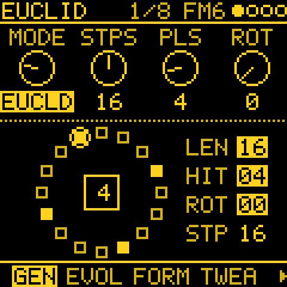 <b>EUCLID</b></td>
<td align="center" width="25%">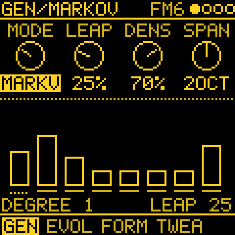 <b>MARKOV</b></td>
<td align="center" width="25%">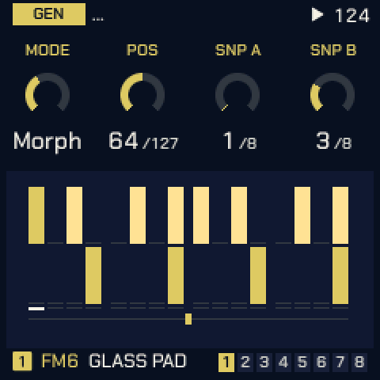 <b>MORPH</b></td>
</tr>
<tr>
<td align="center"> <b>ATLAS</b></td>
<td align="center">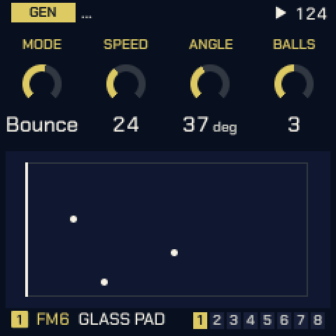 <b>BOUNCE</b></td>
<td align="center"> <b>FALL</b></td>
<td align="center">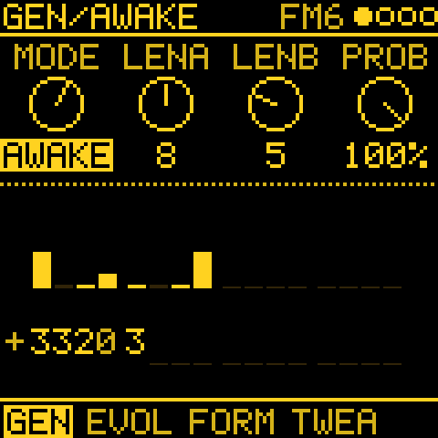 <b>AWAKE</b></td>
</tr>
<tr>
<td align="center"> <b>POLY</b></td>
<td align="center"> <b>QUAD</b></td>
<td align="center"> <b>CONSTL</b></td>
<td align="center"> <b>SERIES</b></td>
</tr>
<tr>
<td align="center"> <b>CHORD</b></td>
<td align="center"> <b>ANSWER</b></td>
<td></td><td></td>
</tr>
</table>

**AWAKE step entry.** On GEN with an AWAKE track the keys are its steps and play no sound. A white key picks a
step: KNOB 1 sets its A value, KNOB 2 its B. Press the same key again, or leave the page, to go back to the usual
knobs.

**Seeds.** Every generator's random choices come from the track's seed (EVOLVE's ROLL). A seed sets the starting
material too: Turing's register, Euclid's pitches, Markov's first state, Awake's loops, Poly's notes, Quad's cells,
the sky. A track gets a random seed the first time a generator is picked, so each power-on starts somewhere new; a
saved project keeps its seeds.

---

## OCT+ layers on GEN

Some generators have more settings than three knobs. Hold **OCT+** on GEN: the knobs' labels change to the layer's, an OCT+
key shows in the header, and the four knobs set the layer. Let go to return.

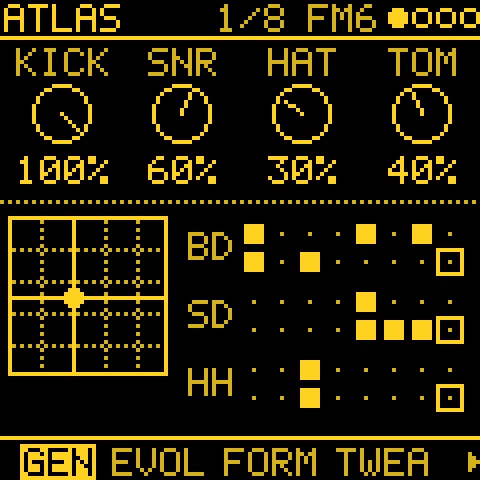 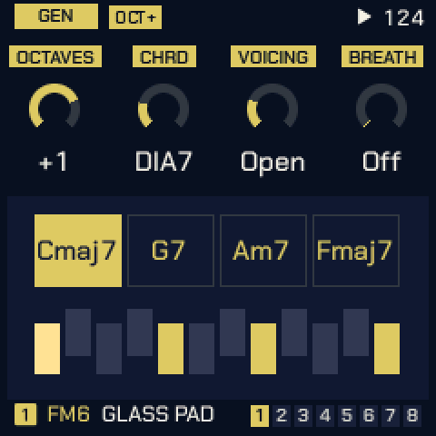 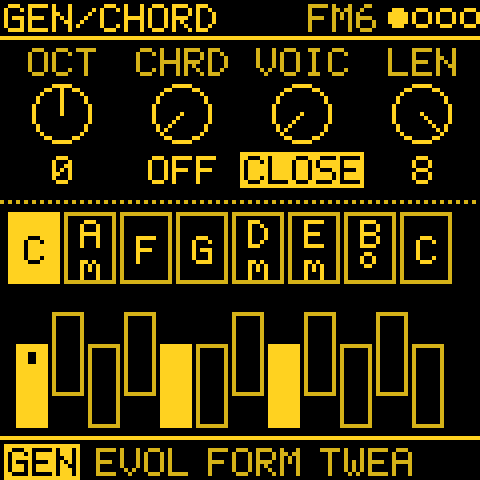

### ATLAS: KICK, SNR, HAT, TOMS

| Knob | Setting | What it does |
|---|---|---|
| 1 | **KICK** (0–100 %) | How much of DENS the kick gets: 0 silences it. |
| 2 | **SNR** | The same for the snare. |
| 3 | **HAT** | The same for the closed hat. |
| 4 | **TOMS** (0–100 %; labelled with the part's sound, TOM at first) | A fourth part: the hits the kick and snare only just miss, so fills follow the groove. 0 (OFF) none. |

With OCT+ held, a **black key** picks the fourth part's sound, as on the drum grid: TOM, CLAP, OPEN HAT, RIM or
BELL. The parts are also mod destinations: AT KICK, AT SNR, AT HAT, AT TOMS.

### CHORD: OCT, CHRD, VOIC, BREATH (or LEN)

| Knob | Setting | What it does |
|---|---|---|
| 1 | **OCTAVES** (−2 to +2) | The chords' register from their home around C3. |
| 2 | **CHRD** | SCL > CHORD's chord kind: OFF plays triads; DIA3 and DIA7 triads and sevenths in the scale; MAJ, MIN, DOM7, MAJ7, MIN7, SUS4, POW. |
| 3 | **VOICING** | CLOSE, OPEN, INV1, INV2 or +OCT. |
| 4 | **BREATH** (0–100 %) | With HIT HOLD the chord breathes: each voice is struck again, softer, on a slow cycle of its own (11 to 19 s), and the same chord again is tied over. BREATH is the chance a voice above the lowest sits a cycle out; 0 (OFF) is off. |
| 4 | **LENGTH** (USER only, in BREATH's place) | How many of USER's chords play, 1 to 8. |

**USER progressions.** Set PROG to USER, hold OCT+ on GEN and play the roots on the keys, one key a chord (the keys
are silent while OCT+ is held; notes outside the scale round down to it). Letting OCT+ go ends the entry, and the
number of chords played sets LENGTH.

### QUAD: columns and RANGE

The grid's columns can turn between the rows, so notes travel from track to track. With OCT+ held:
KNOB 1 picks the column, KNOB 2 its **MOVE** (STOP, DOWN, UP or RAND), KNOB 3 its **EVERY** (/1 to /16 steps of
the first QUAD track), and KNOB 4 **RANGE** (3 OCT, 1 OCT, 2 OCT or ±1: the octaves the row's notes fold into).

### CONSTELLATION: LOCK, LEN, FILL, SIZE

| Knob | Setting | What it does |
|---|---|---|
| 1 | **LOCK** | The chance a step plays the loop of stars already caught instead of the sky: high LOCK repeats a phrase. |
| 2 | **LEN** (1–16) | The loop's length. |
| 3 | **FILL** | OFF: the steps between stars rest. ARP: the last four stars again, low to high and softer. |
| 4 | **SIZE** (0–7) | How many rows either side of the crosshair a star still plays in. |

**AUTO** steers the ship for you: OFF follows Y, 1 to 9 is a wander of its own (faster further up), SEEK flies to
the next star. It has no knob: set it with a mod to **C AUTO** (a cord with no source is a fixed value).

### TURING, EUCLID, MARKOV and MORPH: SOURCE, KEEP, GRAVITY (STEP as seed)

**SOURCE** (KNOB 1) lets TURING, EUCLID, MARKOV or MORPH play from a STEP pattern you wrote. T1 to T4 is that
track's pattern playing now, and it can be this track's own. The pattern itself never changes. OFF, or a pattern
with no notes, plays the generator as usual.

- **TURING** loops the source's first LEN steps (up to 16). Each step, PROB is the chance that the step about to
  play changes and stays changed, as a Turing machine flips a bit. PROB 0 plays your melody as written; turn it up
  and the melody drifts. A new SOURCE or LEN, or PLAY, starts again from the pattern.
- **EUCLID** plays the source's notes in order on its own hits, so the melody gets a new rhythm.
- **MARKOV** learns from the source what follows what. Each step plays what came after the step it just played,
  somewhere in your pattern (when a note appears twice, either of its followers). LEAP is now the chance of a jump
  to any step of the pattern instead. With LEAP 0 a melody where every note is different plays as written; repeated
  notes and rests are where it branches off. DENS has no say: the rhythm comes from the pattern.
- **MORPH** plays **A**, your pattern as written (its first 16 steps), against **B**, a variation of it made at
  PLAY: about half of its steps changed the way TURING changes them. MORPH's position is B's share, and EVOLVE
  changes a few more of B's steps each time.

**KEEP** (KNOB 2) says what stays as written:

| KEEP | TURING, MORPH's B | EUCLID | MARKOV |
|---|---|---|---|
| **FREE** | a step's pitch or its hit may change | the source's notes on EUCLID's hits | notes and rests from the chain |
| **RHYTHM** | only the pitches change (to another of your notes, or any note of the scale over SPAN octaves up from your lowest) | the source's own rhythm, on EUCLID's pitches | the source's rhythm, the notes from the chain |
| **PITCH** | only the hits come and go | as FREE | the chain's rhythm, the notes in written order |

**GRAVITY** (KNOB 3) pulls it all back home: at GRAVITY %, a step plays the source exactly as written at its place.
TURING's changed step goes back to how you wrote it, MARKOV's chain carries on from there, EUCLID plays the
source's own hit or rest, and MORPH plays A. 0 is off; 100 plays your pattern as written whatever the rest says.
Drift with PROB, LEAP or MORPH, and let GRAVITY decide how far it may wander.

The notes keep their written pitch, then follow this track's scale, TRN and SHIFT. Print (REC held) keeps what it
played, as for any generator.

With a SOURCE, TURING's and MORPH's picture on GEN shows the loop as it plays now: a step as you wrote it is drawn plain,
a changed one with the written step drawn over it hollow (its ghost: an empty frame is a note dropped). MORPH shows B, its variation. **HOME** under it is how far the loop has wandered: empty when it plays
your pattern as written, full when every step has changed.

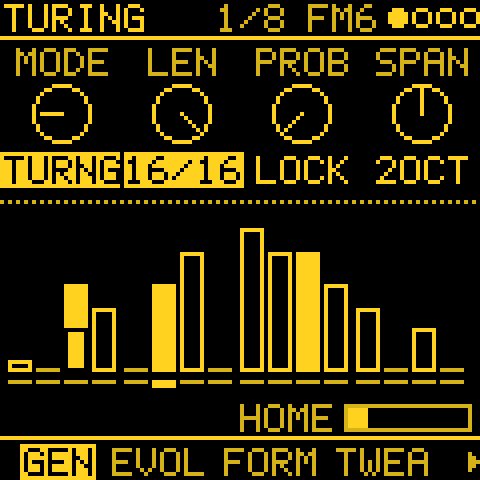

---

## EVOLVE

On a generator track, EVOLVE mutates the phrase every few bars.

| Knob | Setting | What it does |
|---|---|---|
| 1 | **LOCK** (0–100 %) | How much of the phrase stays: 100 loops it, 0 is new every pass. Turing's LOCK is its PROB turned round, Atlas' its CHAOS turned round, Constellation's the chance of its loop. The other generators (Euclid, Bounce, Awake, Poly, Quad, Series, Chord, Answer) have none. |
| 2 | **EVERY** | Mutates every OFF, 1, 2, 4, 8 or 16 bars. OFF keeps the phrase. |
| 3 | **AMOUNT** (0–100 %) | How much changes each time. |
| 4 | **ROLL** (1–128) | The track's seed. While playing, a new seed starts on the track's next bar line (the number blinks until then). |

With LOCK up, Turing's loop is its LENGTH long; Markov's and Morph's loops are as long as PATTERN's **LEN**.

**GRAVITY** (OCT+ held, KNOB 1; the same GRAVITY as the SOURCE layer's) lets the phrase drift and then come home.
Home is the generator as you last set it: a knob, ROLL, MODE or a loaded project. At GRAVITY %, a round of EVERY
moves the generator a step back toward home instead of changing it. Turing flips a changed bit back, Euclid's
rotation and pulses step back, Markov's LEAP, Atlas' X and Y, Bounce's angle and Morph's position move back. Awake,
Poly, Quad, Series and Chord put a changed value back, and Constellation lets no star go. 0 is off; at 100 it goes
home and stays there. With a SOURCE, GRAVITY plays the source instead (above), and with FORM on, the sections play
as they are.

### STEP EVOLVE

On a **STEP** track, EVOLVE varies the steps you wrote, as they play, without changing them.

| Knob | Setting | What it does |
|---|---|---|
| 1 | **LOCK** (0–100 %) | How much of the variation stays from round to round: 100 holds it, 0 is fresh each time. |
| 2 | **EVERY** | Bars between rounds of changes; OFF plays the steps as written. |
| 3 | **AMOUNT** (0–100 %) | How many steps change, up to half: a note moved by a degree or two or an octave, a step dropped, two notes swapped, a ghost note in a rest. |
| 4 | **CLEAR** | Shows how many steps are changed now; turn it to go back to the steps as written. |

Hold **REC** to keep the changes playing: they become the steps (KEPT n STEPS). EDIT held undoes it. Switching
pattern clears the changes.

**HOW** (OCT+ held on EVOLVE, KNOB 1) says what kind of change a round makes. It is saved with the project.

| HOW | A round |
|---|---|
| **DRIFT** | As above: moves, octave jumps, drops, swaps, ghost notes. |
| **ADORN** | Ornaments that only add, never take away: a note ratchets (one more hit, up to x4), jumps an octave or turns to its neighbour a degree away; a rest after a note gets a soft passing note, a degree toward the next note. |
| **SERIAL** | The whole phrase at once, for the round: **backwards** (retrograde), **upside down** (inversion in the scale, about its first note), **rotated** by a few steps, or **half of it at half speed** (augmentation). AMOUNT is the chance a round brings one, LOCK the chance it stays for the next. |

Changing HOW puts the steps back as written. REC held keeps any of them, SERIAL's whole phrase included.

The EVOLVE page's picture shows the steps across the phrase, by pitch, under the bars left until the next round. A
step playing as written is drawn plain; a changed one has the step as written drawn hollow where it was: a ratchet is split into its hits, a passing or ghost note sits in a rest, a dropped note leaves only the
hollow one. Under them: HOW, or SERIAL's transform this round (BACKWARDS, UPSIDE DOWN, ROTATE n, HALF SPEED), and
**HOME**, how far the steps are from as written (empty: all as written). On NOTES, a changed step's note as it
plays now is dashed, beside the note you wrote.

 

---

## FORM

FORM strings mutated phrases into a short song form of sections A, B and C, each EVERY bars long.

| Knob | Setting | What it does |
|---|---|---|
| 1 | **FORM** | OFF, AB, ABAC, ABCB, AABA, ABCA or AABC. Turning it on with EVERY OFF sets EVERY to 4 bars. |
| 2 | **CONTR** (0–100 %) | Contrast: how far a new section moves from the one before. |
| 3 | **CLEAR** | Forgets B and C: the phrase playing becomes A. |
| 4 | **FLRSH** (−12 to +12) | Flourish: semitones added on the last beat of every phrase; 0 is off. |

B and C are made from the section before, by CONTR, the first time they are reached. Changing MODE or ROLL starts
the form again at A.

**DEVELOP** (OCT+ held, KNOB 1, 0–100 %): how far a section varies each time the form comes back to it. At 0 (the
default) a section played again comes back exactly, as before. Above 0 each return is the section with one change of
that size, so it stays recognisable but is never quite the same; the section itself is kept, so the next return
starts from it again and the form never drifts away over hours. GRAVITY (OCT+ held on EVOLVE) is the chance a return
stays exact. A knob turned while a section plays is kept in it, as without DEVELOP.

---

## TWEAK

| Knob | Setting | What it does |
|---|---|---|
| 1 | **SHIFT** (±24) | Transposes by semitones; while following, by scale steps from the followed note. |
| 2 | **DROP** (0–100 %) | The chance a hit is left out, whatever the generator. |
| 3 | **HUMAN** (0–100 %) | Varies each note's velocity and length a little, as a player would: at 100 up to 20 softer or louder and up to half as long, the same each time the piece plays. The timing is TIMING's **HUMAN**. |
| 4 | **FOLLOW** | OFF, or T1 to T4: plays that track's pitch, SHIFT away, in this track's scale. STEP tracks can be followed too. |

On an ATLAS track only DROP and HUMAN apply: SHIFT, FOLLOW and FLRSH would change which drum plays. On a STEP track
TWEAK holds HUMAN alone.

---

## TWEAK 2

TWEAK 2 decides which hits play, and where. Everything starts OFF.

| Knob | Setting | What it does |
|---|---|---|
| 1 | **BRANCH** (0–100 %) | The chance a hit plays on track TO's sound instead, so two tracks answer each other. The tosses replay with the seed. |
| 2 | **TO** | OFF, or a track and a mode: **COIN** tosses each hit, **TOGGLE** switches side on a toss won (100 % alternates), **LATCH** tosses once a bar. |
| 3 | **LOGIC** | OFF, AND, OR, XOR or NOT with another track's hits. A lower track's hit is read on this step, a higher one's on the step before. |
| 4 | **COND** | The bars a hit may play in, counted from PLAY (with FORM on, from the section's start): 1:2, 2:2, 1:4 to 4:4, 1:8, 8:8, FIRST or !FIRST. |

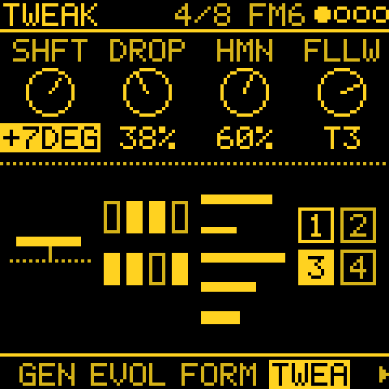 

---

## LENGTH

How long a generator holds its notes.

| Knob | Setting | What it does |
|---|---|---|
| 1 | **LENGTH** | **STEP**: the step's GATE. **FIXED**: LEN, whatever the DIV. **HIT**: until the next hit, so rests let notes ring. ATLAS keeps STEP. |
| 2 | **LEN** | FIXED's length: 1/32 to 1/1 (a bar). |
| 3 | **KEYS** (1–4) | FIXED: how many notes may hold at once. |
| 4 | **GATE** | The track's step gate, as on PATTERN. |

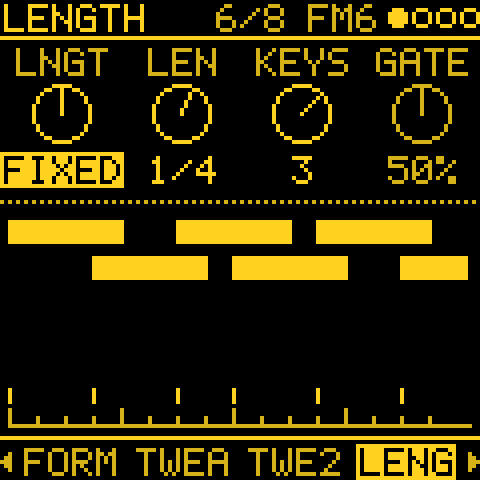

---

## TIMING

Ratchets: a step's notes played again within the step. And HUMAN: each step a little late.

| Knob | Setting | What it does |
|---|---|---|
| 1 | **RATCH** (x1–x8) | How many times a generator's step plays, in its own step: x1 once, as written, up to x8. |
| 2 | **CHANCE** (0–100 %) | How often a step ratchets: 100 every step, below that some play once. The tosses replay with the seed. |
| 3 | **SHAPE** | Where the hits fall: **EVEN** in equal parts, **ACCEL** closer and closer (a roll that speeds up), **DECEL** further and further apart (a bounce). |
| 4 | **HUMAN** (0–60 ms) | Plays each step a little late, as a player behind the beat: up to this many ms, a new amount each step, never early and never more than a quarter of the step. The same each time the piece plays. 0 keeps the grid. Also a cord destination (H TIME). |

On a STEP track TIMING holds SHAPE and HUMAN: each step has its own Ratchet (below). HUMAN adds to a step's Nudge;
an early Nudge stays as it is.

Projects saved before HUMAN had its own knob keep their feel: a generator track's TWEAK HUMAN becomes this HUMAN at a
fifth of it (TWEAK 100: 20 ms).

### A step's Ratchet, Nudge and Accumulate

On a STEP track's NOTES page, **OCT+** on a note opens its sheet (on the drum grid, OCT+ on a hit). Besides Length,
Velocity and Chance it holds:

- **Ratchet** (x1–x8): the step plays that many times in its own step, placed by TIMING's SHAPE.
- **Nudge** (−8/16 to +7/16): the step plays that many sixteenths of a step late or early. An early step plays near
  the end of the step before, and across the loop too, but not across a pattern change or a song's turn, nor while
  recording: there it plays on its line.
- **Accumulate** (−7 to +7, Off): the step's notes move that many scale degrees further each time the pattern comes
  round, so a short loop climbs or falls on its own. They stay within the track's Accum limit and do what its Accum
  mode says there (the pattern's sheet, above). PLAY and a new pattern start them again from the notes as written.
  Every note of a chord moves, in the track's scale (with QNT OFF, in semitones). A TIE holds what played before
  it, and drum hits and recorded notes do not move. On NOTES a small caret over a note points up when it
  climbs, down when it falls; the notes are drawn as written.

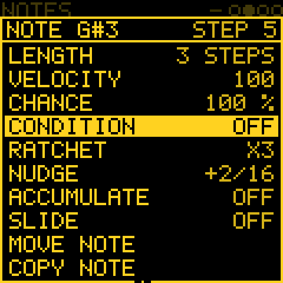

### A step's Condition, and FILL

The same sheet (a note's, or a hit's on the drum grid) has a **Condition**: which passes of the pattern the step
plays in. KNOB 2 steps through them:

| Condition | The step plays |
|---|---|
| **Off** | every pass (as always) |
| **1:2**, **2:2** | in the first, the second of every two passes |
| **1:3** .. **3:3** | in pass 1, 2 or 3 of every three |
| **1:4** .. **4:4** | in pass 1 to 4 of every four |
| **1:8**, **8:8** | in the first, the last of every eight |
| **FILL** | only while FILL is held |
| **!FILL** | only while FILL is not held |
| **FIRST** | in the first pass only |
| **!FIRST** | in every pass but the first |

Each track counts the passes of its own pattern (its own LEN) from PLAY; a pattern change, and each section of a
song, start the count again at the first. A step whose condition is met then rolls its Chance as ever. On the drum
grid the condition is the step's: every hit of that step shares it.

**FILL** is held with **GLO** + **E4** (on MIXER, E4 alone), for as long as the key is held: a fill on the last bar,
or a break with !FILL on the beat that drops out. Conditions are saved with the project; an older project plays
every step as before.

---

## ENERGY

The project's slow shape over minutes, the same for every track (after Zen-1's conductor, the idea only). Both are
off at 0.

| Knob | Setting | What it does |
|---|---|---|
| 1 | **ARC** (0–100 %) | A slow tide, 3 to 6 minutes a turn, swinging round LEVEL from full to sparse and back. At the sparse end the generator tracks leave out up to 70 % more of their hits and play up to 16 softer. At the full end they take back their own DROP and play up to 12 louder. ARC is how far it swings. |
| 2 | **RESTS** (0–100 %) | How often the music rests: 8 to 18 s with the generator tracks silent (a CHORD track's held chord goes on), about every 4 minutes at 100, every 20 near 0, sooner while the tide is sparse. |
| 3 | **LEVEL** (−100 to +100) | The energy by hand: the tide swings round it. Up is busier and louder, down is sparser and softer, as above. 0 is the tracks as set. |
| 4 | **REST** | The seconds left of a rest. |

Energy also sets how much EVOLVE changes: half its AMOUNT at the sparse end, half as much again at the full end.

Hold **OCT+** for **DEPTH** (KNOB 1, 0–100 %): how much energy moves the selected track. 100 is all of it. 0 makes
the track an anchor, a drone or a bass that plays as set through the tide, LEVEL and the rests.

The picture shows a turn of the tide round LEVEL and, while playing, where it is now.

PLAY starts the tide from the project's seeds, so a piece plays the same each time. ENERGY is also a cord source in
MODS: send it to a filter or a send and the sound follows the tide too.

---

## Print and keep

Hold **REC** on a generator track to **print**: what the generator played in its last bars goes into the track's
STEP pattern (1, 2 or 4 bars, as many as the notes span), and the track switches to STEP and plays on from the same
place. Hold EDIT to undo, which puts the generator back.

- Steps written by hand already there: **REPLACE STEPS?** OCT+ prints over them, OCT- keeps them.
- Recorded notes there: **CLEAR TO PRINT**.
- On a STEP track playing STEP EVOLVE's changes, REC held keeps the changes instead.
- On a STEP track without them, REC held captures what you played on the keys in the last bars.

---

## Harmony: one key, CHORD and QNT CHRD

**One key for the project.** The scale (SCL), QNT and the MPC degree are always the same on every track. The key
note, ROOT, is too while **SCL > Key link** is **LINKED** (the default in a new project): change ROOT on any melodic
track, from SCL's list or with SCL held and a key, and every melodic track follows; drum tracks keep their own.
**OWN** gives each track its own ROOT again; turning LINKED back on gives every track the selected track's key. Key
link is saved with the project (a project saved before it loads as OWN). TRN still moves a single track.

A **CHORD** track plays a progression; with **QNT CHRD** the other tracks follow it.

- On the CHORD track: GEN, MODE **CHORD**, then **PROG**, **BARS** and **HIT**. The chord's kind and voicing come
  from **SCL > CHORD** (CHRD, VOIC), or the OCT+ layer. CHRD OFF plays triads.
- On any other track: **SCL**, **QNT** to **CHRD**. Its keys, its MIDI input and its generator snap to the nearest
  note of the chord playing now, and KNOB 2 on NOTES steps through its notes. With no CHORD track, CHRD acts as
  SNAP.
- **CH PROG** is a mod destination, so a slow source can change progressions.

---

## MODS: the modulation cords

Tap **LFO** for **MODS**: up to 16 cords, each from a source on any track to a destination on any track. Four show
at a time, each with an activity light and a moving mark.

| Knob | What it sets |
|---|---|
| 1 | **Source**: `--`, then per track (T1 to T4) LFO, ENV, VEL, KEY, RAND, MODW, AT, EXPR, S&H, SLEW, the generator's GATE, NOTE and CV, DRIFT, TIDE 1 to 3, and SWARM 1 to 8; and the project's ENERGY. |
| 2 | **Mod**: which of the 16 the other knobs edit. |
| 3 | **Destination**, on a track: the voice (PITCH, CUTOFF, SHAPE, GAIN), the mix (LEVEL, PAN, SPREAD, FX SEND, SEND 2, SEND 3), the track's effects (FX1 MIX, FX1 RTE, FX1 CHR, the same for FX2 and FX3), the envelope and LFO settings, the engine's E1 to E8, and the generators' settings (T PROB, T LEN, E PULSE, E ROT, M LEAP, M DENS, MP POS, SHIFT, DROP, HUMAN, BRANCH, EV AMT, CONTR, AT X, AT Y, AT DENS, AT KICK, AT SNR, AT HAT, AT TOMS, B SPEED, B ANGLE, A PROB, Q PROB, C Y, C SIZE, C DENS, C AUTO, S START, CH PROG, AN VARY, H TIME). After the tracks' come the send effects', once, for every track: SF1 MIX, SF1 RTE, SF1 CHR (the same for SF2 and SF3) and RETURN. |
| 4 | **Amount**, −100 to +100 %. With no source (`--`) the cord is a fixed move and KNOB 4 sets its offset. |

- **+- and +: the mod's direction.** Under KNOB 1 a mod shows **+-** (it moves both ways from the knob) or **+** (one
  way only), and its bar says the same: a +- mod's bar reaches as far below the middle as above it. A bipolar source
  (LFO, KEY, RAND, S&H, SLEW, NOTE, DRIFT, TIDE, SWARM, ENERGY) is +-. Press **OCT+** on MODS to make the picked mod
  **+**: the source folded to 0 to 1, so it moves one way only, as ENV does ("+" after the source's name). OCT+ again
  makes it +- again.
- **Not the LFO's POL.** The LFO page's **POL** (BI, UNI) sets how that page's own depths move (LFO PIT, FLT, SHP,
  AMP). It does not reach a mod: a mod from the LFO swings both ways whatever POL is, and its own +- or + alone says
  which way it moves. So a UNI LFO is never shifted twice, and a + mod from a BI LFO moves one way.
- **The lists** of KNOB 1 and KNOB 3 name each entry with its track (**T2 GATE**, **T4 DECAY**); the project's
  ENERGY and the send effects' have none. On the MOSAIC colours an entry is in its track's colour.
- Choosing a destination on a new cord sets the amount to 50 % (or a fixed move of 25 % with no source), so you hear
  it at once.
- **Live marks**: a knob a cord reaches shows a mark where the cords move it now.
- **DRIFT** is each track's slow wander, a new point about every 12 seconds, eased between.
- **Effects.** RTE is the effect's third knob (RATE; ECHO's TIME, ROOM's and REVERB's SIZE, FILTER's CUT), CHR its
  fourth (DEPTH, REPEAT, DECAY, RES, as the effect names it). A moved ECHO TIME glides, as a tape's speed does, so the repeats bend in
  pitch instead of clicking (turning the knob glides too); REVERB changes SIZE a sample at a time. The send
  effects' mods are the project's, not a track's: MATRIX leaves them out. **FX held** + a knob on an FX page makes
  one too. A project with effect mods does not load in firmware before them.
- Melodee's MOD routes, in old projects and sounds, become cords when they load. If all 16 are in use the screen
  says **MODS FULL**.

 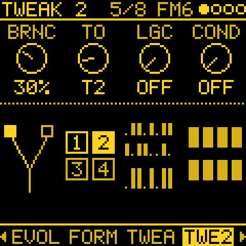

---

## MATRIX

MATRIX, after MODS, shows the cords as a 4 x 4 grid: source track down the left (FROM), destination track along the
top (TO). A cell is lit when a cord goes that way, brighter the more the cords move it now.

| Knob | What it does |
|---|---|
| 1 | **FROM**: the row. |
| 2 | **TO**: the column. |
| 3 | **MOD**: which of the cell's cords, when it holds more than one. |
| 4 | **OPEN**: press **OCT+** to open that cord in MODS. |

---

## ORGANIC: TIDE and SWARM

Each track has its own TIDE and SWARM, slow sources inspired by Nonlinear Circuits' Triple Sloth and Instruō's ochd.

| Knob | Setting | What it does |
|---|---|---|
| 1 | **SPEED** (0–100) | TIDE's speed. At 50 its three chaotic circuits take about 17 minutes (**TIDE 1**), 3 minutes (**TIDE 2**) and 1 minute (**TIDE 3**) a turn; each 12.5 more is twice as fast. |
| 2 | **RATE** (0–100) | SWARM's speed. At 50, **SWARM 1** takes 64 s a turn and **SWARM 8** 2.4 s; each 12.5 more is twice as fast. |

PLAY restarts them from the track's seed, so a piece replays the same way. Pick them as sources on MODS.

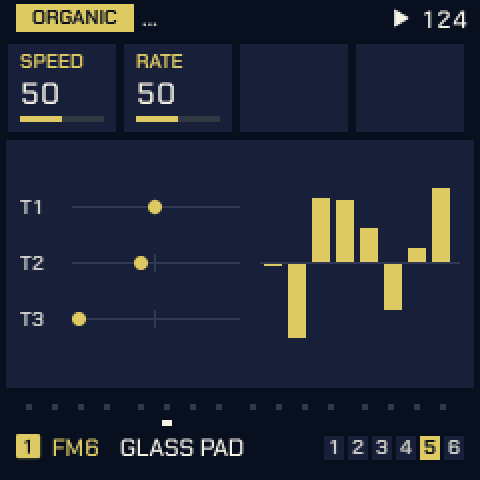

---

## Mod shortcut

Hold **FX** and turn a knob on any page: a cord from the track's shortcut source (its LFO, unless you turn SELECT
while FX is held to pick another) to that knob's parameter, on the same track. Turning sets the amount, like the
attenuverter beside a knob on a modular.

- The first turn makes the cord in a free MODS slot; back at 0 the slot is free again.
- If a cord already reaches that parameter on this track, that cord is edited, whatever its source.
- A parameter no cord can reach shows **no mod**.

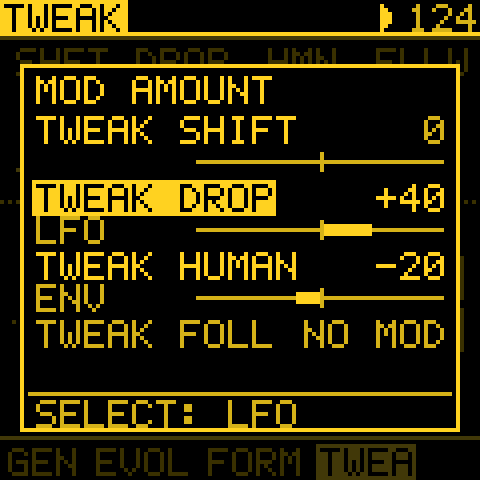

---

## Help card

Hold **ARP** and turn any knob: a card with its parameter, its value and what it does, on every page (on a page's own
knobs, such as NOTES, SONG or PATTERNS, what that knob does there). The value does not change. Turn the **same knob**
further to scroll a long text, back to scroll up. Let go of ARP to close it.

---

## Menu and settings

Hold **HOME** for the menu. Tessera's additions:

| Item | What it does |
|---|---|
| **COLOR** | The screen's ink, on black: YELLOW (the default), WHITE, GREEN, BLUE, RED, ORANGE, PINK, HOT PINK or LILAC; or MOSAIC, a colour per track with the selection in white. |
| **MIDI OUT** | What goes out over USB MIDI: **KEYS** (the notes you play, as Melodee sent them), **ALL** (also the steps, the ARP, recordings and every generator) or **OFF**. Each track on its own channel: see [MIDI OUT channels](#midi-out-channels). |
| **CLOCK OUT** | 24 pulses a beat with START and STOP over USB, while the clock is INT. |
| **MIDI CC IN** | **ON** (the default): CCs and NRPNs set the tracks' parameters (see [MIDI CC control](#midi-cc-control)). **OFF**: they move nothing, for a sequencer that sends CCs to other gear on the same channels. Bend, mod wheel, expression, sustain and aftertouch always play. Saved. |
| **USB HOST** | **ON**: the USB-C port hosts a USB-MIDI keyboard, controller, synth or MIDI-to-CV module, with no computer in between (see [USB host](#usb-host)). **OFF** (the default): the port talks to a computer. Not saved: every start is OFF. |
| **PANEL GAMMA** | The screen's contrast curve: the panel chip's own **G2.2** (the default), G1.8, G2.5 and G1.0, or TUNED and TUNED+VCOM. The screen goes black for a moment and redraws. Saved. |
| **TRACK KNOB** | RIGHT: the ALGORITHM knob picks the track and PRESETS browses sounds, as printed. LEFT: the two swap. |
| **ABOUT** | Version, credits and, after a crash, LAST CRASH (until power-off). |

### MIDI OUT channels

**GLO > MIDI OUT** sets the channel each track's notes go out on, so every track can play its own instrument:
**KNOB 1** to **4** for tracks 1 to 4.

- **AUTO** (the default) works as before: the channel follows **SYSTEM > ROUT** (CH1-4: tracks on 1 to 4), and a
  drum track uses the **DRUM** channel.
- **1** to **16**: that channel, whatever ROUT and DRUM say.
- **OFF**: none of the track's notes go out.

The page lists each track's channel as it is now, AUTO's included. The channels are saved with the project. Which
notes go out at all is still the menu's **MIDI OUT** (KEYS, ALL or OFF): for the steps and the generators, set it to
**ALL**.

**TRANSPOSE**: hold **OCT+** on **GLO > MIDI OUT** and turn **KNOB 1** to **4** to move a track's notes up or down
on their way out, a semitone a detent (12 an octave), up to four octaves either way. For a synth or a MIDI-to-CV
module that plays them too high or too low: **-12** an octave down, **-24** two. Only what goes out over MIDI moves;
the track's own sound stays where it is. A note moved past MIDI's range (0 to 127) is not sent. The page shows a
track's TRANSPOSE after its channel when it is not 0 (**CH 1 ROUT -24**); it is saved with the project.

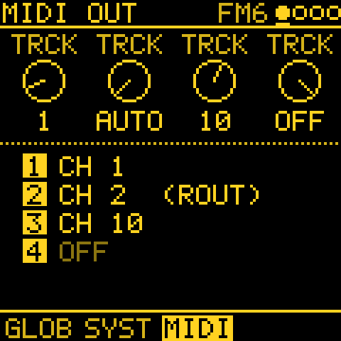 MIDI OUT" width="240">

### MIDI CC control

External gear (a sequencer, a controller, norns or crow through a MIDI interface, a DAW) can turn Tessera's
parameters. A track listens on the channel it plays on (**SYSTEM > ROUT**: CH1-4 is tracks 1 to 4 on channels 1 to 4;
SEL the selected track; a drum track also on the **DRUM** channel). A CC's 0 to 127 spans the whole range of the
parameter, as turning its knob all the way would; the knob carries on from there. While recording, **MOTION** keeps
the moves as it keeps the knob's. Cords and MOD go on adding to the value the CC sets.

| CC | Sets |
|---|---|
| 1 | Mod wheel (a MOD and cord source, **MODW**) |
| 5 | GLIDE |
| 7 | LEVEL |
| 10 | PAN (64 the centre) |
| 11 | Expression (**EXPR**) |
| 16 to 19 | The engine's four HOME knobs |
| 20 to 27 | The engine's E1 to E8 (its two EDIT pages) |
| 64 | Sustain pedal |
| 71, 74 | Two of the engine's own parameters, where it has them (its resonance and brightness) |
| 72, 73, 75 | RELEASE, ATTACK, DECAY |
| 76 | LFO RATE |
| 77, 78 | LFO to pitch, LFO to filter |
| 79 | SUSTAIN |
| 91, 93, 94 | FX SEND 1, 2, 3 |
| 102 | The generator's MODE (0 to 127 across the modes, in the GEN page's order) |
| 103 to 105 | The GEN page's KNOB 2 to 4 for the track's MODE (TURING: LENGTH, PROB, SPAN; EUCLID: STEPS, PULSE, ROT ..) |
| 120, 121, 123 | All sound off, reset controllers, all notes off |

**Every other parameter by NRPN.** Each parameter has a number, its ID in the
[parameter reference](docs/PARAMETERS.md) (0x000 a track's, 0x100 the project's, 0x200 the generators'). Send
NRPN MSB (CC 99) = ID / 128 and LSB (CC 98) = ID % 128, then the value with data entry: CC 6 (0 to 127), and CC 38 after
it for 14-bit precision. Example: TURING PROB on track 1 is 0x202: CC 99 = 4, CC 98 = 2, CC 6 = the amount, on
channel 1. A project setting (TEMPO, the send effects) answers on any channel a track listens on. Left out: the
device's setup (MIDI input, clock source, ROUT), the buttons (LOAD, SAVE ..) and the song's scale (SCL, QNT), which
stay on the device.

Turn **MIDI CC IN** off in the menu when another device's CCs should not reach Tessera.

### USB host

With **USB HOST** ON in the menu the FM-1 is the computer: plug a class-compliant USB-MIDI device into the USB-C port,
directly or through a USB hub, and after a moment the screen says **USB MIDI READY**. A hub with another hub inside
(as many USB-C hubs are) works too; a third hub is not followed.

- **In**: its notes, CCs, bend and clock arrive as USB MIDI from a computer would: MIDI ROUTING picks the tracks, CLK
  on USB follows its clock, and the [CC map](#midi-cc-control) works from its knobs.
- **Out**: what MIDI OUT and CLOCK OUT send goes to the device, so a USB synth or a USB-MIDI-to-CV module plays
  Tessera's tracks and follows its clock (MIDI OUT **ALL** for the steps and generators).
- **Power**: the FM-1 does not power the device. Use a **powered hub**, or a device with its own power supply.
- One MIDI device at a time: the first one found (behind a hub, the first port with a MIDI device). Full-speed
  devices only (**LOW SPEED** otherwise, behind a hub too); a device without USB-MIDI (a USB stick, crow) shows
  **NO MIDI**. norns is itself a host, so connect it as before.
- When nothing is found the screen adds **USB SCAN: ABOUT**: the menu's **ABOUT** then lists, under
  **USB HOST SCAN**, what each hub port had: **P2 0103 NO MIDI 08** is port 2, its status in hex (1 connected,
  2 enabled, 100 powered, 200 low speed, 400 high speed), what was found and the device's USB class in hex (01 audio
  or MIDI, 03 a keyboard or mouse, 08 a stick, 09 a hub, 11 a hub's Billboard). Found: **EMPTY**, **LOW SPEED**,
  **NO MIDI**, **HUB** (a hub inside, listed after it as HUB 2 with the port it is on), **MIDI**, or the step that
  failed (**RESET FAIL**, **NOT ENABLED**, **NO ANSWER**, **ADDRESS FAIL**, **CONFIG FAIL**). Under the first line
  (**ROOT**, what is plugged into the FM-1) come the try (a device that does not answer is reset up to four times,
  over about four seconds), the controller's registers, and for a failure which request got which reply
  (**@0 SETUP NO REPLY**: the device at address 0 did not answer the first request). A photo of it helps with a
  report.
- Unplugging shows **DEVICE LOST** and ends every note held from MIDI; plug it in again and it is found again.
- While USB HOST is ON there is no computer link: no USB audio, no web editor, no updates. Turn it OFF, or restart the
  FM-1 (it always starts OFF), to get them back.

---

## Saving and older projects

A project holds everything in one record: the patterns, the sounds, the generators with their seeds, sections and
layers, ENERGY, and the cords. Since 2.0 Tessera has a project format of its own: projects saved by Melodee (Tess) 1.x or
by Melodee show **OLD FORMAT** in their slot and do not load (there is no converter), and the first save writes over
them. Melodee's own preset banks are not carried over.

**A new project**: tap **SAVE** to the **PROJECT** page, turn **KNOB 1** down the list to **New song** and press
**OCT+** (playback stops; with unsaved changes, **OCT+** again answers Yes to "Start a new song?"). The NEW SONG
screen asks for the key (**KNOB 1** root, **2** scale, **3** tempo), then,
after **OCT+**, a role per track (**KNOB 1** to **4**): **KEEP** its sound, or **DRUMS**, **BASS**, **CHORDS**,
**LEAD** or **PAD** for the first sound of that kind. **OCT+** creates it with every pattern empty; **OCT-** goes back
or cancels. It starts from the template when one is saved in TMPL, else from the power-on sounds, and has no slot
until you save it.

The web editor's **Complete backup** saves and restores the music, slots A to D, the sound banks and the settings.
To try the [demo projects](demos/README.md), `tools/demo_backup.py` puts them into slots of your own backup.

---

## If something goes wrong

- **Single core.** If your FM-1 crashes with the standard build (red crash screen, freezes, or restarts into update
  mode), install the `-1core` firmware from the same release.
- **TESSERA CRASH.** If the crash screen shows, take a photo; after a restart, MENU > ABOUT shows LAST CRASH until
  power-off. Please add both to a bug report.
- **Update mode.** Hold **OCT-** alone while switching on to start the update loader, then reinstall from the web
  installer. See [docs/RECOVERY.md](docs/RECOVERY.md) for a unit stuck in UBOOT.
- Do not unplug the FM-1 while it is writing. This is experimental firmware: use it at your own risk.

---

## Credits

Tessera stands on other people's ideas and work:

- **Melodee** by keremimo, and **Felucca** by Leo Kuroshita / Hügelton Instruments: the firmware Tessera is built on.
  USB host mode is Melodee's, by Kerem Kilic and recursivefieldinstruments.
- **Grids** by Émilie Gillet / Mutable Instruments: the ATLAS generator's drum map and the way it is read.
- **ORACLE** is Melodee's Prophet engine (after the Prophet-5), back under its own name with its own sounds.
- **norns** scripts, as ideas restated in C (no code copied): **Awake** (tehn) for AWAKE, **Fall** (ambalek) for
  BOUNCE's FALL, **Constellation** (timothy-taylor) for CONSTELLATION, **initenere** for QUAD, and **nørgård** for
  SERIES.
- **Turing Machine** (Music Thing Modular) for TURING.
- **Triple Sloth** by Nonlinear Circuits (Andrew Fitch), with J. C. Sprott's jerk system, for TIDE; **ochd** by
  Instruō and DivKid for SWARM (ideas only, no code copied).

Every third-party part and its licence is listed in [LICENSING.md](LICENSING.md).
