
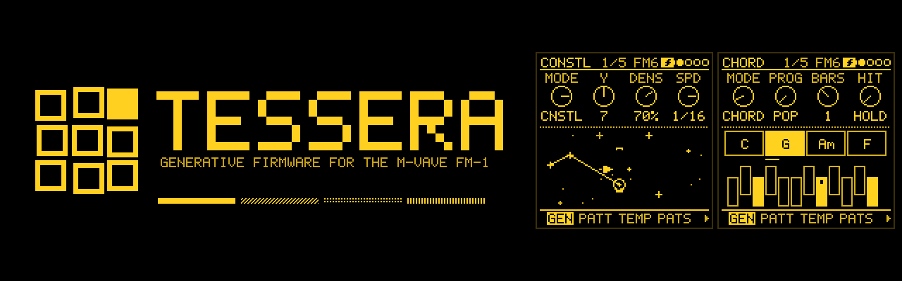

# Tessera manual

Tessera is a generative firmware for the M-Vave FM-1. It grew out of Melodee (Tess), a fork of
[Melodee](https://github.com/keremimo/melodee) by keremimo (itself built on *Felucca* by Leo Kuroshita / Hügelton
Instruments). Each of the four tracks can play its own steps, an arpeggio, or one of thirteen generators, and the
pages around them evolve the phrases, build song forms, pass hits between tracks and modulate anything from
anything.

This manual covers the whole firmware: the step sequencer, the generators, the sounds, the effects, patterns and
songs. For recipes and tips, see **[RECIPES.md](RECIPES.md)**; every button and combination on one
sheet, **[CHEATSHEET.md](CHEATSHEET.md)** (and [a printable PDF](docs/cheatsheet/tessera-cheatsheet.pdf)). Every
setting, with its range and default, is listed in [docs/PARAMETERS.md](docs/PARAMETERS.md).

Page and knob names are the ones on the screen. KNOB 1 to KNOB 4 are the four knobs from left to right, and each
page's four settings sit along the top of the screen in the same order.

**New to Tessera?** Start with [Tessera in plain words](#tessera-in-plain-words): what each page is for and when you
would use it, then a table of goals and where to go for each.

- [Tessera in plain words](#tessera-in-plain-words): an overview of every page, and why you would use it
- [The panel at a glance](#the-panel-at-a-glance)
- [Shortcuts](#shortcuts)
- [Sounds](#sounds)
- [SEQ: the MODE and its pages](#seq-the-mode-and-its-pages)
- [The generators](#the-generators)
- [The GEN layer](#the-gen-layer)
- [EVOLVE](#evolve)
- [FORM](#form)
- [TWEAK](#tweak)
- [TWEAK 2](#tweak-2)
- [LENGTH](#length)
- [TIMING](#timing)
- [ENERGY](#energy)
- [Print and keep](#print-and-keep)
- [Harmony: one key, CHORD and QNT CHRD](#harmony-one-key-chord-and-qnt-chrd)
- [MODS: the modulation cords](#mods-the-modulation-cords)
- [MATRIX](#matrix)
- [ORGANIC: TIDE and SWARM](#organic-tide-and-swarm)
- [Mod shortcut](#mod-shortcut)
- [What a knob does](#what-a-knob-does)
- [Menu and settings](#menu-and-settings)
- [Saving and older projects](#saving-and-older-projects)
- [If something goes wrong](#if-something-goes-wrong)
- [Credits](#credits)

---

## Tessera in plain words

Tessera packs a lot into a small box. This part of the manual says what each part is *for*, in everyday words, so
you know where to look before you need the detail. The rest of the manual then gives every knob in full; look for the
**In short** lines at the top of each section for the same plain version.

### How it fits together

Think of a Tessera project as layers. You can stop at any layer and still have music: each one is optional, and
everything automatic starts switched off.

1. **Sounds.** Each of the four tracks has a sound: an FM6, ORACLE, TRIO, PHYS or DRUM voice. *This lets you pick
   what each part sounds like* (pad, bell, bass, kit).
2. **What a track plays.** Each track plays its own steps (STEP), an arpeggio of the keys you hold (ARP), or a
   **generator** that writes music for you. *This lets you go from a blank page to a moving line in seconds.*
3. **How the line changes.** EVOLVE, TWEAK, TWEAK 2, LENGTH and TIMING shape the generator's notes: how often they
   change, which hits play, how long notes ring, how they swing. *This lets you turn "random" into "musical".*
4. **How a track grows into a song.** FORM gives a track sections A, B and C; CHAIN lines up all the tracks' sections;
   ENTRIES brings tracks in and out; PIECE plans the whole thing from start to end. *This lets a project play for
   minutes or hours without sounding like one loop.* How these act on each other:
   [The long-form layers together](#the-long-form-layers-together).
5. **Movement.** MODS are virtual patch cables: any source (an LFO, a slow TIDE, a generator's notes, a hand-turned
   macro) can move almost any setting on any track. *This lets the sound breathe, and lets tracks talk to each other.*
6. **Playing it.** MIXER, the GLO keys, PERF's macros, FILL, quantized MUTES and MIDI LEARN are the hands-on side.
   *This lets you perform the piece, not just set it going.*

### The long-form layers together

> **In short:** PIECE plans the whole piece, CHAIN sets the section, ENTRIES picks which tracks play, ENERGY sets how
> busy they are, and each track's FORM and generator play the notes. SONG is separate: your written patterns in order.

Six pages shape a piece over time. Five of them work as one system, from the slowest to the fastest; SONG runs beside
them. Every one starts OFF, and you can use any of them alone.

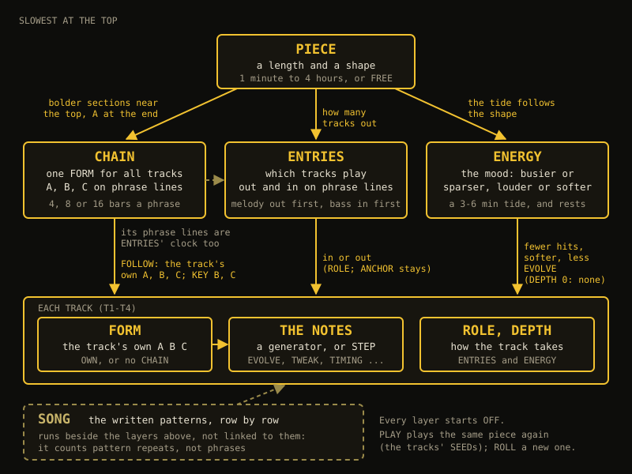

| Layer | Where | How often it changes | What it changes | What it listens to |
|---|---|---|---|---|
| [PIECE](#piece-a-length-and-a-shape) | GLO > PIECE | Over the whole piece, 1 minute to 4 hours | Nothing directly: it steers CHAIN, ENTRIES and ENERGY along its shape | The CHAIN's PHRASE (it counts in phrases) and the tempo |
| [CHAIN](#chain-one-form-for-the-project) | GLO > CHAIN | On phrase lines (4, 8 or 16 bars) | The section (A, B, C) every following track plays, and the key in B and C | PIECE: bolder new sections near its top, A at its end |
| [ENTRIES](#entries-tracks-out-and-back-in) | GLO > ENTRIES | On phrase lines | Which tracks play: it fades or cuts them out and back in | The CHAIN's phrases and sections, each track's ROLE, PIECE (how many out) |
| [ENERGY](#energy) | ARP > ENERGY | A slow tide of 3 to 6 minutes, and rests | How many hits the generator tracks play and how loud; how much EVOLVE changes | PIECE (the tide becomes its shape), each track's DEPTH |
| [FORM](#form) | ARP > FORM, each track | Every EVERY bars, or on the CHAIN's phrases | The track's own sections A, B and C | The CHAIN, while the track FOLLOWs it |
| SONG | SEQ > SONG | When a row has played its repeats | Which written pattern each track plays | Nothing above: it runs beside them |

**Who wins where they meet:**

- **CHAIN and FORM.** A track that FOLLOWs takes its section from the CHAIN, and its own EVERY waits. OWN keeps its own
  FORM. Until you choose, a track follows when its own FORM is OFF.
- **ENTRIES and your hands.** ENTRIES only takes tracks out and brings them back; it never changes what a track plays.
  A mute by hand always wins, and an ANCHOR never goes out.
- **ENERGY and STEP tracks.** ENERGY changes how much a generator plays, not what it plays. STEP tracks play as
  written. DEPTH 0 keeps a track out of ENERGY altogether.
- **PIECE adds nothing of its own.** With LENGTH FREE nothing is planned. With ENTRIES at 0 no track moves, even with a
  PIECE; with ENERGY's ARC at 0 its tide stays flat.
- **SONG and CHAIN** both start counting at PLAY but are not linked: SONG counts pattern repeats, CHAIN counts bars. To
  keep them in step, make each SONG row last a whole number of the CHAIN's phrases.
- **Clocks.** CHAIN, ENTRIES and PIECE change on phrase lines. ENERGY's tide runs on its own slow clock unless a PIECE
  sets it.

**Build it up one layer at a time:**

1. One generator track, FORM **AABA**: the track gets sections.
2. **GLO > CHAIN**, FORM **ABAC**: the tracks change section together (tracks with FORM OFF follow by themselves).
3. **GLO > ENTRIES** at 50: tracks drop out and come back on the phrase lines. Set a drone's ROLE to **ANCHOR**.
4. **GLO > PIECE**, 10 minutes, **ARCH**, END **STOP**: an intro, a peak and an ending, then it stops by itself.
5. **ARP > ENERGY** ARC: how far the busy-sparse swing goes, along the PIECE's shape (or on its own tide without one).

| I want... | Use |
|---|---|
| The whole project to move from A to B together | CHAIN |
| One track with its own verse and chorus | FORM, with that track set to OWN |
| The band to thin out and fill up | ENTRIES |
| A beginning, a peak and an end, then stop | PIECE, END STOP |
| Slow breathing in how busy and loud it is | ENERGY's ARC |
| A fixed order of patterns I wrote | SONG |
| One track left alone by all of this | OWN on FORM, ROLE ANCHOR, DEPTH 0 |

### Every page, and why you would use it

Tap a button to reach its pages; tap again (or turn **SELECT**) to step through them. The tables say what each page
lets you do and when you would want it. Follow a link for the full description.

**HOME** (hold it for the menu)

| Page | What it lets you do | Reach for it when |
|---|---|---|
| [HOME](#the-panel-at-a-glance) | See all four tracks at once, set the tempo with SELECT, and turn each sound's four main knobs. | You want the big picture, or a quick tweak while playing. |
| [Menu](#menu-and-settings) | Set up the device: screen colours, MIDI, the knob look, battery display, MIDI LEARN, how mutes land. | You set things up once, or plug in new gear. |

**SEQ**: what the selected track plays

| Page | What it lets you do | Reach for it when |
|---|---|---|
| [GEN](#seq-the-mode-and-its-pages) | Choose the track's MODE: your own steps, the ARP, or one of thirteen generators, and set the generator's three main knobs. | Every time you start a part. This is the most important page. |
| [NOTES](#seq-the-mode-and-its-pages) | Write and edit steps by hand; open a step's sheet for ratchets, nudges, conditions and climbing notes. | You want a part exactly as you hear it in your head. |
| [PATTERN](#seq-the-mode-and-its-pages) | A generator track's length, speed (DIV) and gate. | A generator should run faster, slower or over a different length. |
| TEMPO | The project's BPM, swing and record quantize. | You set the speed and feel of the whole project. |
| [PATTERNS, SONG](#patterns-and-song) | Pick which of its 8 patterns each track plays, and line patterns up into a song. | You arrange written patterns into a song by hand. |
| ARP | The arpeggiator's MODE, RATE, OCT and GATE, on an ARP track. | You want to play chords and hear them broken up. |

**ARP**: how the selected track's notes are shaped (the pages its MODE uses). *When a knob's name puzzles you, see
[What a knob does](#what-a-knob-does).*

| Page | What it lets you do | Reach for it when |
|---|---|---|
| [EVOLVE](#evolve) | Let a phrase mutate every few bars, pick a new seed (a new line) with ROLL, and pull it home with GRAVITY. | A loop has started to feel too static, or you want a fresh idea. |
| [FORM](#form) | Give the track a song form (A B A C ...) built from its own phrase. | You want verse-and-chorus contrast instead of one long loop. |
| [TWEAK](#tweak) | Transpose, thin out, humanise, or make a track follow another track's pitch. | You want a harmony, a bass that follows the melody, or a looser feel. |
| [TWEAK 2](#tweak-2) | Decide which hits play: pass hits to another track, combine two tracks' rhythms, play only in some bars. | You want two parts to answer each other, or interlocking rhythms. |
| [LENGTH](#length) | Set how long a generator's notes ring. | Notes sound too clipped, or you want pads out of sparse notes. |
| [TIMING](#timing) | Add ratchets (rolls) and a behind-the-beat human feel. | You want rolls, stutters or a more relaxed groove. |
| [ENERGY](#energy) | Give the whole project a slow tide from sparse to full, with occasional rests. | A long piece needs to rise and fall on its own. |
| ARP 2 | The arpeggiator's SWING, PROB, HOLD and ORDER, on an ARP track. | The arpeggio should swing, skip notes or hold on. |

**LFO**: movement

| Page | What it lets you do | Reach for it when |
|---|---|---|
| [MODS](#mods-the-modulation-cords) | Patch up to 16 cords from any source to any destination, including other synths over MIDI CC. | You want anything to move by itself, or one track to shape another. |
| [MATRIX](#matrix) | See who modulates whom as a 4 x 4 grid, and jump to a cord. | The patch has grown and you need to find a cord. |
| LFO, LFO 2, LFO DEST | The track's own LFO and how far it moves pitch, filter, shape and level. | You want classic vibrato, wobble or tremolo. |
| [ORGANIC](#organic-tide-and-swarm) | Set the speed of TIDE (very slow, minutes a turn) and SWARM (eight related wanderers). | You want movement too slow and natural to hear as an LFO. |

**ENV**: the track's envelope and where it goes (on FM6 and ORACLE, the sound's own envelopes). *Use it to make a
sound pluck, swell or sustain.*

**SCL**: harmony

| Page | What it lets you do | Reach for it when |
|---|---|---|
| SCALES, SCL | Choose the project's scale and key, how notes are snapped to it (QNT), and transpose a track. | Always, early on: every generator plays in this scale. |
| CHORD | Set the chord kind and voicing a CHORD track (or QNT CHRD) uses. | You want sevenths, sus or add9 chords, open voicings or power chords. |
| [USER scales](#your-own-scales-user1-to-user4) | Make up to four 12-note scales of your own on the keys. | No built-in scale is the one you hear. |
| [Scala tunings](#your-own-tunings-scala-files) | Load your own microtonal tunings from the web editor. | You want to leave twelve-note tuning behind. |

**EDIT**: the sound's own pages ([Sounds](#sounds)). Tap EDIT again for a map of them. *Use it to design or adjust a
sound; save it to USER from SAVE.*

**FX**: the insert and send effects (ECHO, ROOM, REVERB, CHORUS, TAPE, PHASER, FILTER and more). Held, it sets
how far a cord moves the knob you turn ([Mod shortcut](#mod-shortcut)). *Use it for space, colour, and the quickest way to make a mod.*

**GLO**: the project and the long form

| Page | What it lets you do | Reach for it when |
|---|---|---|
| [MIXER](#the-panel-at-a-glance) | Levels, pans, mutes and solos for all four tracks, plus FILL and tap tempo on the keys. | You are playing live, or balancing the mix. |
| GLOBAL, SYSTEM | Tuning reference, the voice BUDGET, clock source, MIDI routing and channels. | Notes crackle (lower BUDGET), or you sync to other gear. |
| [MIDI OUT](#midi-out-channels) | Give each track its own MIDI channel, transpose what goes out, or silence a track's own sound. | Tessera should play other synths, or a track should only modulate. |
| [PIECE](#piece-a-length-and-a-shape) | Plan a whole piece: how long, what shape (an arch, waves, builds), and what happens at the end. | You want a 20-minute or 2-hour piece that plays itself. |
| [CHAIN](#chain-one-form-for-the-project) | Give all tracks one shared song form, so their sections change together. | Tracks with FORM should move from A to B at the same moment. |
| [ENTRIES](#entries-tracks-out-and-back-in) | Let tracks drop out and come back in on phrase lines, like a band arranging itself. | The piece should thin out and fill up without you touching the mutes. |
| [LANDSCAPE](#landscape-rain-on-water) | A night lake drawn by the music. Changes nothing. | You want something to watch while it plays. |
| [PERF](#perf-four-macros) | Four macro knobs that can each drive many mods at once. | You want one knob to do a big move live (a build, a breakdown). |

Hold **GLO** on any page for the performance keys: mutes, solos, FILL, levels, tempo and sound browsing.

**SAVE**: PRESETS (browse and favourite sounds), USER (store a sound), PROJECT (save, load, start a new song). Hold
SAVE to save the project. *See [Saving](#saving-and-older-projects).*

**REC**: record from the keys, or held, [print](#print-and-keep) what a generator just played into steps you can edit.
*Use it to keep a happy accident.*

### Which generator for what

| You want | Try | Why |
|---|---|---|
| A melody that repeats but slowly changes | **TURING** | A loop you can lock, or let drift note by note. |
| A melody from your own notes, varied | TURING, EUCLID, MARKOV or MORPH with a **SOURCE** | They play your STEP pattern and vary it; GRAVITY keeps it close. |
| A wandering, natural-sounding line | **MARKOV** | Walks between nearby notes, with the odd leap. |
| An evenly spread rhythm | **EUCLID** | Spreads hits as evenly as possible: many world rhythms come out of it. |
| A drum groove | **ATLAS** | A map of drum patterns: move X and Y for a different groove. |
| Chords and a progression | **CHORD** | Plays a progression in your scale; other tracks can follow it with QNT CHRD. |
| Polyrhythms | **POLY** or **QUAD** | Rhythms of different lengths against each other. |
| Sparse, chime-like melodies | **BOUNCE**, its **FALL** mode, or **CONSTL** | Notes from balls, falling leaves or passing stars: gentle and unpredictable. |
| A slow lead that never quite repeats | **SERIES** | A self-similar melody that unfolds for a long time. |
| Two interlocking loops | **AWAKE** | A melody loop lifted by a second loop of a different length. |
| Something that answers you | **ANSWER** | Play a phrase; it plays it back, changed a little more each time. |
| A blend between two rhythms | **MORPH** | Slides from one rhythm to another with a single knob. |

### I want to...

| I want to... | Go to |
|---|---|
| Hear something generative right away | [A first generative patch in a minute](RECIPES.md#a-first-generative-patch-in-a-minute) |
| Keep a line I like | Note the seed on EVOLVE's **ROLL**, or hold **REC** to [print](#print-and-keep) it into steps |
| Stop a generator from changing | TURING's **PROB 0** (Lock), or EVOLVE's **EVERY OFF** |
| Make a part change slowly over time | [EVOLVE](#evolve), then [GRAVITY](#evolve) to keep it near home |
| Have every track play in the same key and follow the chords | [Harmony](#harmony-one-key-chord-and-qnt-chrd): Key link and **QNT CHRD** |
| Make the sound move on its own | [MODS](#mods-the-modulation-cords), or hold **FX** and turn a knob ([Mod shortcut](#mod-shortcut)) |
| Make a piece that plays for an hour and has a beginning, middle and end | [PIECE](#piece-a-length-and-a-shape), [CHAIN](#chain-one-form-for-the-project), [ENTRIES](#entries-tracks-out-and-back-in), and the [recipe](RECIPES.md#a-piece-that-plays-itself-piece-chain-and-entries) |
| Do big moves live with one hand | [PERF](#perf-four-macros) macros and the [recipe](RECIPES.md#one-knob-for-a-big-build-perf-macros) |
| Mute and unmute in time with the music | MENU > **MUTES** BAR or PHRASE ([recipe](RECIPES.md#drops-that-land-on-the-bar-mutes)) |
| Play a drum fill | Set some steps' Condition to **FILL**, then hold **GLO** + **E4** ([Condition and FILL](#a-steps-condition-and-fill)) |
| Control Tessera from my MIDI controller | MENU > **MIDI LEARN** ([recipe](RECIPES.md#your-controllers-knobs-kept-midi-learn)) |
| Play an outside synth from Tessera | [MIDI OUT channels](#midi-out-channels) and [Driving another synth](RECIPES.md#driving-another-synth-midi-out) |
| Move an outside synth's filter from Tessera's LFOs | A mod onto **CC** ([recipe](RECIPES.md#an-lfo-for-another-synths-filter-mods-out-as-cc)) |
| Find out what a knob does | Its page in this manual, or the [parameter reference](docs/PARAMETERS.md) ([What a knob does](#what-a-knob-does)) |
| Stop crackles | Lower **GLO > GLOBAL > BUDGET**, or thin a busy track ([How many voices at once](#how-many-voices-at-once)) |

---

## The panel at a glance

> **In short:** the buttons get you to pages, the four knobs set what is on the page, and holding a button opens a
> second job. You rarely need more than HOME, SEQ, LFO and GLO to start.

| Button | Tap | Hold |
|---|---|---|
| **HOME** | The home page: four tracks, their sounds and knobs | The menu |
| **SEQ** | What the track plays: GEN, then NOTES or ARP or PATTERN (by its MODE), TEMPO, PATTERNS, SONG | PATTERNS (the song under it) |
| **ARP** | How the track's notes are shaped: EVOLVE, FORM, TWEAK, TIMING and the rest (by its MODE) | |
| **LFO** | MODS, MATRIX, LFO, LFO 2, ORGANIC, LFO DEST (an FM6 track: then FM LFO) | |
| **ENV** | ENV, ENV DEST (an FM6 track: EG RATE, EG LVL, PITCH EG, PITCH LV) | |
| **SCL** | SCALES, SCL, CHORD | Quick SET: a key sets ROOT; KNOB 1 to 4 set ROOT, SCL, CHRD, VOIC |
| **EDIT** | The sound's EDIT pages; on an EDIT page, the map | With OCT- / OCT+: undo / redo |
| **FX** | The insert and send effects | The mod amount of any knob you turn |
| **GLO** | MIXER, [PERF](#perf-four-macros), GLOBAL, SYSTEM, MIDI OUT, [PIECE](#piece-a-length-and-a-shape), [CHAIN](#chain-one-form-for-the-project), [ENTRIES](#entries-tracks-out-and-back-in), [LANDSCAPE](#landscape-rain-on-water) | Quick SET: the black keys mute T1 to T4, the white keys solo while held, E4 holds [FILL](#a-steps-condition-and-fill), KNOB 1 to 4 the levels, SELECT turns the tempo, F4 taps it, PRESETS browses the sounds; with PLAY, restart from the top |
| **SAVE** | USER (ready to save the sound), PROJECT, PRESETS | Save the project to its slot (as SAVE + REC) |
| **REC** | Records the selected track until REC again (see [Recording live](#recording-live)) | Capture or print the last bars (see [Print and keep](#print-and-keep)) |
| **OCT+** | Octave up; on some pages, an action (shown on screen) | The page's sheet; a page without one says NO SHEET (its second knobs are on OCT- held: see [The GEN layer](#the-gen-layer)) |

On the home page each track's tile shows its sound and engine. **ALGORITHM** picks the track on every page (or
the left knob, with MENU > TRACK KNOB set to LEFT), and **SELECT** turns the pages of the section shown (on the home
page, the tempo). When a section has more pages than the footer's tabs show, the header gives the page's place (4/10:
SEQ counts GEN's pages and the sequencer's together, the way the button goes through them) and arrows at the footer's
ends say more pages lie that way. The four sounds a new project starts with are an ambient set: **GLASS PAD**
and **BELLS** on FM6, **STRING MACH** on TRIO, and the **808 KIT** on DRUM. (Track 2 is a TRIO pad so that
generators on both pads stay within what the FM-1 can play: see [How many voices at once](#how-many-voices-at-once).) A new project has no mods, so nothing moves until
you patch it.

On every page the four knobs' values sit under their dials (or bars: MENU > KNOBS). The value you turn is drawn
inverted. On the home page and on pages without a picture of their own, while you turn it its name and value also show
large across the foot of the screen, with a bar for where it sits in its range; they go when the knob rests. Pages with
a picture (a generator's, an envelope, the LFO, PIECE and the rest) keep the picture in view, so you see what the knob
does: MENU > **LARGE VALUE** shows it on every page (ON) or on none (OFF).

 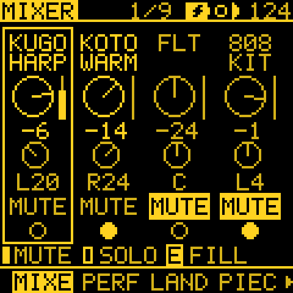

**MIXER** (tap GLO) is the four tracks as a mixer: **KNOB 1 to 4** set the levels of tracks 1 to 4, and with
**OCT-** held they set the pans. The keys are the mixer's while it is shown: the **black keys** F#3 G#3 A#3 C#4 mute
and unmute tracks 1 to 4, the **white keys** F3 G3 A3 B3 solo a track while held, **C4** unmutes them all, **E4**
holds FILL and **F4** taps the tempo, the same as with GLO held on any other page. Each strip shows MUTE or SOLO; a track silenced by
another's solo dims. Any page button leaves the mixer, and the keys play notes again. A mute only silences the track: a
muted track still leads the tracks that follow it (FOLLOW, an ANSWER's SOURCE, QNT CHRD's chord, QUAD's LINK, the cords).

**Lists** (the HOME menu, SCL, VOICE, the sheets and the sound designer): KNOB 1 picks the row, KNOB 2 changes its
value.

**The look.** Tessera draws every screen in one ink on black, with a 5 x 7 pixel font: the selected item is
inverted, and quieter things are drawn in a dimmer ink. MENU > COLOR picks the ink: **YELLOW** (the default),
WHITE, GREEN, BLUE, RED, and ORANGE, PINK, HOT PINK and LILAC to match the FM-1's shells. In these the tracks are told
apart by their numbers, not by colours. **MOSAIC** gives each track a colour of its own (T1 yellow, T2 blue, T3 hot pink,
T4 green): the screen takes the selected track's, the pages that show all four (HOME, MIXER, PATTERNS, SONG, QUAD,
FOLLOW, MATRIX, MIDI OUT, the cords) draw each in its own, and the value you turn and the row you pick show in white.
**SUNSET** (orange, hot pink, lilac, yellow), **OCEAN** (blue, teal, green, lilac) and **NEON** (cyan, magenta, lime,
orange) do the same in other colours. With COLOR picked in the menu, the inks and the four-colour sets show below it,
the one chosen framed and its name large; KNOB 2 or OCT+ steps through them.

**GROUND.** MENU > GROUND, just below COLOR, sets what the ink is drawn on: **DARK** (the default, black, as above) or
**LIGHT**, warm paper. On paper each ink becomes a darker version of itself that reads well there, and several inks
share one: WHITE becomes CHARCOAL, YELLOW and ORANGE become SEPIA, GREEN FOREST, BLUE NAVY, RED, PINK and HOT PINK
CRIMSON, and LILAC PLUM. The four-colour sets keep four different inks: MOSAIC SEPIA, NAVY, CRIMSON and FOREST; SUNSET
SEPIA, CRIMSON, PLUM and CHARCOAL; OCEAN NAVY, TEAL, FOREST and PLUM; NEON TEAL, PLUM, FOREST and SEPIA; the selection
in CHARCOAL. While LIGHT is on, COLOR's sheet shows the light versions on paper, so you see what you pick. Older
firmware keeps the ink you chose and draws it on black.

<table>
<tr>
<td align="center"> <b>YELLOW</b></td>
<td align="center"> <b>WHITE</b></td>
<td align="center">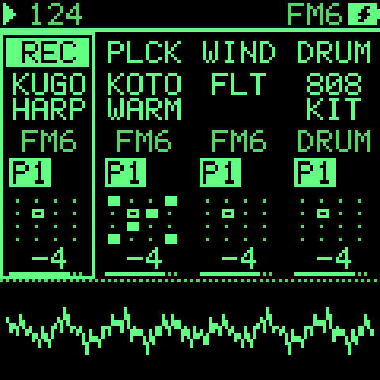 <b>GREEN</b></td>
<td align="center">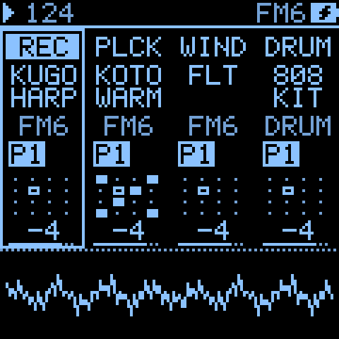 <b>BLUE</b></td>
</tr>
<tr>
<td align="center">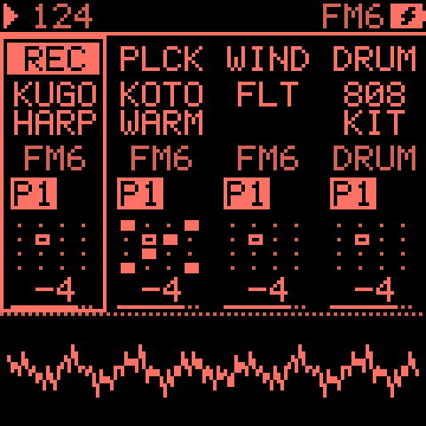 <b>RED</b></td>
<td align="center"> <b>ORANGE</b></td>
<td align="center"> <b>PINK</b></td>
<td align="center">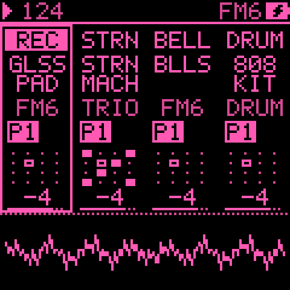 <b>HOT PINK</b></td>
<td align="center">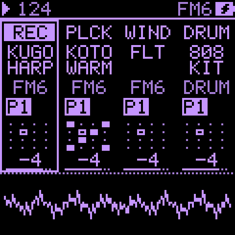 <b>LILAC</b></td>
<td align="center">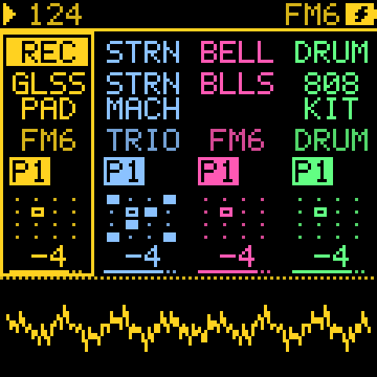 <b>MOSAIC</b></td>
</tr>
<tr>
<td align="center">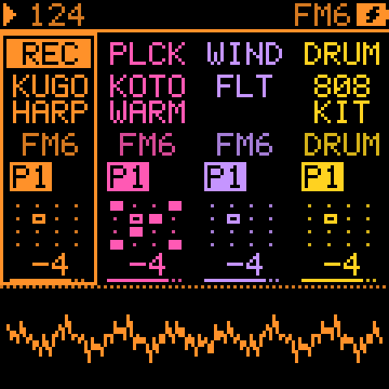 <b>SUNSET</b></td>
<td align="center">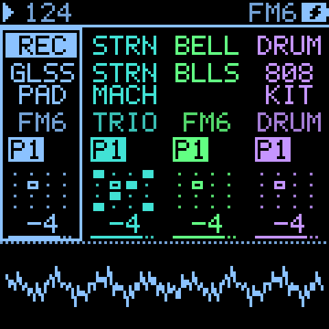 <b>OCEAN</b></td>
<td align="center">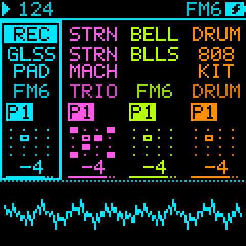 <b>NEON</b></td>
</tr>
</table>

**At power-on** the Tessera mark is laid tile by tile, held for a moment, then breaks into grains that a wind sweeps away. Any button or
key skips it.

---

## Shortcuts

> **In short:** the combinations worth learning first are SEQ for GEN, FX held to make
> a mod, REC held to keep what a generator played, and EDIT held with OCT- to undo.

| Do this | And this happens |
|---|---|
| Tap **SEQ** | **GEN** first: KNOB 1 (**MODE**) picks what the track plays. SEQ then shows only what that mode plays, ARP how it is shaped. |
| Tap **ARP** | The track's shaping pages (EVOLVE, TWEAK, TIMING and so on); tap again for the next. It never changes the track's MODE: that is GEN's KNOB 1. |
| Hold **OCT-** on GEN | KNOB 1 RANDOM; KNOB 2 to 4 the generator's second layer, for TURING, EUCLID, MARKOV, MORPH, QUAD, CHORD, ATLAS, CONSTELLATION and ANSWER (see [The GEN layer](#the-gen-layer)). Hold **OCT+** for the GEN sheet, where a generator has a setting past those. |
| Hold **OCT-** on EVOLVE | KNOB 1 ROLL ALL; KNOB 3 PAT GEN; KNOB 4 a generator's GRAVITY (a STEP track: STEP EVOLVE's HOW) (see [EVOLVE](#evolve)). |
| Hold **OCT-** on GEN or TWEAK, turn **KNOB 1** | **RANDOM**: turn right and the page's knobs get new values, each inside its range (GEN: the generator's KNOB 2 to 4; TWEAK: SHIFT, DROP and HUMAN). The screen says **RANDOMIZED**. Turn left to put back the values from before the last turn (**PUT BACK**, once). KNOB 2 to 4 of this layer are the generator's own ([The GEN layer](#the-gen-layer)); on TWEAK, FOLLOW's HOW, RHYTHM and HOLD. MODE, the seed, FOLLOW, QUAD's LINK and CONSTELLATION's AUTO never change. A STEP or ARP track says **NO GENERATOR**. |
| Turn **SELECT** on HOME or MIXER, or with **GLO** held | Sets the tempo (BPM), as SEQ > TEMPO does; F4 with GLO held taps it. With CLK on USB or TRS the tempo is the clock's, and a Song Position from it (a DAW's PLAY from mid-song) starts the steps, the ARP and the generators where that song is, as if they had played from the top. |
| Turn **PRESETS** with **GLO** held, on any page | Browses the selected track's sounds as PRESETS does on HOME. The GLO map gives way to the sound: the track, the list and the place in it, the sounds before and after, the sound's name large and its engine (a fast turn: the name the knob will load when it stops, with its speed, X4). It stays while GLO is held; a GLO key or knob brings the map back. Without GLO, PRESETS keeps the page's own job (or does nothing), so a stray turn never changes the sound. GLO + OCT- does not put the sound back. |
| **GLO** + **E4** (on MIXER, E4) | Holds [FILL](#a-steps-condition-and-fill) for the steps whose condition is FILL or !FILL. |
| **GEN** on an AWAKE track, a white key | Picks that step: KNOB 1 sets its A, KNOB 2 its B. The same key lets it go. |
| Hold **FX**, turn a knob | Sets how far a cord moves that knob's parameter (see [Mod shortcut](#mod-shortcut)). |
| Hold **REC** | On a generator or ARP track: prints its last bars into STEP. On STEP EVOLVE: keeps the changes. On a STEP track: captures what you just played. |
| Hold **EDIT**, press **OCT-** / **OCT+** | Undo / redo. |
| **SAVE** + **REC**, or hold **SAVE** | Saves the project to its slot (stops playback first). |
| **EVOLVE**, KNOB 4 (**ROLL**) | Each click is a new seed (1 to 128), so a new line; turn back for the last one, note for note. |
| **FORM**, KNOB 3 (**CLEAR**) | Forgets B and C: the section playing becomes A. |
| **MODS**, **OCT+** | Switches the picked mod between **+-** (both ways), **+** (one way), **^** (GATE) and **=** (HOLD). |
| **MODS**, **OCT-** held + **KNOB 4** | Sets a GATE mod's threshold. |
| **MODS**, hold **OCT-** | Shows the picked mod's scope: its move over time over its source (see [MODS](#mods-the-modulation-cords)). |
| **MATRIX**, **OCT+** | Opens the picked mod in MODS. |
| **EDIT** on an EDIT page | The map of the sound's pages: KNOB 1 across a row, KNOB 2 between rows, OCT+ opens the page, OCT- or EDIT closes it. Any other page button leaves it for its page. |
| **PLAY** | Every generator starts its random choices from the top of its seed, and TIDE and SWARM restart: with EVOLVE's EVERY off, a project plays the same way each time. |

---

## Sounds

> **In short:** each track's voice. FM6 for bright, glassy and bell-like sounds, ORACLE for warm analogue pads, brass
> and basses, TRIO for simple basses and leads, PHYS for plucks, mallets and bowed sounds, DRUM for kits. Browse them
> with PRESETS; change any of them on EDIT.

Tessera has five engines on the device:

| Engine | What it is |
|---|---|
| **FM6** | Six-operator FM in the manner of the DX7: 32 algorithms, operator envelopes and scaling, pitch EG, LFO and the function settings (bend, porta, wheel, foot, breath, aftertouch). Its ENGINE setting picks MODERN, MARK I (the DX7's own tables) or OPL. The main melodic voice. |
| **ORACLE** | Two oscillators, POLY MOD and a four-pole low-pass filter: a classic polyphonic analogue voice. Warm pads, brass, sync leads, basses, plucks. 24 sounds of its own; the sound is kept in the project. |
| **TRIO** | Three oscillators: WAVE, INT2, INT3 (intervals) and DETUNE. Basses and leads. |
| **PHYS** | Physical models: MODAL (bars, bells, plates), STRNG (a plucked or bowed string), MEMB (drum heads) and SYMP (a string with three more ringing along). Bells, mallets, plucks, bowed pads and drones; 17 sounds. |
| **DRUM** | Drum kits: **808** and **909**. Eight lanes: BD, SD, CP, CH, OH, TM, RS, CB. The 808 has six tom pitches. |

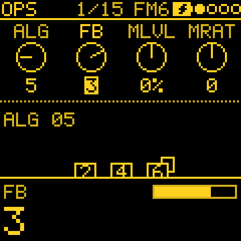 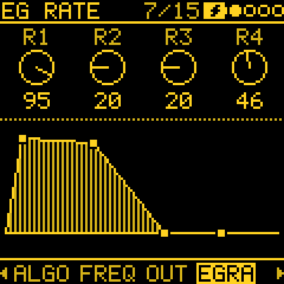 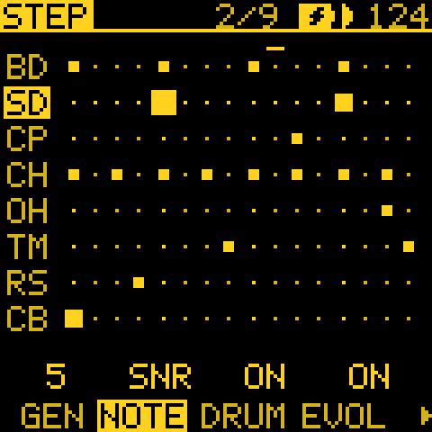

**PHYS** is back. Its knobs each cover only their musical range now, with wide sweet spots: STRC keeps
MODAL's overtones in tune from 16 to 48, a chime's near 84 and a marimba's at the top (the picture names where it
is); a dull, short or bowed sound is as loud as a bright one. An old project's PHYS track (one not saved again
since 2.0, which turned it into FM6) plays PHYS again, a little differently towards the ends of the knobs. **SID** is no longer in the device build, and neither is CZ-1: a track saved
with SID loads FM6's INIT. DRUM's SID KIT
and SID DIGI are out too (2.2, for flash room): a track saved with KIT SID loads as the 909. FM6 and TRIO presets have
releases that ring out, so short sequenced notes are not cut off. The slow pads (GLASS PAD, SOFT PAD, DEEP PAD, PAD,
STRINGS) swell in slowly: they speak on long notes and drones, and stay quiet on short steps.

**FM6's amp envelope.** FM6 has no ADSR of its own, as the DX7 had none: each carrier's envelope (ENV: EG RATE, EG
LVL, an operator at a time) is the sound's volume. **AEG** (EDIT 2, KNOB 4) moves them all at once: turned right a
slower attack and a longer release, left a shorter one, 0 the patch as it is.

**A filter for FM6.** FM6 has no filter of its own, as the DX7 had none: its brightness is **MLVL** (EDIT 1, KNOB 3),
the level of the operators that are not carriers, and the track's CUTOFF cords move it. For a resonant low-pass, put
the **FILTER** effect on the track (FX, an insert's TYPE **FILTER**): **CUT** is its cutoff, **RES** its resonance,
and both are cord destinations (FX1 RTE, FX1 CHR). It works on any track, and as a send effect.

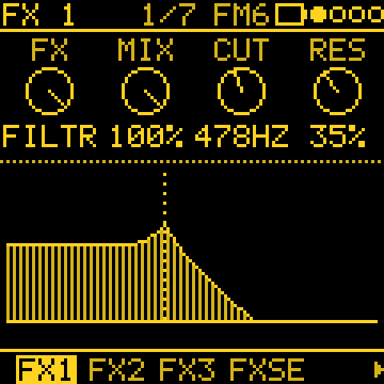

**ORACLE.** Oscillator A (saw, pulse) and B (saw, triangle, pulse) and noise go through a resonant four-pole
low-pass filter and the amp, each with its own envelope. **POLY MOD** lets the filter envelope and oscillator B bend
A's pitch, A's pulse width or the cutoff, note by note: B at audio rate into A's pitch gives bells and metal, the
filter envelope into A's pitch a sweep on each note. Its pages, on **EDIT**:

| Page | KNOB 1 to 4 |
|---|---|
| **MACRO**, **MACRO 2** | CUT, RES, TUNE A, TUNE B; PW A, PW B, LVL A, LVL B: offsets on the sound, the ones the HOME knobs, cords and motion move |
| **OSC A** | FREQ A (semitones), WAVE A (SAW, PLS, S+P), PW A, SYNC (A restarts with B) |
| **OSC B** | FREQ B, FINE B (a little sharp, for beating), WAVE B (SAW, TRI, PLS and their mixes), PW B |
| **OSC MIX** | the levels of OSC A, OSC B and NOISE; B MODE: KEY (follows the notes), FIXED, LO KEY / LO FIX (B as a slow LFO for POLY MOD) |
| **FILTER** | CUTOFF, RES, ENV AMT (how far FILT ENV opens it), KEY (OFF, HALF, FULL: brighter as notes go up) |
| **POLY MOD** | FENV and OSC B (how much each moves), TO (FREQ, PW, FILT or a mix), VEL (what playing harder opens) |
| **CHARACTER** | MODEL (EARLY or LATE filter: each colours the resonance its own way), VINTAGE (each voice drifts a little), GLIDE |
| **FILT ENV**, **AMP ENV** | ATK, DEC, SUS, REL |
| **LFO MOD** | RATE, AMOUNT, WAVE (SAW, TRI, SQR and mixes), NOISE (random movement mixed in) |
| **LFO ROUTE** | PITCH (A, B, A+B: vibrato), PW, FILT |

As on FM6, **ENV** goes to FILT ENV and AMP ENV (ORACLE has no use for the track's ENV), and **LFO** to MODS and the
track's LFO pages, then LFO MOD and LFO ROUTE. The sound lives in the project, a patch per track: a turned knob is
saved with it, and SAVE > SOUND keeps one you like in a USER slot, as on the other engines. ORACLE takes more of the FM-1 than an FM6 voice (about
one and a half times): one ORACLE track of pads or chords is fine; with two busy ones, keep BUDGET in mind (below).

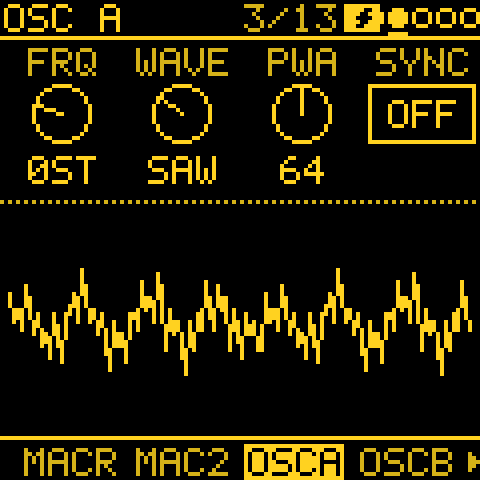 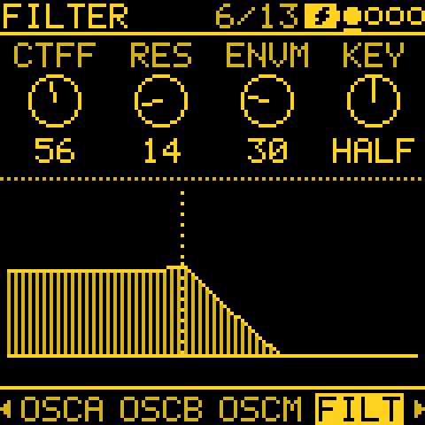 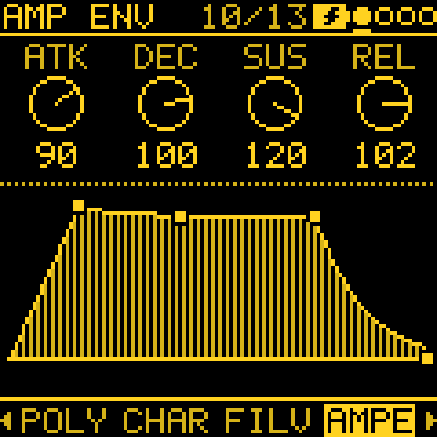

**PRESETS** (SAVE) browses the sounds. Its LIST knob picks ALL, the favourites, RECENT or a category, and it starts
on ALL at power-on. The PRESETS knob browses the same list on HOME and on PRESETS; on any other page, hold GLO and
turn it.

### How many voices at once

All the tracks share one pool of voices, set by **GLO > GLOBAL > BUDGET** (16 by default). A note that rings on in
its release still holds a voice, so a busy generator on a sound with a long release can keep most of the pool
ringing on its own: TINE EP under MARKOV at 100 % density and 1/16 holds about 15. When the pool is full, a new note
takes the oldest released voice; when the FM-1 has more six-operator voices to work out than it has time for, you
hear a faint crackle.

One busy FM6 track like that is fine; two or more of them at full density is past the FM-1's limit. To keep it
clean:

- thin one of them (DENSITY, DROP, or a slower DIV);
- give one a shorter note (LENGTH) or a sound with a shorter release, such as a TRIO voice or DRUM;
- lower **BUDGET** (12, say): fewer voices ring at once, which leaves the FM-1 headroom; higher allows more, and
  crackles sooner.

---

## SEQ: the MODE and its pages

> **In short:** GEN's MODE decides what a track plays: your own steps, an arpeggio, or a generator that writes the
> notes. SEQ (what plays) and ARP (how it is shaped) then only show the pages that matter for that choice.

Tap **SEQ** for **GEN**, where **KNOB 1, MODE** picks what the selected track plays:

- **STEP**: the step sequencer.
- **ARP**: the arpeggiator over the keys held.
- One of thirteen generators, in the knob's order: **CHORD** first, then **TURING**, **EUCLID**, **MARKOV**,
  **MORPH**, **ATLAS**, **BOUNCE**, **AWAKE**, **POLY**, **QUAD**, **CONSTL** (Constellation), **SERIES** and
  **ANSWER**.

Two buttons share the track's pages, and each shows only what its MODE uses. **SEQ** holds what the track plays;
the **ARP** button holds how its notes are shaped. SELECT turns the pages of the one you are on.

| MODE | SEQ: what plays | ARP: how it is shaped |
|---|---|---|
| **STEP** | GEN, NOTES (a DRUM track: NOTES, DRUM HIT), TEMPO, PATTERNS, SONG | EVOLVE (STEP EVOLVE), TWEAK (its HUMAN), TIMING (its SHAPE and HUMAN) |
| **ARP** | GEN, NOTES, ARP (MODE, RATE, OCT, GATE), TEMPO, PATTERNS, SONG | ARP 2 (SWING, PROB, HOLD, ORDER), TWEAK (SHIFT and HUMAN) |
| a generator | GEN, PATTERN, TEMPO, PATTERNS, SONG | EVOLVE, FORM, TWEAK, TWEAK 2, LENGTH, TIMING, ENERGY |

ARP's **MODE** is the order the held notes play in, over OCT octaves:

| MODE | Plays C E G as |
|---|---|
| **UP** | C E G, C E G (low to high) |
| **DN** | G E C, G E C (high to low) |
| **UPDN** | C E G E, C E G E (up, then down; the top and bottom notes once) |
| **DNUP** | G E C E, G E C E (down, then up; the top and bottom notes once) |
| **RND** | a new random note each step |
| **RND1** | one random order, such as E C G, then the same again; a new one when the held notes change (or OCT or ORDER) |
| **ORD** | in the order the keys were pressed (or the notes came in over MIDI) |
| **REPEAT** | the last note pressed, again and again |

ARP 2's **ORDER** (NOTE or PLAY) decides what UP, DN, UPDN, DNUP and RND1 start from: the notes low to high, or as
pressed. ORD always plays them as pressed.

On an ARP track, TWEAK's **SHIFT** moves the arpeggio by semitones and **HUMAN** makes its notes a little softer or
louder and shorter, as on a generator. The arpeggio's tosses (RND's notes, RND1's order, PROB) come from the track's SEED, so PLAY
plays it the same again.

**MOTION**, the knob moves recorded on the pattern (see [Recording live](#recording-live)), shows once a track has
some. DRUM HIT, a DRUM track's grid of hits, comes right after NOTES. With STEP or ARP, GEN is also the pattern's page: KNOB 2 to 4 are
LENGTH, DIVISION and GATE, and the track's SWING is a row of the pattern's sheet (OCT+ held). A generator track has
these on PATTERN instead. The generators run at the track's DIV and play in the track's scale (SCL). Choosing STEP or a
generator turns the arpeggiator off; choosing ARP again brings back its last setting.

A generator picked while the others play **joins in time**: it starts where it would be had it
played since PLAY, on the same steps and bars, so an ATLAS groove picked under a playing chord lands on the beat.
A muted track plays on unheard, so unmuted it comes back in time.
BOUNCE, QUAD, CONSTELLATION and SERIES run free and simply carry on.

On NOTES, **KNOB 2** sets the picked note's pitch. With **QNT OFF** it moves a semitone a detent. With QNT on
(SNAP, WHITE, ALL, MPC) it moves a note of the scale a detent; a note off the scale goes to the next scale note in
the turn's direction first. With **QNT CHRD** and a CHORD track playing it moves through that chord's notes. Hold
**ENV** while turning for a semitone at a time. A microtonal scale moves a degree a detent, as before. With
**MENU > NOTE PREVIEW** on (the default), you hear the new pitch at the note's velocity, for about a sixth of a second, on that track
and on MIDI OUT as a key's note would (KEYS, ALL); nothing is recorded. It sounds while playing too, but not while
recording.

A note's bar stands for its pitch over the C below the page's lowest note. The scale is one, two or three octaves
tall, as the page's notes need; anything above three octaves shares the top of the area, so one note raised high
leaves the others readable. A page with only one pitch shows where it sits in the whole range.

QNT works on notes as they come in, so notes written with QNT OFF or before SCL changed stay where they are. To bring
them onto the scale, use **Snap to scale** in the pattern's sheet (below).

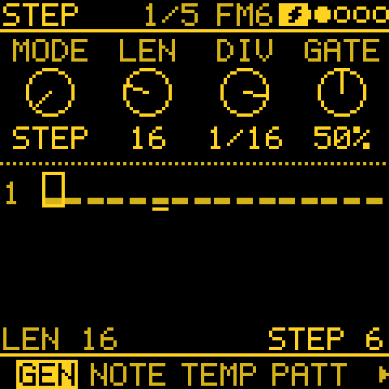

### Recording live

> **In short:** play the keys and Tessera records them into the pattern, pass after pass, so you can build a part up
> layer by layer.

Tap **REC** to arm the selected track. With the sequencer playing, it waits for the pattern's start (**WAIT FOR
LOOP**), then records what you play on the keys (or MIDI IN) over every pass, each pass on top of the last, until
you tap **REC** again. Stopped, the first key you play starts the sequencer and the take at once; **REC** +
**PLAY** starts both together. QNT (TEMPO) snaps the take when it ends.

- **EDIT** + **REC** on NOTES (either first): **CLEAR PATTERN?** OCT+ clears it and REC stays on, so the next
  pass records a new take. With REC off, EDIT held undoes the clear.
- **EDIT** held while recording on NOTES erases as the steps pass.
- **EDIT** tapped on NOTES (not recording) deletes the note at the cursor with its ties, then the cursor moves on the
  way **KNOB 1** last turned it: right as before, or left if you came from the right, so tap after tap clears a run either
  way. On a DRUM track grid, the same for the step.
- **OCT-** / **OCT+** on NOTES with REC on move the keys an octave down / up, as on HOME (both together: back to
  the middle). The header shows it (**KEYS OCT +1**). OCT+ held still opens the pattern's sheet.

### The pattern's sheet: Snap to scale, Double, Half, Euclid, Accumulate

> **In short:** quick tools for a whole pattern. This lets you fix wrong notes after a scale change, double a loop to
> add a variation, or drop in an even rhythm in one press.

Hold **OCT+** on GEN (STEP, ARP), NOTES, PATTERN or the drum grid for the pattern's sheet. Besides Quantize,
Swing (the track's, KNOB 2), Clear pattern and Clear motion it has:

- **Snap to scale**: OCT+ moves every written note of the pattern onto the track's scale and ROOT, once. That means
  every note of a chord, recorded notes, and steps hidden past LEN. Each note goes to the nearest note of the scale;
  halfway between two, it goes down. Two notes of a chord that land on the same note become one. With **QNT CHRD** and
  a CHORD track playing, notes go to the nearest note of the chord playing now. The header says how many moved
  (**SNAPPED 7**), or **ALL IN SCALE**. It works at any QNT, OFF included. On a microtonal scale or your own tuning
  with QNT on, every note already is a degree of the scale, so nothing moves. With QNT OFF such a scale's notes play
  as semitones and go to the nearest semitone close to the scale. A kit or slices has no such row.
- **Double**: the pattern twice as long (up to 64 steps). Its steps, recorded notes and motion are copied after
  themselves; a playing pattern carries on into the copy.
- **Half**: LEN halved (15 steps become 8). The steps past it stay, hidden, as when LEN is turned down.
- **Euclid**: KNOB 2 sets the hits ("5 of 16 BD"), and OCT+ spreads them over LEN as evenly as they go, the first
  on step 1. On the drum grid it writes the selected lane. On NOTES it writes one note row: the note at the
  cursor, else the pattern's first note, else ROOT. A step with a hit gets the note, and a step without one loses
  it. Other lanes and notes stay as they are. **Euclid turn** (KNOB 2) starts the hits that many steps later.
  It does not work on a pattern with recorded notes.

Each one is undone with **EDIT** held, one at a time.

**Direction** (KNOB 2, or OCT+ for the next) sets the order the pattern plays its steps in. Each of the track's 8
patterns keeps its own, saved with it:

- **FWD** (the default): step 1 to the last, as always.
- **BACK**: the last step to step 1.
- **PEND**: there and back, the end steps once (1 2 3 4 3 2 1 2 ..).
- **PONG**: there and back, the end steps twice (1 2 3 4 4 3 2 1 1 2 ..).
- **RAND**: any step, each time.
- **DRUNK**: one step on or one back, at random; past the ends it goes round.

A pass is still LEN steps of time, whatever the direction. So step Conditions (1:2 ..), Accumulate, pattern
changes, the SONG and STEP EVOLVE's rounds stay on the bar line, in time with the other tracks; a PEND of 16 steps
goes on into the next pass. SWING swings the off-beats, whichever step is on them. RAND and DRUNK draw from the
track's SEED, so PLAY plays the same line again. Changing the direction while it plays never moves the playhead: the
next step comes from the one playing, the new way. A new pattern starts at its own direction's start (BACK: its last
step). Capture and print write the notes in the order they sounded and set the pattern to FWD. A generator track
does not use it.

Two rows set the track's pitch accumulator (a step's Accumulate, below):

- **Accum limit** (1–14, 7): how far a step's notes go, in scale degrees from the notes as written. 7 is an octave
  of a 7-note scale.
- **Accum mode**: what they do there. **Wrap** goes back to the notes as written and climbs again, **Ping** turns
  round and comes back, **Clamp** stays at the limit.

### PATTERNS and SONG

> **In short:** each track has 8 patterns, like 8 pages of its own steps. PATTERNS picks the one each track plays.
> SONG lines up sets of patterns, one per track, into a song.

**What a pattern holds.** A track's 64 steps with everything on them (notes, drum hits, each step's length, velocity,
chance, ratchet, nudge, accumulate and condition), its recorded notes and knob motion, and its LEN, DIV, SWING and
GATE. Each of the four tracks has 8, so a project has 32.

What a pattern changes depends on the track's MODE:

| MODE | A pattern is |
|---|---|
| **STEP** | The whole part. Another pattern plays other notes. |
| **ARP** | Its LEN, DIV, GATE and its notes. The ARP and ARP 2 settings belong to the track. |
| a generator | Only LEN, DIV, GATE, and the steps the generator can take as its seed (SOURCE, see [STEP as seed](#turing-euclid-markov-and-morph-source-keep-gravity-step-as-seed)). |

The generator itself, its MODE, its knobs, EVOLVE, FORM, TWEAK and the rest, belongs to the track, not to a pattern,
unless **PAT GEN** is ON (EVOLVE page, hold **OCT-**, KNOB 3). With PAT GEN ON each pattern keeps its own MODE, the
generator's knobs, SEED and EVOLVE's EVERY, AMOUNT and LOCK, so switching pattern (by hand, PATTERNS or SONG)
switches the generator too, and it starts again from that pattern's SEED. A pattern can be STEP while another is a
generator. Turning PAT GEN ON gives all 8 patterns the settings as they are; edit a pattern's generator while it
plays. COPY copies it with the steps. FORM, TWEAK, TWEAK 2, NOTE LENGTH, TIMING and the rest stay the track's.
Firmware before 3.5 loads such a project with every pattern playing the generator of the pattern that was playing
when it was saved. To change a generator over a piece without PAT GEN, use [FORM](#form) and
[CHAIN](#chain-one-form-for-the-project) sections, [cords](#mods-the-modulation-cords), or separate projects.

**PATTERNS.** Hold **SEQ** (or turn to its page). A row per track, a cell per pattern, 1 to 8:

| On the screen | Means |
|---|---|
| Filled in the track's colour | The pattern playing. The bar at its foot shows how far through it is. |
| Dashed | Queued: it plays next. |
| Grey, three bars | Has notes. The bars show how many fall in its first, middle and last third. |
| An outline | Empty. |
| Letters at the foot | The song's sections; the one playing (or picked on SONG) is lit. With no song: **JAM** and the rows it logged (below). |

| Do this | And this happens |
|---|---|
| **KNOB 1** to **KNOB 4** | Track 1 to 4's next pattern. Stopped: it changes at once. Playing: it waits (dashed) and changes when the pattern playing reaches its end. While a song plays it does not change: **STOP TO SWITCH**. |
| **OCT-** | Clears the queue. Again: HOME. |
| **OCT+** | The selected track's pattern's sheet: **Copy to** and **Delete pattern** (its notes and motion). |

Copy to frames a place on the track's row, the first empty one first. Any knob moves it, **OCT+** copies (over a
pattern in use it asks first), **OCT-** leaves. It works only while no song plays.

With **SEQ** held, the white keys F3 to F4 pick the selected track's pattern 1 to 8, and SELECT the next or previous
one.

**SONG.** A song is up to 16 sections. Each section is one pattern per track and how many times it plays (1 to 16).
A repeat is one pass of track 1's pattern, so make track 1's pattern the longest. Sections with the same four
patterns share a letter: A, B, A, C.

The screen shows the sections as columns and the tracks as rows, each pattern a block in the track's colour. At the
top, the song's length at the tempo; at the foot, its sections and bars.

| Do this | And this happens |
|---|---|
| **KNOB 1** | The section. The **+** after the last adds one. |
| **KNOB 2** | The track. |
| **KNOB 3** | That track's pattern in the section. On **+** it adds the section, starting from the one before. |
| **KNOB 4** | The section's repeats. |
| **PLAY** or **OCT+** | Plays the song from its first section. It stops after the last one. |
| **OCT+** held | The song's sheet: Insert section, Duplicate section, Delete section, Take jam, Clear song. |
| **REC** held | Take jam (below). |

The song is edited only while it is stopped (**STOP TO EDIT**). While it plays, PATTERNS cannot switch patterns.
**STOP** brings back the patterns that were selected before the song started.

**The jam.** Playing without a song, Tessera logs the patterns you play: each time track 1's pattern starts, the
four patterns playing are a row (the same as the last row: one more repeat). SONG's header says **capturing jam**. **REC** held on SONG makes those rows the song (**SONG FROM JAM**); over a song it asks first. The
log starts again at each PLAY.

SONG is not linked to [CHAIN](#chain-one-form-for-the-project): SONG counts pattern repeats, CHAIN counts bars. See
[The long-form layers together](#the-long-form-layers-together).

---

## The generators

> **In short:** a generator writes the notes for you, in your scale, at the track's speed. Each one has its own
> character; see [Which generator for what](#which-generator-for-what) for a quick guide.

Each generator's three settings are on GEN, KNOB 2 to 4, and the panel under them shows what it plays. Every
generator is also a mod source: its **GATE**, its **NOTE** and a **CV** (see [MODS](#mods-the-modulation-cords)).

| MODE | KNOB 2 | KNOB 3 | KNOB 4 | What it plays |
|---|---|---|---|---|
| **TURING** | LENGTH (2–16) | PROB (0–100 %) | SPAN (1–3 oct) | A looping shift register, as a Turing Machine. PROB is the chance a step changes as it comes round: 0 locks the loop (the knob reads Lock), 100 is new every pass. |
| **EUCLID** | STEPS (1–32) | PULSE | ROT | Hits spread as evenly as they go over STEPS, turned round by ROT, on pitches picked by the seed. |
| **MARKOV** | LEAP (0–100 %) | DENS (5–100 %) | SPAN (1–3 oct) | A random walk over eight scale degrees. LEAP 0 moves to neighbours, 100 leaps widely. DENS is the chance a step plays. |
| **MORPH** | POS (0–127) | SNP A (1–8) | SNP B (1–8) | A rhythm blended from preset A into preset B. POS starts halfway. |
| **ATLAS** | X (0–255) | Y (0–255) | DENS (0–100 %) | Inspired by Émilie Gillet's Grids (Mutable Instruments): its drum map, kick, snare, closed hat and a fourth part from the point X, Y. Best on a DRUM track. The first time a track turns to ATLAS after power-on or a new song, X and Y start at a random point and DENS at 30 to 50 %, for a fresh groove; a loaded project keeps its own. More on the [OCT+ layer](#atlas-kick-snr-hat-toms). |
| **BOUNCE** | SPEED (1–64) | ANGLE (0–90°) | BALLS (1–4, Fall) | Balls in a box: a note where a ball hits a wall. Each extra ball starts from its own place and angle; balls that hit on the same step play together, three notes at most. Past 4, **FALL** (after ambalek's norns script Fall): eight leaves fall at their own speeds and play where they land (left low, right high), and ANGLE becomes **WIND**: calm in the middle, leaning the melody low or high either side, gusting further out. |
| **AWAKE** | LEN A (1–16) | LEN B (1–16) | PROB (0–100 %) | Two loops, as norns' Awake. A is the melody (scale degrees or rests), B lifts it up the scale; different lengths shift B against A. Steps can be set from the keys (below). |
| **POLY** | RHY (1–4) | DIVISION (OFF, /1–/16) | SPAN (1–3 oct) | Four notes stepped on by four rhythms. RHY picks which rhythm DIVISION edits. Rhythms that land together play once, louder: /4 against /3 is a polyrhythm. |
| **QUAD** | DIR | PROB (0–100 %) | LINK | A 4 x 4 grid of notes the four tracks share, a row each, inspired by the norns script initenere. Each QUAD track plays its row on its own DIV, so the polyrhythm comes from the tracks' speeds. DIR: FWD, BACK, PEND, RAND or HOLD. LINK: the other QUAD tracks this one's steps also move on (HOLD tracks then play only when pulled). More on the [OCT+ layer](#quad-columns-and-range). |
| **CONSTL** | Y (0–14) | DENS (0–100 %) | SPEED | After timothy-taylor's norns script Constellation: a ship flies through a sky of stars; the stars that cross its crosshair play. Y is the crosshair's height (where the melody sits), DENS how many stars, SPEED how fast the sky passes (the straight note values, slow to fast). More on the [OCT+ layer](#constellation-lock-len-fill-size). |
| **SERIES** | START (0–127) | INTV (1–7) | LOOP (OFF, 1–16) | Per Nørgård's infinity series (after the norns script nørgård): a melody alike at every scale. START picks where it begins, INTV how many scale degrees a step of the series is, LOOP repeats that many steps (OFF never repeats). |
| **CHORD** | PROG | BARS (½, 1, 2, 4) | HIT | A progression's chords in the track's scale: POP (I V vi IV), 50S, 2-5-1, CIRCLE, TWO, DRONE, WALK (four chords from the seed) or USER (your own). HIT: HOLD (once, held), BEAT, STEP or OFFBEAT (short stabs on the "and" between the beats, a reggae skank). See [Harmony](#harmony-one-key-chord-and-qnt-chrd). |
| **ANSWER** | VARY (0–100 %) | ECHO (0–100 %) | FADE (1–16, LOOPS) | After Zen-1's call and response (the idea only): play a phrase on the track's keys (or MIDI IN), up to 8 notes, and a bar without a key ends it. ANSWER plays it back, after a rest, as answers that change a little more each time (VARY: a note moved a degree or two, an octave, left out or swapped), each softer than the last. ECHO repeats some notes once more at half the velocity. FADE is how many answers it gives, 1 to 16, before it rests until you play again; turned on past 16 (LOOPS SHORT, MID or LONG, the loops' lengths) it never forgets and plays on as four loops of different lengths. Its OCT+ layer: SOURCE (below), ORDER (PLAYED, REVERSE, SHUFFLE), SHIFT (each answer moved up to this many scale degrees) and SPACE (the rest before an answer, up to 4 bars). **SOURCE** (OFF, T1 to T4) makes a STEP pattern the call instead of the keys: that track's pattern playing now (this track's own too), its first 8 notes at their steps, read again before each answer, so a sequence you record in STEP gets answered, and answered anew when you change it. The keys then just play. The other way round, REC held prints ANSWER's answers into STEP (see [Print and keep](#print-and-keep)). |

<table>
<tr>
<td align="center" width="25%">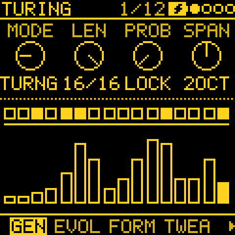 <b>TURING</b></td>
<td align="center" width="25%">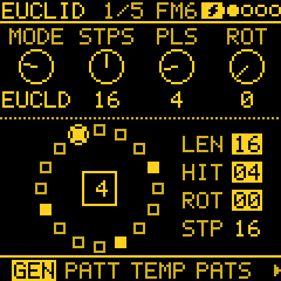 <b>EUCLID</b></td>
<td align="center" width="25%">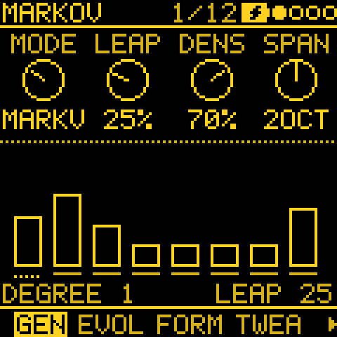 <b>MARKOV</b></td>
<td align="center" width="25%">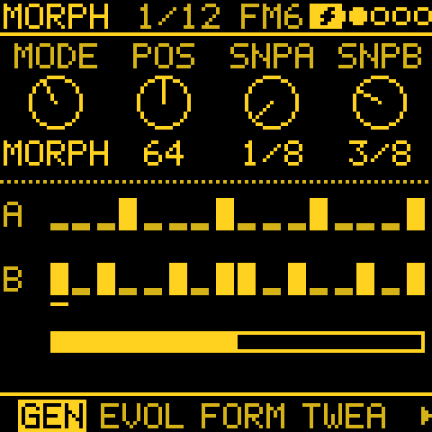 <b>MORPH</b></td>
</tr>
<tr>
<td align="center">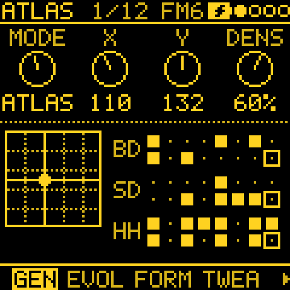 <b>ATLAS</b></td>
<td align="center">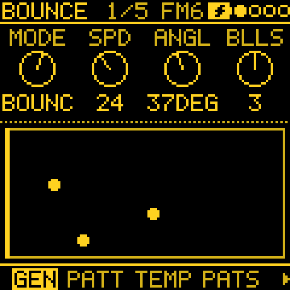 <b>BOUNCE</b></td>
<td align="center">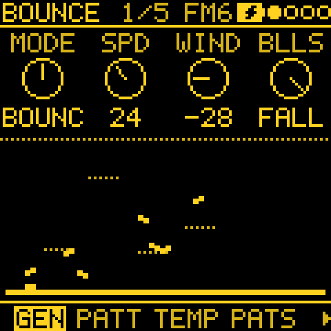 <b>FALL</b></td>
<td align="center">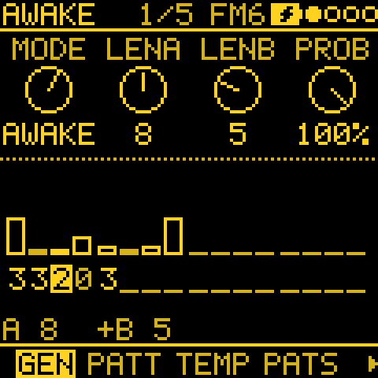 <b>AWAKE</b></td>
</tr>
<tr>
<td align="center">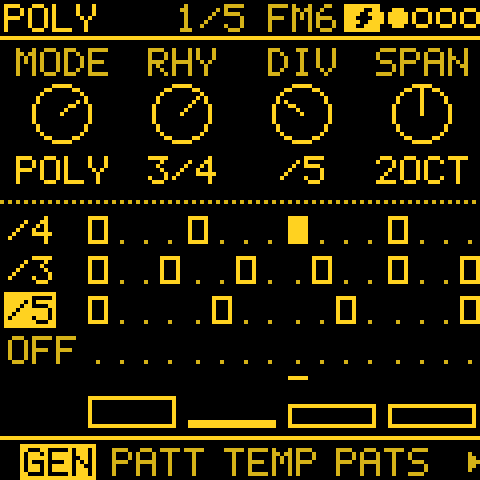 <b>POLY</b></td>
<td align="center">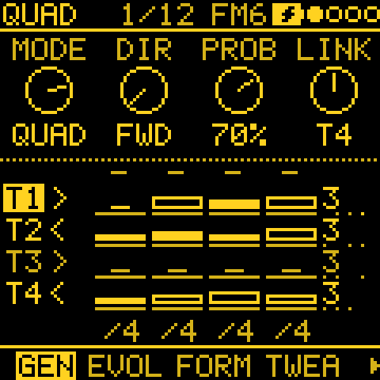 <b>QUAD</b></td>
<td align="center">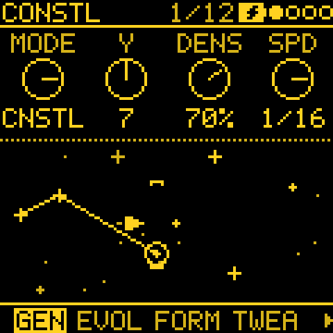 <b>CONSTL</b></td>
<td align="center">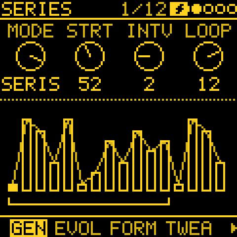 <b>SERIES</b></td>
</tr>
<tr>
<td align="center">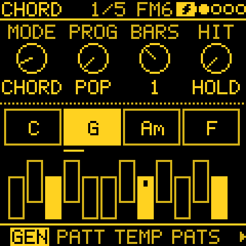 <b>CHORD</b></td>
<td align="center">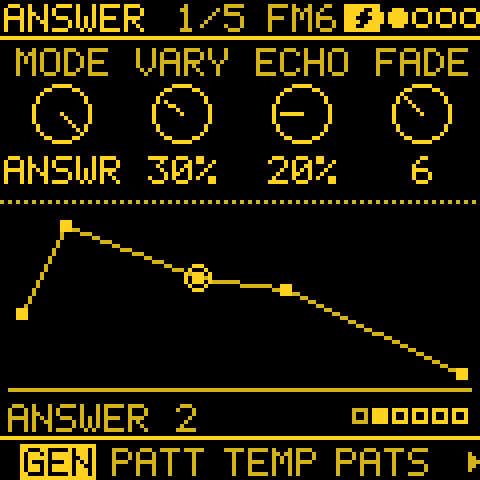 <b>ANSWER</b></td>
<td></td><td></td>
</tr>
</table>

**AWAKE step entry.** On GEN with an AWAKE track the keys are its steps and play no sound. A white key picks a
step: KNOB 1 sets its A value, KNOB 2 its B. Press the same key again, or leave the page, to go back to the usual
knobs.

**Seeds.** Every generator's random choices come from the track's seed (EVOLVE's ROLL). A seed sets the starting
material too: Turing's register, Euclid's pitches, Markov's first state, Awake's loops, Poly's notes, Quad's cells,
the sky. A track gets a random seed the first time a generator is picked, so each power-on starts somewhere new; a
saved project keeps its seeds.

---

## The GEN layer

> **In short:** holding OCT- on GEN gives a generator a second set of knobs: KNOB 1 RANDOM, KNOB 2 to 4 its finer
> settings. This lets you shape the details without crowding the main page. A setting past those, where a generator
> has one, is on the GEN sheet (hold OCT+).

Hold **OCT-** on GEN: the knobs' labels change to the layer's, KNOB 1 is **RANDOM** as on every generator (see
[Shortcuts](#shortcuts)) and KNOB 2 to 4 set the layer. Let go to return; letting go never goes back a page. A
generator with more settings than that has them on the **GEN sheet**: hold **OCT+** (or tap it) on GEN, pick the row
with KNOB 1 and turn its value with KNOB 2. (Until 3.5's betas these layers were on OCT+ held, KNOB 1 to 4.)

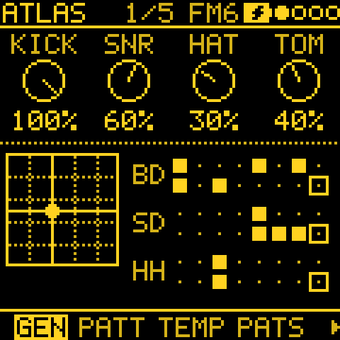 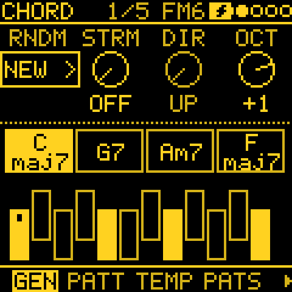 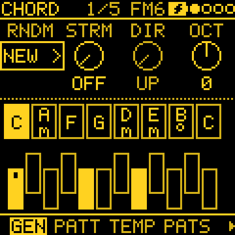

### ATLAS: KICK, SNR, HAT; the fourth part

| Knob (OCT- held) | Setting | What it does |
|---|---|---|
| 2 | **KICK** (0–100 %) | How much of DENS the kick gets: 0 silences it. |
| 3 | **SNR** | The same for the snare. |
| 4 | **HAT** | The same for the closed hat. |
| GEN sheet | **Fourth part** (0–100 %) | A fourth part, on the tom at first: the hits the kick and snare only just miss, so fills follow the groove. 0 (OFF) none. |

With OCT- held, a **black key** picks the fourth part's sound, as on the drum grid: TOM, CLAP, OPEN HAT, RIM or
BELL. The parts are also mod destinations: AT KICK, AT SNR, AT HAT, AT TOMS.

### CHORD: STRUM, DIR, OCT; CHRD, VOIC, BREATH (or LEN)

Hold **OCT-** on GEN with a CHORD track: KNOB 1 is RANDOM, KNOB 2 and 3 set how the chord is struck, KNOB 4 its
register. The chord's kind and voicing are on the GEN sheet (and on SCL > CHORD).

| Knob (OCT- held) | Setting | What it does |
|---|---|---|
| 2 | **STRUM** (OFF, 5 to 60 ms, 5 ms a detent) | The time between one note of the chord and the next, as a strummed chord. A four-note chord at 40 ms spreads over 120 ms. OFF strikes them together, as before. |
| 3 | **DIR** | **UP**: the lowest note first. **DOWN**: the highest first. **ALT**: up, down, up and so on, a strike each, like strumming (from PLAY, so a piece replays the same). |
| 4 | **OCT** (−2 to +2) | The chords' register from their home around C3. |
| GEN sheet | **Chord** | SCL > CHORD's chord kind: OFF plays triads; DIA3 and DIA7 triads and sevenths in the scale; MAJ, MIN, DOM7, MAJ7, MIN7, SUS4, POW, SUS2, 7SUS4, ADD9, MAJ6 (fixed shapes on any note). |
| GEN sheet | **Voicing** | CLOSE, OPEN, INV1, INV2 or +OCT. |
| GEN sheet | **Breath** (0–100 %) | With HIT HOLD the chord breathes: each voice is struck again, softer, on a slow cycle of its own (11 to 19 s), and the same chord again is tied over. BREATH is the chance a voice above the lowest sits a cycle out; 0 (OFF) is off. |
| GEN sheet | **Length** (USER only, in Breath's place) | How many of USER's chords play, 1 to 8. |

**USER progressions.** Set PROG to USER, hold OCT- on GEN and play the roots on the keys, one key a chord (the keys
are silent while OCT- is held; notes outside the scale round down to it). Letting OCT- go ends the entry, and the
number of chords played sets Length.

- The strum fits in half the chord's length: a short BEAT, STEP or OFFBEAT stab strums tighter and keeps every
  note. HOLD strums once for each chord; the other HITs every strike. All the notes end together.
- **HUMAN** time moves the strike late as before; the strum starts from there. A **RATCH** strums its first hit;
  the repeats strike the chord together. BREATH's single voices are not strummed.
- **MIDI OUT** sends each note when it sounds, so the notes go out strummed too (also with SOUND OFF).
- Each note takes its voice when it starts. With fewer voices than notes the last ones steal, so DIR decides which
  note may take another's voice.
- STRUM and DIR are saved with the project; firmware before STRUM plays the chords together.

### QUAD: columns and RANGE

The grid's columns can turn between the rows, so notes travel from track to track. With OCT- held:
KNOB 2 picks the column, KNOB 3 its **MOVE** (STOP, DOWN, UP or RAND), KNOB 4 its **EVERY** (/1 to /16 steps of
the first QUAD track). **Range** on the GEN sheet (3 OCT, 1 OCT, 2 OCT or ±1) sets the octaves the row's notes fold
into.

### CONSTELLATION: LOCK, LEN, FILL; SIZE

| Knob (OCT- held) | Setting | What it does |
|---|---|---|
| 2 | **LOCK** | The chance a step plays the loop of stars already caught instead of the sky: high LOCK repeats a phrase. |
| 3 | **LEN** (1–16) | The loop's length. |
| 4 | **FILL** | OFF: the steps between stars rest. ARP: the last four stars again, low to high and softer. |
| GEN sheet | **Size** (0–7) | How many rows either side of the crosshair a star still plays in. |

### ANSWER: SOURCE, ORDER, SHIFT; SPACE

With OCT- held, KNOB 2 is **SOURCE** (the call: the keys, or T1 to T4's pattern), KNOB 3 **ORDER** (PLAYED,
REVERSE or SHUFFLE) and KNOB 4 **SHIFT** (each answer moved by up to this many scale degrees). **Space** on the GEN
sheet is the rest before each answer.

**AUTO** steers the ship for you: OFF follows Y, 1 to 9 is a wander of its own (faster further up), SEEK flies to
the next star. It has no knob: set it with a mod to **C AUTO** (a cord with no source is a fixed value).

In the MOSAIC, SUNSET, OCEAN and NEON palettes the sky takes all four colours: each star the colour of its size, the
constellation and the crosshair colours of their own, the ship white.

### TURING, EUCLID, MARKOV and MORPH: SOURCE, KEEP, GRAVITY (STEP as seed)

> **In short:** write a short melody in STEP, then let a generator play and vary it. This lets you keep your own tune
> at the centre while it grows new versions of itself. KEEP says what must stay (the rhythm or the notes), GRAVITY how
> close to the original it stays.

**SOURCE** (OCT- held, KNOB 2) lets TURING, EUCLID, MARKOV or MORPH play from a STEP pattern you wrote. T1 to T4 is that
track's pattern playing now, and it can be this track's own. The pattern itself never changes. OFF, or a pattern
with no notes, plays the generator as usual.

- **TURING** loops the source's first LEN steps (up to 16). Each step, PROB is the chance that the step about to
  play changes and stays changed, as a Turing machine flips a bit. PROB 0 plays your melody as written; turn it up
  and the melody drifts. A new SOURCE or LEN, or PLAY, starts again from the pattern.
- **EUCLID** plays the source's notes in order on its own hits, so the melody gets a new rhythm.
- **MARKOV** learns from the source what follows what. Each step plays what came after the step it just played,
  somewhere in your pattern (when a note appears twice, either of its followers). LEAP is now the chance of a jump
  to any step of the pattern instead. With LEAP 0 a melody where every note is different plays as written; repeated
  notes and rests are where it branches off. DENS has no say: the rhythm comes from the pattern.
- **MORPH** plays **A**, your pattern as written (its first 16 steps), against **B**, a variation of it made at
  PLAY: about half of its steps changed the way TURING changes them. MORPH's position is B's share, and EVOLVE
  changes a few more of B's steps each time.

**KEEP** (KNOB 3) says what stays as written:

| KEEP | TURING, MORPH's B | EUCLID | MARKOV |
|---|---|---|---|
| **FREE** | a step's pitch or its hit may change | the source's notes on EUCLID's hits | notes and rests from the chain |
| **RHYTHM** | only the pitches change (to another of your notes, or any note of the scale over SPAN octaves up from your lowest) | the source's own rhythm, on EUCLID's pitches | the source's rhythm, the notes from the chain |
| **PITCH** | only the hits come and go | as FREE | the chain's rhythm, the notes in written order |

**GRAVITY** (KNOB 4) pulls it all back home: at GRAVITY %, a step plays the source exactly as written at its place.
TURING's changed step goes back to how you wrote it, MARKOV's chain carries on from there, EUCLID plays the
source's own hit or rest, and MORPH plays A. 0 is off; 100 plays your pattern as written whatever the rest says.
Drift with PROB, LEAP or MORPH, and let GRAVITY decide how far it may wander.

The notes keep their written pitch, then follow this track's scale, TRN and SHIFT. Print (REC held) keeps what it
played, as for any generator.

With a SOURCE, TURING's and MORPH's picture on GEN shows the loop as it plays now: a step as you wrote it is drawn plain,
a changed one with the written step drawn over it hollow (its ghost: an empty frame is a note dropped). MORPH shows B, its variation. **HOME** under it is how far the loop has wandered: empty when it plays
your pattern as written, full when every step has changed.

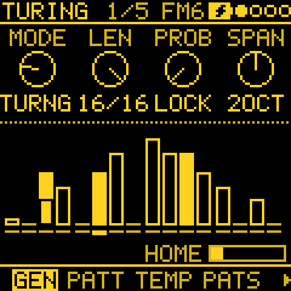

---

## EVOLVE

> **In short:** EVOLVE changes a generator's phrase every few bars, so a loop never wears out. ROLL picks a new line,
> and GRAVITY lets it wander and then come home.

On a generator track, EVOLVE mutates the phrase every few bars.

| Knob | Setting | What it does |
|---|---|---|
| 1 | **LOCK** (0–100 %) | How much of the phrase stays: 100 loops it, 0 is new every pass. Turing's LOCK is its PROB turned round, Atlas' its CHAOS turned round, Constellation's the chance of its loop. The other generators (Euclid, Bounce, Awake, Poly, Quad, Series, Chord, Answer) have none. |
| 2 | **EVERY** | Mutates every OFF, 1, 2, 4, 8 or 16 bars. OFF keeps the phrase. |
| 3 | **AMOUNT** (0–100 %) | How much changes each time. |
| 4 | **ROLL** (1–128) | The track's seed. While playing, a new seed starts on the track's next bar line (the number blinks until then). The screen says **NEW LINE** (**NEW LINE AT BAR** while playing), as the new seed also changes values on the generator's other pages. Hold **OCT-** and turn **KNOB 1** for **ROLL ALL**: right and every generator track gets a new seed at once; turn left to get the seeds from before it back (once). STEP tracks keep theirs. |

With LOCK up, Turing's loop is its LENGTH long; Markov's and Morph's loops are as long as PATTERN's **LEN**.

**GRAVITY** (OCT- held, KNOB 4; the same GRAVITY as the SOURCE layer's) lets the phrase drift and then come home.
Home is the generator as you last set it: a knob, ROLL, MODE or a loaded project. At GRAVITY %, a round of EVERY
moves the generator a step back toward home instead of changing it. Turing flips a changed bit back, Euclid's
rotation and pulses step back, Markov's LEAP, Atlas' X and Y, Bounce's angle and Morph's position move back. Awake,
Poly, Quad, Series and Chord put a changed value back, and Constellation lets no star go. 0 is off; at 100 it goes
home and stays there. With a SOURCE, GRAVITY plays the source instead (above), and with FORM on, the sections play
as they are.

### STEP EVOLVE

> **In short:** your written steps get small variations as they play (a note moved, an ornament, the phrase played
> backwards), but the steps themselves stay as you wrote them. Hold REC to keep a variation you like.

On a **STEP** track, EVOLVE varies the steps you wrote, as they play, without changing them.

| Knob | Setting | What it does |
|---|---|---|
| 1 | **LOCK** (0–100 %) | How much of the variation stays from round to round: 100 holds it, 0 is fresh each time. |
| 2 | **EVERY** | Bars between rounds of changes; OFF plays the steps as written. |
| 3 | **AMOUNT** (0–100 %) | How many steps change, up to half: a note moved by a degree or two or an octave, a step dropped, two notes swapped, a ghost note in a rest. |
| 4 | **CLEAR** | Shows how many steps are changed now; turn it to go back to the steps as written. |

Hold **REC** to keep the changes playing: they become the steps (KEPT n STEPS). EDIT held undoes it. Switching
pattern clears the changes.

**HOW** (OCT- held on EVOLVE, KNOB 4) says what kind of change a round makes. It is saved with the project.

| HOW | A round |
|---|---|
| **DRIFT** | As above: moves, octave jumps, drops, swaps, ghost notes. |
| **ADORN** | Ornaments that only add, never take away: a note ratchets (one more hit, up to x4), jumps an octave or turns to its neighbour a degree away; a rest after a note gets a soft passing note, a degree toward the next note. |
| **SERIAL** | The whole phrase at once, for the round: **backwards** (retrograde), **upside down** (inversion in the scale, about its first note), **rotated** by a few steps, or **half of it at half speed** (augmentation). AMOUNT is the chance a round brings one, LOCK the chance it stays for the next. |

Changing HOW puts the steps back as written. REC held keeps any of them, SERIAL's whole phrase included.

The EVOLVE page's picture shows the steps across the phrase, by pitch, under the bars left until the next round. A
step playing as written is drawn plain; a changed one has the step as written drawn hollow where it was: a ratchet is split into its hits, a passing or ghost note sits in a rest, a dropped note leaves only the
hollow one. Under them: HOW, or SERIAL's transform this round (BACKWARDS, UPSIDE DOWN, ROTATE n, HALF SPEED), and
**HOME**, how far the steps are from as written (empty: all as written). On NOTES, a changed step's note as it
plays now is dashed, beside the note you wrote.

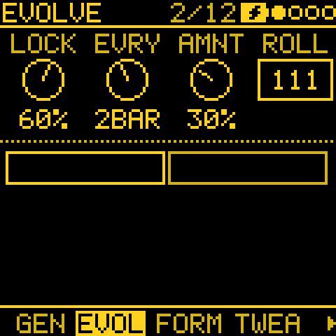 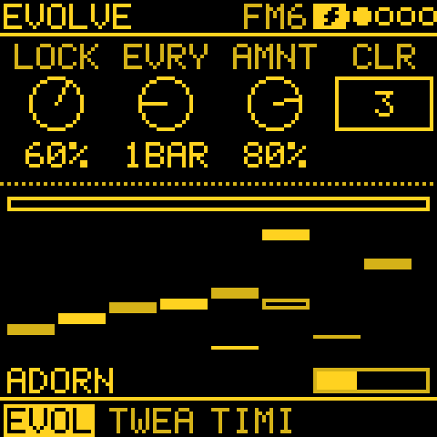

---

## FORM

> **In short:** FORM turns one track's phrase into a little song: A, then a contrasting B, back to A, and so on. This
> lets a single generator play with verses and choruses instead of one loop.

FORM strings mutated phrases into a short song form of sections A, B and C, each EVERY bars long.

| Knob | Setting | What it does |
|---|---|---|
| 1 | **FORM** | OFF, AB, ABAC, ABCB, AABA, ABCA or AABC. Turning it on with EVERY OFF sets EVERY to 4 bars. |
| 2 | **CONTR** (0–100 %) | Contrast: how far a new section moves from the one before. |
| 3 | **CLEAR** | Forgets B and C: the phrase playing becomes A. |
| 4 | **FLRSH** (−12 to +12) | Flourish: semitones added on the last beat of every phrase; 0 is off. |

B and C are made from the section before, by CONTR, the first time they are reached. Changing MODE or ROLL starts
the form again at A.

**DEVELOP** (OCT- held, KNOB 1, 0–100 %): how far a section varies each time the form comes back to it. At 0 (the
default) a section played again comes back exactly, as before. Above 0 each return is the section with one change of
that size, so it stays recognisable but is never quite the same; the section itself is kept, so the next return
starts from it again and the form never drifts away over hours. GRAVITY (OCT- held on EVOLVE) is the chance a return
stays exact. A knob turned while a section plays is kept in it, as without DEVELOP.

**CHAIN** (OCT- held, KNOB 2, FOLLOW or OWN) and **SKIP** (OCT- held, KNOB 3, 0–100 %): this track's part in the
project's [CHAIN](#chain-one-form-for-the-project). FOLLOW: its sections change with the CHAIN's letters. OWN: it keeps
its own FORM. Until you set it, a track follows when its own FORM is OFF and keeps its own when it has one. SKIP is the
chance the track stays in its section one phrase longer where the CHAIN moves on (then it catches up; never twice
running). Both are lit only while the CHAIN's FORM is on.

**ROLE** (OCT- held, KNOB 4): this track's part for [ENTRIES](#entries-tracks-out-and-back-in), the same setting as
on the ENTRIES page.

### PIECE: a length and a shape

> **In short:** tell Tessera how long the piece should be and its shape (an arch, waves, a slow rise), and it steers
> ENERGY, CHAIN and ENTRIES to follow it: an intro, a build, a peak and an ending, with nobody at the controls.

**GLO > PIECE** plans the whole piece: how long it lasts and the shape it takes, sparse to full and back. It adds no
system of its own; it steers ENERGY, [CHAIN](#chain-one-form-for-the-project) and
[ENTRIES](#entries-tracks-out-and-back-in) along the shape.

| Knob | Setting | What it does |
|---|---|---|
| 1 | **LENGTH** | FREE (the default: nothing planned, nothing changes), or 1 minute to 4 hours. |
| 2 | **SHAPE** | ARCH (up to PEAK, down to the end), RISE, FALL, PLATEAU (up, held round PEAK, down), VALLEY (full, thin round PEAK, full), WAVES (COUNT swells), BUILDS (COUNT rises, each dropped at once), STEPS (the arch in COUNT terraces), FLAT or USER. |
| 3 | **PEAK** (10–90 %) or **COUNT** (2–8) | PEAK: where ARCH, PLATEAU and VALLEY have their centre. COUNT: WAVES' swells, BUILDS' builds, STEPS' terraces. |
| 4 | **END** | What happens at the end, on a phrase line: STOP (the tracks fade out, the tails ring, then it stops), LOOP (the same piece again from the top), NEW (new SEEDs, a new piece) or FREE (it carries on unplanned until STOP). |

With **SHAPE** USER, hold **OCT-**: **KNOB 1** picks one of its eight points (drawn bigger on the shape) and
**KNOB 2** sets its level (0–100 %). The eight sit evenly along the piece, and the shape stays in view while you
draw it. The picture shows the shape, where the piece is while playing, and the time left.

The piece is counted in the time played since PLAY: a tempo change, a TEMPO mod or an external clock that drifts never
jumps it to another place in its shape, and it lasts its LENGTH whatever the tempo (a faster tempo plays more bars).
Every shape but RISE and FALL begins and ends sparse: an intro and an outro. While a LENGTH is set:

- ENERGY's tide is the shape (ARC is how far it swings; LEVEL as before). RESTS' rests grow shorter in the shape's
  upper half, and none comes at its top: the climax plays on.
- ENTRIES keeps out as many tracks as the shape is low, of the most ENTRIES allows, one change a phrase, so the piece
  layers in, thins and fills, and layers out at its end. At ENTRIES 0 no track moves.
- The CHAIN's new sections depart further near the top (up to +20 CONTR), and the last 15 % of the piece (12 phrases
  at most) stays on A, its home.
- In its last 5 % the generators' notes are drawn more and more to the key's root and fifth (up to half of them at the
  very end, a note at most two semitones away), so the piece resolves home.

The piece comes from the tracks' SEEDs, so PLAY plays it again the same.

### CHAIN: one form for the project

> **In short:** CHAIN makes all the tracks change section together, so the whole project moves from A to B at once,
> like a band going into the chorus.

**GLO > CHAIN** gives the whole project one FORM, so the tracks' sections line up: on each phrase line the CHAIN moves
to its next letter, and every generator track that FOLLOWs moves to its own A, B or C at the same moment (made by its
CONTR the first time, recalled after, varied by its DEVELOP). Phrases are counted in bars from PLAY, so a change always
lands on a downbeat, whatever each track's DIV.

| Knob | Setting | What it does |
|---|---|---|
| 1 | **FORM** | OFF, AB, ABAC, ABCB, AABA, ABCA or AABC. OFF (the default): every track as set, nothing changes. |
| 2 | **PHRASE** | 4, 8 or 16 bars a phrase. |
| 3 | **WANDER** (0–100 %) | 0 plays the FORM as written, round and round. Up, the next letter is more often chosen than read. |

Hold **OCT-** for each place's **REPEAT** (KNOB 1 to 4, 1 to 8 phrases): ABAC with A at 2 and C at 3 plays
A A B A C C C, then again. The picture shows the places as blocks as long as their repeats, the one playing filled with
its phrases along the foot, and the tracks that follow.

WANDER's choices keep a shape: A is home and comes back the longer the music is away; a letter not heard yet comes
only after a return to A; a letter plays twice running only if the FORM has it twice (AABA); a chosen letter plays its
first place's REPEAT. Each phrase further from A makes the next new section a little more different (up to +30 on its
CONTR). The choices come from the tracks' SEEDs, so PLAY plays the same piece again. While a track follows, its own
EVERY waits (the CHAIN's phrases are its sections) and FLOURISH plays on the CHAIN's last beat.

**A key for each section.** SCL's last rows, **Key in B** and **Key in C** (KEY B, KEY C: -12 to +12 semitones, 0 the default)
move the key while the CHAIN plays its B or C: +5 takes B a fourth up, +7 a fifth, -2 a
tone down. A is always the key as set. Every track that follows the CHAIN moves, its scale with it, on the phrase line;
melodic STEP tracks move too (unless set OWN), drum tracks and OWN tracks never; a SKIP holds the track's key with its
section. ROOT and TRN stay as set, so STOP is back in A's key. Saved with the project; older firmware plays every
section in A's key.

### ENTRIES: tracks out and back in

> **In short:** ENTRIES arranges the piece for you by taking tracks out and bringing them back in on phrase lines, in
> a musical order (the bass comes in first, the melody leaves first). You can still mute and unmute by hand.

**GLO > ENTRIES** lets tracks drop out and come back on the CHAIN's phrase lines, so a piece thins and fills over
time without a hand on the mutes. It works with the CHAIN's FORM on or OFF (OFF: phrases of the CHAIN's PHRASE, a
section every 4 phrases), and on every track, STEP tracks too.

| Knob | Setting | What it does |
|---|---|---|
| 1 | **ENTRIES** (0–100 %) | How many tracks may be out at once, up to all but one. 0 (the default, OFF): every track as set. |
| 2 | **DWELL** (1–8 phrases) | The least a track stays in or out before it moves again (default 2). |
| 3 | **STYLE** | CUT: in or out at once on the line. FADE (the default): its level fades over FADE bars from the line. |
| 4 | **FADE** (1–4 bars) | How long a FADE takes. |

Hold **OCT-** for each track's **ROLE** (KNOB 1 to 4; also OCT- held on FORM, KNOB 4): **BASS**, **RHYTHM**,
**HARMONY**, **MELODY** or **ANCHOR**. AUTO (the default) guesses: CHORD is harmony, ATLAS or a drum sound rhythm, a
track whose notes sit mostly below C3 bass, anything else melody. The picture shows each track's role (AUTO's guess
marked), whether it is IN, OUT or muted by hand, and its level.

The ENTRIES sheet (hold **OCT+**) has each track's **ORDER** (Order T1 to T4, KNOB 2): **AUTO** (the default) or **1ST**, **2ND**, **3RD**, **4TH**,
to choose the order tracks come in, for example the bass third instead of first. Numbered tracks come in first, one a
phrase, lowest number first; the AUTO tracks follow by ROLE as below. They leave the other way round: last in, first
out, so the AUTO tracks leave before the numbered ones and 1ST leaves last. Two tracks on one number take turns. An
ANCHOR still never leaves, and only an AUTO melody waits for a bass or harmony (a numbered one comes in when its turn
comes). With every track on AUTO, ENTRIES works exactly as before. While OCT- is held the picture shows each track's
ORDER in place of its role. ORDER is saved with the project; a project from before it loads as AUTO, and firmware
before 3.5 loads a project that uses it with every track on AUTO (the rest of the project as saved).

How it moves, in the ways music is usually built:

- Where a section begins (the CHAIN moves on), a new number of tracks to leave out is chosen, one more or one fewer;
  away from A mostly thinner, back on A fuller. Exits happen there, all at once, MELODY first, then HARMONY, RHYTHM
  and BASS last (with ORDER set: the highest number first).
- Entries come one a phrase the other way round, BASS first; a melody comes in only over a bass or harmony that is
  playing.
- With ENTRIES above 50, the phrase before a return to A (after two phrases away or more) drops to the anchors, and A
  comes back with everything. Without an ANCHOR, the track lowest in that order plays on alone.
- An **ANCHOR** is never taken out. At least one track always plays.
- Each change is decided a bar ahead: that track's mute key on GLO blinks quickly through the bar. A track with
  FLOURISH set comes in on its flourish, the bar's last beat.
- A track out plays no notes (none to MIDI OUT either), like a muted one.

Your hand wins. A track you mute stays muted and is left out of the rules. Its mute key on GLO brings a track Entries
took out straight back, and Entries leaves it alone until the next section. SOLO is heard whatever Entries says.
The choices come from the tracks' SEEDs, so PLAY plays the same piece again; STOP brings every track back.

### LANDSCAPE: rain on water

> **In short:** a screen to watch while the music plays; it never changes the sound.

**GLO > LANDSCAPE** is a page to look at while the music plays: a night lake, drawn by the music.
It has no settings and changes nothing; the knobs do nothing here.

- Each note a track plays is a drop on the water. **Pitch** sets where it lands, low notes at the left, high at the
  right. **T1** lands far out, **T4** close by. Louder notes open wider rings, with a second ring inside.
- **ENERGY**'s tide moves the clouds: more and lower as it fills, a thin wisp as it falls sparse. While playing, the
  clouds drift.
- **Stars** come out as the music thins and all of them once nothing has played for a few seconds. Then the water is
  still and the moon's reflection lies quiet.

The scene only listens while the page shows. In the MOSAIC palette each track's drops are in its own colour.

### PERF: four macros

> **In short:** four knobs for performing. Each macro can drive as many mods as you like, so one turn can open
> filters, add reverb and speed up the tempo together.

**GLO > PERF** (the page after MIXER) gives you four hand controls for the whole project: **KNOB 1 to 4** set
**MACRO 1 to 4**, 0 to 100 %. A macro does nothing by itself. In **MODS**, pick **MACRO 1 to 4** as a mod's source
(they are the project's, so they show without a track) and send it anywhere: a filter, a level, an FX send, TEMPO,
another mod's amount. One macro can drive as many mods as you like, so a single knob can open a filter, raise the
reverb and push the tempo together.

The page shows each macro as a bar and how many mods it drives. The macros are saved with the project. A project
with a mod from a macro loses that mod on older firmware.

---

## TWEAK

> **In short:** TWEAK moves a track's notes up or down, thins them out, loosens them like a human player, or makes the
> track follow another track's notes, for harmonies and bass lines that move with the melody.

| Knob | Setting | What it does |
|---|---|---|
| 1 | **SHIFT** (±24) | Transposes by semitones; while following, by scale steps from the followed note. |
| 2 | **DROP** (0–100 %) | The chance a hit is left out, whatever the generator. |
| 3 | **HUMAN** (0–100 %) | Varies each note's velocity and length a little, as a player would: at 100 up to 20 softer or louder and up to half as long, the same each time the piece plays. The timing is TIMING's **HUMAN**. |
| 4 | **FOLLOW** | OFF, or T1 to T4: plays that track's pitch, SHIFT away, in this track's scale. STEP tracks can be followed too. A muted track still leads the tracks that follow it. |

Hold **OCT-** and turn **KNOB 1** right for random SHIFT, DROP and HUMAN; turn it left to put them back (as on GEN).

**HOLD** (OCT- held, KNOB 4: OFF, or T1 to T4): a sample and hold for FOLLOW. The followed note is taken only when
the HOLD track plays a note, and this track keeps playing that note, in its own rhythm, until the HOLD track plays
again. So a bass can take a TURING line's note once a bar: FOLLOW the TURING track, and HOLD on a track that plays once
a bar (a STEP track, or a EUCLID with one pulse; set it to SOUND OFF with its channel OFF to keep it silent). HOLD on a
track with random hits (DROP, BRANCH) samples at random moments. OFF: a new note on each of this track's own hits, as
before. HOLD is saved with the project; older firmware loads the project without it.

**HOW** (OCT- held, KNOB 2) says what FOLLOW does with the other track's note. SHIFT still moves the result by scale
steps.

| HOW | What the following track plays |
|---|---|
| **SAME** | The other track's note (as before). |
| **CHORD** | The third, fifth or seventh of the chord built on that note in this track's scale, whichever lies nearest this track's last note: a harmony that moves smoothly instead of jumping. |
| **CONTRA** | Contrary motion: it goes down as many scale steps as the other track goes up, and the other way, mirrored around the first note it followed. |
| **BASS** | The note one octave down (two from middle C up), on beats 1 and 3 of the bar only. |
| **CANON1** to **CANON8** | The other track's note from that many notes ago: a round. It stays silent until the other track has played that many. HOLD does nothing here. |

**RHYTHM** (OCT- held, KNOB 3) says when it plays. **OWN**: on this track's own hits (as before). **SOURCE**: only
when the followed track has played a note, so the two move together; this track's own rhythm is left out. **BOTH**:
its own hits and the other track's. Follow a track with a lower number for the tightest timing: a lower track's note
is that step's, a higher one's lands a step later. With BASS, the beats 1 and 3 still decide.

SAME and OWN are the defaults: a track set to them plays exactly as before. HOW and RHYTHM are saved with the project;
older firmware (3.3 and before) loads it with SAME and OWN.

On an ATLAS track only DROP and HUMAN apply: SHIFT, FOLLOW and FLRSH would change which drum plays. On a STEP track
TWEAK holds HUMAN alone.

---

## TWEAK 2

> **In short:** TWEAK 2 makes tracks interact: hits can jump to another track's sound (call and response), combine
> with another track's rhythm (AND, OR, XOR), or play only in certain bars. This lets two simple parts become one
> interlocking groove.

TWEAK 2 decides which hits play, and where. Everything starts OFF.

| Knob | Setting | What it does |
|---|---|---|
| 1 | **BRANCH** (0–100 %) | The chance a hit plays on track TO's sound instead, so two tracks answer each other. The tosses replay with the seed. |
| 2 | **TO** | OFF, or a track and a mode: **COIN** tosses each hit, **TOGGLE** switches side on a toss won (100 % alternates), **LATCH** tosses once a bar. |
| 3 | **LOGIC** | OFF, AND, OR, XOR or NOT with another track's hits. A lower track's hit is read on this step, a higher one's on the step before. |
| 4 | **COND** | The bars a hit may play in, counted from PLAY (with FORM on, from the section's start): 1:2, 2:2, 1:4 to 4:4, 1:8, 8:8, FIRST or !FIRST. |

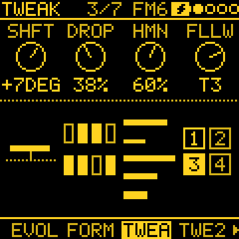 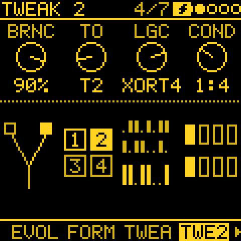

---

## LENGTH

> **In short:** LENGTH decides how long a generator's notes last. HIT lets every note ring until the next one, which
> turns sparse notes into pads.

How long a generator holds its notes.

| Knob | Setting | What it does |
|---|---|---|
| 1 | **LENGTH** | **STEP**: the step's GATE. **FIXED**: LEN, whatever the DIV. **HIT**: until the next hit, so rests let notes ring. ATLAS keeps STEP. |
| 2 | **LEN** | FIXED's length: 1/32 to 1/1 (a bar). |
| 3 | **KEYS** (1–4) | FIXED: how many notes may hold at once. |
| 4 | **GATE** | The track's step gate, as on PATTERN. |

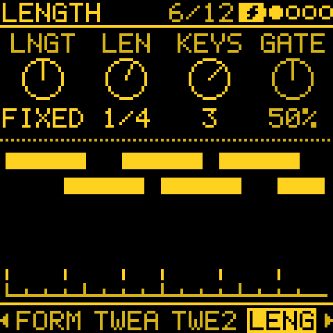

---

## TIMING

> **In short:** rolls and feel. Ratchets repeat a step quickly (a drum roll, a stutter); HUMAN plays steps a touch
> late, like a player sitting behind the beat; SPLIT (OCT- held) breaks some steps into the next finer division.

Ratchets: a step's notes played again within the step. And HUMAN: each step a little late.

| Knob | Setting | What it does |
|---|---|---|
| 1 | **RATCH** (x1–x8) | How many times a generator's step plays, in its own step: x1 once, as written, up to x8. |
| 2 | **CHANCE** (0–100 %) | How often a step ratchets: 100 every step, below that some play once. The tosses replay with the seed. |
| 3 | **SHAPE** | Where the hits fall: **EVEN** in equal parts, **ACCEL** closer and closer (a roll that speeds up), **DECEL** further and further apart (a bounce). |
| 4 | **HUMAN** (0–60 ms) | Plays each step a little late, as a player behind the beat: up to this many ms, a new amount each step, never early and never more than a quarter of the step. The same each time the piece plays. 0 keeps the grid. Also a cord destination (H TIME). |

On a STEP track TIMING holds SHAPE and HUMAN: each step has its own Ratchet (below). HUMAN adds to a step's Nudge;
an early Nudge stays as it is.

Projects saved before HUMAN had its own knob keep their feel: a generator track's TWEAK HUMAN becomes this HUMAN at a
fifth of it (TWEAK 100: 20 ms).

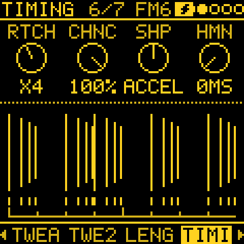

**SPLIT.** Hold **OCT-** on TIMING, on a generator or a STEP track, and the knobs set how often a step breaks out of the
grid: a 1/8 track now and then plays a pair of 1/16s, or a note pushed onto the off-1/16, as a player does.

| Knob (OCT- held) | Setting | What it does |
|---|---|---|
| 1 | **SPLIT** (0–100 %) | The chance a step plays at half its division: 1/4 to 1/8, 1/8 to 1/16, a triplet to its half. 0 is off, and the track plays exactly as without it. Also a cord destination (SPLIT), so an LFO, TIDE or ENERGY can bring it in and out. |
| 2 | **HOW** | **DOUBLE**: the note, then a second note halfway through the step. **PUSH**: the note plays halfway through the step instead of on its line; late only. **MIX**: each split tosses again for one or the other. |

- **DOUBLE's second note:** on a generator a scale degree up or down (tossed); the generator is not stepped again, so its
  phrase and loop stay as they are. On a STEP track a degree toward the next written note, as ADORN's passing note. A
  drum hit or ATLAS plays the same hit again.
- **Gates:** each half gets half of the step's gate, as with a RATCH x2 step, and so does a pushed note.
- **The tosses** have their own stream: SPLIT never changes which notes a generator picks. The same piece replays the same
  from PLAY; ROLL gives new tosses.
- **Left as written:** the bar's first step, so the downbeat stays on the grid, and the pattern's first step; a generator
  track with RATCH above x1 (even at its lower CHANCE), a STEP track's step with a Ratchet; an early Nudge (a late one adds
  to PUSH, as HUMAN does); a tie, a slide and the step slid into; timed notes; and everything while the track records.
  Notes that LENGTH holds (FIXED, HIT) can PUSH but not DOUBLE.

A project with SPLIT plays on firmware before 3.3 without it. A project with a cord onto SPLIT can't be read by that
firmware at all, as with every new cord destination.

### Rolls and feel: which one to use

> **In short:** RATCH and a step's Ratchet make rolls, SPLIT breaks steps into the finer division now and then, HUMAN and
> Nudge move steps a little late (or early), and SWING moves every other step. Use one for a clear job rather than all
> at once.

| Tool | Where | Tracks | What it does | Random? | Use it for |
|---|---|---|---|---|---|
| **RATCH**, CHANCE, SHAPE | TIMING, KNOB 1 to 3 | Generators | A step plays 2 to 8 times within itself, the same note; SHAPE spaces the hits evenly, faster or slower | CHANCE picks which steps (replays from PLAY) | Rolls, stutters, drum fills |
| A step's **Ratchet** | NOTES, the note's sheet | STEP | The same for one written step; TIMING's SHAPE places the hits | No, it is written | A roll on the step you choose |
| **ADORN** | EVOLVE on a STEP track | STEP | Each round adds a little: an extra hit, an octave jump, a neighbour note, a passing note in a rest | Yes, while EVOLVE runs | A written line that decorates itself |
| **SPLIT**, HOW | TIMING, OCT- held | Both | Some steps play at half their division: two notes (DOUBLE) or one note late (PUSH) | Yes (replays from PLAY) | Now and then breaking out of the grid |
| **HUMAN** (timing) | TIMING | Both | Each step up to 60 ms late, never more than a quarter of a step | Yes (replays from PLAY) | A relaxed, behind-the-beat feel |
| **HUMAN** (velocity) | TWEAK | Both | Each note a little softer or louder, and shorter | Yes (replays from PLAY) | Dynamics that sound played |
| A step's **Nudge** | NOTES, the note's sheet | STEP | One step early or late, in sixteenths of a step | No, it is written | A push or a lay-back on one note |
| **SWING** | The pattern's sheet (a track), TEMPO (the project) | Both | Every other step late by the same amount | No | Shuffle and groove |

How they combine:

- **Rolls win over SPLIT.** A generator track with RATCH above x1 never splits, nor does a STEP track's step with a
  Ratchet.
- **Late adds up.** HUMAN, a late Nudge and SPLIT's PUSH add together; an early Nudge stays as written.
- **Feel first, breaks second.** Start with HUMAN around 10 to 20 ms and a little SWING; add SPLIT at 10 to 25 % for the
  odd fill; keep RATCH for real rolls. Everything random replays the same from PLAY, and ROLL gives new tosses.

### A step's Ratchet, Nudge and Accumulate

> **In short:** per-step details for written patterns: a roll on one step (Ratchet), a step pushed slightly early or
> late (Nudge), and a note that climbs a little higher each time round (Accumulate).

On a STEP track's NOTES page, **OCT+** on a note opens its sheet (on the drum grid, OCT+ on a hit). On an empty
step it opens nothing and the screen says **NOTHING THERE**: KNOB 2 or a key places a note (on the grid, KNOB 3 or a
white key sets a hit). Held, OCT+ opens the pattern's sheet instead; once the hold is long enough the screen says
**PATTERN SHEET**, so you know which one you get when you let go. Besides Length,
Velocity and Chance it holds:

- **Ratchet** (x1–x8): the step plays that many times in its own step, placed by TIMING's SHAPE.
- **Nudge** (−8/16 to +7/16): the step plays that many sixteenths of a step late or early. An early step plays near
  the end of the step before, and across the loop too, but not across a pattern change or a song's turn, nor while
  recording: there it plays on its line.
- **Accumulate** (−7 to +7, Off): the step's notes move that many scale degrees further each time the pattern comes
  round, so a short loop climbs or falls on its own. They stay within the track's Accum limit and do what its Accum
  mode says there (the pattern's sheet, above). PLAY and a new pattern start them again from the notes as written.
  Every note of a chord moves, in the track's scale (with QNT OFF, in semitones). A TIE holds what played before
  it, and drum hits and recorded notes do not move. On NOTES a small caret over a note points up when it
  climbs, down when it falls; the notes are drawn as written.

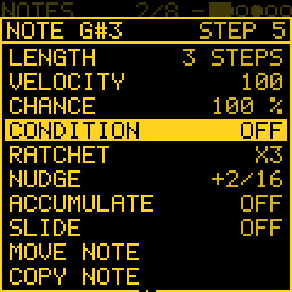

### A step's Condition, and FILL

> **In short:** a step can play only on some passes (every second time, only the first time) or only while you hold
> FILL. This lets a short loop sound longer, and gives you drum fills on demand.

The same sheet (a note's, or a hit's on the drum grid) has a **Condition**: which passes of the pattern the step
plays in. KNOB 2 steps through them:

| Condition | The step plays |
|---|---|
| **Off** | every pass (as always) |
| **1:2**, **2:2** | in the first, the second of every two passes |
| **1:3** .. **3:3** | in pass 1, 2 or 3 of every three |
| **1:4** .. **4:4** | in pass 1 to 4 of every four |
| **1:8**, **8:8** | in the first, the last of every eight |
| **FILL** | only while FILL is held |
| **!FILL** | only while FILL is not held |
| **FIRST** | in the first pass only |
| **!FIRST** | in every pass but the first |

Each track counts the passes of its own pattern (its own LEN) from PLAY; a pattern change, and each section of a
song, start the count again at the first. A step whose condition is met then rolls its Chance as ever. On the drum
grid the condition is the step's: every hit of that step shares it.

**FILL** is held with **GLO** + **E4** (on MIXER, E4 alone), for as long as the key is held: a fill on the last bar,
or a break with !FILL on the beat that drops out. Conditions are saved with the project; an older project plays
every step as before.

---

## ENERGY

> **In short:** ENERGY is the project's mood over minutes: a slow tide from sparse and quiet to busy and loud, and an
> occasional rest where the generators fall silent. This lets a long piece breathe. Set DEPTH 0 on a track (a drone, a
> bass) to keep it steady through the tide.

The project's slow shape over minutes, the same for every track (after Zen-1's conductor, the idea only). Both are
off at 0.

| Knob | Setting | What it does |
|---|---|---|
| 1 | **ARC** (0–100 %) | A slow tide, 3 to 6 minutes a turn, swinging round LEVEL from full to sparse and back. At the sparse end the generator tracks leave out up to 70 % more of their hits and play up to 16 softer. At the full end they take back their own DROP and play up to 12 louder. ARC is how far it swings. |
| 2 | **RESTS** (0–100 %) | How often the music rests: 8 to 18 s with the generator tracks silent (a CHORD track's held chord goes on), about every 4 minutes at 100, every 20 near 0, sooner while the tide is sparse. |
| 3 | **LEVEL** (−100 to +100) | The energy by hand: the tide swings round it. Up is busier and louder, down is sparser and softer, as above. 0 is the tracks as set. |
| 4 | **REST** | The seconds left of a rest. |

Energy also sets how much EVOLVE changes: half its AMOUNT at the sparse end, half as much again at the full end.

Hold **OCT-** for **DEPTH** (KNOB 1, 0–100 %): how much energy moves the selected track. 100 is all of it. 0 makes
the track an anchor, a drone or a bass that plays as set through the tide, LEVEL and the rests.

The picture shows a turn of the tide round LEVEL and, while playing, where it is now.

PLAY starts the tide from the project's seeds, so a piece plays the same each time. ENERGY is also a cord source in
MODS: send it to a filter or a send and the sound follows the tide too.

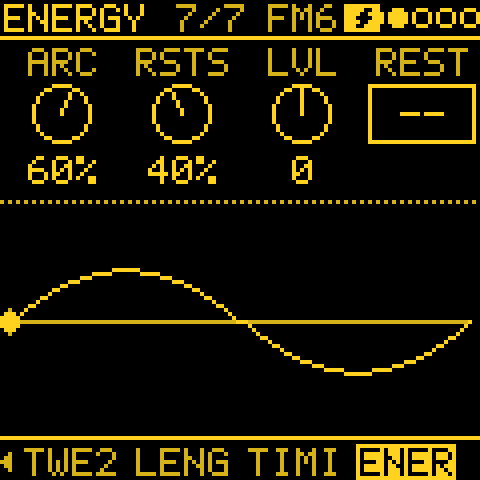

---

## Print and keep

> **In short:** when a generator plays something you love, hold REC: its last bars become ordinary steps that you can
> edit, and that never change unless you change them.

Hold **REC** on a generator track to **print**: what the generator played in its last bars goes into the track's
STEP pattern (1, 2 or 4 bars, as many as the notes span), and the track switches to STEP and plays on from the same
place. Hold EDIT to undo, which puts the generator back.

On an **ARP** track it prints what the arpeggio played (not the keys you held) the same way: the track switches
to STEP, and EDIT held brings the ARP back (hold the keys again to restart it).

- Steps written by hand already there: **REPLACE STEPS?** OCT+ prints over them, OCT- keeps them.
- Recorded notes there: **CLEAR TO PRINT**.
- On a STEP track playing STEP EVOLVE's changes, REC held keeps the changes instead.
- On a STEP track without them, REC held captures what you played on the keys in the last bars.

---

## Harmony: one key, CHORD and QNT CHRD

> **In short:** all tracks share one scale and key, so nothing clashes. Put a progression on a CHORD track, set the
> others' QNT to CHRD, and their notes follow the chords as they change.

**One key for the project.** The scale (SCL), QNT and the MPC degree are always the same on every track. The key
note, ROOT, is too while **SCL > Key link** is **LINKED** (the default in a new project): change ROOT on any melodic
track, from SCL's list or with SCL held and a key, and every melodic track follows; drum tracks keep their own.
**OWN** gives each track its own ROOT again; turning LINKED back on gives every track the selected track's key. Key
link is saved with the project (a project saved before it loads as OWN). TRN still moves a single track. The **Key in B** and
**Key in C** rows at the end of SCL's list change the key in the CHAIN's sections ([CHAIN](#chain-one-form-for-the-project)).

A **CHORD** track plays a progression; with **QNT CHRD** the other tracks follow it.

- On the CHORD track: GEN, MODE **CHORD**, then **PROG**, **BARS** and **HIT**. The chord's kind and voicing come
  from **SCL > CHORD** (CHRD, VOIC), or the GEN sheet. CHRD OFF plays triads; DIA3 and DIA7
  stay in the scale, the fixed kinds (MAJ, MIN, DOM7, MAJ7, MIN7, SUS4, POW, SUS2, 7SUS4, ADD9, MAJ6) lay the same shape
  on every chord of the progression, so some may leave the key.
- On any other track: **SCL**, **QNT** to **CHRD**. Its keys, its MIDI input and its generator snap to the nearest
  note of the chord playing now, and KNOB 2 on NOTES steps through its notes. With no CHORD track, CHRD acts as
  SNAP.
- **CH PROG** is a mod destination, so a slow source can change progressions.
- **STRUM** (hold **OCT-** on GEN, KNOB 2 and 3): the chord's notes start a few ms apart instead of together, as a
  played guitar or keyboard chord. See [CHORD: STRUM, DIR, OCT](#chord-strum-dir-oct-chrd-voic-breath-or-len).

### Your own scales (USER1 to USER4)

> **In short:** four 12-note scales of your own, made on the keys, played by every track and generator like a
> built-in scale.

1. **SCL > SCALES**, KNOB 1 to the **USER** family (after the favourites), KNOB 2 to **USER1** to **USER4**. They
   are always listed (after any Scala tunings); one never set is the major scale.
2. With one picked, each **key** adds its note to the scale or takes it out (the screen says, e.g. USER1 F# IN).
   The root (ROOT, KNOB 3) always stays. The key still plays, so you hear the note.
3. **ROOT** moves the scale as for a built-in one: the notes are counted from the root.

- The USER scale is the project's, like SCL: every melodic track plays it. The keys, MIDI input, every generator,
  QNT, chords and FOLLOW use it as a built-in scale.
- Picking a built-in scale or a tuning, or turning **SCL** itself, goes back to it. The USER scale stays as you made it.
- The four are the **FM-1's**: kept with the settings, so they are there after power-off and in every project.
- A project that plays a USER scale is **saved with it** and the other three, so it plays the same on another FM-1;
  loading it brings them (until power-off, or kept for good at the next settings change). A project that plays a
  built-in scale leaves your USER scales as they are. Firmware before USER scales plays the scale picked on SCL
  under it.

### Your own tunings (Scala files)

> **In short:** load microtonal tunings from the thousands of Scala files online, and every melodic track and
> generator plays in them.

Besides the 77 built-in scales, the FM-1 plays up to four tunings of your own, **USR1** to **USR4**, made from
[Scala](https://www.huygens-fokker.org/scala/) `.scl` files (the format of the Scala archive's thousands of scales,
and of most microtonal tools).

1. Connect the FM-1 to the web editor, open **Projects**, and under **Tunings (Scala)** press **Load .scl** on a
   slot. The editor reads the file and sends it; the slot takes the file's name (7 characters) and its description.
2. On the device: **SCL > SCALES**, KNOB 1 to the **USER** family (after the favourites), KNOB 2 to the tuning. Or
   press **Play** in the editor. It is listed in **ALL** too, after the built-in scales.
3. Play with **QNT** on (any mode but OFF), as for the built-in microtonal scales.

- The tuning is the project's, like SCL: every melodic track plays it (a drum track does not). The keys, MIDI input,
  the generators, QNT, chords and recordings play its degrees; **ROOT** is degree 0 and **TRN** moves it.
- Up to **64 degrees** per period. The last pitch of the file is the period, so non-octave tunings (a tritave, a
  stretched octave) work, up to four octaves. Degrees below 1/1 or past the period are folded into it, sorted, and a
  repeated one dropped; the editor says when it did.
- Picking a built-in scale, or turning **SCL** itself, goes back to it (TUNING OFF). The **USR** slot stays.
- The tunings are **saved with the project** (SAVE or autosave), so a project plays the same on any FM-1. Loading a
  project brings its own tunings; a project saved without any loads with all four slots empty.
- A `.kbm` keyboard map is not used: ROOT places degree 0, and the layouts (WHITE, ALL, MPC) place the degrees on
  the keys as for the built-in scales. MIDI OUT sends no tuning messages, as for the built-in microtonal scales.

---

## MODS: the modulation cords

> **In short:** MODS are patch cables without the cables. Pick a source (an LFO, an envelope, a slow TIDE, another
> track's notes, a PERF macro) and a destination (a filter, a level, a generator's setting, another synth's CC) and
> the destination moves with the source. This is how tracks start to influence each other.

Tap **LFO** for **MODS**: up to 16 cords, each from a source on any track to a destination on any track. Four show
at a time, each with an activity light and a moving mark.

| Knob | What it sets |
|---|---|
| 1 | **Source**: `--`, then per track (T1 to T4) LFO, ENV, VEL, KEY, RAND, MODW, AT, EXPR, S&H, SLEW, the generator's GATE, NOTE and CV, DRIFT, TIDE 1 to 3, SWARM 1 to 8 and EOC (the track's LFO cycle start: high from each wrap of the LFO until an eighth of the cycle has passed, a gate for GATE mods, FILL and the buses; setting its phase with TRIG or PLAY is not a wrap; the last of a track's sources in KNOB 1's list); and the project's ENERGY, [PERF](#perf-four-macros)'s MACRO 1 to 4 and the MIX buses BUS A and BUS B (see *MIX buses*). |
| 2 | **Mod**: which of the 16 the other knobs edit. |
| 3 | **Destination**, on a track: the voice (PITCH, CUTOFF, SHAPE, GAIN), the mix (LEVEL, PAN, SPREAD, FX SEND, SEND 2, SEND 3), the track's effects (FX1 MIX, FX1 RTE, FX1 CHR, the same for FX2 and FX3), the envelope and LFO settings, the engine's E1 to E8, and the generators' settings (T PROB, T LEN, E PULSE, E ROT, M LEAP, M DENS, MP POS, SHIFT, DROP, HUMAN, BRANCH, EV AMT, CONTR, AT X, AT Y, AT DENS, AT KICK, AT SNR, AT HAT, AT TOMS, B SPEED, B ANGLE, A PROB, Q PROB, C Y, C SIZE, C DENS, C AUTO, S START, CH PROG, AN VARY, H TIME, SPLIT), the STEP pattern's **DIR** (see *DIR* below) and **CC** (a MIDI CC out, see *CC out*). After the tracks' come the send effects', once, for every track: SF1 MIX, SF1 RTE, SF1 CHR (the same for SF2 and SF3) and RETURN; then the mods' own moves, **M1 AMT** to **M16 AMT** (see *Mods of mods* below), **FILL** (see *FILL*), **TEMPO** (see *TEMPO*) and the MIX buses **BUS A** and **BUS B** (see *MIX buses*). |
| 4 | **Amount**, −100 to +100 %. With no source (`--`) the cord is a fixed move and KNOB 4 sets its offset. |

- **+- and +: the mod's direction.** Under KNOB 1 a mod shows **+-** (it moves both ways from the knob) or **+** (one
  way only), and its bar says the same: a +- mod's bar reaches as far below the middle as above it. A bipolar source
  (LFO, KEY, RAND, S&H, SLEW, NOTE, DRIFT, TIDE, SWARM, ENERGY) is +-. Press **OCT+** on MODS to make the picked mod
  **+**: the source folded to 0 to 1, so it moves one way only, as ENV does ("+" after the source's name). OCT+ again
  makes it a GATE, then HOLD, and once more +- again (a 0 to 1 source goes +, GATE, HOLD).
- **GATE: all or nothing.** A GATE mod ("^" after the source's name) moves its destination by its whole amount while
  the source is over a threshold, and not at all under it, like a comparator on a modular. Hold **OCT-** and turn
  **KNOB 4** to set the threshold (it starts at the middle of a +- source, at 50 % of a 0 to 1 one). Two GATE mods from
  one source, one at -20 % with +50 and one at +20 % with -50, open a window: the destination moves only while the
  source is between them. A little hysteresis keeps a slow source near the threshold from chattering.
- **HOLD: once a bar.** A HOLD mod ("=" after the source's name) takes its source on the first step of each bar of
  its destination's track and holds it until the next bar, like a sample and hold clocked by the bar. So TIDE, ENERGY,
  a generator's CV or an LFO moves a setting in steps, a bar at a time, instead of sweeping it; onto DIR or a
  generator's setting it changes the line on the bar line. It reads the source as +- does (a 0 to 1 source one way);
  AMOUNT and OFFSET work as for +-. A destination of the project's (FILL, TEMPO, the send effects, M AMT) takes track
  1's bar. Set while stopped, it takes the source at once; PLAY takes it again on the first step. (S&H, a source, holds
  random values for an LFO cycle; FOLLOW HOLD takes another track's pitch on its notes.) Saved with the project;
  firmware before it plays a HOLD mod as +-.
- **DIR.** A mod onto a track's **DIR** picks the direction its STEP pattern plays in (see *Direction* on the
  pattern's sheet), in whole steps from the pattern's own along FWD, BACK, PEND, PONG, RAND, DRUNK: each 20 % of move
  is one more, and it stops at the ends. So the amount and the offset say which directions it can reach: from FWD, a +
  mod at 40 % goes FWD, BACK, PEND as its source rises. A GATE mod at 20 % plays BACK while its source is over the
  threshold and FWD under it; S&H from the track's LFO synced to a bar or two picks a new direction at random. It is
  read at each step and never moves the playhead: the next step comes from the one playing. With no mod, the
  pattern's own. A generator track does not use it.
- **FILL.** Near the end of KNOB 3's list is the project's **FILL**: held while the mod's move is past half, as if
  you held FILL on the GLO layer (steps set to FILL play, NOT FILL steps rest). A GATE mod onto FILL turns an LFO,
  TIDE or ENERGY into fills that come and go; the GLO layer's FILL lights while a mod holds it.
- **TEMPO.** After FILL, **TEMPO** moves the project's tempo on CLK INT: a full move up doubles it, a full move down halves
  it, half a move is half an octave (120 BPM: 170 or 85). BPM stays as you set it. The steps, ARP, synced LFOs and
  CLOCK OUT all follow, with no step skipped or repeated. A planned piece (PIECE's LENGTH) is read in beats at BPM,
  so a TEMPO mod plays it faster or slower and it lasts shorter or longer; it never jumps through the shape. With CLK
  on USB or TRS the external clock sets the tempo and TEMPO does nothing.
- **MIX buses.** **BUS A** and **BUS B**, at the end of KNOB 3's list, are two mixers of the project's. Every mod
  into a bus is combined there, and the bus is then a source of its own (BUS A, BUS B at the end of KNOB 1's list) for
  as many mods as you like. So a sum of two LFOs can drive a GATE, or one envelope can move four destinations without
  setting four amounts that must match. Hold **OCT+** on MODS for MODS' sheet, where each bus
  has two settings (KNOB 1 the row, KNOB 2 its value, OCT- closes):
  - **Mode**, how its mods combine: **SUM** adds them (clamped to -100 .. 100 %, the default), **MAX** takes the
    highest, **MIN** the lowest, **DIFF** how far apart the first two are. With GATE mods at +100 into a bus, MAX is
    OR (either open), MIN is AND (both), DIFF is XOR (one or the other, not both): logic with no exact amounts to
    remember. Read the bus as a GATE mod (threshold 50 %) to use the result as a gate.
  - **Lag**, a slew on the result: OFF, or the time a whole move from 0 to 100 % takes, up and down (10 ms to 20 s). A
    track's GATE into a lagged bus rises and falls as an envelope (Maths' slew), and a stepped source (S&H, a HOLD mod)
    glides.

  A bus is read one block (0.7 ms) after its mods, so it can feed itself or the other bus: BUS A into BUS A at +100 %
  with a small fixed mod adds up (an integrator, stopping at 100 %); at a negative amount it settles or swings,
  always within the clamp. With no mod into a bus it stays at 0 and nothing changes. Buses come from no track, so
  MATRIX leaves their mods out. The settings are saved with the project. Firmware before the buses does not load a
  project with a mod to or from a bus (it ignores the bus settings alone).
- **CC out.** A mod onto a track's **CC** sends its move over USB MIDI as a control change on that track's MIDI OUT
  channel, so an LFO, TIDE, SWARM or a generator's CV can play an outside synth's filter or any other CC. Hold **OCT-**
  and turn **KNOB 3** to pick the CC number (0 to 119; a new one starts on 1, the mod wheel); the destination shows it
  (**T2 CC 74**). A +- source sends 0 to 127 around 64 (its whole range at 100 %), a + source and a fixed mod (no
  source) from 0 up. A value goes out only when it changes, and at most about every 9 ms. Nothing is sent with
  NOTES OUT OFF, the track's channel OFF or the track muted. A track at SOUND OFF with its channel set is a CC lane
  that plays nothing itself. The CC numbers are saved with the project; firmware before CC out does not load a
  project with a CC mod.
- **Not the LFO's POL.** The LFO page's **POL** (BI, UNI) sets how that page's own depths move (LFO PIT, FLT, SHP,
  AMP). It does not reach a mod: a mod from the LFO swings both ways whatever POL is, and its own +- or + alone says
  which way it moves. So a UNI LFO is never shifted twice, and a + mod from a BI LFO moves one way.
- **The lists** of KNOB 1 and KNOB 3 name each entry with its track (**T2 GATE**, **T4 DECAY**); the project's
  ENERGY and the send effects' have none. On the MOSAIC colours an entry is in its track's colour.
- Choosing a destination on a new cord sets the amount to 50 % (or a fixed move of 25 % with no source), so you hear
  it at once.
- **The scope.** Hold **OCT-** on MODS to see how the picked mod moves: its row stays at the top and, in the other
  rows' place, its move over time (the solid line) over its source (the dashed one), the dotted middle line 0, the top
  +100 % of the destination's range. With AMOUNT under 100 % the gap between the two lines is the amount; a mod of
  mods swells and shrinks inside its source. A GATE mod draws its threshold as a dashed line across the source, so you
  see where it opens; a HOLD mod steps once a bar. It sweeps left to right (a gap marks now) over a window that suits
  the source, with ticks at the bars: a bar for the notes' own (ENV, VEL, GATE, NOTE, CV, S&H ...), 2 to 16 bars for
  an LFO (it keeps 2 to 6 cycles in view), 4 for a MACRO, 16 for DRIFT and SWARM, 64 for TIDE and ENERGY. Let go and
  the four rows come back. With the screen reader, holding OCT- says it once: the window, the shape and the lowest and
  highest move ("SCOPE 2 BARS, CYCLING 2 A BAR, LOW -60 HIGH 60 %"; a GATE: how often it opens and whether it is open
  now). The same hold turns a GATE's threshold (KNOB 4), so you watch the line move against the source. A cord
  from BUS A or BUS B draws the bus as its source. Nothing is saved; nothing changes until you hold it.
- **Live marks**: a knob a cord reaches shows a mark where the cords move it now.
- **DRIFT** is each track's slow wander, a new point about every 12 seconds, eased between.
- **Effects.** RTE is the effect's third knob (RATE; ECHO's TIME, ROOM's and REVERB's SIZE, FILTER's CUT), CHR its
  fourth (DEPTH, REPEAT, DECAY, RES, as the effect names it). A moved ECHO TIME glides, as a tape's speed does, so the repeats bend in
  pitch instead of clicking (turning the knob glides too); REVERB changes SIZE a sample at a time. The send
  effects' mods are the project's, not a track's: MATRIX leaves them out. **FX held** + a knob on an FX page makes
  one too. A project with effect mods does not load in firmware before them.
- **Mods of mods.** **M1 AMT** to **M16 AMT** at the end of KNOB 3's list move another mod's amount (a fixed mod's
  offset), as a hand on its KNOB 4 would: send T4 ENV to M3 AMT and each of track 4's notes deepens mod 3 for a moment, so
  one track's playing spreads into another's sound. What the mods add goes on top of the amount you set, up to 100 %
  either way; set mod 3 to 0 and only the mods of mods move it, so it comes and goes. The bar under a moved mod shows
  its amount as it is now. One level only: a mod that moves an M AMT mod, or itself, does nothing. They are the
  project's (no track) and MATRIX leaves them out. **FX held** + **KNOB 4** on MODS makes one for the picked mod, from
  the track's shortcut source. A project with them does not load in firmware before them.
- Melodee's MOD routes, in old projects and sounds, become cords when they load. If all 16 are in use the screen
  says **MODS FULL**.

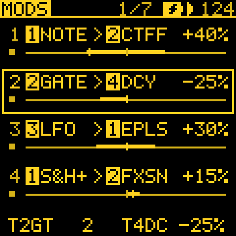 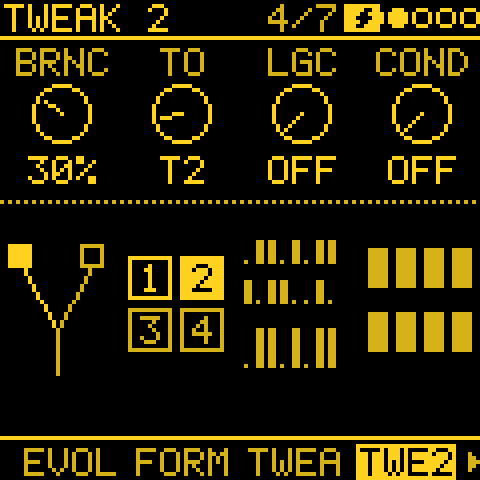

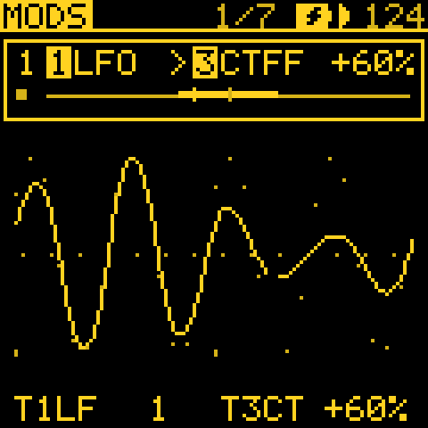 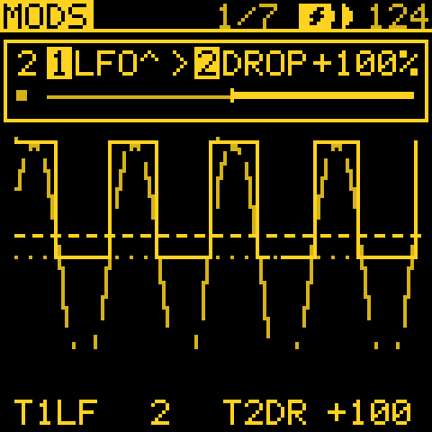

---

## MATRIX

> **In short:** an overview of the patch: which track moves which. Use it to find and open a cord once there are many.

MATRIX, after MODS, shows the cords as a 4 x 4 grid: source track down the left (FROM), destination track along the
top (TO). A cell is lit when a cord goes that way, brighter the more the cords move it now. Mods of the project's
(the send effects', M AMT, FILL, TEMPO) and those to or from a MIX bus belong to no track: they are on MODS only.

| Knob | What it does |
|---|---|
| 1 | **FROM**: the row. |
| 2 | **TO**: the column. |
| 3 | **MOD**: which of the cell's cords, when it holds more than one. |
| 4 | **OPEN**: press **OCT+** to open that cord in MODS. |

---

## ORGANIC: TIDE and SWARM

> **In short:** slow, natural-feeling movement. TIDE takes minutes a turn, and SWARM is eight related wanderers. Send
> them to a filter or a pan for sounds that slowly drift and never repeat exactly.

Each track has its own TIDE and SWARM, slow sources inspired by Nonlinear Circuits' Triple Sloth and Instruō's ochd.

| Knob | Setting | What it does |
|---|---|---|
| 1 | **SPEED** (0–100) | TIDE's speed. At 50 its three chaotic circuits take about 17 minutes (**TIDE 1**), 3 minutes (**TIDE 2**) and 1 minute (**TIDE 3**) a turn; each 12.5 more is twice as fast. |
| 2 | **RATE** (0–100) | SWARM's speed. At 50, **SWARM 1** takes 64 s a turn and **SWARM 8** 2.4 s; each 12.5 more is twice as fast. |

PLAY restarts them from the track's seed, so a piece replays the same way. Pick them as sources on MODS.

---

## Mod shortcut

> **In short:** the fastest way to make a mod: hold FX and turn the knob you want to move. No need to open MODS.

Hold **FX** and turn a knob on any page: a cord from the track's shortcut source (its LFO, unless you turn SELECT
while FX is held to pick another) to that knob's parameter, on the same track. Turning sets the amount, like the
attenuverter beside a knob on a modular.

- The first turn makes the cord in a free MODS slot; back at 0 the slot is free again.
- If a cord already reaches that parameter on this track, that cord is edited, whatever its source.
- A parameter no cord can reach shows **no mod**.

---

## What a knob does

> **In short:** each page's knobs are described in this manual under that page, and every parameter in the
> [parameter reference](docs/PARAMETERS.md).

The [parameter reference](docs/PARAMETERS.md) lists every setting with its range, its default and what it does, the
texts the help cards showed for them. Earlier versions had a help card on the device (hold ARP and turn a knob); it made
way for screen reader support, so that the FM-1 can be played without seeing the screen (issue #430). Holding ARP
and turning a knob now turns it as usual.

### Screen reader

Tessera can say what is on its screen. Plug the FM-1 into a computer by USB, open the
[FM-1 Screen Reader](https://charlesvestal.github.io/fm1-reader/) in Chrome or Edge and click Connect. It speaks with
its own voice, or hands the words to your screen reader (VoiceOver, NVDA, JAWS, TalkBack). Tessera stays silent until
the reader connects, so a DAW on the same port sees nothing.

It says each page as you open it (its name, the track and the knobs), a knob's name and value once you stop turning it,
the row of a list or menu with its place ("3 OF 8"), the messages in the header, PLAY and STOP, yes/no questions with
their keys, the GLO and SCL layers while held, and a step when you press its key while stopped. PATTERNS, SONG, the
sound browser, the slot pages and SCALES say what is selected. Tessera's abbreviations are said as words (T1 is
"track 1", BP on SCALES is "Bohlen-Pierce").

---

## Menu and settings

> **In short:** device settings you set once and then forget, plus a few for playing: MIDI LEARN puts Tessera's knobs
> on your controller (and remembers them), and MUTES makes mutes land on the bar or the phrase.

Hold **HOME** for the menu. Its rows come in groups: the screen, the knobs and buttons, playing, MIDI, USB, then the tools. Tessera's additions, in that order:

| Item | What it does |
|---|---|
| **COLOR** | The screen's ink, on black: YELLOW (the default), WHITE, GREEN, BLUE, RED, ORANGE, PINK, HOT PINK or LILAC; or MOSAIC, SUNSET, OCEAN or NEON, a colour per track with the selection in white. Holding HOME opens the list; turn KNOB 2 on COLOR (or press OCT+) and it shows them all below it: ONE INK, then MOSAIC (the four-colour sets), the one chosen framed. KNOB 1 to another row or OCT- folds them away. |
| **GROUND** | What the ink is drawn on: **DARK** (the default), black, or **LIGHT**, warm paper with each ink's darker light version (see *The look*). KNOB 2 right LIGHT, left DARK; OCT+ switches. Saved. |
| **KNOBS** | How the four knobs' values are drawn on every page: **DIAL** (the default) or **BAR**, an upright bar that fills from the bottom. MIXER and the home page keep their dials. Saved. |
| **LARGE VALUE** | The knob you turn, its name and value large across the foot of the screen. **AUTO** (the default): on the home page and pages without a picture of their own, so a picture (a generator's sky, an envelope, the LFO) stays in view while you turn; **ON**: on every page; **OFF**: never. The value always shows, inverted, in the knob's column. Saved. |
| **BATTERY** | **ON** (the default): every page's header shows the battery, its bars (none to three) on the battery, solid with a bolt in it on external power (a computer, a hub or a charger). A long message takes its place for as long as it shows. **WHEN LOW**: only when it is down to a bar or none, on the battery. Saved. Either way, when the last bar goes the screen says **BATTERY LOW** once; with autosave on, the project is then saved as soon as you press STOP (no five seconds' wait), so a long piece is not lost to a flat battery. It never saves while playing. |
| **PANEL GAMMA** | The screen's contrast curve: the panel chip's own **G2.2** (the default), G1.8, G2.5 and G1.0, or TUNED and TUNED+VCOM. The screen goes black for a moment and redraws. Saved. |
| **TRACK KNOB** | RIGHT: the ALGORITHM knob picks the track and PRESETS browses sounds, as printed. LEFT: the two swap. |
| **MUTES** | When GLO's mute keys (and C4's UNMUTE ALL) take effect while playing. **NOW** (the default): at once. **BAR**: on the next bar line. **PHRASE**: on the next phrase line (the CHAIN's PHRASE, counted from PLAY). A key waiting blinks quickly; press it again before the line to call it off. Stopped, a press is at once. Saved. |
| **NOTES OUT** | What goes out over USB MIDI: **KEYS** (only the notes you play on the keys), **ALL** (also the steps, the ARP, recordings and every generator) or **OFF**. Each track on its own channel: see [MIDI OUT channels](#midi-out-channels). |
| **CLOCK OUT** | 24 pulses a beat with START and STOP over USB, while the clock is INT. |
| **MIDI CC IN** | **ON** (the default): CCs and NRPNs set the tracks' parameters (see [MIDI CC control](#midi-cc-control)). **OFF**: they move nothing, for a sequencer that sends CCs to other gear on the same channels. Bend, mod wheel, expression, sustain and aftertouch always play. Saved. |
| **MIDI LEARN** | Puts any knob on a CC of your controller. Turn KNOB 2 right (or press OCT+): the menu closes and the screen says **LEARN: A KNOB**. Turn a knob on any page (it still edits; the screen names it and asks **SEND A CC**), then move the controller's knob: **CC 21 =** then **T1 CUTOFF**. Repeat for as many as 16 knobs. While learning, the header says **MIDI LEARN ON**; OCT- ends it, as does holding HOME for the menu. A learned CC works from any channel, on whatever page is shown, and takes over what the [fixed CC map](#midi-cc-control) gave it, even with MIDI CC IN OFF. The row shows how many are learned; KNOB 2 left asks **FORGET? OCT+**: OCT+ forgets them all, OCT- keeps them. They are the device's, not a project's: kept through power-off and project loads (saved once the music stops). |
| **USB AUDIO** | Which USB audio devices the computer sees, named from the FM-1's side: **IN + OUT** (the default), **IN** (the computer plays into the FM-1, through device **Tessera In**), **OUT** (the computer records the FM-1 from device **Tessera Out**) or **OFF**. The computer gets the change once the knob rests for a moment (the FM-1 reconnects). Saved. |
| **USB OUTPUT** | What the FM-1 sends to the computer on **Tessera Out**: **STEREO** (the default: the mix, two channels) or **4 TRACKS** (each track on its own channel). Both are taken before MASTER. For stems in a DAW see [Recording the four tracks as separate stems](#recording-the-four-tracks-as-separate-stems). Saved. |
| **USB VOLUME** | The level of the computer's audio played through the FM-1, **0 to 100 %** in 5 % steps, apart from MASTER: the volume pot sets the FM-1's own sound, this the computer's. 50 % (the default) is the old level at MASTER's default. What the FM-1 records over USB (USB OUTPUT: stereo or four tracks) is taken before MASTER too, so the pot never changes a recording's level. Saved. |
| **USB HOST** | **ON**: the USB-C port hosts a USB-MIDI keyboard, controller, synth or MIDI-to-CV module, with no computer in between (see [USB host](#usb-host)). **OFF** (the default): the port talks to a computer. Not saved: every start is OFF. |
| **ABOUT** | Version, credits, **POWER** (the battery's reading and bars, whether 5 V comes in), and, after a crash, LAST CRASH (until power-off). |

### MIDI OUT channels

> **In short:** send each track to its own MIDI channel, so Tessera's generators can play your other synths. A track
> can also go silent on the FM-1 and only play out over MIDI, or only modulate.

**GLO > MIDI OUT** sets the channel each track's notes go out on, so every track can play its own instrument:
**KNOB 1** to **4** for tracks 1 to 4.

- **AUTO** (the default) works as before: the channel follows **SYSTEM > ROUT** (CH1-4: tracks on 1 to 4). A drum
  track does the same while **SYSTEM > DRUM** is **OFF** (the default since 3.3.1); set DRUM to a channel, **10** for
  General MIDI's drums, and a drum track uses that one instead.
- **1** to **16**: that channel, whatever ROUT and DRUM say.
- **OFF**: none of the track's notes go out.

The MIDI OUT sheet (hold **OCT+**) sets each track's **DRUM MAP** (Drum map T1 to T4), the notes a drum track or ATLAS
sends: **GM** (the default) General MIDI's drum notes, kick 36, snare 38, closed hat 42; **ROW** one note a drum in a
row from 36, in the order of a drum machine's tracks such as the Analog Rytm's (kick, snare, rim, clap, -, low tom,
-, -, closed hat, open hat, -, bell). Then move the row onto the machine's first note with **TRANSPOSE**.

The page lists each track's channel as it is now, AUTO's included. The channels are saved with the project. Which
notes go out at all is still the menu's **NOTES OUT** (KEYS, ALL or OFF): for the steps and the generators, set it to
**ALL**.

**TRANSPOSE**: hold **OCT-** on **GLO > MIDI OUT** and turn **KNOB 1** to **4** to move a track's notes up or down
on their way out, a semitone a detent (12 an octave), up to four octaves either way. For a synth or a MIDI-to-CV
module that plays them too high or too low: **-12** an octave down, **-24** two. Only what goes out over MIDI moves;
the track's own sound stays where it is. A note moved past MIDI's range (0 to 127) is not sent. The page shows a
track's TRANSPOSE after its channel when it is not 0 (**CH 1 ROUT -24**); it is saved with the project.

**SOUND**: on the MIDI OUT sheet (hold **OCT+** on **GLO > MIDI OUT**), Sound T1 to T4 (KNOB 2 right OFF, left ON). A track at SOUND
OFF plays nothing on the FM-1 and takes none of its voices, but its notes still go out over MIDI on its channel, and
its GATE, NOTE and CV still move the mods. So a track can play an outside synth alone, or, with its channel OFF too,
be a lane that only modulates the other tracks (a generator driving their filters, say, through MODS). The keys
played on that track make no sound either. The page shows **SND OFF** after the channel (**MODS ONLY** when the
channel is OFF too); it is saved with the project, and firmware before it plays the track's sound as usual.

 MIDI OUT" width="240">

### MIDI CC control

> **In short:** a controller, sequencer or DAW can turn Tessera's settings over MIDI. For your own controller's knobs,
> MIDI LEARN in the menu is easier.

External gear (a sequencer, a controller, norns or crow through a MIDI interface, a DAW) can turn Tessera's
parameters. A track listens on the channel it plays on (**SYSTEM > ROUT**: CH1-4 is tracks 1 to 4 on channels 1 to 4;
SEL the selected track; a drum track also on the **DRUM** channel, when DRUM is not OFF). A CC's 0 to 127 spans the whole range of the
parameter, as turning its knob all the way would; the knob carries on from there. While recording, **MOTION** keeps
the moves as it keeps the knob's. Cords and MOD go on adding to the value the CC sets.

| CC | Sets |
|---|---|
| 1 | Mod wheel (a MOD and cord source, **MODW**) |
| 5 | GLIDE |
| 7 | LEVEL |
| 10 | PAN (64 the centre) |
| 11 | Expression (**EXPR**) |
| 16 to 19 | The engine's four HOME knobs |
| 20 to 27 | The engine's E1 to E8 (its two EDIT pages) |
| 64 | Sustain pedal |
| 71, 74 | Two of the engine's own parameters, where it has them (its resonance and brightness) |
| 72, 73, 75 | RELEASE, ATTACK, DECAY |
| 76 | LFO RATE |
| 77, 78 | LFO to pitch, LFO to filter |
| 79 | SUSTAIN |
| 91, 93, 94 | FX SEND 1, 2, 3 |
| 102 | The generator's MODE (0 to 127 across the modes, in the GEN page's order) |
| 103 to 105 | The GEN page's KNOB 2 to 4 for the track's MODE (TURING: LENGTH, PROB, SPAN; EUCLID: STEPS, PULSE, ROT ..) |
| 120, 121, 123 | All sound off, reset controllers, all notes off |

**Every other parameter by NRPN.** Each parameter has a number, its ID in the
[parameter reference](docs/PARAMETERS.md) (0x000 a track's, 0x100 the project's, 0x200 the generators'). Send
NRPN MSB (CC 99) = ID / 128 and LSB (CC 98) = ID % 128, then the value with data entry: CC 6 (0 to 127), and CC 38 after
it for 14-bit precision. Example: TURING PROB on track 1 is 0x202: CC 99 = 4, CC 98 = 2, CC 6 = the amount, on
channel 1. A project setting (TEMPO, the send effects) answers on any channel a track listens on. Left out: the
device's setup (MIDI input, clock source, ROUT), the buttons (LOAD, SAVE ..) and the song's scale (SCL, QNT), which
stay on the device.

Turn **MIDI CC IN** off in the menu when another device's CCs should not reach Tessera.

### USB host

> **In short:** plug a USB-MIDI keyboard or synth straight into the FM-1, with no computer in between.

With **USB HOST** ON in the menu the FM-1 is the computer: plug a class-compliant USB-MIDI device into the USB-C port,
directly or through a USB hub, and after a moment the screen says **USB MIDI READY**. A hub with another hub inside
(as many USB-C hubs are) works too; a third hub is not followed.

- **In**: its notes, CCs, bend and clock arrive as USB MIDI from a computer would: MIDI ROUTING picks the tracks, CLK
  on USB follows its clock, and the [CC map](#midi-cc-control) works from its knobs.
- **Out**: what NOTES OUT and CLOCK OUT send goes to the device, so a USB synth or a USB-MIDI-to-CV module plays
  Tessera's tracks and follows its clock (NOTES OUT **ALL** for the steps and generators).
- **Power**: the FM-1 does not power the device. Use a **powered hub**, or a device with its own power supply.
- One MIDI device at a time: the first one found (behind a hub, the first port with a MIDI device). Full-speed
  devices only (**LOW SPEED** otherwise, behind a hub too); a device without USB-MIDI (a USB stick, crow) shows
  **NO MIDI**. norns is itself a host, so connect it as before.
- When nothing is found the screen adds **USB SCAN: ABOUT**: the menu's **ABOUT** then lists, under
  **USB HOST SCAN**, what each hub port had: **P2 0103 NO MIDI 08** is port 2, its status in hex (1 connected,
  2 enabled, 100 powered, 200 low speed, 400 high speed), what was found and the device's USB class in hex (01 audio
  or MIDI, 03 a keyboard or mouse, 08 a stick, 09 a hub, 11 a hub's Billboard). Found: **EMPTY**, **LOW SPEED**,
  **NO MIDI**, **HUB** (a hub inside, listed after it as HUB 2 with the port it is on), **MIDI**, or the step that
  failed (**RESET FAIL**, **NOT ENABLED**, **NO ANSWER**, **ADDRESS FAIL**, **CONFIG FAIL**). Under the first line
  (**ROOT**, what is plugged into the FM-1) come the try (a device that does not answer is reset up to four times,
  over about four seconds), the controller's registers, and for a failure which request got which reply
  (**@0 SETUP NO REPLY**: the device at address 0 did not answer the first request). A photo of it helps with a
  report.
- Unplugging shows **DEVICE LOST** and ends every note held from MIDI; plug it in again and it is found again.
- While USB HOST is ON there is no computer link: no USB audio, no web editor, no updates. Turn it OFF, or restart the
  FM-1 (it always starts OFF), to get them back.

### Recording the four tracks as separate stems

> **In short:** set USB OUTPUT to 4 TRACKS and the computer sees **Tessera Out** as a four-channel input, one mono channel per track, so each track records on its own DAW track.

1. Hold **HOME** for the menu and set **USB OUTPUT** to **4 TRACKS**. The FM-1 reconnects to the computer. (It is saved; **STEREO** takes you back to the mix.)
2. In your DAW choose **Tessera Out** as the audio input device and enable its inputs 1 to 4. Inputs 1 to 4 are tracks 1 to 4.
3. Make four audio tracks, each set to one input, and arm and record. Recording works while the FM-1 plays.

**What is in a stem.** A track's own sound after its insert effects, its LEVEL, MUTE/SOLO and [Entries](#entries-tracks-out-and-back-in), so a muted track is silent in its stem. It is taken before PAN and SPREAD, so each stem is mono, and without the shared SEND and RETURN effects, MASTER and the limiter. The stems are dry of the shared reverb and delay; USB VOLUME and the volume pot do not change them.

**Ableton Live.**

- **macOS** (all four channels show natively): Settings > Audio, Audio Input Device = **Tessera Out**. Under Input Config enable inputs 1 to 4 as four mono inputs. On each audio track set Audio From to Ext. In and the channel 1, 2, 3 or 4.
- **Windows:** Live's MME/DirectX driver type opens only two channels of a device, so Input Config offers just 1/2. For four stems use an ASIO wrapper: **FlexASIO** (backend WASAPI, input *Synthesizer (Tessera Out)*, 4 channels) or **ASIO4ALL**; Live opens one ASIO device, so the wrapper also carries your output. Set Live to 44100 Hz. Then enable Input Config as on macOS. Windows lists the FM-1's recording device as *Synthesizer (...)*, not Microphone. A unit that once ran Melodee can show an old name or a disabled device, which Live leaves out: open the Sound control panel > Recording, right-click and choose Show Disabled Devices, and enable it. (Wrappers are not yet tested with the FM-1.)
- **Other DAWs:** pick **Tessera Out** as the input device, enable all four channels as mono inputs (not as two stereo pairs), and send channel 1 to 4 to one track each. The sample rate is 44.1 kHz; set the project to match.

**Reverb and delay.** The shared effects are not in the stems. Record dry and add your DAW's own reverb on a return, or record a second pass with USB OUTPUT on **STEREO** to keep the FM-1's wet mix.

---

## Saving and older projects

> **In short:** a project keeps everything: patterns, sounds, generators and their seeds, forms and cords. Hold SAVE
> to save. Start a new song from SAVE > PROJECT.

A project holds everything in one record: the patterns, the sounds, the generators with their seeds, sections and
layers, ENERGY, and the cords. Since 2.0 Tessera has a project format of its own: projects saved by Melodee (Tess) 1.x or
by Melodee show **OLD FORMAT** in their slot and do not load (there is no converter), and the first save writes over
them. Melodee's own preset banks are not carried over.

**A new project**: tap **SAVE** to the **PROJECT** page, turn **KNOB 1** down the list to **New song** and press
**OCT+** (playback stops; with unsaved changes, **OCT+** again answers Yes to "Start a new song?"). The NEW SONG
screen asks for the key (**KNOB 1** root, **2** scale, **3** tempo), then,
after **OCT+**, a role per track (**KNOB 1** to **4**): **KEEP** its sound, or **DRUMS**, **BASS**, **CHORDS**,
**LEAD** or **PAD** for the first sound of that kind. The role also sets the track's ENTRIES **ROLE** (DRUMS: RHYTHM,
BASS: BASS, CHORDS and PAD: HARMONY, LEAD: MELODY), so ENTRIES takes the parts out and back in a musical order; KEEP
leaves it as it was. **OCT+** creates it with every pattern empty; **OCT-** goes back or cancels. It starts from the template when one is saved in TMPL, else from the power-on sounds, and has no slot
until you save it.

The web editor's **Complete backup** saves and restores the music, slots A to D, the sound banks and the settings.
To try the [demo projects](demos/README.md), the editor's **Demo projects** (on the Projects tab) puts each into a
slot you choose and leaves the rest of the FM-1 as it is; `tools/demo_backup.py` does the same with a backup file.

To see how hard the FM-1 is working, the editor's **Settings** tab has **Health**: press **Live** and it reads the
CPU load, the worst audio half against its deadline, late halves, voices shed or stolen (per track too), the second
core and the stacks once a second. A value shown inverted means a crackle or a cut voice is likely. **Reset worst**
starts the worst times again, for example before you try a busy part.

---

## If something goes wrong

- **Single core.** If your FM-1 crashes with the standard build (red crash screen, freezes, or restarts into update
  mode), install the `-1core` firmware from the same release.
- **TESSERA CRASH.** If the crash screen shows, take a photo; after a restart, MENU > ABOUT shows LAST CRASH until
  power-off. Please add both to a bug report.
- **Update mode.** Hold **OCT-** alone while switching on to start the update loader, then reinstall from the web
  installer. See [docs/RECOVERY.md](docs/RECOVERY.md) for a unit stuck in UBOOT.
- Do not unplug the FM-1 while it is writing. Tessera is experimental in every sense of the word: use it at your own risk.

---

## Credits

Tessera stands on other people's ideas and work:

- **Melodee** by keremimo, and **Felucca** by Leo Kuroshita / Hügelton Instruments: the firmware Tessera is built on.
  USB host mode is Melodee's, by Kerem Kilic and recursivefieldinstruments.
- **Grids** by Émilie Gillet / Mutable Instruments: the ATLAS generator's drum map and the way it is read.
- **ORACLE** is Melodee's Prophet engine (after the Prophet-5), back under its own name with its own sounds.
- **norns** scripts, as ideas restated in C (no code copied): **Awake** (tehn) for AWAKE, **Fall** (ambalek) for
  BOUNCE's FALL, **Constellation** (timothy-taylor) for CONSTELLATION, **initenere** for QUAD, and **nørgård** for
  SERIES.
- **Turing Machine** (Music Thing Modular) for TURING.
- **Triple Sloth** by Nonlinear Circuits (Andrew Fitch), with J. C. Sprott's jerk system, for TIDE; **ochd** by
  Instruō and DivKid for SWARM (ideas only, no code copied).

Every third-party part and its licence is listed in [LICENSING.md](LICENSING.md).
