
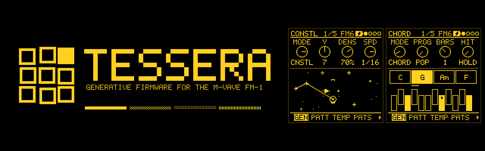

# Tessera manual

Tessera is a generative firmware for the M-Vave FM-1. It grew out of Melodee (Tess), a fork of
[Melodee](https://github.com/keremimo/melodee) by keremimo (itself built on *Felucca* by Leo Kuroshita / Hügelton
Instruments). Each of the four tracks can play its own steps, an arpeggio, or one of thirteen generators, and the
pages around them evolve the phrases, build song forms, pass hits between tracks and modulate anything from
anything.

This manual covers the whole firmware: the step sequencer, the generators, the sounds, the effects, patterns and
songs. For recipes and tips, see **[RECIPES.md](RECIPES.md)**; every button and combination on one
sheet, **[CHEATSHEET.md](CHEATSHEET.md)** (and [a printable PDF](docs/cheatsheet/tessera-cheatsheet.pdf)). Every
setting, with its range and default, is listed in [docs/PARAMETERS.md](docs/PARAMETERS.md). To print this manual or
read it offline, download it as **[a PDF](docs/manual/tessera-manual.pdf)**.

Page and knob names are the ones on the screen. KNOB 1 to KNOB 4 are the four knobs from left to right, and each
page's four settings sit along the top of the screen in the same order.

New to some terms? See the [Glossary](#glossary) at the end. Have a loop and wonder what to do with it? See [First steps](RECIPES.md#first-steps-you-have-a-loop-what-next).

**New to Tessera?** Start with [Tessera in plain words](#tessera-in-plain-words): what each page is for and when you
would use it, then a table of goals and where to go for each.

**Guide videos.** Short captioned clips show each part on the screen. Start with [getting started](https://www.youtube.com/playlist?list=PLO1Q_qcfoes4), 25 clips in order, then the reference playlists: [steps and patterns](https://www.youtube.com/playlist?list=PLRyv3Qy2MzQ0), [generators](https://www.youtube.com/playlist?list=PLN7aK5SMl2vA), [long form](https://www.youtube.com/playlist?list=PLVXT4bgugQk4), [harmony](https://www.youtube.com/playlist?list=PLeU_ZorOoLxI), [mods](https://www.youtube.com/playlist?list=PLcOTnVq9xfok), [sounds and effects](https://www.youtube.com/playlist?list=PLXacQBye4j9M), [settings](https://www.youtube.com/playlist?list=PLdxRras8uNgg). Each section below links its own clips. <!-- guide videos -->

- [Tessera in plain words](#tessera-in-plain-words): an overview of every page, and why you would use it
- [The panel at a glance](#the-panel-at-a-glance)
- [Shortcuts](#shortcuts)
- [Sounds](#sounds)
- [SEQ: the MODE and its pages](#seq-the-mode-and-its-pages)
- [The generators](#the-generators)
- [The GEN layer](#the-gen-layer)
- [EVOLVE](#evolve)
- [FORM](#form)
- [TWEAK](#tweak)
- [TWEAK 2](#tweak-2)
- [LENGTH](#length)
- [TIMING](#timing)
- [ENERGY](#energy)
- [Print and keep](#print-and-keep)
- [Harmony: one key, CHORD and QNT CHRD](#harmony-one-key-chord-and-qnt-chrd)
- [MODS: the modulation cords](#mods-the-modulation-cords)
- [MATRIX](#matrix)
- [ORGANIC: TIDE and SWARM](#organic-tide-and-swarm)
- [Mod shortcut](#mod-shortcut)
- [What a knob does](#what-a-knob-does)
- [Menu and settings](#menu-and-settings)
- [Saving and older projects](#saving-and-older-projects)
- [If something goes wrong](#if-something-goes-wrong)
- [Glossary](#glossary): the words on the screen, A to Z
- [Credits](#credits)

---

## Tessera in plain words

<a href="https://youtu.be/GAE0D6EDFgM">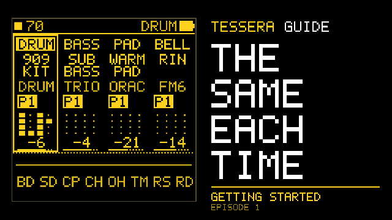</a>
 <!-- guide videos -->

Tessera packs a lot into a small box. This part of the manual says what each part is *for*, in everyday words, so
you know where to look before you need the detail. The rest of the manual then gives every knob in full; look for the
**In short** lines at the top of each section for the same plain version.

### How it fits together

Think of a Tessera project as layers. You can stop at any layer and still have music: each one is optional, and
everything automatic starts switched off.

1. **Sounds.** Each of the four tracks has a sound: an FM6, ORACLE, TRIO, PHYS or DRUM voice. *This lets you pick
   what each part sounds like* (pad, bell, bass, kit).
2. **What a track plays.** Each track plays its own steps (STEP), an arpeggio of the keys you hold (ARP), or a
   **generator** that writes music for you. *This lets you go from a blank page to a moving line in seconds.*
3. **How the line changes.** EVOLVE, TWEAK, TWEAK 2, LENGTH and TIMING shape the generator's notes: how often they
   change, which hits play, how long notes ring, how they swing. *This lets you turn "random" into "musical".*
4. **How a track grows into a song.** FORM gives a track sections A, B and C; CHAIN lines up all the tracks' sections;
   ENTRIES brings tracks in and out; PIECE plans the whole thing from start to end. *This lets a project play for
   minutes or hours without sounding like one loop.* How these act on each other:
   [The long-form layers together](#the-long-form-layers-together).
5. **Movement.** MODS are virtual patch cables: any source (an LFO, a slow TIDE, a generator's notes, a hand-turned
   macro) can move almost any setting on any track. *This lets the sound breathe, and lets tracks talk to each other.*
6. **Playing it.** MIXER, the GLO keys, PERF's macros, FILL, quantized MUTES and MIDI LEARN are the hands-on side.
   *This lets you perform the piece, not just set it going.*

### The long-form layers together

> **In short:** PIECE plans the whole piece, CHAIN sets the section, ENTRIES picks which tracks play, ENERGY sets how
> busy they are, and each track's FORM and generator play the notes. SONG is separate: your written patterns in order.

Six pages shape a piece over time. Five of them work as one system, from the slowest to the fastest; SONG runs beside
them. Every one starts OFF, and you can use any of them alone.

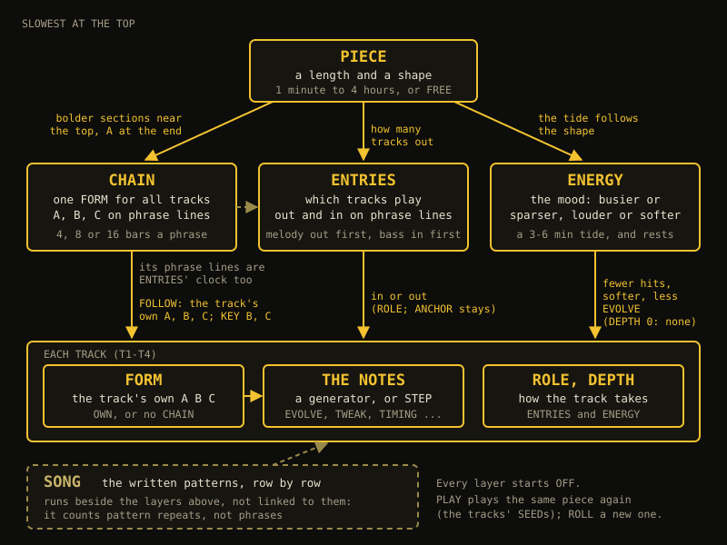

| Layer | Where | How often it changes | What it changes | What it listens to |
|---|---|---|---|---|
| [PIECE](#piece-a-length-and-a-shape) | GLO > PIECE | Over the whole piece, 1 minute to 4 hours | Nothing directly: it steers CHAIN, ENTRIES and ENERGY along its shape | The CHAIN's PHRASE (it counts in phrases) and the tempo |
| [CHAIN](#chain-one-form-for-the-project) | GLO > CHAIN | On phrase lines (4, 8 or 16 bars) | The section (A, B, C) every following track plays, and the key in B and C | PIECE: bolder new sections near its top, A at its end |
| [ENTRIES](#entries-tracks-out-and-back-in) | GLO > ENTRIES | On phrase lines | Which tracks play: it fades or cuts them out and back in | The CHAIN's phrases and sections, each track's ROLE, PIECE (how many out) |
| [ENERGY](#energy) | ARP > ENERGY | A slow tide of 3 to 6 minutes, and rests | How many hits the generator tracks play and how loud; how much EVOLVE changes | PIECE (the tide becomes its shape), each track's DEPTH |
| [FORM](#form) | ARP > FORM, each track | Every EVERY bars, or on the CHAIN's phrases | The track's own sections A, B and C | The CHAIN, while the track FOLLOWs it |
| SONG | SEQ > SONG | When a row has played its repeats | Which written pattern each track plays | Nothing above: it runs beside them |

**Who wins where they meet:**

- **CHAIN and FORM.** A track that FOLLOWs takes its section from the CHAIN, and its own EVERY waits. OWN keeps its own
  FORM. Until you choose, a track follows when its own FORM is OFF.
- **ENTRIES and your hands.** ENTRIES only takes tracks out and brings them back; it never changes what a track plays.
  A mute by hand always wins, and an ANCHOR never goes out.
- **ENERGY and STEP tracks.** ENERGY changes how much a generator plays, not what it plays. STEP tracks play as
  written. DEPTH 0 keeps a track out of ENERGY altogether.
- **PIECE adds nothing of its own.** With LENGTH FREE nothing is planned. With ENTRIES at 0 no track moves, even with a
  PIECE; with ENERGY's ARC at 0 its tide stays flat.
- **SONG and CHAIN** both start counting at PLAY but are not linked: SONG counts pattern repeats, CHAIN counts bars. To
  keep them in step, make each SONG row last a whole number of the CHAIN's phrases.
- **Clocks.** CHAIN, ENTRIES and PIECE change on phrase lines. ENERGY's tide runs on its own slow clock unless a PIECE
  sets it.

**Build it up one layer at a time:**

1. One generator track, FORM **AABA**: the track gets sections.
2. **GLO > CHAIN**, FORM **ABAC**: the tracks change section together (tracks with FORM OFF follow by themselves).
3. **GLO > ENTRIES** at 50: tracks drop out and come back on the phrase lines. Set a drone's ROLE to **ANCHOR**.
4. **GLO > PIECE**, 10 minutes, **ARCH**, END **STOP**: an intro, a peak and an ending, then it stops by itself.
5. **ARP > ENERGY** ARC: how far the busy-sparse swing goes, along the PIECE's shape (or on its own tide without one).

| I want... | Use |
|---|---|
| The whole project to move from A to B together | CHAIN |
| One track with its own verse and chorus | FORM, with that track set to OWN |
| The band to thin out and fill up | ENTRIES |
| A beginning, a peak and an end, then stop | PIECE, END STOP |
| Slow breathing in how busy and loud it is | ENERGY's ARC |
| A fixed order of patterns I wrote | SONG |
| One track left alone by all of this | OWN on FORM, ROLE ANCHOR, DEPTH 0 |

### Every page, and why you would use it

<a href="https://youtu.be/md3v8T15dVg">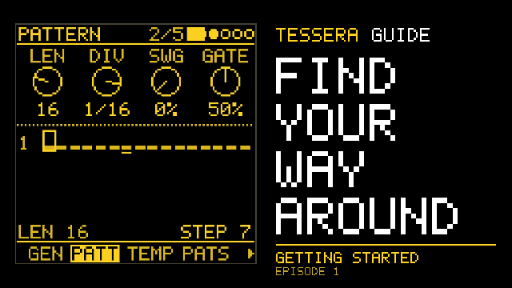</a> <a href="https://youtu.be/tCmJ-fns_dY">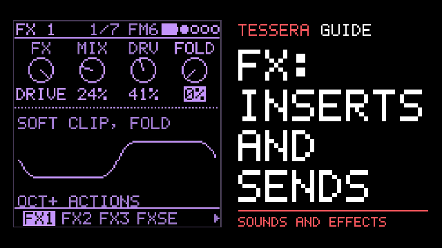</a>
 <!-- guide videos -->

Tap a button to reach its pages; tap again (or turn **SELECT**) to step through them. The tables say what each page
lets you do and when you would want it. Follow a link for the full description.

**HOME** (hold it for the menu)

| Page | What it lets you do | Reach for it when |
|---|---|---|
| [HOME](#the-panel-at-a-glance) | See all four tracks at once, set the tempo with SELECT, and turn each sound's four main knobs. | You want the big picture, or a quick tweak while playing. |
| [Menu](#menu-and-settings) | Set up the device: screen colours, MIDI, the knob look, battery display, MIDI LEARN, how mutes land. | You set things up once, or plug in new gear. |

**SEQ**: what the selected track plays

| Page | What it lets you do | Reach for it when |
|---|---|---|
| [GEN](#seq-the-mode-and-its-pages) (tap SEQ) | Choose the track's MODE: your own steps, the ARP, or one of thirteen generators, and set the generator's three main knobs. | Every time you start a part. This is the most important page. |
| [NOTES](#seq-the-mode-and-its-pages) | Write and edit steps by hand; open a step's sheet for ratchets, nudges, conditions and climbing notes. | You want a part exactly as you hear it in your head. |
| [PATTERN](#seq-the-mode-and-its-pages) | A generator track's length, speed (DIV) and gate. | A generator should run faster, slower or over a different length. |
| TEMPO | The project's BPM, swing and record quantize. | You set the speed and feel of the whole project. |
| [PATTERNS, SONG](#patterns-and-song) | Pick which of its 8 patterns each track plays, and line patterns up into a song. | You arrange written patterns into a song by hand. |
| ARP | The arpeggiator's MODE, RATE, OCT and GATE, on an ARP track. | You want to play chords and hear them broken up. |

**ARP**: how the selected track's notes are shaped (the pages its MODE uses). *When a knob's name puzzles you, see
[What a knob does](#what-a-knob-does).*

| Page | What it lets you do | Reach for it when |
|---|---|---|
| [EVOLVE](#evolve) | Let a phrase mutate every few bars, pick a new seed (a new line) with ROLL, and pull it home with GRAVITY. | A loop has started to feel too static, or you want a fresh idea. |
| [FORM](#form) | Give the track a song form (A B A C ...) built from its own phrase. | You want verse-and-chorus contrast instead of one long loop. |
| [TWEAK](#tweak) | Transpose, thin out, humanise, or make a track follow another track's pitch. | You want a harmony, a bass that follows the melody, or a looser feel. |
| [TWEAK 2](#tweak-2) | Decide which hits play: pass hits to another track, combine two tracks' rhythms, play only in some bars. | You want two parts to answer each other, or interlocking rhythms. |
| [LENGTH](#length) | Set how long a generator's notes ring. | Notes sound too clipped, or you want pads out of sparse notes. |
| [TIMING](#timing) | Add ratchets (rolls) and a behind-the-beat human feel. | You want rolls, stutters or a more relaxed groove. |
| [ENERGY](#energy) | Give the whole project a slow tide from sparse to full, with occasional rests. | A long piece needs to rise and fall on its own. |

**LFO**: movement

| Page | What it lets you do | Reach for it when |
|---|---|---|
| [MODS](#mods-the-modulation-cords) | Patch up to 16 cords from any source to any destination, including other synths over MIDI CC. | You want anything to move by itself, or one track to shape another. |
| [MATRIX](#matrix) | See who modulates whom as a 4 x 4 grid, and jump to a cord. | The patch has grown and you need to find a cord. |
| LFO, LFO 2, LFO DEST | The track's own LFO and how far it moves pitch, filter, shape and level. | You want classic vibrato, wobble or tremolo. |
| [ORGANIC](#organic-tide-and-swarm) | Set the speed of TIDE (very slow, minutes a turn) and SWARM (eight related wanderers). | You want movement too slow and natural to hear as an LFO. |

**ENV**: the track's envelope and where it goes (on FM6 and ORACLE, the sound's own envelopes). *Use it to make a
sound pluck, swell or sustain.*

**SEL**: harmony

| Page | What it lets you do | Reach for it when |
|---|---|---|
| SCALES, SCL | Choose the project's scale and key, how notes are snapped to it (QNT), and transpose a track. | Always, early on: every generator plays in this scale. |
| CHORD | Set the chord kind and voicing a CHORD track (or QNT CHRD) uses. | You want sevenths, sus or add9 chords, open voicings or power chords. |
| [USER scales](#your-own-scales-user1-to-user4) | Make up to four 12-note scales of your own on the keys. | No built-in scale is the one you hear. |
| [Scala tunings](#your-own-tunings-scala-files) | Load your own microtonal tunings from the web editor. | You want to leave twelve-note tuning behind. |

**EDIT**: the sound's own pages ([Sounds](#sounds)). Tap EDIT again for a map of them. *Use it to design or adjust a
sound; save it to USER from SAVE.*

**FX**: the insert and send effects (ECHO, SYNC ECHO, ROOM, REVERB, CHORUS, TAPE, PHASER, FILTER, DRIVE and more). Held, it sets
how far a cord moves the knob you turn ([Mod shortcut](#mod-shortcut)). *Use it for space, colour, and the quickest way to make a mod.*

**GLO**: the project and the long form

| Page | What it lets you do | Reach for it when |
|---|---|---|
| [MIXER](#the-panel-at-a-glance) | Levels, pans, mutes and solos for all four tracks, plus FILL and tap tempo on the keys. | You are playing live, or balancing the mix. |
| [PERF](#perf-four-macros) | Four macro knobs that can each drive many mods at once. | You want one knob to do a big move live (a build, a breakdown). |
| [LANDSCAPE](#landscape-rain-on-water) | A sea drawn by the music, at night or by day (GROUND LIGHT): every named project is a place of its own, with something to find on its shores. The knobs are PERF's macros. | You want something to watch while it plays. |
| [PIECE](#piece-a-length-and-a-shape) | Plan a whole piece: how long, what shape (an arch, waves, builds), and what happens at the end. | You want a 20-minute or 2-hour piece that plays itself. |
| [CHAIN](#chain-one-form-for-the-project) | Give all tracks one shared song form, so their sections change together. | Tracks with FORM should move from A to B at the same moment. |
| [ENTRIES](#entries-tracks-out-and-back-in) | Let tracks drop out and come back in on phrase lines, like a band arranging itself. | The piece should thin out and fill up without you touching the mutes. |
| SYSTEM | The voice BUDGET and how hard the FM-1 is working (VOICES and CPU meters), the tuning reference. | Notes crackle (lower BUDGET). |
| MIDI IN | The MIDI input, the DRUM channel, the routing of channels to tracks (ROUT) and the clock source; OCT- held, KNOB 4 is the clock's PPQN. | You play Tessera from a keyboard or a DAW, or sync to other gear. |
| [MIDI OUT](#midi-out-channels) | Give each track its own MIDI channel, transpose what goes out, or silence a track's own sound. | Tessera should play other synths, or a track should only modulate. |

The first three pages are the ones to play with: on MIXER, PERF and LANDSCAPE the keys are the performance keys
(mutes, solos, FILL, tap tempo) without holding anything. Hold **GLO** on any other page for the same keys, plus the
levels, tempo and sound browsing.

**SAVE**: PRESETS (browse and favourite sounds), USER (store a sound), PROJECT (save, load, start a new song). Hold
SAVE to save the project. *See [Saving](#saving-and-older-projects).*

**REC**: record from the keys, or held, [print](#print-and-keep) what a generator just played into steps you can edit.
*Use it to keep a happy accident.*

### Which generator for what

| You want | Try | Why |
|---|---|---|
| A melody that repeats but slowly changes | **TURING** | A loop you can lock, or let drift note by note. |
| A melody from your own notes, varied | TURING, EUCLID, MARKOV or MORPH with a **SOURCE** | They play your STEP pattern and vary it; GRAVITY keeps it close. |
| A wandering, natural-sounding line | **MARKOV** | Walks between nearby notes, with the odd leap. |
| An evenly spread rhythm | **EUCLID** | Spreads hits as evenly as possible: many world rhythms come out of it. |
| A drum groove | **ATLAS** | A map of drum patterns: move X and Y for a different groove. |
| Chords and a progression | **CHORD** | Plays a progression in your scale; other tracks can follow it with QNT CHRD. |
| Polyrhythms | **POLY** or **QUAD** | Rhythms of different lengths against each other. |
| Sparse, chime-like melodies | **BOUNCE**, its **FALL** mode, or **CONSTL** | Notes from balls, falling leaves or passing stars: gentle and unpredictable. |
| A slow lead that never quite repeats | **SERIES** | A self-similar melody that unfolds for a long time. |
| Two interlocking loops | **AWAKE** | A melody loop lifted by a second loop of a different length. |
| Something that answers you | **ANSWER** | Play a phrase; it plays it back, changed a little more each time. |
| A blend between two rhythms | **MORPH** | Slides from one rhythm to another with a single knob. |

### I want to...

| I want to... | Go to |
|---|---|
| Hear something generative right away | [A first generative patch in a minute](RECIPES.md#a-first-generative-patch-in-a-minute) |
| Keep a line I like | Note the seed on EVOLVE's **ROLL**, or hold **REC** to [print](#print-and-keep) it into steps |
| Stop a generator from changing | TURING's **PROB 0** (Lock), or EVOLVE's **EVERY OFF** |
| Make a part change slowly over time | [EVOLVE](#evolve), then [GRAVITY](#evolve) to keep it near home |
| Have every track play in the same key and follow the chords | [Harmony](#harmony-one-key-chord-and-qnt-chrd): Key link and **QNT CHRD** |
| Turn a line, the keys or MIDI IN into arpeggios of the chords | [HARM: a harmonizer](#harm-a-harmonizer): **QNT HARM**, or FOLLOW's **HOW HARM** |
| Make the sound move on its own | [MODS](#mods-the-modulation-cords), or hold **FX** and turn a knob ([Mod shortcut](#mod-shortcut)) |
| Make a piece that plays for an hour and has a beginning, middle and end | [PIECE](#piece-a-length-and-a-shape), [CHAIN](#chain-one-form-for-the-project), [ENTRIES](#entries-tracks-out-and-back-in), and the [recipe](RECIPES.md#a-piece-that-plays-itself-piece-chain-and-entries) |
| Do big moves live with one hand | [PERF](#perf-four-macros) macros and the [recipe](RECIPES.md#one-knob-for-a-big-build-perf-macros) |
| Mute and unmute in time with the music | MENU > **MUTES** BAR or PHRASE ([recipe](RECIPES.md#drops-that-land-on-the-bar-mutes)) |
| Play a drum fill | Set some steps' Condition to **FILL**, then hold **GLO** + **E4** ([Condition and FILL](#a-steps-condition-and-fill)) |
| Control Tessera from my MIDI controller | MENU > **MIDI LEARN** ([recipe](RECIPES.md#your-controllers-knobs-kept-midi-learn)) |
| Play an outside synth from Tessera | [MIDI OUT channels](#midi-out-channels) and [Driving another synth](RECIPES.md#driving-another-synth-midi-out) |
| Move an outside synth's filter from Tessera's LFOs | A mod onto **CC** ([recipe](RECIPES.md#an-lfo-for-another-synths-filter-mods-out-as-cc)) |
| Find out what a knob does | Its page in this manual, or the [parameter reference](docs/PARAMETERS.md) ([What a knob does](#what-a-knob-does)) |
| Stop crackles | Lower **GLO > SYSTEM > BUDGET**, or thin a busy track ([How many voices at once](#how-many-voices-at-once)) |

---

## The panel at a glance

<a href="https://youtu.be/6FU-tiFkh1s">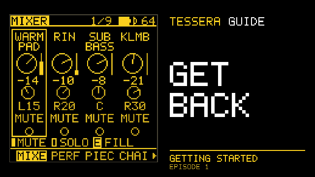</a> <a href="https://youtu.be/SCrp2-y8JsQ">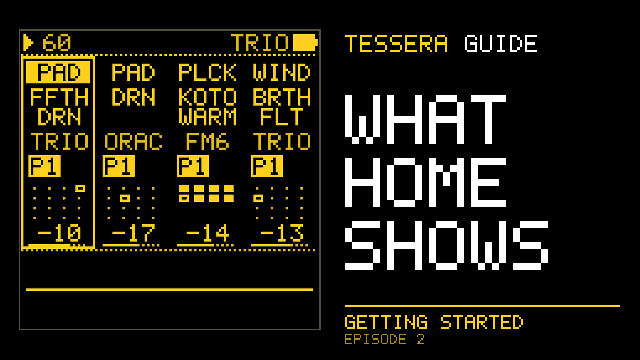</a> <a href="https://youtu.be/rVL7WHqJ9zA">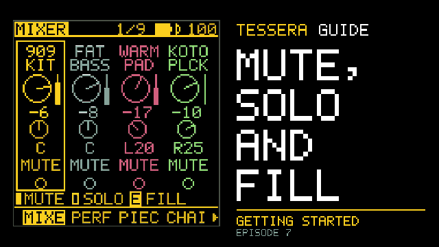</a>
 <!-- guide videos -->

> **In short:** the buttons get you to pages, the four knobs set what is on the page, and holding a button opens a
> second job. You rarely need more than HOME, SEQ, LFO and GLO to start.

| Button | Tap | Hold |
|---|---|---|
| **HOME** | The home page: four tracks, their sounds and knobs | The menu |
| **SEQ** | What the track plays: GEN, then NOTES or ARP or PATTERN (by its MODE), TEMPO, PATTERNS, SONG | PATTERNS (the song under it) |
| **ARP** | How the track's notes are shaped: EVOLVE, FORM, TWEAK, TIMING and the rest (by its MODE) | |
| **LFO** | MODS, MATRIX, LFO, LFO 2, ORGANIC, LFO DEST (an FM6 track: then FM LFO) | |
| **ENV** | ENV, ENV DEST (an FM6 track: EG RATE, EG LVL, PITCH EG, PITCH LV) | On HOME, with OCT- / OCT+: the selected track an octave down / up (its TRN, up to ±24; both OCTs: 0) |
| **SEL** | SCALES, SCL, CHORD | Quick SET: a key sets ROOT; KNOB 1 to 4 set ROOT, SCL, CHRD, VOIC |
| **EDIT** | The sound's EDIT pages; on an EDIT page, the map | With OCT- / OCT+: undo / redo |
| **FX** | The insert and send effects | The mod amount of any knob you turn |
| **GLO** | MIXER, [PERF](#perf-four-macros), [PIECE](#piece-a-length-and-a-shape), [CHAIN](#chain-one-form-for-the-project), [ENTRIES](#entries-tracks-out-and-back-in), [LANDSCAPE](#landscape-rain-on-water), SYSTEM, MIDI IN, MIDI OUT | Quick SET: the black keys mute T1 to T4, the white keys solo while held, D4 holds the generators' line ([HOLD](#evolve)), E4 holds [FILL](#a-steps-condition-and-fill), KNOB 1 to 4 the levels, SELECT turns the tempo, F4 taps it, PRESETS browses the sounds; with PLAY, restart from the top |
| **SAVE** | USER (ready to save the sound), PROJECT, PRESETS | Save the project to its slot (as SAVE + REC) |
| **REC** | Records the selected track until REC again (see [Recording live](#recording-live)) | Capture or print the last bars (see [Print and keep](#print-and-keep)) |
| **OCT+** | On HOME: octave up. Elsewhere Enter: the row, slot, note or mod under the cursor, the action picked; where there is nothing to enter, nothing (the sheet is a hold) | The page's sheet; a page without one says NO SHEET (its second knobs are on OCT- held: see [The GEN layer](#the-gen-layer)) |
| **OCT-** | On HOME: octave down. Elsewhere Back: closes a sheet, list, map or selection; a page opened from the EDIT map or from MATRIX goes back there. On a page with nothing open, nothing (HOME goes to the home page) | The page's second knobs while held; letting go returns to the page, never back |

**Getting around:**

- On the home page, each track's tile shows its sound and engine.
- **ALGORITHM** picks the track on every page (or the left knob, with MENU > TRACK KNOB set to LEFT).
- **SELECT** turns the pages of the section shown (on the home page, the tempo).
- When a section has more pages than the footer's tabs show, the header gives the page's place (4/10), and arrows at
  the footer's ends say more pages lie that way. SEQ counts GEN's pages and the sequencer's together, the way the
  button goes through them.

**A new project** starts with the sounds of the CEDAR RAIN demo:

- **KUGO HARP**, **KOTO WARM** and **FLUTE** on FM6, and the **808 KIT** on DRUM;
- in **KUMOI** on E, at 80 BPM;
- a REVERB and an ECHO on the two send effects;
- no mods, so nothing moves until you patch it.

Plucks ring out by themselves, so generators on all three melodic tracks stay within what the FM-1 can play (see
[How many voices at once](#how-many-voices-at-once)). For a pad, load one with **PRESETS** (GLASS PAD, STRING MACH).

**Knob values:**

- On every page, the four knobs' values sit under their dials (or bars: MENU > KNOBS). The value you turn is drawn
  inverted.
- On the home page and on pages without a picture of their own, the name and value also show large across the foot of
  the screen while you turn, with a bar for where it sits in its range. They go when the knob rests.
- Pages with a picture (a generator's, an envelope, the LFO, PIECE and the rest) keep the picture in view, so you see
  what the knob does. MENU > **LARGE VALUE** shows the large value on every page (ON) or on none (OFF).
- A value from a short list (DIV, ARP MODE, LFO SYNC, QNT, CHRD, VOIC, an FX type) steps under its knob as you turn;
  the ones in time order go slow to fast. Only long lists (a mod's source and destination, LFO WAVE) open a list to
  pick from.

 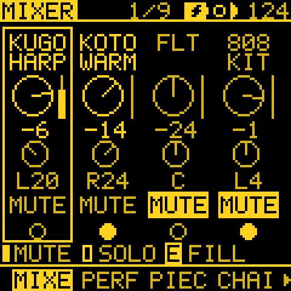

**MIXER** (tap GLO) is the four tracks as a mixer, and GLO's first page.

| Control | What it does on MIXER |
|---|---|
| **KNOB 1 to 4** | The levels of tracks 1 to 4. With **OCT-** held, the pans (the pan dials light up). |
| **Black keys** F#3 G#3 A#3 C#4 | Mute and unmute tracks 1 to 4. |
| **White keys** F3 G3 A3 B3 | Solo a track while held. |
| **C4** | Unmutes them all. |
| **D4** | Holds the generators' line ([HOLD](#evolve)). |
| **E4** | Holds FILL. |
| **F4** | Taps the tempo. |
| **SELECT** | Sets the tempo. (On the other GLO pages it turns the pages, past MIXER.) |
| **OCT+** held | MIXER's sheet: **Mutes**, when the mute keys take effect while playing (NOW, BAR or PHRASE), the same setting as MENU > MUTES. |

- The keys work the same with GLO held on any other page. The line above the page tabs says so: a black key MUTE, a
  white key SOLO, E FILL.
- Each strip shows MUTE or SOLO; a track silenced by another's solo dims.
- The keys stay the mixer's on the next two GLO pages, PERF and LANDSCAPE, so you can mute and solo while you turn the
  macros or watch the sea (the knobs turn the macros there too). Any other page button leaves them, and the keys play
  notes again.
- A mute only silences the track: a muted track still leads the tracks that follow it (FOLLOW, an ANSWER's SOURCE, QNT
  CHRD's chord, QUAD's LINK, the cords).

**Lists** (the HOME menu, SCL, VOICE and the sheets): KNOB 1 picks the row, KNOB 2 changes its
value. A row with `>` opens a page of its own on OCT+ and comes back to the list: SCL's Scale (SCALES), VOICE's Sound
(PRESETS).

**The look.** Tessera draws every screen in one ink on black, with a 5 x 7 pixel font. The selected item is inverted,
and quieter things are drawn in a dimmer ink. MENU > COLOR picks the ink:

| COLOR | Colours |
|---|---|
| **YELLOW** (the default), WHITE, GREEN, BLUE, RED; ORANGE, PINK, HOT PINK, LILAC (to match the FM-1's shells) | One ink. The tracks are told apart by their numbers, not by colours. |
| **MOSAIC** | A colour per track: T1 yellow, T2 blue, T3 hot pink, T4 green. |
| **SUNSET** | Orange, hot pink, lilac, yellow. |
| **OCEAN** | Blue, teal, green, lilac. |
| **NEON** | Cyan, magenta, lime, orange. |

- **With a four-colour set,** the screen takes the selected track's colour, the pages that show all four (HOME, MIXER,
  PATTERNS, SONG, QUAD, FOLLOW, MATRIX, MIDI OUT, the cords) draw each in its own, and the value you turn and the row
  you pick show in white.
- **Picking:** with COLOR picked in the menu, the inks and the four-colour sets show below it, the one chosen framed and
  its name large. KNOB 2 or OCT+ steps through them.

**GROUND.** MENU > GROUND, just below COLOR, sets what the ink is drawn on: **DARK** (the default, black, as above) or
**LIGHT**, warm paper. On paper each ink becomes a darker version of itself that reads well there, and several inks
share one:

| On DARK | On LIGHT |
|---|---|
| WHITE | BLACK (COLOR calls it BLACK) |
| YELLOW, ORANGE | SEPIA (COLOR shows YELLOW) |
| GREEN | FOREST |
| BLUE | NAVY |
| RED, PINK, HOT PINK | CRIMSON (COLOR shows PINK) |
| LILAC | PLUM |
| MOSAIC | SEPIA, NAVY, CRIMSON, FOREST |
| SUNSET | SEPIA, CRIMSON, PLUM, CHARCOAL |
| OCEAN | NAVY, TEAL, FOREST, PLUM |
| NEON | TEAL, PLUM, FOREST, SEPIA |

- The selection is in CHARCOAL.
- A RED, HOT PINK or ORANGE you chose on DARK is shown and drawn as PINK or YELLOW on paper, and is itself again on
  DARK.
- While LIGHT is on, COLOR's sheet shows the light versions on paper, so you see what you pick.
- Older firmware keeps the ink you chose and draws it on black.

<table>
<tr>
<td align="center"> <b>YELLOW</b></td>
<td align="center"> <b>WHITE</b></td>
<td align="center">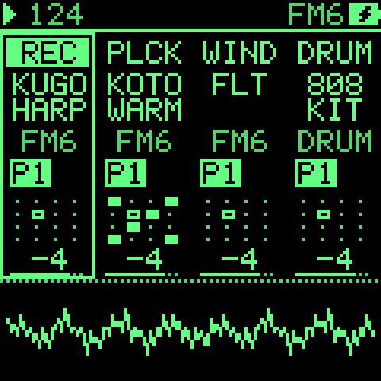 <b>GREEN</b></td>
<td align="center">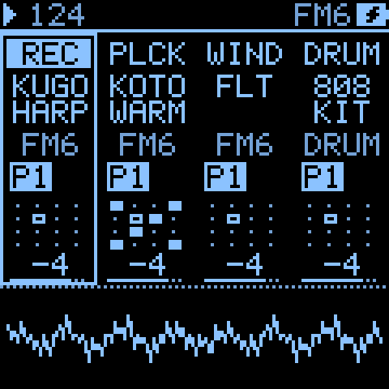 <b>BLUE</b></td>
</tr>
<tr>
<td align="center">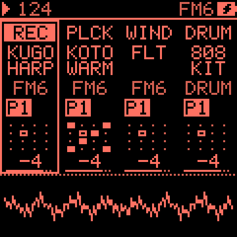 <b>RED</b></td>
<td align="center"> <b>ORANGE</b></td>
<td align="center"> <b>PINK</b></td>
<td align="center">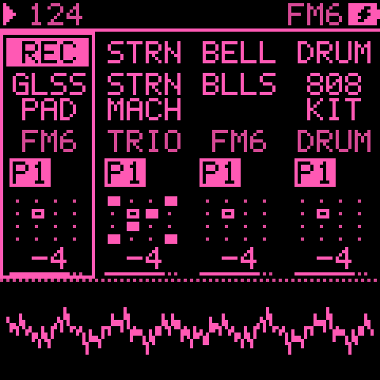 <b>HOT PINK</b></td>
<td align="center">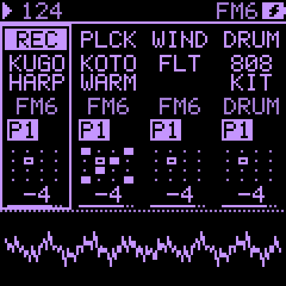 <b>LILAC</b></td>
<td align="center">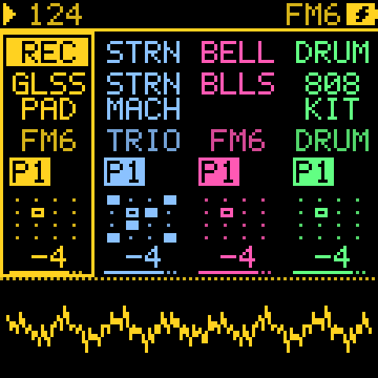 <b>MOSAIC</b></td>
</tr>
<tr>
<td align="center">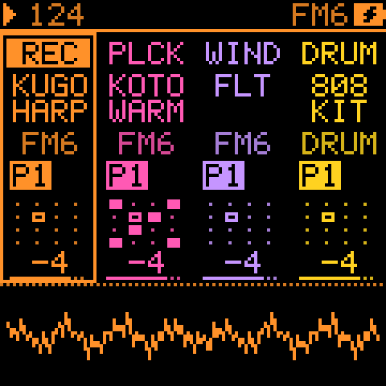 <b>SUNSET</b></td>
<td align="center">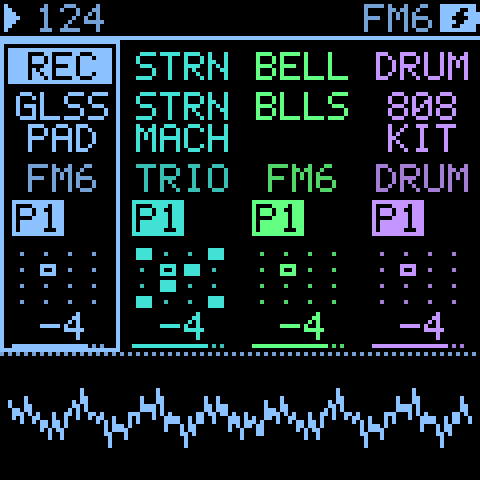 <b>OCEAN</b></td>
<td align="center">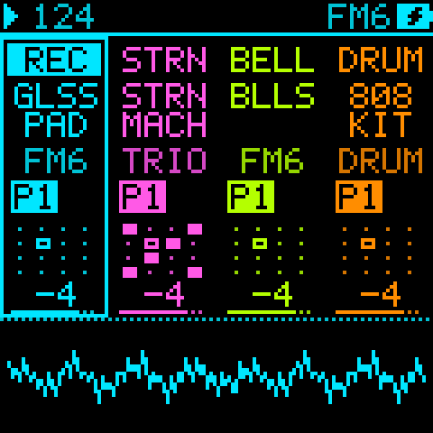 <b>NEON</b></td>
</tr>
</table>

**At power-on** the Tessera mark is laid tile by tile, held for a moment, then breaks into grains that a wind sweeps away. Any button or
key skips it.

---

## Shortcuts

<a href="https://youtu.be/v0EAFYWEDCo">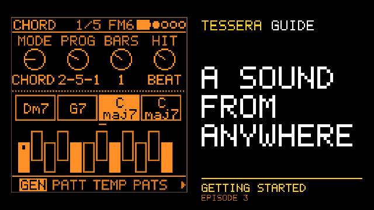</a> <a href="https://youtu.be/kX7NwcYfDSQ">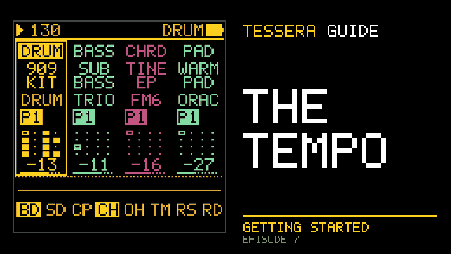</a>
 <!-- guide videos -->

> **In short:** the combinations worth learning first are SEQ for GEN, FX held to make
> a mod, REC held to keep what a generator played, and EDIT held with OCT- to undo.

| Do this | And this happens |
|---|---|
| Tap **SEQ** | **GEN** first: KNOB 1 (**MODE**) picks what the track plays. SEQ then shows only what that mode plays, ARP how it is shaped. |
| Tap **ARP** | The track's shaping pages (EVOLVE, TWEAK, TIMING and so on); tap again for the next. It never changes the track's MODE: that is GEN's KNOB 1. |
| Hold **OCT-** on GEN | KNOB 1 RANDOM; KNOB 2 to 4 the generator's second layer, for TURING, EUCLID, MARKOV, MORPH, QUAD, CHORD, ATLAS, CONSTELLATION and ANSWER (see [The GEN layer](#the-gen-layer)). Hold **OCT+** for the GEN sheet, where a generator has a setting past those. |
| Hold **OCT-** on EVOLVE | KNOB 1 ROLL ALL; KNOB 3 PAT GEN; KNOB 4 a generator's GRAVITY (a STEP track: STEP EVOLVE's HOW) (see [EVOLVE](#evolve)). |
| Hold **OCT-** on GEN or TWEAK, turn **KNOB 1** | **RANDOM**: turn right and the page's knobs get new values, each inside its range (GEN: the generator's KNOB 2 to 4; TWEAK: SHIFT, DROP and HUMAN). The screen says **RANDOMIZED**. Turn left to put back the values from before the last turn (**PUT BACK**, once). KNOB 2 to 4 of this layer are the generator's own ([The GEN layer](#the-gen-layer)); on TWEAK, FOLLOW's HOW, RHYTHM and HOLD. MODE, the seed, FOLLOW, QUAD's LINK and CONSTELLATION's AUTO never change. A STEP or ARP track says **NO GENERATOR**. |
| Turn **SELECT** on HOME or MIXER, or with **GLO** held | Sets the tempo (BPM), as SEQ > TEMPO does; F4 with GLO held taps it. With CLK on USB or TRS the tempo is the clock's, and a Song Position from it (a DAW's PLAY from mid-song) starts the steps, the ARP and the generators where that song is, as if they had played from the top. |
| Turn **PRESETS** with **GLO** held, on any page | Browses the selected track's sounds as PRESETS does on HOME. The GLO map gives way to the sound: the track, the list and the place in it, the sounds before and after, the sound's name large and its engine (a fast turn: the name the knob will load when it stops, with its speed, X4). It stays while GLO is held; a GLO key or knob brings the map back. Without GLO, PRESETS keeps the page's own job (or does nothing), so a stray turn never changes the sound. GLO + OCT- does not put the sound back. |
| Tap **GLO** or **SEL** twice quickly | Locks its Quick SET open on the page you were on, so you need not hold the button: the header says **[GLO] LOCK** (or **[SEL] LOCK**), and the keys and knobs are the layer's. Tap the button again to close it; any other page button, the menu or a dialog closes it too (PLAY, REC and OCT keep working). |
| **GLO** + **E4** (on MIXER, PERF or LANDSCAPE, E4) | Holds [FILL](#a-steps-condition-and-fill) for the steps whose condition is FILL or !FILL. |
| **GLO** + **D4** (on MIXER, PERF or LANDSCAPE, D4) | **HOLD**: while the key is held every generator keeps the line it is playing. EVOLVE and STEP EVOLVE skip their rounds, TURING plays as PROB 0, MARKOV and MORPH replay their phrase as LOCK 100 (at LOCK 0, the last pass they played), CONSTELLATION replays its loop and ATLAS keeps this bar's CHAOS. Let go and they carry on from where they are. Tap D4 twice to latch it (**HOLD LATCHED**), tap it again to let go (**HOLD OFF**). The GLO map's D cell and D4's light show it. Not saved. |
| **GEN** on an AWAKE track, a white key | Picks that step: KNOB 1 sets its A, KNOB 2 its B. The same key lets it go. |
| Hold **FX**, turn a knob | Sets how far a cord moves that knob's parameter (see [Mod shortcut](#mod-shortcut)). |
| Hold **REC** | On a generator or ARP track: prints its last bars into STEP. On STEP EVOLVE: keeps the changes. On a STEP track: captures what you just played. |
| Hold **EDIT**, press **OCT-** / **OCT+** | Undo / redo. |
| **SAVE** + **REC**, or hold **SAVE** | Saves the project to its slot (stops playback first). |
| **EVOLVE**, KNOB 4 (**ROLL**) | Each click is a new seed (1 to 128), so a new line; turn back for the last one, note for note. |
| **FORM**, KNOB 3 (**CLEAR**) | Forgets B and C: the section playing becomes A. |
| **MODS**, **OCT+** | Switches the picked mod between **+-** (both ways), **+** (one way), **^** (GATE) and **=** (HOLD). |
| **MODS**, **OCT-** held + **KNOB 4** | Sets a GATE mod's threshold. |
| **MODS**, hold **OCT-** | Shows the picked mod's scope: its move over time over its source (see [MODS](#mods-the-modulation-cords)). |
| **MATRIX**, **OCT+** | Opens the picked mod in MODS. |
| **EDIT** on an EDIT page | The map of the sound's pages: KNOB 1 across a row, KNOB 2 between rows, OCT+ opens the page, OCT- or EDIT closes it. Any other page button leaves it for its page. |
| **PLAY** | Every generator starts its random choices from the top of its seed, and TIDE and SWARM restart: with EVOLVE's EVERY off, a project plays the same way each time. |

---

## Sounds

<a href="https://youtu.be/paX0NQLxHJQ">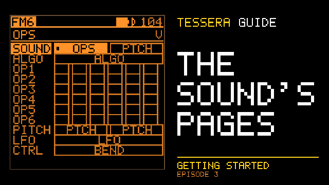</a> <a href="https://youtu.be/-ztS8lQAQ7E">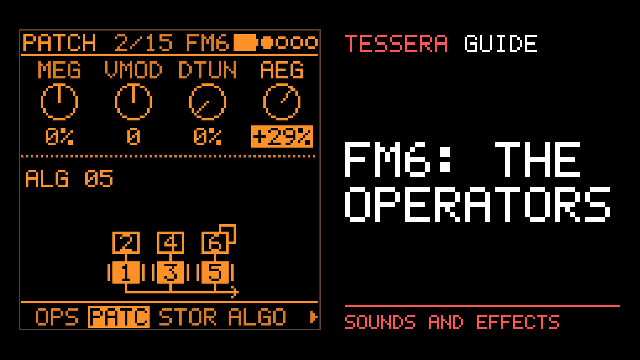</a> <a href="https://youtu.be/V96G-abswgI">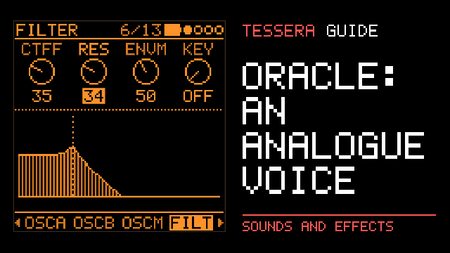</a> <a href="https://youtu.be/Sb-ZcOb-5Zo">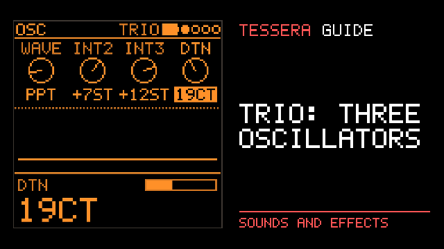</a> <a href="https://youtu.be/alSGN6S4j9o">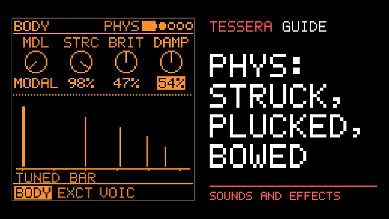</a> <a href="https://youtu.be/jASqwwpbtEw">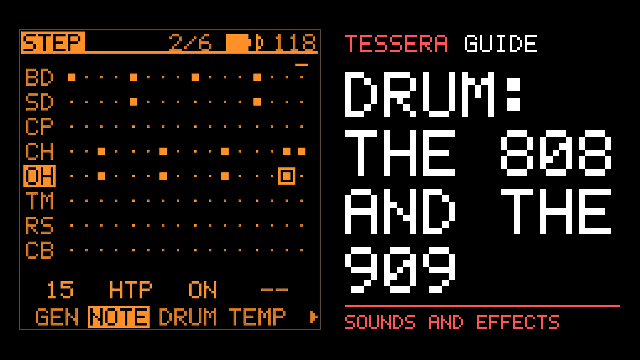</a>
 <!-- guide videos -->

> **In short:** each track's voice. FM6 for bright, glassy and bell-like sounds, ORACLE for warm analogue pads, brass
> and basses, TRIO for simple basses and leads, PHYS for plucks, mallets and bowed sounds, DRUM for kits. Browse them
> with PRESETS; change any of them on EDIT.

Tessera has five engines on the device:

| Engine | What it is |
|---|---|
| **FM6** | Six-operator FM in the manner of the DX7: 32 algorithms, operator envelopes and scaling, pitch EG, LFO and the function settings (bend, porta, wheel, foot, breath, aftertouch). Its ENGINE setting picks MODERN, MARK I (the DX7's own tables) or OPL. The main melodic voice. |
| **ORACLE** | Two oscillators, POLY MOD and a four-pole low-pass filter: a classic polyphonic analogue voice. Warm pads, brass, sync leads, basses, plucks. 24 sounds of its own; the sound is kept in the project. |
| **TRIO** | Three oscillators: WAVE, INT2, INT3 (intervals) and DETUNE. Basses and leads. |
| **PHYS** | Physical models: MODAL (bars, bells, plates), STRNG (a plucked or bowed string), MEMB (drum heads) and SYMP (a string with three more ringing along). Bells, mallets, plucks, bowed pads and drones; 17 sounds. |
| **DRUM** | Drum kits: **808** and **909**. Eight lanes: BD, SD, CP, CH, OH, TM, RS, CB. The 808 has six tom pitches. |

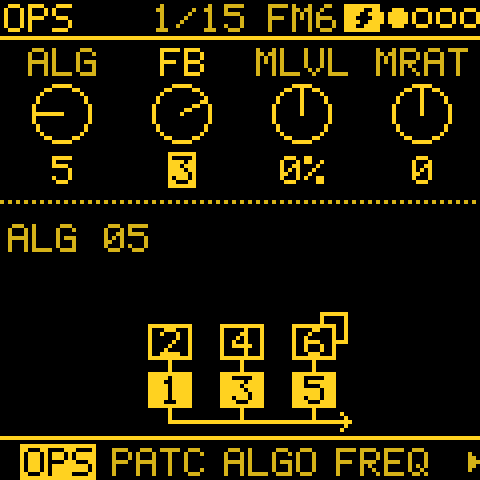 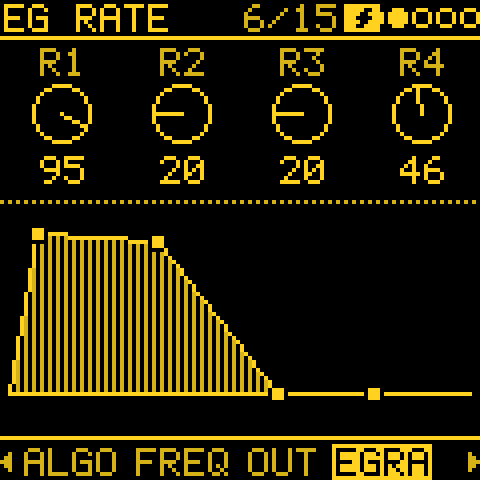 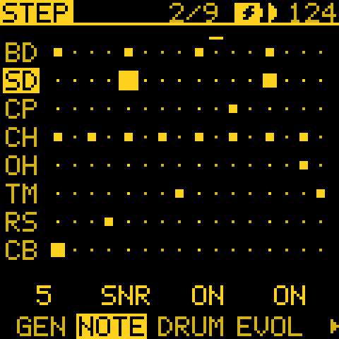

- **PHYS's knobs** each cover only their musical range, with wide sweet spots. STRC keeps MODAL's overtones in tune
  from 16 to 48, a chime's near 84 and a marimba's at the top (the picture names where it is). A dull, short or bowed
  sound is as loud as a bright one.
- **Releases:** FM6 and TRIO presets have releases that ring out, so short sequenced notes are not cut off.
- **Slow pads** (GLASS PAD, SOFT PAD, DEEP PAD, PAD, STRINGS) swell in slowly: they speak on long notes and drones, and
  stay quiet on short steps.
- **Old projects:** a PHYS track in a project from before 2.0 plays as PHYS, a little differently towards the ends of
  the knobs. A track saved with SID or CZ-1 loads FM6's INIT, and a drum track saved with KIT SID or SID DIGI loads as
  the 909.

**FM6's amp envelope.** FM6 has no ADSR of its own, as the DX7 had none: each carrier's envelope (ENV: EG RATE, EG
LVL, an operator at a time) is the sound's volume. **AEG** (EDIT 2, KNOB 4) moves them all at once: turned right a
slower attack and a longer release, left a shorter one, 0 the patch as it is.

**A filter for FM6.** FM6 has no filter of its own, as the DX7 had none: its brightness is **MLVL** (EDIT 1, KNOB 3),
the level of the operators that are not carriers, and the track's CUTOFF cords move it. For a resonant low-pass, put
the **FILTER** effect on the track (FX, an insert's TYPE **FILTER**): **CUT** is its cutoff, **RES** its resonance,
and both are cord destinations (FX1 RTE, FX1 CHR). It works on any track, and as a send effect.

**CUTOFF and SHAPE per engine.** A mod (or the ENV and LFO routes) onto a track's **CUTOFF** or **SHAPE** moves what
that track's engine has in their place, on every voice: a filter where there is one, the brightness or the timbre
where there is none. Where an engine has nothing there, the mod does nothing; for a resonant low-pass on any track,
use the **FILTER** effect above.

| Engine | CUTOFF moves | SHAPE moves |
|---|---|---|
| TRIO | **CUT**, its filter | **PW**, the pulse width |
| ORACLE | **CUT**, its four-pole ladder | **PW A** and **PW B**, both pulse widths |
| NOISE | **FREQ**, its filter | **COLR**, the noise's colour |
| VOICE | **VOWL** and **VOWL2**, the vowel | **BUZZ**, the buzz against the breath |
| FM6 | **MLVL**, the modulators' level (its brightness) | **FB**, the feedback |
| PHYS | **BRIT**, the brightness | nothing |
| WHEEL | nothing | nothing |
| DRUM | nothing | nothing |

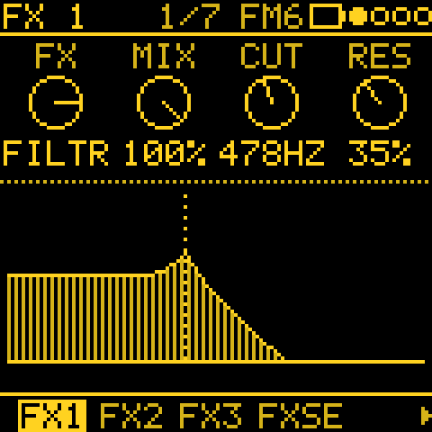

**ORACLE.** Oscillator A (saw, pulse) and B (saw, triangle, pulse) and noise go through a resonant four-pole
low-pass filter and the amp, each with its own envelope. **POLY MOD** lets the filter envelope and oscillator B bend
A's pitch, A's pulse width or the cutoff, note by note: B at audio rate into A's pitch gives bells and metal, the
filter envelope into A's pitch a sweep on each note. Its pages, on **EDIT**:

| Page | KNOB 1 to 4 |
|---|---|
| **MACRO**, **MACRO 2** | CUT, RES, TUNE A, TUNE B; PW A, PW B, LVL A, LVL B: offsets on the sound, the ones the HOME knobs, cords and motion move |
| **OSC A** | FREQ A (semitones), WAVE A (SAW, PLS, S+P), PW A, SYNC (A restarts with B) |
| **OSC B** | FREQ B, FINE B (a little sharp, for beating), WAVE B (SAW, TRI, PLS and their mixes), PW B |
| **OSC MIX** | the levels of OSC A, OSC B and NOISE; B MODE: KEY (follows the notes), FIXED, LO KEY / LO FIX (B as a slow LFO for POLY MOD) |
| **FILTER** | CUTOFF, RES, ENV AMT (how far FILT ENV opens it), KEY (OFF, HALF, FULL: brighter as notes go up) |
| **POLY MOD** | FENV and OSC B (how much each moves), TO (FREQ, PW, FILT or a mix), VEL (what playing harder opens) |
| **CHARACTER** | MODEL (EARLY or LATE filter: each colours the resonance its own way), VINTAGE (each voice drifts a little), GLIDE |
| **FILT ENV**, **AMP ENV** | ATK, DEC, SUS, REL |
| **LFO MOD** | RATE, AMOUNT, WAVE (SAW, TRI, SQR and mixes), NOISE (random movement mixed in) |
| **LFO ROUTE** | PITCH (A, B, A+B: vibrato), PW, FILT |

As on FM6, **ENV** goes to FILT ENV and AMP ENV (ORACLE has no use for the track's ENV), and **LFO** to MODS and the
track's LFO pages, then LFO MOD and LFO ROUTE. The sound lives in the project, a patch per track: a turned knob is
saved with it, and SAVE > SOUND keeps one you like in a USER slot, as on the other engines. ORACLE takes more of the FM-1 than an FM6 voice (about
one and a half times): one ORACLE track of pads or chords is fine; with two busy ones, keep BUDGET in mind (below).

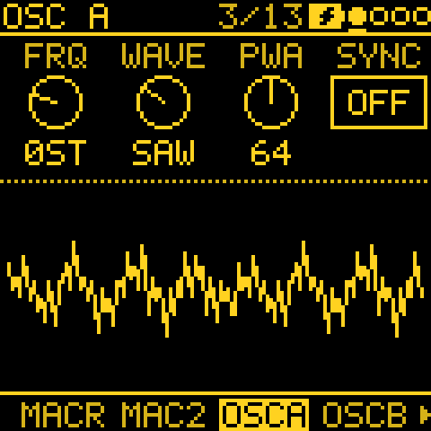 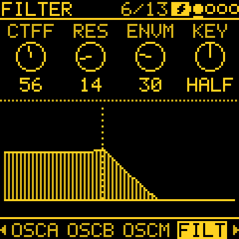 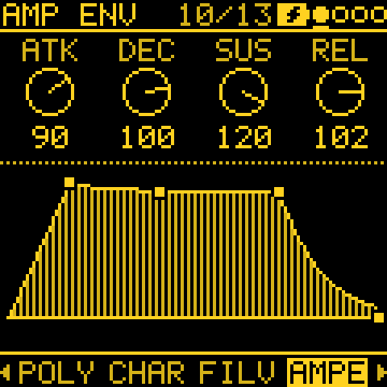

### Choosing a sound

<a href="https://youtu.be/vJHdMg-8y0s">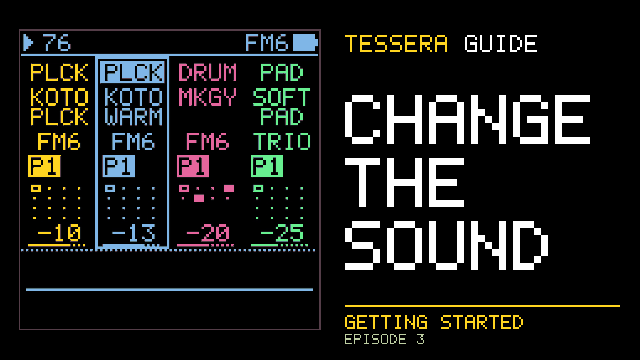</a>
 <!-- guide videos -->

**PRESETS** (SAVE) browses the sounds.

- **Its LIST knob** picks ALL, the favourites, RECENT, a category, or (after the categories) one engine: FM6, ORACLE,
  TRIO, PHYS or DRUM, each with only its own sounds, factory and user. So an ORACLE pad is ORACLE, then a turn of
  PRESETS. It starts on ALL at power-on.
- **The PRESETS knob** browses the same list on HOME and on PRESETS. On any other page, hold GLO and turn it.
- **EDIT > VOICE** starts with the track's **Sound** (`SOUND  KUGO HARP >`). KNOB 2 there steps through the PRESETS
  list as the PRESETS knob does, and **OCT+** opens PRESETS in place. OK (OCT+) there keeps the sound you picked, BACK
  (OCT-) puts back the one you had; either way you are back on VOICE's list, not on HOME.

### How many voices at once

<a href="https://youtu.be/I-N4ikzKje0">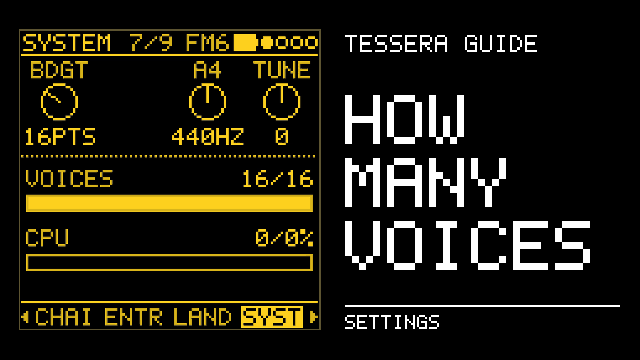</a>
 <!-- guide videos -->

All the tracks share one pool of voices, set by **GLO > SYSTEM > BUDGET** (16 by default). A note that rings on in
its release still holds a voice, so a busy generator on a sound with a long release can keep most of the pool
ringing on its own: TINE EP under MARKOV at 100 % density and 1/16 holds about 15. When the pool is full, a new note
takes the oldest released voice; when the FM-1 has more six-operator voices to work out than it has time for, you
hear a faint crackle.

One busy FM6 track like that is fine; two or more of them at full density is past the FM-1's limit. To keep it
clean:

- thin one of them (DENSITY, DROP, or a slower DIV);
- give one a shorter note (LENGTH) or a sound with a shorter release, such as a TRIO voice or DRUM;
- lower **BUDGET** (12, say): fewer voices ring at once, which leaves the FM-1 headroom; higher allows more, and
  crackles sooner.

**Watching the load on GLO > SYSTEM:**

- **CPU**, in its second column, shows two numbers: the average, then the worst moment of about the last second
  (`55/92 %`), USB audio and MIDI included. When the second number reaches 99, notes may drop or the sound crackle.
- Below: a **VOICES** bar (the voices sounding now, out of the BUDGET) and a **CPU** bar (the average, with a tick at
  the peak).
- At the foot, since power-on: **FADED**, the times the FM-1 ran short of time and faded a voice to catch up (a note
  cut short), and **LATE**, the times the sound was late (a crackle).
- **When it happens, the header tells you:** the four track dots at the top right fill for a moment, once when a voice
  was faded, twice when the sound was late (on HOME they show in the engine's and the battery's place). They point at
  no track: the voice faded is the quietest one, not the busiest. At most once every five seconds. A voice that BUDGET
  takes doesn't blink. **MENU > OVERLOAD OFF** stops the blink; FADED and LATE still count. If you hear a click and
  the dots stay as they are, the FM-1 wasn't overloaded: please report it.
- For the full picture, the web editor's [Health](#health-how-hard-the-fm-1-is-working) reads the same numbers and more.

**A track nobody can hear costs next to nothing.** At LEVEL 0, muted, left out by SOLO or taken out by
[ENTRIES](#entries-tracks-out-and-back-in), its voices and insert effects stop after a moment, while its sequencer, LFO
and the tracks that follow it go on. Heard again, it fades back in. (A track whose ENV a cord reads always plays on.)
Muting a busy part is a quick way to make room.

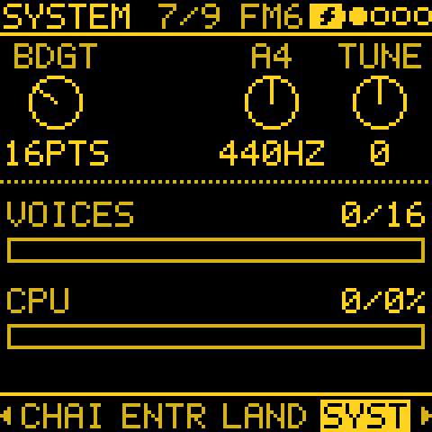

On the same page, **A4** (the FM-1's tuning reference, 440 Hz by default) and **TUNE** (a fine offset in cents) set the pitch.

---

## SEQ: the MODE and its pages

<a href="https://youtu.be/CDoVeqAkvv8">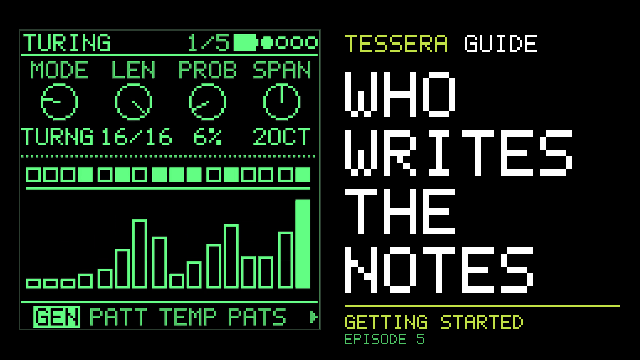</a> <a href="https://youtu.be/HOReZkSzdxg">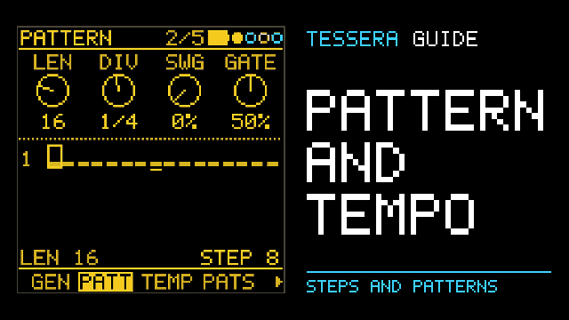</a>
 <!-- guide videos -->

> **In short:** GEN's MODE decides what a track plays: your own steps, an arpeggio, or a generator that writes the
> notes. SEQ (what plays) and ARP (how it is shaped) then only show the pages that matter for that choice.

Tap **SEQ** for **GEN**, where **KNOB 1, MODE** picks what the selected track plays:

- **STEP**: the step sequencer.
- **ARP**: the arpeggiator over the keys held.
- One of thirteen generators, in the knob's order: **CHORD** first, then **TURING**, **EUCLID**, **MARKOV**,
  **MORPH**, **ATLAS**, **BOUNCE**, **AWAKE**, **POLY**, **QUAD**, **CONSTL** (Constellation), **SERIES** and
  **ANSWER**.

Two buttons share the track's pages, and each shows only what its MODE uses. **SEQ** holds what the track plays;
the **ARP** button holds how its notes are shaped. SELECT turns the pages of the one you are on.

| MODE | SEQ: what plays | ARP: how it is shaped |
|---|---|---|
| **STEP** | GEN, NOTES (a DRUM track: NOTES, DRUM HIT), TEMPO, PATTERNS, SONG | EVOLVE (STEP EVOLVE), TWEAK (its HUMAN), TIMING (its SHAPE and HUMAN) |
| **ARP** | GEN, NOTES, ARP (MODE, RATE, OCT, GATE; OCT- held: SWING, PROB, HOLD, ORDER), TEMPO, PATTERNS, SONG | TWEAK (SHIFT and HUMAN) |
| a generator | GEN, PATTERN, TEMPO, PATTERNS, SONG | EVOLVE, FORM, TWEAK, TWEAK 2, LENGTH, TIMING, ENERGY |

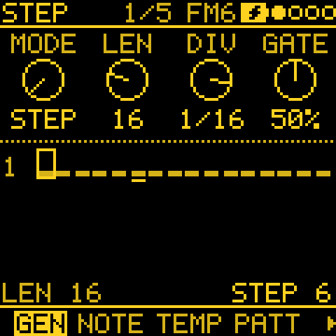

**The pages, in a little more detail:**

- **GEN** is also the pattern's page with STEP or ARP: KNOB 2 to 4 are LENGTH, DIVISION and GATE, and the track's
  SWING is a row of the pattern's sheet (OCT+ held). A generator track has these on **PATTERN** instead.
- **DRUM HIT**, a DRUM track's grid of hits, comes right after NOTES.
- **MOTION**, the knob moves recorded on the pattern (see [Recording live](#recording-live)), shows once a track has
  some.
- The generators run at the track's DIV and play in the track's scale (SCL).
- Choosing STEP or a generator turns the arpeggiator off; choosing ARP again brings back its last setting.

**A generator joins in time.** A generator picked while the others play starts where it would be had it played since
PLAY, on the same steps and bars, so an ATLAS groove picked under a playing chord lands on the beat. A muted track
plays on unheard, so when unmuted it comes back in time. BOUNCE, QUAD, CONSTELLATION and SERIES run free and simply
carry on.

### The ARP page

<a href="https://youtu.be/PpYMGIey_vg">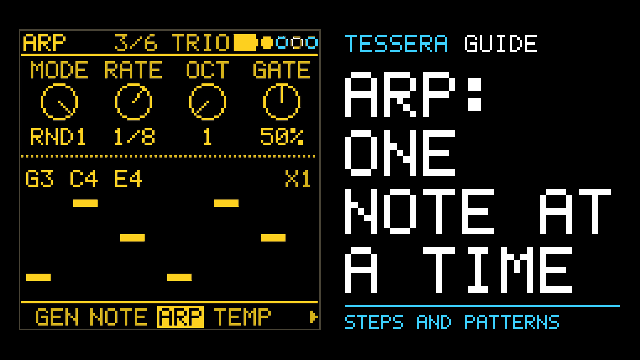</a>
 <!-- guide videos -->

ARP's **MODE** is the order the held notes play in, over OCT octaves:

| MODE | Plays C E G as |
|---|---|
| **UP** | C E G, C E G (low to high) |
| **DN** | G E C, G E C (high to low) |
| **UPDN** | C E G E, C E G E (up, then down; the top and bottom notes once) |
| **DNUP** | G E C E, G E C E (down, then up; the top and bottom notes once) |
| **RND** | a new random note each step |
| **RND1** | one random order, such as E C G, then the same again; a new one when the held notes change (or OCT or ORDER) |
| **ORD** | in the order the keys were pressed (or the notes came in over MIDI) |
| **REPEAT** | the last note pressed, again and again |

**The second layer:** hold **OCT-** (its light is on there) and KNOB 1 to 4 are **SWING**, **PROB**, **HOLD** and
**ORDER**. **ORDER** (NOTE or PLAY) decides what UP, DN, UPDN, DNUP and RND1 start from: the notes low to high, or as
pressed. ORD always plays them as pressed.

- On an ARP track, TWEAK's **SHIFT** moves the arpeggio by semitones, and **HUMAN** makes its notes a little softer or
  louder and shorter, as on a generator.
- The arpeggio's tosses (RND's notes, RND1's order, PROB) come from the track's SEED, so PLAY plays it the same again.

### Writing notes on NOTES

<a href="https://youtu.be/3nJsvgpO-mI">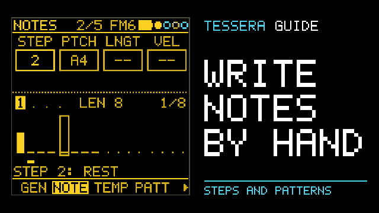</a>
 <!-- guide videos -->

On NOTES, **KNOB 2** sets the picked note's pitch:

| QNT | A detent moves |
|---|---|
| **OFF** | a semitone |
| **SNAP**, **WHITE**, **ALL**, **MPC** | a note of the scale. A note off the scale first goes to the next scale note in the turn's direction. |
| **CHRD** or **HARM**, with a CHORD track playing | through that chord's notes |

- Hold **ENV** while turning for a semitone at a time.
- A microtonal scale moves a degree a detent.
- **Hearing it:** with **MENU > NOTE PREVIEW** on (the default), you hear the new pitch at the note's velocity for about
  a sixth of a second, on that track and on MIDI OUT as a key's note would be (KEYS, ALL). Nothing is recorded. It
  sounds while playing too, but not while recording.
- **QNT works on notes as they come in,** so notes written with QNT OFF, or before SCL changed, stay where they are. To
  bring them onto the scale, use **Snap to scale** on [the pattern's sheet](#the-patterns-sheet-snap-to-scale-double-half-euclid-accumulate).

**The bars:** a note's bar stands for its pitch over the C below the page's lowest note. The scale is one, two or three
octaves tall, as the page's notes need; anything above three octaves shares the top of the area, so one note raised
high leaves the others readable. A page with only one pitch shows where it sits in the whole range.

### Recording live

<a href="https://youtu.be/F85vgOe1-nI">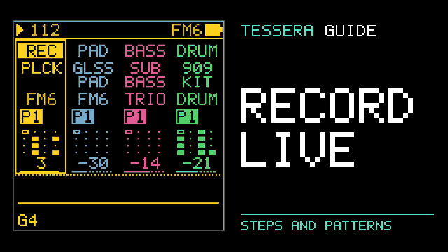</a>
 <!-- guide videos -->

> **In short:** play the keys and Tessera records them into the pattern, pass after pass, so you can build a part up
> layer by layer.

| Do this | And this happens |
|---|---|
| Tap **REC** while playing | Arms the selected track. It waits for the pattern's start (**WAIT FOR LOOP**), then records what you play on the keys (or MIDI IN) over every pass, each pass on top of the last, until you tap **REC** again. |
| Play a key while stopped (REC armed) | Starts the sequencer and the take at once. |
| **REC** + **PLAY** | Starts both together. |

QNT (TEMPO) snaps the take when it ends.

**Editing while you record, on NOTES:**

- **EDIT** + **REC** (either first): **CLEAR PATTERN?** OCT+ clears it and REC stays on, so the next pass records a new
  take. With REC off, EDIT held undoes the clear.
- **EDIT** held while recording erases as the steps pass.
- **EDIT** tapped (not recording) deletes the note at the cursor with its ties. The cursor then moves on the way
  **KNOB 1** last turned it, right or left, so tap after tap clears a run either way. On a DRUM track's grid, the same
  for the step.
- **OCT-** / **OCT+** with REC on move the keys an octave down / up, as on HOME (both together: back to the middle). The
  header shows it (**KEYS OCT +1**). OCT+ held still opens the pattern's sheet.

### The pattern's sheet: Snap to scale, Double, Half, Euclid, Accumulate

<a href="https://youtu.be/XITnEeU4NbM">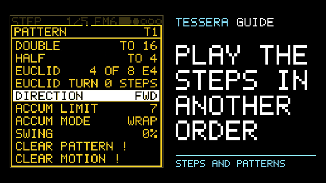</a>
 <!-- guide videos -->

> **In short:** quick tools for a whole pattern. This lets you fix wrong notes after a scale change, double a loop to
> add a variation, or drop in an even rhythm in one press.

Hold **OCT+** on GEN (STEP, ARP), NOTES, PATTERN or the drum grid for the pattern's sheet. Besides Quantize, Swing (the
track's, KNOB 2), Clear pattern and Clear motion, it has these rows:

| Row | What it does |
|---|---|
| **Snap to scale** | OCT+ moves every written note of the pattern onto the track's scale and ROOT, once. |
| **Double** | Makes the pattern twice as long (up to 64 steps). |
| **Half** | Halves LEN (15 steps become 8). |
| **Euclid** | KNOB 2 sets the hits ("5 of 16 BD"), and OCT+ spreads them over LEN as evenly as they go, the first on step 1. |
| **Euclid turn** | KNOB 2: starts the hits that many steps later. |
| **Direction** | The order the pattern plays its steps in (see below). |
| **Accum limit** (1–14, 7) | How far a step's Accumulate takes its notes, in scale degrees from the notes as written. 7 is an octave of a 7-note scale. |
| **Accum mode** | What they do at the limit: **Wrap** goes back to the notes as written and climbs again, **Ping** turns round and comes back, **Clamp** stays at the limit. |

Snap to scale, Double, Half and Euclid are each undone with **EDIT** held, one at a time.

**Snap to scale:**

- It moves every note of a chord, recorded notes, and steps hidden past LEN.
- Each note goes to the nearest note of the scale; halfway between two, it goes down. Two notes of a chord that land on
  the same note become one.
- With **QNT CHRD** (or HARM) and a CHORD track playing, notes go to the nearest note of the chord playing now.
- The header says how many moved (**SNAPPED 7**), or **ALL IN SCALE**.
- It works at any QNT, OFF included.
- A kit or slices has no such row.

More detail: Snap to scale on unusual scales

- On a microtonal scale or your own tuning, every note already is a degree of the scale, so nothing moves.
- With QNT OFF on a scale of up to 12 degrees (the maqamat, the just and meantone scales), its notes are semitones and
  go to the nearest semitone close to the scale.

**Double** copies the steps, recorded notes and motion after themselves; a playing pattern carries on into the copy.
**Half** keeps the steps past the new LEN, hidden, as when LEN is turned down.

**Euclid:**

- On the drum grid, it writes the selected lane.
- On NOTES, it writes one note row: the note at the cursor, else the pattern's first note, else ROOT. A step with a hit
  gets the note, and a step without one loses it.
- Other lanes and notes stay as they are.
- It does not work on a pattern with recorded notes.

#### Direction

**Direction** (KNOB 2, or OCT+ for the next) sets the order the pattern plays its steps in. Each of the track's 8
patterns keeps its own, saved with it. A generator track does not use it.

| Direction | Plays |
|---|---|
| **FWD** (the default) | Step 1 to the last, as always. |
| **BACK** | The last step to step 1. |
| **PEND** | There and back, turning on the end steps; each end plays once (1 2 3 4 3 2 1 2 ..). |
| **FOLD** | From the ends inwards, the first and last steps in turn (1 8 2 7 3 6 4 5 on 8 steps), then again. |
| **RAND** | Any step, each time. |
| **DRUNK** | One step on or one back, at random; past the ends it goes round. |

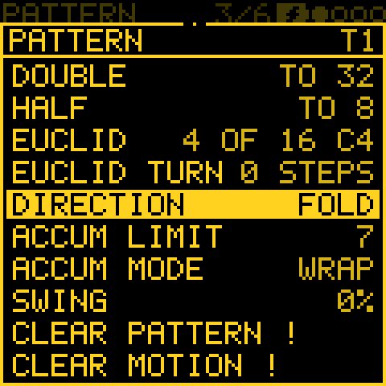

- **It stays in time.** A pass is still LEN steps of time, whatever the direction. So step Conditions (1:2 ..),
  Accumulate, pattern changes, the SONG and STEP EVOLVE's rounds stay on the bar line, in time with the other tracks.
  A PEND of 16 steps goes on into the next pass.
- SWING swings the off-beats, whichever step is on them.
- RAND and DRUNK draw from the track's SEED, so PLAY plays the same line again.
- Changing the direction while it plays never moves the playhead: the next step comes from the one playing, the new
  way. A new pattern starts at its own direction's start (BACK: its last step).
- Capture and print write the notes in the order they sounded, and set the pattern to FWD.
- While a mod moves the direction, the Direction row shows both, the pattern's own and the one playing: FWD>PEND.

More detail: ties and recorded notes going backwards

- Going backwards (BACK, the way back of PEND, DRUNK's steps back), a tied note plays once. A run of a note and the
  TIEs after it starts on the run's last step and lasts the whole run, as it does forwards; it does not play again on
  the note's own step.
- Recorded notes (REC) follow the direction too: each step plays the notes recorded on it, whichever way the playhead
  goes.

### PATTERNS and SONG

> **In short:** each track has 8 patterns, like 8 pages of its own steps. PATTERNS picks the one each track plays.
> SONG lines up sets of patterns, one per track, into a song.

**What a pattern holds:** a track's 64 steps with everything on them (notes, drum hits, each step's length, velocity,
chance, ratchet, nudge, accumulate and condition), its recorded notes and knob motion, and its LEN, DIV, SWING and
GATE. Each of the four tracks has 8, so a project has 32.

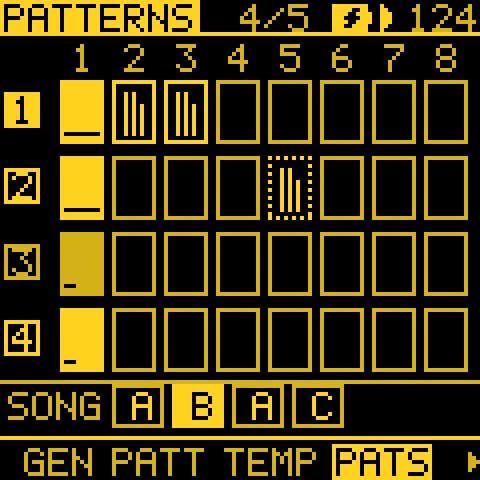 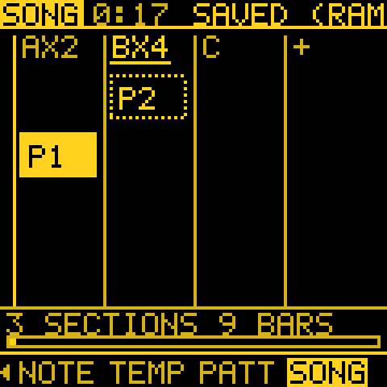

What a pattern changes depends on the track's MODE:

| MODE | A pattern is |
|---|---|
| **STEP** | The whole part. Another pattern plays other notes. |
| **ARP** | Its LEN, DIV, GATE and its notes. The ARP settings (and its OCT- layer's) belong to the track. |
| a generator | Only LEN, DIV, GATE, and the steps the generator can take as its seed (SOURCE, see [STEP as seed](#turing-euclid-markov-and-morph-source-keep-gravity-step-as-seed)). |

#### PAT GEN: a generator per pattern

The generator itself (its MODE, its knobs, EVOLVE, FORM, TWEAK and the rest) belongs to the track, not to a pattern,
unless **PAT GEN** is ON (EVOLVE page, hold **OCT-**, KNOB 3).

- With PAT GEN ON, each pattern keeps its own MODE, the generator's knobs, SEED, and EVOLVE's EVERY, AMOUNT and LOCK.
  So switching pattern (by hand, PATTERNS or SONG) switches the generator too, and it starts again from that pattern's
  SEED.
- A pattern can be STEP while another is a generator.
- Turning PAT GEN ON gives all 8 patterns the settings as they are. Edit a pattern's generator while it plays.
- COPY copies it with the steps.
- FORM, TWEAK, TWEAK 2, NOTE LENGTH, TIMING and the rest stay the track's.
- Without PAT GEN, change a generator over a piece with [FORM](#form) and [CHAIN](#chain-one-form-for-the-project)
  sections, [cords](#mods-the-modulation-cords), or separate projects.

#### PATTERNS

<a href="https://youtu.be/AOdqlhFV_mI">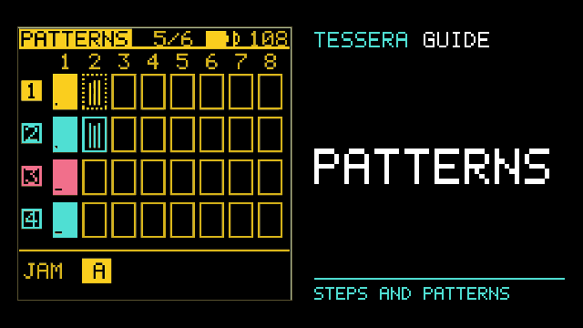</a>
 <!-- guide videos -->

Hold **SEQ** (or turn to its page). It shows a row per track, and a cell per pattern, 1 to 8:

| On the screen | Means |
|---|---|
| Filled in the track's colour | The pattern playing. The bar at its foot shows how far through it is. |
| Dashed | Queued: it plays next. |
| Grey, three bars | Has notes. The bars show how many fall in its first, middle and last third. |
| An outline | Empty. |
| Letters at the foot | The song's sections; the one playing (or picked on SONG) is lit. With no song: **JAM** and the rows it logged (below). |

| Do this | And this happens |
|---|---|
| **KNOB 1** to **KNOB 4** | Track 1 to 4's next pattern. Stopped: it changes at once. Playing: it waits (dashed) and changes when the pattern playing reaches its end. While a song plays it does not change: **STOP TO SWITCH**. |
| **OCT-** | Clears the queue. |
| **OCT+** held | The selected track's pattern's sheet: **Copy to** and **Delete pattern** (its notes and motion). |
| **SEQ** held + white keys F3 to F4 | Picks the selected track's pattern 1 to 8. SELECT picks the next or previous one. |

**Copy to** frames a place on the track's row, the first empty one first. Any knob moves it, **OCT+** copies (over a
pattern in use, it asks first), and **OCT-** leaves. It works only while no song plays.

#### SONG

<a href="https://youtu.be/O28GCeQLRPQ">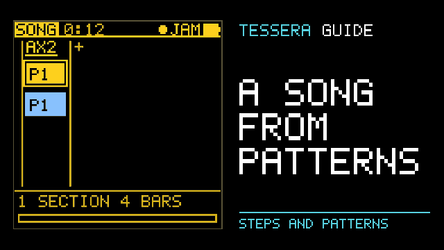</a>
 <!-- guide videos -->

A song is up to 16 sections. Each section is one pattern per track, and how many times it plays (1 to 16).

- A repeat is one pass of track 1's pattern, so make track 1's pattern the longest.
- Sections with the same four patterns share a letter: A, B, A, C.
- The screen shows the sections as columns and the tracks as rows, each pattern a block in the track's colour. At the
  top is the song's length at the tempo; at the foot, its sections and bars.

| Do this | And this happens |
|---|---|
| **KNOB 1** | The section. The **+** after the last adds one. |
| **KNOB 2** | The track. |
| **KNOB 3** | That track's pattern in the section. On **+** it adds the section, starting from the one before. |
| **KNOB 4** | The section's repeats. |
| **PLAY** or **OCT+** | Plays the song from its first section. It stops after the last one. |
| **OCT+** held | The song's sheet: Insert section, Duplicate section, Delete section, Take jam, Clear song. |
| **REC** held | Take jam (below). |

- The song is edited only while it is stopped (**STOP TO EDIT**).
- While it plays, PATTERNS cannot switch patterns.
- **STOP** brings back the patterns that were selected before the song started.

**The jam: turn what you played into a song.**

1. Play without a song, switching patterns as you like. SONG's header says **capturing jam**: each time track 1's
   pattern starts, the four patterns playing make a row (the same as the last row: one more repeat).
2. Hold **REC** on SONG. Those rows become the song (**SONG FROM JAM**). Over an existing song, it asks first.

The log starts again at each PLAY.

SONG is not linked to [CHAIN](#chain-one-form-for-the-project): SONG counts pattern repeats, CHAIN counts bars. See
[The long-form layers together](#the-long-form-layers-together).

### SEQ and older firmware

- **PAT GEN:** firmware before 3.5 loads such a project with every pattern playing the generator of the pattern that was
  playing when it was saved.

---

## The generators

<a href="https://youtu.be/-1sDYpQWxUQ">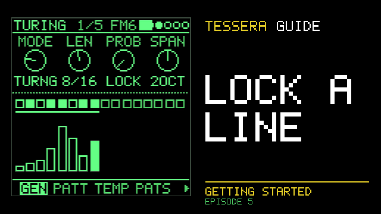</a> <a href="https://youtu.be/PjTSFgYj-rM">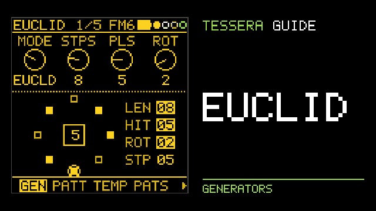</a>       
 <!-- guide videos -->

> **In short:** a generator writes the notes for you, in your scale, at the track's speed. Each one has its own
> character; see [Which generator for what](#which-generator-for-what) for a quick guide.

Each generator's three settings are on GEN, KNOB 2 to 4, and the panel under them shows what it plays. Every
generator is also a mod source: its **GATE**, its **NOTE** and a **CV** (see [MODS](#mods-the-modulation-cords)); a STEP
track gives the same GATE and NOTE from its pattern.

| MODE | KNOB 2 | KNOB 3 | KNOB 4 | What it plays |
|---|---|---|---|---|
| **TURING** | LENGTH (2–16) | PROB (0–100 %) | SPAN (1–3 oct) | A looping shift register, as a Turing Machine. PROB is the chance a step changes as it comes round: 0 locks the loop (the knob reads Lock), 100 is new every pass. |
| **EUCLID** | STEPS (1–32) | PULSE | ROT | Hits spread as evenly as they go over STEPS, turned round by ROT, on pitches picked by the seed. |
| **MARKOV** | LEAP (0–100 %) | DENS (5–100 %) | SPAN (1–3 oct) | A random walk over eight scale degrees. LEAP 0 moves to neighbours, 100 leaps widely. DENS is the chance a step plays. |
| **MORPH** | POS (0–127) | SNP A (1–8) | SNP B (1–8) | A rhythm blended from preset A into preset B. POS starts halfway. |
| **ATLAS** | X (0–255) | Y (0–255) | DENS (0–100 %) | Inspired by Émilie Gillet's Grids (Mutable Instruments): its drum map, kick, snare, closed hat and a fourth part from the point X, Y. Best on a DRUM track. The first time a track turns to ATLAS after power-on or a new song, X and Y start at a random point and DENS at 30 to 50 %, for a fresh groove; a loaded project keeps its own. More on the [OCT+ layer](#atlas-kick-snr-hat-the-fourth-part). |
| **BOUNCE** | SPEED (1–64) | ANGLE (0–90°) | BALLS (1–4, Fall) | Balls in a box: a note where a ball hits a wall. Each extra ball starts from its own place and angle; balls that hit on the same step play together, three notes at most. Past 4, **FALL** (after ambalek's norns script Fall): eight leaves fall at their own speeds and play where they land (left low, right high), and ANGLE becomes **WIND**: calm in the middle, leaning the melody low or high either side, gusting further out. |
| **AWAKE** | LEN A (1–16) | LEN B (1–16) | PROB (0–100 %) | Two loops, as norns' Awake. A is the melody (scale degrees or rests), B lifts it up the scale; different lengths shift B against A. Steps can be set from the keys (below). |
| **POLY** | RHY (1–4) | DIVISION (OFF, /1–/16) | SPAN (1–3 oct) | Four notes stepped on by four rhythms. RHY picks which rhythm DIVISION edits. Rhythms that land together play once, louder: /4 against /3 is a polyrhythm. |
| **QUAD** | DIR | PROB (0–100 %) | LINK | A 4 x 4 grid of notes the four tracks share, a row each, inspired by the norns script initenere. Each QUAD track plays its row on its own DIV, so the polyrhythm comes from the tracks' speeds. DIR: FWD, BACK, PEND, RAND or HOLD. LINK: the other QUAD tracks this one's steps also move on (HOLD tracks then play only when pulled). More on the [OCT+ layer](#quad-columns-and-range). |
| **CONSTL** | Y (0–14) | DENS (0–100 %) | SPEED | After timothy-taylor's norns script Constellation: a ship flies through a sky of stars; the stars that cross its crosshair play. Y is the crosshair's height (where the melody sits), DENS how many stars, SPEED how fast the sky passes (the straight note values, slow to fast). More on the [OCT+ layer](#constellation-lock-len-fill-size). |
| **SERIES** | START (0–127) | INTV (1–7) | LOOP (OFF, 1–16) | Per Nørgård's infinity series (after the norns script nørgård): a melody alike at every scale. START picks where it begins, INTV how many scale degrees a step of the series is, LOOP repeats that many steps (OFF never repeats). |
| **CHORD** | PROG | BARS (½, 1, 2, 4) | HIT | A progression's chords in the track's scale: POP (I V vi IV), 50S, 2-5-1, CIRCLE, TWO, DRONE, WALK (four chords from the seed) or USER (your own). HIT: HOLD (once, held), BEAT, STEP or OFFBEAT (short stabs on the "and" between the beats, a reggae skank). See [Harmony](#harmony-one-key-chord-and-qnt-chrd). |
| **ANSWER** | VARY (0–100 %) | ECHO (0–100 %) | FADE (1–16, LOOPS) | After Zen-1's call and response (the idea only): play a phrase on the track's keys (or MIDI IN), up to 16 notes, and a bar without a key ends it (with the transport stopped, a pause of a second and a half). ANSWER plays it back, after a rest, as answers that change a little more each time (VARY: a note moved a degree or two, an octave, left out or swapped), each softer than the last. ECHO repeats some notes once more at half the velocity. A note held down rings back that long too, when [LENGTH](#length) is left at its default STEP (FIXED or HIT there still decide). FADE is how many answers it gives, 1 to 16, before it rests until you play again; turned on past 16 (LOOPS SHORT, MID or LONG, the loops' lengths) it never forgets and plays on as four loops of different lengths. Its OCT+ layer: SOURCE (below), ORDER (PLAYED, REVERSE, SHUFFLE), SHIFT (each answer moved up to this many scale degrees) and SPACE (the rest before an answer, up to 4 bars). The GEN sheet (OCT+ held) adds **CHORD**: ARP (the old behaviour: notes played together are spread one a step apart) or TRUE (they share the step and come back as a real chord), and **MODE**: REPLY (as above) or BEND, a delay with a mind of its own that repeats every note TIME steps later while you play, drifting (VARY, SHIFT) and glitching (BREAK) as it goes (see [ANSWER: SOURCE, ORDER, SHIFT; SPACE, CHORD](#answer-source-order-shift-space-chord)). **SOURCE** (OFF, T1 to T4) makes a STEP pattern the call instead of the keys: that track's pattern playing now (this track's own too), its first 16 notes at their steps, read again before each answer, so a sequence you record in STEP gets answered, and answered anew when you change it. The keys then just play. While that track's pattern is empty, the notes you play live on its keys (or its MIDI IN) are the call instead, so you can play T1 and have T2 answer. The other way round, REC held prints ANSWER's answers into STEP (see [Print and keep](#print-and-keep)). |

<table>
<tr>
<td align="center" width="25%"> <b>TURING</b></td>
<td align="center" width="25%"> <b>EUCLID</b></td>
<td align="center" width="25%"> <b>MARKOV</b></td>
<td align="center" width="25%"> <b>MORPH</b></td>
</tr>
<tr>
<td align="center"> <b>ATLAS</b></td>
<td align="center"> <b>BOUNCE</b></td>
<td align="center"> <b>FALL</b></td>
<td align="center"> <b>AWAKE</b></td>
</tr>
<tr>
<td align="center"> <b>POLY</b></td>
<td align="center"> <b>QUAD</b></td>
<td align="center"> <b>CONSTL</b></td>
<td align="center"> <b>SERIES</b></td>
</tr>
<tr>
<td align="center"> <b>CHORD</b></td>
<td align="center"> <b>ANSWER</b></td>
<td></td><td></td>
</tr>
</table>

**AWAKE step entry.** On GEN with an AWAKE track the keys are its steps and play no sound. A white key picks a
step: KNOB 1 sets its A value, KNOB 2 its B. Press the same key again, or leave the page, to go back to the usual
knobs.

**Seeds.** Every generator's random choices come from the track's seed (EVOLVE's ROLL). A seed sets the starting
material too: Turing's register, Euclid's pitches, Markov's first state, Awake's loops, Poly's notes, Quad's cells,
the sky. A track gets a random seed the first time a generator is picked, so each power-on starts somewhere new; a
saved project keeps its seeds.

---

## The GEN layer

 <!-- guide videos -->

> **In short:** on the GEN page (tap SEQ), hold OCT-: a generator gets a second set of knobs, not a page of its own: KNOB 1 RANDOM, KNOB 2 to 4 its finer
> settings. This lets you shape the details without crowding the main page. A setting past those, where a generator
> has one, is on the GEN sheet (hold OCT+).

On the **GEN** page (tap **SEQ**):

| Do this | What you get |
|---|---|
| Hold **OCT-** | **The GEN layer.** The knobs' labels change to the layer's. KNOB 1 is **RANDOM**, as on every generator (see [Shortcuts](#shortcuts)), and KNOB 2 to 4 set the layer. Let go to return; letting go never goes back a page. |
| Hold **OCT+** (or tap it) | **The GEN sheet**, for a generator with more settings than that. Pick the row with **KNOB 1** and turn its value with **KNOB 2**. |

  

### ATLAS: KICK, SNR, HAT; the fourth part

 <!-- guide videos -->

| Knob (OCT- held) | Setting | What it does |
|---|---|---|
| 2 | **KICK** (0–100 %) | How much of DENS the kick gets: 0 silences it. |
| 3 | **SNR** | The same for the snare. |
| 4 | **HAT** | The same for the closed hat. |
| GEN sheet | **Fourth part** (0–100 %) | A fourth part, on the tom at first: the hits the kick and snare only just miss, so fills follow the groove. 0 (OFF) plays none. |

- **The fourth part's sound:** with OCT- held, a **black key** picks it, as on the drum grid: TOM, CLAP, OPEN HAT, RIM
  or BELL.
- The parts are also mod destinations: AT KICK, AT SNR, AT HAT, AT TOMS.

### CHORD: STRUM, DIR, OCT; CHRD, VOIC, BREATH (or LEN)

 <!-- guide videos -->

Hold **OCT-** on GEN with a CHORD track. KNOB 1 is RANDOM, KNOB 2 and 3 set how the chord is struck, and KNOB 4 its
register. The chord's kind and voicing are on the GEN sheet (and on SCL > CHORD).

| Knob (OCT- held) | Setting | What it does |
|---|---|---|
| 2 | **STRUM** (OFF, 1 to 250 ms) | The time between one note of the chord and the next, as in a strummed chord. A four-note chord at 40 ms spreads over 120 ms. OFF strikes them together. |
| 3 | **DIR** | **UP**: the lowest note first. **DOWN**: the highest first. **ALT**: up, down, up and so on, a strike each, like strumming (counted from PLAY, so a piece replays the same). |
| 4 | **OCT** (−2 to +2) | The chords' register, from their home around C3. |
| GEN sheet | **Chord** | SCL > CHORD's chord kind. OFF plays triads. DIA3 and DIA7 play triads and sevenths in the scale, and 2NDS, 4THS and 5THS stack its seconds, fourths or fifths. MAJ, MIN, DOM7, MAJ7, MIN7, SUS4, POW, SUS2, 7SUS4, ADD9 and MAJ6 are fixed shapes on any note. |
| GEN sheet | **Voicing** | CLOSE, OPEN, INV1, INV2 or +OCT. |
| GEN sheet | **Breath** (0–100 %) | With HIT HOLD, the chord breathes: each voice is struck again, softer, on a slow cycle of its own (11 to 19 s), and the same chord again is tied over. BREATH is the chance a voice above the lowest sits a cycle out. 0 (OFF) is off. |
| GEN sheet | **Length** (USER only, in Breath's place) | How many of USER's chords play, 1 to 8. |
| GEN sheet | **Move when** | Which strikes of a BEAT, STEP or OFFBEAT chord move (below). OFF moves none. |
| GEN sheet | **Move by** | How far they move (below). |

**STRUM's steps.** The knob moves by 1 ms up to 10 (a flam), by 5 up to 60, then by 10. 100 ms and more is a slow
roll that slow pads and strings let you hear.

**Moving a strike (Move when, Move by).** A moved strike is home again on the next, so the push pulls back into
the bar's first beat. HIT HOLD strikes once and never moves.

| Move when | The strikes that move |
|---|---|
| **LAST** | The bar's last: with OFFBEAT, the and of 4 |
| **LAST 2** | The bar's last two |
| **ODD** | Every second strike, a rocking skank |
| **CHANGE** | The last before the chord changes (with BARS 2 or 4, once a chord, not once a bar) |
| **RAND** | One a bar, drawn from the track's SEED, so PLAY plays the same again |

| Move by | What the strike plays |
|---|---|
| **-2 ST** to **+3 ST** | The whole shape moved by semitones, as up the frets: from Am, +1 is B♭m, +2 Bm, +3 Cm |
| **+1 DEG**, **+2 DEG** | The chord one or two degrees up the scale, in key: in A minor, +2 turns Am into C; in A Phrygian, +1 turns it into B♭ |
| **INV+**, **INV-** | The same chord turned over: the lowest note an octave up, or the highest an octave down |
| **OCT+** | The same chord an octave up |
| **TOP** | Only the top note, a degree up the scale (a sus-like push) |
| **LEAD** | The next chord, a semitone below, leading into it |

> **Try this: a pushed skank.** CHORD on a pad or ORACLE track, HIT **OFFBEAT**, a minor scale. On the GEN sheet set
> **Move when** to LAST and **Move by** to +2 ST: the last skank of each bar steps up a whole step and drops back on
> the one. For roots dub try +2 DEG (to the relative major); for a darker steppers feel, +1 ST.

**Your own progression (USER):**

1. Set PROG to USER.
2. Hold **OCT-** on GEN and play the roots on the keys, one key a chord. The keys are silent while OCT- is held, and
   notes outside the scale round down to it.
3. Let OCT- go to end the entry. The number of chords you played sets Length.

**How the strum plays:**

- The strum fits in half the chord's length, so a short BEAT, STEP or OFFBEAT stab strums tighter and keeps every
  note.
- HOLD strums once for each chord; the other HITs strum every strike.
- All the notes end together.
- **MIDI OUT** sends each note when it sounds, so the notes go out strummed too (also with SOUND OFF).

More detail on the strum

- **HUMAN** time moves the strike late, and the strum starts from there.
- A **RATCH** strums its first hit; the repeats strike the chord together.
- BREATH's single voices are not strummed.
- Each note takes its voice when it starts. With fewer voices than notes, the last ones steal, so DIR decides which
  note may take another's voice.
- STRUM and DIR are saved with the project.

### QUAD: columns and RANGE

 <!-- guide videos -->

The grid's columns can turn between the rows, so notes travel from track to track.

| Knob (OCT- held) | Setting | What it does |
|---|---|---|
| 2 | **Column** | Which column KNOB 3 and 4 set. |
| 3 | **MOVE** | STOP, DOWN, UP or RAND: which way the column turns. |
| 4 | **EVERY** | How often it turns: /1 to /16 steps of the first QUAD track. |
| GEN sheet | **Range** | 3 OCT, 1 OCT, 2 OCT or ±1: the octaves the row's notes fold into. |

### CONSTELLATION: LOCK, LEN, FILL; SIZE

 <!-- guide videos -->

| Knob (OCT- held) | Setting | What it does |
|---|---|---|
| 2 | **LOCK** | The chance a step plays the loop of stars already caught instead of the sky: high LOCK repeats a phrase. |
| 3 | **LEN** (1–16) | The loop's length. |
| 4 | **FILL** | OFF: the steps between stars rest. ARP: the last four stars again, low to high and softer. |
| GEN sheet | **Size** (0–7) | How many rows either side of the crosshair a star still plays in. |

- **AUTO** steers the ship for you: OFF follows Y, 1 to 9 is a wander of its own (faster further up), and SEEK flies
  to the next star. It has no knob: set it with a mod to **C AUTO** (a cord with no source is a fixed value; see
  [MODS](#mods-the-modulation-cords)).
- **Colours:** in the MOSAIC, SUNSET, OCEAN and NEON palettes the sky takes all four colours. Each star has the colour
  of its size, the constellation and the crosshair have colours of their own, and the ship is white.

### ANSWER: SOURCE, ORDER, SHIFT; SPACE, CHORD

 <!-- guide videos -->

ANSWER plays back what it hears. It has two modes, set on the GEN sheet's **Mode** row:

- **REPLY** (the default) waits for your phrase to end, rests SPACE, then answers it.
- **BEND** (after Qu-Bit's Data Bender, the idea only) answers while you play, like a delay locked to the tempo.

| Knob (OCT- held) | Setting | What it does |
|---|---|---|
| 2 | **SOURCE** | The call: the keys, T1 to T4's pattern, or that track's keys while its pattern is empty. On its own track it shows **OWN**: it answers the phrase written on its STEP page. |
| 3 | **ORDER** | PLAYED, REVERSE or SHUFFLE. |
| 4 | **SHIFT** | Each answer moves by up to this many scale degrees. |

**The GEN sheet's rows:**

| Row | In REPLY | In BEND |
|---|---|---|
| 1 | **Space**: the rest before each answer | **Time** (1 to 16 steps, 3 by default) |
| 2 | **Chord**: ARP or TRUE | **Break** |
| 3 | **Mode** | **Mode** |

**Chord** (REPLY): **ARP**, the default, spreads notes played together on the keys one step apart, so a chord answers
as an arpeggio. **TRUE** keeps them on the same step, so they answer back as a real chord. Because ARP is the default,
an old project still answers exactly as it did.

#### BEND: a delay that bends

BEND does not wait for you to stop. Every note you play comes back **Time** steps later (3 by default: a dotted
eighth at 16 steps a bar), while you are still playing, and again every Time steps after that. The other settings
then bend the repeats:

| Setting | What it does in BEND |
|---|---|
| **FADE** | How many repeats, 1 to 16, each softer than the last. At the top (**NEVER**) the repeats go on at full velocity; once 16 are waiting, the one repeated most makes room for what you play now. |
| **VARY** | The chance a repeat changes: a degree or two, an octave, silent this once, or the note you played next to it. The chance grows with each repeat, and what changes is kept, so a line drifts further every time round. |
| **SHIFT** | The repeats climb or sink, up to that many scale degrees a bar, in a new direction each bar. |
| **ORDER** | REVERSE or SHUFFLE plays your line's first repeats back to front or mixed up. |
| **ECHO** | As in REPLY: a note now and then comes back once more. |
| **Break** | The chance a repeat glitches, this once only: it slips a step early or late, skips, stutters (plays again a step later) or jumps back to a note you played a little before. |

With VARY, SHIFT, ECHO and Break at 0, BEND is a plain delay.

More detail on BEND

- On the OCT- layer, Time shows where SPACE does.
- The picture shows the repeats waiting, the nearest at the left.
- BEND hears the keys, MIDI IN and a generator SOURCE. A STEP pattern as SOURCE is not heard in BEND yet (the keys
  are).
- Switching Mode clears whatever is waiting.

### TURING, EUCLID, MARKOV and MORPH: SOURCE, KEEP, GRAVITY (STEP as seed)

 <!-- guide videos -->

> **In short:** write a short melody in STEP, then let a generator play and vary it. This lets you keep your own tune
> at the centre while it grows new versions of itself. KEEP says what must stay (the rhythm or the notes), GRAVITY how
> close to the original it stays.

| Knob (OCT- held) | Setting | What it does |
|---|---|---|
| 2 | **SOURCE** | OFF, T1 to T4 (that track's STEP pattern), or KEYS (what you play). |
| 3 | **KEEP** | FREE, RHYTHM or PITCH: what stays as written. |
| 4 | **GRAVITY** | 0 to 100 %: how often a step plays the source exactly as written. |

> **Try this:** write a short melody on a STEP track. Switch the track's MODE to TURING, hold **OCT-** on GEN and turn
> **KNOB 2** (SOURCE) to the track's own number. With PROB at 0 it plays your melody as written. Turn PROB up and the
> melody drifts; turn GRAVITY (KNOB 4) up to keep it near home.

#### SOURCE: a pattern or what you play

**A pattern (T1 to T4).** TURING, EUCLID, MARKOV or MORPH plays from a STEP pattern you wrote: that track's pattern
playing now, which can be this track's own. The pattern itself never changes. OFF, or a pattern with no notes, plays
the generator as usual.

**KEYS** (after T4) plays from what you play instead: a **take** on this track's keys or MIDI IN, up to 16 notes.

- The first note starts a take, and the generator rests while you play.
- A bar without a key ends the take. The generator then plays it from where it has got to, so your bars stay where
  you played them.
- The take loops as whole bars, as many as it spans (up to four).
- Play again to make a new take; it replaces the old one.
- The take is kept in the project. Until there is one, the generator plays as usual.

**Print a take.** Hold **REC** on a track with SOURCE KEYS and a take:

- The take goes into the track's STEP pattern as you played it (it asks REPLACE STEPS? first if the pattern has
  steps), with its LEN set to the take's.
- SOURCE turns to that pattern, and the generator plays on from it. So you can fix a wrong note by hand in STEP.
- EDIT held undoes the steps.

#### What each generator does with it

- **TURING** loops the source's first LEN steps (up to 16). At each step, PROB is the chance that the step about to
  play changes and stays changed, as a Turing machine flips a bit. PROB 0 plays your melody as written; turn it up
  and the melody drifts. A new SOURCE or LEN, or PLAY, starts again from the pattern.
- **EUCLID** plays the source's notes in order on its own hits, so the melody gets a new rhythm.
- **MARKOV** learns from the source what follows what. Each step plays what came after the step it just played,
  somewhere in your pattern (when a note appears twice, either of its followers).
  - LEAP becomes the chance of a jump to any step of the pattern.
  - With LEAP 0, a melody where every note is different plays as written. Repeated notes and rests are where it
    branches off.
  - DENS has no say: the rhythm comes from the pattern.
- **MORPH** plays **A**, your pattern as written (its first 16 steps), against **B**, a variation of it made at PLAY,
  with about half of its steps changed the way TURING changes them. MORPH's position is B's share, and EVOLVE changes
  a few more of B's steps each time.

#### KEEP: what stays as written

| KEEP | TURING, MORPH's B | EUCLID | MARKOV |
|---|---|---|---|
| **FREE** | a step's pitch or its hit may change | the source's notes on EUCLID's hits | notes and rests from the chain |
| **RHYTHM** | only the pitches change (to another of your notes, or any note of the scale over SPAN octaves up from your lowest) | the source's own rhythm, on EUCLID's pitches | the source's rhythm, the notes from the chain |
| **PITCH** | only the hits come and go | as FREE | the chain's rhythm, the notes in written order |

#### GRAVITY: the pull back home

At GRAVITY %, a step plays the source exactly as written at its place:

- TURING's changed step goes back to how you wrote it;
- MARKOV's chain carries on from there;
- EUCLID plays the source's own hit or rest;
- MORPH plays A.

0 is off; 100 plays your pattern as written, whatever the rest says. Drift with PROB, LEAP or MORPH, and let GRAVITY
decide how far it may wander.

#### Pitch, print and the picture

- The notes keep their written pitch, then follow this track's scale, TRN and SHIFT.
- Print (REC held) keeps what it played, as for any generator. With SOURCE KEYS and a take, it prints the take itself
  (see above).
- **The picture:** with a SOURCE, TURING's and MORPH's picture on GEN shows the loop as it plays now. A step as you
  wrote it is drawn plain. A changed one has the written step drawn over it hollow (its ghost; an empty frame is a
  note dropped). MORPH shows B, its variation.
- **HOME**, under the picture, is how far the loop has wandered: empty when it plays your pattern as written, full
  when every step has changed.

### The GEN layer and older firmware

- Firmware from before STRUM plays CHORD's chords together.
- Firmware from before Move when plays every strike at home.
- 3.5-beta4 and beta5 took STRUM up to 60 ms only: they do not load a project with a longer STRUM.
- A project saved with ANSWER's BEND (or with Time or Break set) needs firmware with BEND to open.

---

## EVOLVE

 
 <!-- guide videos -->

> **In short:** EVOLVE changes a generator's phrase every few bars, so a loop never wears out. ROLL picks a new line,
> and GRAVITY lets it wander and then come home.

On a generator track, EVOLVE mutates the phrase every few bars.

| Knob | Setting | What it does |
|---|---|---|
| 1 | **LOCK** (0–100 %) | How much of the phrase stays: 100 loops it, 0 is new every pass. Turing's LOCK is its PROB turned round, Atlas' its CHAOS turned round, Constellation's the chance of its loop. The other generators (Euclid, Bounce, Awake, Poly, Quad, Series, Chord, Answer) have none. |
| 2 | **EVERY** | Mutates every OFF, 1, 2, 4, 8 or 16 bars. OFF keeps the phrase. |
| 3 | **AMOUNT** (0–100 %) | How much changes each time. |
| 4 | **ROLL** (1–128) | The track's seed. While playing, a new seed starts on the track's next bar line (until then the new number shows dotted under the one playing, then solid in its place). The screen says **NEW LINE** (**NEW LINE AT BAR** while playing), as the new seed also changes values on the generator's other pages. Hold **OCT-** and turn **KNOB 1** for **ROLL ALL**: right and every generator track gets a new seed at once; turn left to get the seeds from before it back, and once more for those from before the ROLL ALL before it (two levels). STEP tracks keep theirs. |

- **Loop lengths:** with LOCK up, Turing's loop is its LENGTH long; Markov's and Morph's loops are as long as
  PATTERN's **LEN**.
- **Catch a pass:** at LOCK 0, Markov and Morph still remember the pass they just played. Turn LOCK up while playing
  and that pass loops at once.

> **Try this:** put TURING on a track, set EVERY to 4 and AMOUNT to 30 %. Every four bars the line changes a little.
> When you hear one you like, hold **GLO** + **D4** (HOLD) to keep it, or hold **REC** to [print](#print-and-keep) it.

### HOLD: freeze every track's line

 <!-- guide videos -->

**HOLD** is **GLO** + **D4**: held, or tap twice to latch and once more to let go. It is LOCK 100 for every track at
once, as a key to play:

- no round of EVERY (a STEP track's STEP EVOLVE too);
- Turing plays as at PROB 0;
- Markov and Morph play their recorded phrase every pass (at LOCK 0, the last pass they played);
- Constellation plays its loop;
- Atlas' CHAOS stays as this bar.

Let go and they carry on from where they are. HOLD is not saved.

### GRAVITY: drift, then come home

 <!-- guide videos -->

**GRAVITY** (OCT- held, KNOB 4; the same GRAVITY as the SOURCE layer's) lets the phrase drift and then come home.
**Home** is the generator as you last set it: by a knob, ROLL, MODE or a loaded project.

- At GRAVITY %, a round of EVERY moves the generator a step back toward home instead of changing it.
- 0 is off. At 100 it goes home and stays there.
- With a SOURCE, GRAVITY plays the source instead (see [STEP as seed](#turing-euclid-markov-and-morph-source-keep-gravity-step-as-seed)),
  and with FORM on, the sections play as they are.

| Generator | A step back home |
|---|---|
| Turing | flips a changed bit back |
| Euclid | its rotation and pulses step back |
| Markov, Atlas, Bounce, Morph | LEAP, X and Y, the angle, the position move back |
| Awake, Poly, Quad, Series, Chord | put a changed value back |
| Constellation | lets no star go |

### STEP EVOLVE

 <!-- guide videos -->

> **In short:** your written steps get small variations as they play (a note moved, an ornament, the phrase played
> backwards), but the steps themselves stay as you wrote them. Hold REC to keep a variation you like.

On a **STEP** track, EVOLVE varies the steps you wrote, as they play, without changing them.

| Knob | Setting | What it does |
|---|---|---|
| 1 | **LOCK** (0–100 %) | How much of the variation stays from round to round: 100 holds it, 0 is fresh each time. |
| 2 | **EVERY** | Bars between rounds of changes; OFF plays the steps as written. |
| 3 | **AMOUNT** (0–100 %) | How many steps change, up to half: a note moved by a degree or two or an octave, a step dropped, two notes swapped, a ghost note in a rest. |
| 4 | **CLEAR** | Shows how many steps are changed now; turn it to go back to the steps as written. |

- Hold **REC** to keep the changes playing: they become the steps (KEPT n STEPS). EDIT held undoes it.
- Switching pattern clears the changes.

**HOW** (OCT- held on EVOLVE, KNOB 4) says what kind of change a round makes. It is saved with the project.

| HOW | A round |
|---|---|
| **DRIFT** | As above: moves, octave jumps, drops, swaps, ghost notes. |
| **ADORN** | Ornaments that only add, never take away: a note ratchets (one more hit, up to x4), jumps an octave or turns to its neighbour a degree away; a rest after a note gets a soft passing note, a degree toward the next note. |
| **SERIAL** | The whole phrase at once, for the round: **backwards** (retrograde), **upside down** (inversion in the scale, about its first note), **rotated** by a few steps, or **half of it at half speed** (augmentation). AMOUNT is the chance a round brings one, LOCK the chance it stays for the next. |

Changing HOW puts the steps back as written. REC held keeps any of them, SERIAL's whole phrase included.

**The picture** shows the steps across the phrase, by pitch, under the bars left until the next round:

- A step playing as written is drawn plain.
- A changed one has the step as written drawn hollow where it was: a ratchet is split into its hits, a passing or ghost
  note sits in a rest, and a dropped note leaves only the hollow one.
- Under them: HOW, or SERIAL's transform this round (BACKWARDS, UPSIDE DOWN, ROTATE n, HALF SPEED), and **HOME**, how
  far the steps are from as written (empty: all as written).
- On NOTES, a changed step's note as it plays now is dashed, beside the note you wrote.

 

---

## FORM

 <!-- guide videos -->

> **In short:** FORM turns one track's phrase into a little song: A, then a contrasting B, back to A, and so on. This
> lets a single generator play with verses and choruses instead of one loop.

FORM strings mutated phrases into a short song form of sections A, B and C, each EVERY bars long.

| Knob | Setting | What it does |
|---|---|---|
| 1 | **FORM** | OFF, AB, ABAC, ABCB, AABA, ABCA or AABC. Turning it on with EVERY OFF sets EVERY to 4 bars. |
| 2 | **CONTR** (0–100 %) | Contrast: how far a new section moves from the one before. |
| 3 | **CLEAR** | Forgets B and C: the phrase playing becomes A. |
| 4 | **FLRSH** (−12 to +12) | Flourish: semitones added on the last beat of every phrase. 0 is off. |
| 1, OCT- held | **DEVELOP** (0–100 %) | How far a section varies each time the form comes back to it. |
| 2, OCT- held | **CHAIN** (FOLLOW or OWN) | This track's part in the project's [CHAIN](#chain-one-form-for-the-project). |
| 3, OCT- held | **SKIP** (0–100 %) | The chance the track stays in its section one phrase longer where the CHAIN moves on. |
| 4, OCT- held | **ROLE** | This track's part for [ENTRIES](#entries-tracks-out-and-back-in): the same setting as on the ENTRIES page. |

- B and C are made from the section before, by CONTR, the first time they are reached.
- Changing MODE or ROLL starts the form again at A.

**DEVELOP:**

- At 0 (the default), a section played again comes back exactly.
- Above 0, each return is the section with one change of that size, so it stays recognisable but is never quite the
  same.
- The section itself is kept, so the next return starts from it again, and the form never drifts away over hours.
- GRAVITY (OCT- held on EVOLVE) is the chance a return stays exact.
- A knob turned while a section plays is kept in it, as without DEVELOP.

**CHAIN and SKIP** (both lit only while the CHAIN's FORM is on):

- **FOLLOW:** the track's sections change with the CHAIN's letters. **OWN:** it keeps its own FORM.
- Until you set it, a track follows when its own FORM is OFF and keeps its own when it has one.
- After a SKIP, the track catches up. It never skips twice running.

### PIECE: a length and a shape

 <!-- guide videos -->

> **In short:** tell Tessera how long the piece should be and its shape (an arch, waves, a slow rise), and it steers
> ENERGY, CHAIN and ENTRIES to follow it: an intro, a build, a peak and an ending, with nobody at the controls.

**GLO > PIECE** plans the whole piece: how long it lasts, and the shape it takes, sparse to full and back. It adds no
system of its own; it steers ENERGY, [CHAIN](#chain-one-form-for-the-project) and
[ENTRIES](#entries-tracks-out-and-back-in) along the shape.

| Knob | Setting | What it does |
|---|---|---|
| 1 | **LENGTH** | FREE (the default: nothing planned, nothing changes), or 1 minute to 4 hours. |
| 2 | **SHAPE** | The piece's shape (see below). |
| 3 | **PEAK** (10–90 %) or **COUNT** (2–8) | PEAK: where ARCH, PLATEAU and VALLEY have their centre. COUNT: WAVES' swells, BUILDS' builds, STEPS' terraces. |
| 4 | **END** | What happens at the end, on a phrase line (see below). |

| SHAPE | How it goes |
|---|---|
| **ARCH** | Up to PEAK, down to the end. |
| **RISE** | A build to the end. |
| **FALL** | Starts full and dissolves. |
| **PLATEAU** | Up, held round PEAK, down. |
| **VALLEY** | Full, thin round PEAK, full. |
| **WAVES** | COUNT swells. |
| **BUILDS** | COUNT rises, each dropped at once. |
| **STEPS** | The arch in COUNT terraces. |
| **FLAT** | Steady. |
| **USER** | Your own, from eight points (see below). |

Every shape but RISE and FALL begins and ends sparse: an intro and an outro.

| END | What happens |
|---|---|
| **STOP** | The tracks fade out, the tails ring, then it stops. |
| **LOOP** | The same piece again from the top. |
| **NEW** | New SEEDs: a new piece. |
| **FREE** | It carries on, unplanned, until STOP. |

**Drawing a USER shape.** With SHAPE at USER, hold **OCT-**. **KNOB 1** picks one of its eight points (drawn bigger on
the shape), and **KNOB 2** sets its level (0–100 %). The eight sit evenly along the piece, and the shape stays in view
while you draw it.

**The picture** shows the shape, where the piece is while playing, and the time left.

**Time, not bars.** The piece is counted in the time played since PLAY. A tempo change, a TEMPO mod or an outside clock
that drifts never jumps it to another place in its shape. It lasts its LENGTH whatever the tempo; a faster tempo plays
more bars.

**What a set LENGTH steers:**

- **ENERGY:** its tide is the shape (ARC is how far it swings, LEVEL sets its middle). RESTS' rests grow shorter in the
  shape's upper half, and none comes at its top: the climax plays on.
- **ENTRIES:** keeps out as many tracks as the shape is low, of the most ENTRIES allows, one change a phrase. So the
  piece layers in, thins and fills, and layers out at its end. At ENTRIES 0 no track moves.
- **CHAIN:** new sections depart further near the top (up to +20 CONTR). The last 15 % of the piece (12 phrases at
  most) stays on A, its home.
- **The ending:** in the last 5 %, the generators' notes are drawn more and more to the key's root and fifth (up to half
  of them at the very end, a note at most two semitones away), so the piece resolves home.

The piece comes from the tracks' SEEDs, so PLAY plays it again the same.

### CHAIN: one form for the project

 <!-- guide videos -->

> **In short:** CHAIN makes all the tracks change section together, so the whole project moves from A to B at once,
> like a band going into the chorus.

**GLO > CHAIN** gives the whole project one FORM, so the tracks' sections line up. On each phrase line the CHAIN moves
to its next letter, and every generator track that FOLLOWs moves to its own A, B or C at the same moment (made by its
CONTR the first time, recalled after, varied by its DEVELOP). Phrases are counted in bars from PLAY, so a change always
lands on a downbeat, whatever each track's DIV.

| Knob | Setting | What it does |
|---|---|---|
| 1 | **FORM** | OFF, AB, ABAC, ABCB, AABA, ABCA or AABC. OFF (the default): every track as set, nothing changes. |
| 2 | **PHRASE** | 4, 8 or 16 bars a phrase. |
| 3 | **WANDER** (0–100 %) | 0 plays the FORM as written, round and round. Turned up, the next letter is more often chosen than read. |
| 1 to 4, OCT- held | **REPEAT** (1 to 8 phrases) | How many phrases each place in the FORM plays. ABAC with A at 2 and C at 3 plays A A B A C C C, then again. |

**The picture** shows the places as blocks as long as their repeats, the one playing filled with its phrases along the
foot, and the tracks that follow.

**WANDER keeps a shape:**

- A is home, and comes back the longer the music is away.
- A letter not heard yet comes only after a return to A.
- A letter plays twice running only if the FORM has it twice (AABA).
- A chosen letter plays its first place's REPEAT.
- Each phrase further from A makes the next new section a little more different (up to +30 on its CONTR).
- The choices come from the tracks' SEEDs, so PLAY plays the same piece again.

**A following track:** its own EVERY waits (the CHAIN's phrases are its sections), and FLOURISH plays on the CHAIN's
last beat.

#### A key for each section

SCL's last rows, **Key in B** and **Key in C** (KEY B, KEY C: −12 to +12 semitones, 0 the default), move the key while
the CHAIN plays its B or C. For example, +5 takes B a fourth up, +7 a fifth, −2 a tone down. A is always the key as
set.

- Every track that follows the CHAIN moves, its scale with it, on the phrase line.
- Melodic STEP tracks move too (unless set OWN). Drum tracks and OWN tracks never move.
- A SKIP holds the track's key with its section.
- ROOT and TRN stay as set, so STOP is back in A's key.
- Saved with the project.

### ENTRIES: tracks out and back in

 <!-- guide videos -->

> **In short:** ENTRIES arranges the piece for you by taking tracks out and bringing them back in on phrase lines, in
> a musical order (the bass comes in first, the melody leaves first). You can still mute and unmute by hand.

**GLO > ENTRIES** lets tracks drop out and come back on the CHAIN's phrase lines, so a piece thins and fills over
time without a hand on the mutes. It works on every track, STEP tracks too, with the CHAIN's FORM on or OFF (OFF:
phrases of the CHAIN's PHRASE, a section every 4 phrases).

 

| Knob | Setting | What it does |
|---|---|---|
| 1 | **ENTRIES** (0–100 %) | How many tracks may be out at once, up to all but one. 0 (the default, OFF): every track as set. |
| 2 | **DWELL** (1–8 phrases) | The least a track stays in or out before it moves again (default 2). |
| 3 | **STYLE** | CUT: in or out at once on the line. FADE (the default): its level fades over FADE bars from the line. |
| 4 | **FADE** (1–4 bars) | How long a FADE takes. |
| 1 to 4, OCT- held | **ROLE** | Each track's part: **BASS**, **RHYTHM**, **HARMONY**, **MELODY**, **ANCHOR** or AUTO (the default). Also on FORM (OCT- held, KNOB 4). |

> **Try this:** set the CHAIN's FORM to ABAC and ENTRIES to 50 %. Press PLAY and leave it: tracks drop out where a
> section begins and come back one a phrase, bass first.

#### How it moves

- **Where a section begins** (the CHAIN moves on), a new number of tracks to leave out is chosen, one more or one
  fewer: away from A mostly thinner, back on A fuller. Exits happen there, all at once: MELODY first, then HARMONY,
  RHYTHM and BASS last (with ORDER set: the highest number first).
- **Entries** come one a phrase, the other way round: BASS first. A melody comes in only over a bass or harmony that
  is playing.
- **Before a return to A:** with ENTRIES above 50, the phrase before a return to A (after two phrases away or more)
  drops to the anchors, and A comes back with everything. Without an ANCHOR, the track lowest in that order plays on
  alone.
- **An ANCHOR** is never taken out. At least one track always plays.
- **A bar's warning:** each change is decided a bar ahead, and that track's mute key on GLO blinks quickly through the
  bar. A track with FLOURISH set comes in on its flourish, the bar's last beat.
- **A track that is out** plays no notes (none to MIDI OUT either), like a muted one.
- **MIDI OUT fades too** with STYLE at FADE: while a track fades out or in, its notes go out softer, their velocity
  following its level (never below 1). A synth that ignores velocity still cuts. CUT sends every note as played.

#### Your hand wins

- A track you mute stays muted and is left out of the rules.
- Its mute key on GLO brings a track Entries took out straight back, and Entries leaves it alone until the next
  section.
- SOLO is heard whatever Entries says.
- STOP brings every track back.
- The choices come from the tracks' SEEDs, so PLAY plays the same piece again.

#### How AUTO guesses a ROLE

AUTO looks at all four tracks together:

- CHORD, chord keys (CHRD) or a STEP pattern mostly of chords is **harmony**;
- ATLAS, a drum kit, SLICE or NOISE is **rhythm**;
- of the rest, the lowest track is **bass** when it sits a fifth or more below every other track (or below C3);
- anything else is **melody**.

Before PLAY it goes by the settings (a generator's ROOT and TRN, a STEP pattern's notes); once playing, by the notes
heard. The guess is made at PLAY and on each section's line, and holds in between. The picture shows each track's role
(AUTO's guess marked \*), whether it is IN, OUT or muted by hand, and its level.

#### ORDER: choose who comes in first

The ENTRIES sheet (hold **OCT+**) has each track's **ORDER** (Order T1 to T4, KNOB 2): **AUTO** (the default), or
**1ST**, **2ND**, **3RD**, **4TH**. Use it to choose the order tracks come in, for example the bass third instead of
first.

- Numbered tracks come in first, one a phrase, lowest number first. The AUTO tracks follow by ROLE, as above.
- They leave the other way round, last in first out: the AUTO tracks leave before the numbered ones, and 1ST leaves
  last.
- Each number belongs to one track. Setting a number another track holds swaps the two, and the header says which
  track moved (for example T2 NOW AUTO). AUTO can be any number of tracks.
- An ANCHOR still never leaves. Only an AUTO melody waits for a bass or harmony; a numbered one comes in when its turn
  comes.
- With every track on AUTO, ENTRIES picks the order itself.
- While OCT- is held, the picture shows each track's ORDER in place of its role.
- A project saved with two tracks on one number keeps them, and they take turns.
- ORDER is saved with the project. A project from before it loads as AUTO.

### LANDSCAPE: rain on water

 <!-- guide videos -->

> **In short:** a sea drawn by the music, to watch while it plays: by night, or by day on GROUND LIGHT. Every named
> project is a place of its own, with something to find on its shores. The scene changes nothing; the knobs are
> PERF's macros.

**GLO > LANDSCAPE** is a page to look at while the music plays: a night sea, drawn by the music. It has no settings,
and the scene itself changes nothing.

- **The keys** are MIXER's (mute, solo, FILL, tap).
- **KNOB 1 to 4** are PERF's **MACRO 1 to 4**, so you can thin the music or make a big move and watch the sea answer.
  A macro being turned shows large across the foot (whatever LARGE VALUE is set to; there are no columns here), and
  the screen reader says it.
- **With IDLE LANDSCAPE**, the first touch, a knob too, still only takes you back to your page: a bump never changes
  the music.
- The scene only listens while the page shows.

| What happens in the music | What you see |
|---|---|
| A track plays a note | A drop on the water. **Pitch** sets where it lands, low notes at the left, high at the right. **T1** lands far out, **T4** close by. Louder notes open wider rings, with a second ring inside. In the MOSAIC palette, each track's drops are in its own colour. |
| **ENERGY**'s tide | Moves the clouds: more and lower as it fills, a thin wisp as it falls sparse. |
| A **rest** | Mist on the water. The moon's reflection fades into it until the notes come back. |
| The music thins | **Stars** come out, and all of them once nothing has played for a few seconds. |
| A **PIECE** (LENGTH set) | The moon crosses the sky (see below). |
| The **CHAIN** moves on | Each section has its own shore, coming in from the right (see below). |

Each of these shows only when its layer is on. Nothing new moves on the water but the rain (and a cherry's petals).

More detail: clouds, stars and water

- While playing, the clouds drift with the wind: to the right while the tide builds, to the left while it thins,
  faster the steeper it is, and still at its turns. Without ENERGY they drift right, as the wind always blew.
- At night a few stars are always out, however busy the music, and the next ones come and go dimly.
- While playing, the moon's reflection shimmers, between notes too. Stopped, the water is still and the reflection lies
  quiet.
- On **GROUND LIGHT** it is day: a sun (a ring with short rays) takes the moon's place on the same arc, and no stars
  come out. Rain, clouds, hills and the water are the same.

#### The moon and a PIECE

A **PIECE** (LENGTH set) moves the moon across the sky, rising at the left as it starts and setting at the right.

- **Its phase** follows its climb, evenly: a thin crescent as it rises, fuller as it climbs, full at the top halfway
  through the piece, then thinner to the other crescent as it sets.
- It waxes on the way up (lit on the left) and wanes on the way down (lit on the right), as the moon does over a month
  seen from the southern hemisphere: low at either end, it faces into the scene.
- **Dusk:** over the piece's last tenth dusk falls (on GROUND LIGHT, the sky darkens from the hills up), and at night
  the stars come out.
- **END STOP:** the moon sets behind the hills.

#### Shores and places

- **The CHAIN:** each section has its own shore. When the form moves on, the new shore comes in from the right, as if
  you were travelling; back to A, you are home. Where two shores meet they run into each other, so a hill carries on
  into the next. When the whole form comes round, a shooting star crosses the sky.
- **A place of its own:** a project with a name gets its own landscape, made from the name: the shape of its hills,
  where its stars are, where the moon rests, and its kind of place. The same name is always the same place; renaming a
  project takes it somewhere else. An unnamed project keeps the old view: one long shore, with nothing on it.

| Kind of place | How often |
|---|---|
| **Islands**, with open water between | Most |
| **Land cut by narrow channels**, with an arched bridge over the first | About a quarter |
| **All land** | About one in eight |

**One thing on each shore:**

- **A's shore** has a torii gate (on an all-land place, a seated Buddha with a halo in its place).
- **With a CHAIN,** B and C each have one of a pagoda, a stone lantern and a pine, in an order of the place's own,
  never two on a shore (the bridge aside).
- Sometimes a shore is left bare, just hills and water. Now and then a flowering cherry stands in for the pine,
  letting fall a few slow petals while the music plays.
- Each stands upside down in the water below, rippling. The lantern is lit, and its glow grows a little as the notes
  land.
- **Colours:** each takes an ink of the palette's that suits it. The torii, pagoda and bridge take the gate's (MOSAIC
  pink), the Buddha the moon's, the pine the hills', and the cherry's blossom the gate's, over a trunk of the hills'.

### PERF: four macros

 <!-- guide videos -->

> **In short:** four knobs for performing. Each macro can drive as many mods as you like, so one turn can open
> filters, add reverb and speed up the tempo together.

**GLO > PERF** is the page after MIXER, and its keys are MIXER's (mute, solo, FILL, tap). It gives you four hand
controls for the whole project: **KNOB 1 to 4** set **MACRO 1 to 4**, 0 to 100 %.

A macro does nothing by itself. In **MODS**, pick **MACRO 1 to 4** as a mod's source (they are the project's, so they
show without a track) and send it anywhere: a filter, a level, an FX send, TEMPO, another mod's amount. One macro can
drive as many mods as you like.

> **Try this:** in MODS, make three cords from **MACRO 1**: to T1 CUTOFF, to SF1 MIX (a send effect) and to TEMPO.
> Back on PERF, KNOB 1 now opens a filter, raises the effect and pushes the tempo together.

The page shows each macro as a bar, and how many mods it drives. The macros are saved with the project.

#### MOD DEPTH: a brake for the whole patch

**MOD DEPTH** (hold **OCT+** on PERF for its sheet) sets how much of the whole patch plays, 0 to 100 %. 100, the
default, plays every mod as set; 0 makes the patch dry. It is the brake for a feedback patch, and a dry / patched
control for playing.

- **What it scales:** the moving part of every mod with a source (AMOUNT times the source), onto any destination,
  FILL, TEMPO and CC included.
- **What it leaves:** it never scales an OFFSET, so fixed mods, a CC's base value and a GATE's threshold stay where
  they are. A CLOCK mod is left as it is (its AMOUNT is a division, not a move).
- **At 0:** FILL is no longer held by mods, TEMPO is back at BPM, and CCs sit at their offsets.
- **Chains:** a mod of mods and a mod into a MIX bus are scaled once, where what they move lands, so a chain is not
  scaled twice.
- **As a destination:** **MOD DEP** sits at the end of KNOB 3's list on MODS. A MACRO onto it at −100 % turns the
  patch dry as the knob goes up. Mods onto MOD DEP are not scaled by it.
- **Note:** a GATE mod onto FILL at AMOUNT 100 stops holding FILL once MOD DEPTH is under 50 %.
- Saved with the project.

See the recipe [A brake for the whole patch](RECIPES.md#a-brake-for-the-whole-patch-mod-depth-35).

### FORM and older firmware

- **Key in B / Key in C:** older firmware plays every section in A's key.
- **ENTRIES' ORDER:** firmware before 3.5 loads a project that uses it with every track on AUTO (the rest of the project
  as saved).
- **PERF:** a project with a mod from a macro loses that mod on older firmware.
- **MOD DEPTH:** older firmware plays it at 100 %, and does not load a project with a mod onto MOD DEP.

---

## TWEAK

 <!-- guide videos -->

> **In short:** TWEAK moves a track's notes up or down, thins them out, loosens them like a human player, or makes the
> track follow another track's notes, for harmonies and bass lines that move with the melody.

| Knob | Setting | What it does |
|---|---|---|
| 1 | **SHIFT** (±24) | Transposes by semitones; while following, by scale steps from the followed note. |
| 2 | **DROP** (0–100 %) | The chance a hit is left out, whatever the generator. |
| 3 | **HUMAN** (0–100 %) | Varies each note's velocity and length a little, as a player would: at 100 up to 20 softer or louder and up to half as long, the same each time the piece plays. The timing is TIMING's **HUMAN**. |
| 4 | **FOLLOW** | OFF, or T1 to T4: plays that track's pitch, SHIFT away, in this track's scale. STEP tracks can be followed too, and so can the notes you play on that track's keys (or its MIDI IN): while its STEP pattern is empty, or until its generator's next note. A muted track still leads the tracks that follow it. |

Hold **OCT-** and turn **KNOB 1** right for random SHIFT, DROP and HUMAN; turn it left to put them back (as on GEN).

**FOLLOW's second layer** (hold **OCT-**):

| Knob (OCT- held) | Setting | What it does |
|---|---|---|
| 2 | **HOW** | What FOLLOW does with the other track's note (table below). SAME is the default. |
| 3 | **RHYTHM** | When it plays: **OWN** (the default), **SOURCE** or **BOTH** (below). |
| 4 | **HOLD** (OFF, T1 to T4) | A sample and hold for FOLLOW (below). |

### FOLLOW HOLD: take the note now and then

The followed note is taken only when the HOLD track plays a note, and this track keeps playing that note, in its own
rhythm, until the HOLD track plays again. OFF takes a new note on each of this track's own hits.

- **Example:** a bass can take a TURING line's note once a bar. FOLLOW the TURING track, and set HOLD to a track that
  plays once a bar (a STEP track, or a EUCLID with one pulse; set it to SOUND OFF with its channel OFF to keep it
  silent).
- HOLD on a track with random hits (DROP, BRANCH) samples at random moments.
- HOLD is saved with the project.

### FOLLOW HOW: what to play

SHIFT still moves the result by scale steps.

| HOW | What the following track plays |
|---|---|
| **SAME** | The other track's note. |
| **CHORD** | The third, fifth or seventh of the chord built on that note in this track's scale, whichever lies nearest this track's last note: a harmony that moves smoothly instead of jumping. |
| **CONTRA** | Contrary motion: it goes down as many scale steps as the other track goes up, and the other way, mirrored around the first note it followed. |
| **BASS** | The note one octave down (two from middle C up), on beats 1 and 3 of the bar only. |
| **CANON1** to **CANON8** | The other track's note from that many notes ago: a round. It stays silent until the other track has played that many. HOLD does nothing here. |
| **HARM** | The other track's note counted into the chord a CHORD track plays: each note of the scale it goes up, the chord's next note up; SHIFT moves by chord notes. No CHORD track: as SAME. See [HARM: a harmonizer](#harm-a-harmonizer). |

### FOLLOW RHYTHM: when to play

| RHYTHM | The following track plays |
|---|---|
| **OWN** (the default) | on this track's own hits |
| **SOURCE** | only when the followed track has played a note, so the two move together; this track's own rhythm is left out |
| **BOTH** | on its own hits and the other track's |

- **Tightest timing:** follow a track with a lower number. A lower track's note is that step's; a higher one's lands a
  step later.
- With BASS, the beats 1 and 3 still decide.
- HOW and RHYTHM are saved with the project.

**Which tracks use TWEAK:** on an ATLAS track only DROP and HUMAN apply (SHIFT, FOLLOW and FLRSH would change which drum
plays). On a STEP track, TWEAK holds HUMAN alone.

**Older firmware** loads a project without its FOLLOW HOLD. 3.3 and before load HOW and RHYTHM as SAME and OWN.

---

## TWEAK 2

 <!-- guide videos -->

> **In short:** TWEAK 2 makes tracks interact: hits can jump to another track's sound (call and response), combine
> with another track's rhythm (AND, OR, XOR), or play only in certain bars. This lets two simple parts become one
> interlocking groove.

TWEAK 2 decides which hits play, and where. Everything starts OFF.

| Knob | Setting | What it does |
|---|---|---|
| 1 | **BRANCH** (0–100 %) | The chance a hit plays on track TO's sound instead, so two tracks answer each other. The tosses replay with the seed. |
| 2 | **TO** | OFF, or a track and a mode: **COIN** tosses each hit, **TOGGLE** switches side on a toss won (100 % alternates), **LATCH** tosses once a bar. |
| 3 | **LOGIC** | OFF, AND, OR, XOR or NOT with another track's hits. A lower track's hit is read on this step, a higher one's on the step before. |
| 4 | **COND** | The bars a hit may play in, counted from PLAY (with FORM on, from the section's start): 1:2, 2:2, 1:4 to 4:4, 1:8, 8:8, FIRST or !FIRST. |

 

---

## LENGTH

 <!-- guide videos -->

> **In short:** LENGTH decides how long a generator's notes last. HIT lets every note ring until the next one, which
> turns sparse notes into pads.

How long a generator holds its notes.

| Knob | Setting | What it does |
|---|---|---|
| 1 | **LENGTH** | **STEP**: the step's GATE (ANSWER: as long as the key was held, if at all). **FIXED**: LEN, whatever the DIV. **HIT**: until the next hit, so rests let notes ring. ATLAS keeps STEP. |
| 2 | **LEN** | FIXED's length: 1/32 to 1/1 (a bar). |
| 3 | **KEYS** (1–4) | FIXED: how many notes may hold at once. |
| 4 | **GATE** | The track's step gate, as on PATTERN. |

---

## TIMING

> **In short:** rolls and feel. Ratchets repeat a step quickly (a drum roll, a stutter); HUMAN plays steps a touch
> late, like a player sitting behind the beat; SPLIT (OCT- held) breaks some steps into the next finer division.

Ratchets: a step's notes played again within the step. And HUMAN: each step a little late.

| Knob | Setting | What it does |
|---|---|---|
| 1 | **RATCH** (x1–x8) | How many times a generator's step plays, in its own step: x1 once, as written, up to x8. |
| 2 | **CHANCE** (0–100 %) | How often a step ratchets: 100 every step, below that some play once. The tosses replay with the seed. |
| 3 | **SHAPE** | Where the hits fall: **EVEN** in equal parts, **ACCEL** closer and closer (a roll that speeds up), **DECEL** further and further apart (a bounce). |
| 4 | **HUMAN** (0–60 ms) | Plays each step a little late, as a player behind the beat: up to this many ms, a new amount each step, never early and never more than a quarter of the step. The same each time the piece plays. 0 keeps the grid. Also a cord destination (H TIME). |

- On a STEP track, TIMING holds SHAPE and HUMAN: each step has its own Ratchet (below).
- HUMAN adds to a step's Nudge; an early Nudge stays as it is.
- Projects saved before HUMAN had its own knob keep their feel: a generator track's TWEAK HUMAN becomes this HUMAN at a
  fifth of it (TWEAK 100: 20 ms).

 

**SPLIT.** Hold **OCT-** on TIMING, on a generator or a STEP track, and the knobs set how often a step breaks out of the
grid: a 1/8 track now and then plays a pair of 1/16s, or a note pushed onto the off-1/16, as a player does.

| Knob (OCT- held) | Setting | What it does |
|---|---|---|
| 1 | **SPLIT** (0–100 %) | The chance a step plays at half its division: 1/4 to 1/8, 1/8 to 1/16, a triplet to its half. 0 is off, and the track plays exactly as without it. Also a cord destination (SPLIT), so an LFO, TIDE or ENERGY can bring it in and out. |
| 2 | **HOW** | **DOUBLE**: the note, then a second note halfway through the step. **PUSH**: the note plays halfway through the step instead of on its line; late only. **MIX**: each split tosses again for one or the other. |

- **DOUBLE's second note:** on a generator a scale degree up or down (tossed); the generator is not stepped again, so its
  phrase and loop stay as they are. On a STEP track a degree toward the next written note, as ADORN's passing note. A
  drum hit or ATLAS plays the same hit again.
- **Gates:** each half gets half of the step's gate, as with a RATCH x2 step, and so does a pushed note.
- **The tosses** have their own stream: SPLIT never changes which notes a generator picks. The same piece replays the same
  from PLAY; ROLL gives new tosses.
- **Notes that LENGTH holds** (FIXED, HIT) can PUSH but not DOUBLE.

What SPLIT leaves as written

- the bar's first step, so the downbeat stays on the grid, and the pattern's first step;
- a generator track with RATCH above x1 (even at its lower CHANCE), and a STEP track's step with a Ratchet;
- an early Nudge (a late one adds to PUSH, as HUMAN does);
- a tie, a slide and the step slid into;
- timed notes;
- everything, while the track records.

**Older firmware:** a project with SPLIT plays on firmware before 3.3 without it. A project with a cord onto SPLIT
can't be read by that firmware at all, as with every new cord destination.

### Rolls and feel: which one to use

 <!-- guide videos -->

> **In short:** RATCH and a step's Ratchet make rolls, SPLIT breaks steps into the finer division now and then, HUMAN and
> Nudge move steps a little late (or early), and SWING moves every other step. Use one for a clear job rather than all
> at once.

| Tool | Where | Tracks | What it does | Random? | Use it for |
|---|---|---|---|---|---|
| **RATCH**, CHANCE, SHAPE | TIMING, KNOB 1 to 3 | Generators | A step plays 2 to 8 times within itself, the same note; SHAPE spaces the hits evenly, faster or slower | CHANCE picks which steps (replays from PLAY) | Rolls, stutters, drum fills |
| A step's **Ratchet** | NOTES, the note's sheet | STEP | The same for one written step; TIMING's SHAPE places the hits | No, it is written | A roll on the step you choose |
| **ADORN** | EVOLVE on a STEP track | STEP | Each round adds a little: an extra hit, an octave jump, a neighbour note, a passing note in a rest | Yes, while EVOLVE runs | A written line that decorates itself |
| **SPLIT**, HOW | TIMING, OCT- held | Both | Some steps play at half their division: two notes (DOUBLE) or one note late (PUSH) | Yes (replays from PLAY) | Now and then breaking out of the grid |
| **HUMAN** (timing) | TIMING | Both | Each step up to 60 ms late, never more than a quarter of a step | Yes (replays from PLAY) | A relaxed, behind-the-beat feel |
| **HUMAN** (velocity) | TWEAK | Both | Each note a little softer or louder, and shorter | Yes (replays from PLAY) | Dynamics that sound played |
| A step's **Nudge** | NOTES, the note's sheet | STEP | One step early or late, in sixteenths of a step | No, it is written | A push or a lay-back on one note |
| **SWING** | The pattern's sheet (a track), TEMPO (the project) | Both | Every other step late by the same amount | No | Shuffle and groove |

How they combine:

- **Rolls win over SPLIT.** A generator track with RATCH above x1 never splits, nor does a STEP track's step with a
  Ratchet.
- **Late adds up.** HUMAN, a late Nudge and SPLIT's PUSH add together; an early Nudge stays as written.
- **Feel first, breaks second.** Start with HUMAN around 10 to 20 ms and a little SWING; add SPLIT at 10 to 25 % for the
  odd fill; keep RATCH for real rolls. Everything random replays the same from PLAY, and ROLL gives new tosses.

### A step's Ratchet, Nudge and Accumulate

 <!-- guide videos -->

> **In short:** per-step details for written patterns: a roll on one step (Ratchet), a step pushed slightly early or
> late (Nudge), and a note that climbs a little higher each time round (Accumulate).

**Opening a note's sheet:**

- On a STEP track's NOTES page, tap **OCT+** on a note (on the drum grid, on a hit).
- On an empty step it opens nothing and the screen says **NOTHING THERE**: KNOB 2 or a key places a note (on the grid,
  KNOB 3 or a white key sets a hit).
- Held, OCT+ opens the pattern's sheet instead. Once the hold is long enough the screen says **PATTERN SHEET**, so you
  know which one you get when you let go.

Besides Length, Velocity and Chance, the note's sheet holds:

| Row | Range | What it does |
|---|---|---|
| **Ratchet** | x1–x8 | The step plays that many times in its own step, placed by TIMING's SHAPE. |
| **Nudge** | −8/16 to +7/16 | The step plays that many sixteenths of a step early or late. |
| **Accumulate** | −7 to +7, Off | The step's notes move that many scale degrees further each time the pattern comes round, so a short loop climbs or falls on its own. |

**Nudge:** an early step plays near the end of the step before, and across the loop too. It does not cross a pattern
change or a song's turn, and not while recording: there it plays on its line.

**Accumulate:**

- The notes stay within the track's **Accum limit** and do what its **Accum mode** says there (the pattern's sheet,
  above).
- PLAY and a new pattern start them again from the notes as written.
- Every note of a chord moves, in the track's scale (with QNT OFF, in semitones).
- A TIE holds what played before it. Drum hits and recorded notes do not move.
- On NOTES, a small caret over a note points up when it climbs and down when it falls; the notes are drawn as written.

### A step's Condition, and FILL

 <!-- guide videos -->

> **In short:** a step can play only on some passes (every second time, only the first time) or only while you hold
> FILL. This lets a short loop sound longer, and gives you drum fills on demand.

The same sheet (a note's, or a hit's on the drum grid) has a **Condition**: which passes of the pattern the step
plays in. KNOB 2 steps through them:

| Condition | The step plays |
|---|---|
| **Off** | every pass (as always) |
| **1:2**, **2:2** | in the first, the second of every two passes |
| **1:3** .. **3:3** | in pass 1, 2 or 3 of every three |
| **1:4** .. **4:4** | in pass 1 to 4 of every four |
| **1:8**, **8:8** | in the first, the last of every eight |
| **FILL** | only while FILL is held |
| **!FILL** | only while FILL is not held |
| **FIRST** | in the first pass only |
| **!FIRST** | in every pass but the first |

- **Counting passes:** each track counts the passes of its own pattern (its own LEN) from PLAY. A pattern change, and
  each section of a song, start the count again at the first.
- A step whose condition is met then rolls its Chance as usual.
- On the drum grid the condition is the step's: every hit of that step shares it.
- Conditions are saved with the project. An older project plays every step.

**FILL** is held with **GLO** + **E4** (on MIXER, PERF or LANDSCAPE, E4 alone), for as long as the key is held. Use it
for a fill on the last bar, or a break with !FILL on the beat that drops out. FILL can also be held by a mod: see
[FILL from a mod](#mods-the-modulation-cords).

---

## ENERGY

 <!-- guide videos -->

> **In short:** ENERGY is the project's mood over minutes: a slow tide from sparse and quiet to busy and loud, and an
> occasional rest where the generators fall silent. This lets a long piece breathe. Set DEPTH 0 on a track (a drone, a
> bass) to keep it steady through the tide.

The project's slow shape over minutes, the same for every track (after Zen-1's conductor, the idea only). Both are
off at 0.

| Knob | Setting | What it does |
|---|---|---|
| 1 | **ARC** (0–100 %) | A slow tide, 3 to 6 minutes a turn, swinging round LEVEL from full to sparse and back. At the sparse end the generator tracks leave out up to 70 % more of their hits and play up to 16 softer. At the full end they take back their own DROP and play up to 12 louder. ARC is how far it swings. |
| 2 | **RESTS** (0–100 %) | How often the music rests: 8 to 18 s with the generator tracks silent (a CHORD track's held chord goes on), about every 4 minutes at 100, every 20 near 0, sooner while the tide is sparse. |
| 3 | **LEVEL** (−100 to +100) | The energy by hand: the tide swings round it. Up is busier and louder, down is sparser and softer, as above. 0 is the tracks as set. |
| 4 | **REST** | The seconds left of a rest. |
| 1, OCT- held | **DEPTH** (0–100 %) | How much energy moves the selected track. 100 is all of it. 0 makes the track an anchor, a drone or a bass that plays as set through the tide, LEVEL and the rests. |

- Energy also sets how much EVOLVE changes: half its AMOUNT at the sparse end, half as much again at the full end.
- The picture shows a turn of the tide round LEVEL and, while playing, where it is now.
- PLAY starts the tide from the project's seeds, so a piece plays the same each time.
- ENERGY is also a cord source in [MODS](#mods-the-modulation-cords): send it to a filter or a send and the sound
  follows the tide too.

---

## Print and keep

 <!-- guide videos -->

> **In short:** when a generator plays something you love, hold REC: its last bars become ordinary steps that you can
> edit, and that never change unless you change them.

| Track | Hold **REC** and | Undo (hold **EDIT**) |
|---|---|---|
| A generator | What it played in its last whole passes goes into the track's STEP pattern (1, 2 or 4 passes of PATTERN's LEN, as many as the notes span, up to 64 steps). The track switches to STEP and plays on from the same place. | Puts the generator back. |
| **ARP** | What the arpeggio played (not the keys you held) is printed the same way, and the track switches to STEP. | Brings the ARP back (hold the keys again to restart it). |
| STEP, with STEP EVOLVE's changes playing | Keeps the changes. | Undoes it. |
| STEP, without them | Captures what you played on the keys in the last bars. | |

- Steps written by hand already there: **REPLACE STEPS?** OCT+ prints over them, OCT- keeps them.
- Recorded notes there: **CLEAR TO PRINT**.
- A print starts where a pass starts, so the loop joins up the way it played. With LEN 16 that is a bar; with LEN 12, two passes print as 24 steps.

> **Try this: an endless solo.** A generator doesn't have to loop. Put **MARKOV** on a track, set LEAP to about 30 %
> and DENS to about 70 %, and on EVOLVE turn **LOCK** to 0: every pass is a new line, so it walks on for as long as
> you let it, never repeating. When it plays a phrase you want to keep, hold **REC**: its last bars (up to four)
> become steps you can loop and edit. For a solo that keeps coming back to its ideas, try LOCK at about 50 %.

---

## Harmony: one key, CHORD and QNT CHRD

 
 <!-- guide videos -->

> **In short:** all tracks share one scale and key, so nothing clashes. Put a progression on a CHORD track, set the
> others' QNT to CHRD, and their notes follow the chords as they change.

**One key for the project.** What every track shares:

| Setting | Shared? |
|---|---|
| **The scale (SCL)** | Always the same on every track. |
| **The key note (ROOT)** | Shared while **SCL > Key link** is **LINKED** (the default in a new project). Change ROOT on any melodic track, from SCL's list or with SEL held and a key, and every melodic track follows; drum tracks keep their own. **OWN** gives each track its own ROOT again. |
| **QNT and the MPC degree** | Shared while **QNT link** is **LINKED** (the default). **OWN** gives each track its own, so a track played from MPC pads can sit beside tracks on CHRD or HARM. |
| **TRN** | Never: it still moves a single track. |

- Turning either link back to LINKED gives every track the selected track's setting.
- Both links are saved with the project. A project saved before Key link loads as OWN; one saved before QNT link loads
  as LINKED.
- The **Key in B** and **Key in C** rows at the end of SCL's list change the key in the CHAIN's sections (see
  [CHAIN](#chain-one-form-for-the-project)).

**QNT: how the keys meet the scale.** SCL's **QNT** row, with **QNT link** under it:

| QNT | What it does |
|---|---|
| **OFF** | Every key plays its own note, in the scale or not. A microtonal scale of up to 12 degrees (RAST, BAYATI, HIJAZ, SABA, HUSAYN, SIKAH, the just and meantone scales) tunes the keys nearest its degrees: RAST on C plays E and B half flat, C# an ordinary C#. A bigger one (24EDO) plays every degree in a row, a key each. |
| **SNAP** | Every key plays; a note outside the scale moves down to the scale's next note below. |
| **WHITE** | The scale on the white keys, from C4 = ROOT upwards; the black keys are silent. |
| **ALL** | Every key, black and white, is the next note of the scale. |
| **MPC** | For playing Tessera from an MPC's pads (or any pad controller that sends the same notes). See below. |
| **CHRD** | The keys, MIDI IN and the generators snap to the nearest note of the chord a CHORD track plays (no CHORD track: as SNAP). See below. |
| **HARM** | Each note up the scale plays the next note up of that chord: [HARM: a harmonizer](#harm-a-harmonizer). |

**QNT MPC:**

- The FM-1's own keys work as WHITE.
- From MIDI IN only notes 20 to 35 play: the 16 pads of Bank H in MPC Sample's default map, H01 to H16. They play
  successive notes of the scale, pad by pad (H01 the lowest).
- Every other MIDI note is silent, on a drum track too (a kit keeps its own sounds on 20 to 35).
- **DEGREE**, a row of SCL's list that shows only with QNT MPC, is the scale degree pad **H02** plays (1 is ROOT, up to
  the scale's number of notes). H01 plays the one below it.
- The octave buttons (OCT- and OCT+ on HOME) move the pads by octaves.

With any QNT but OFF, KNOB 2 on NOTES moves a note by the scale's notes (CHRD and HARM: the chord's). Notes already
written stay where they are; **Snap to scale** on the pattern's sheet moves them onto the scale, once.

 

A **CHORD** track plays a progression; with **QNT CHRD** the other tracks follow it.

- On the CHORD track: GEN, MODE **CHORD**, then **PROG**, **BARS** and **HIT**. The chord's kind and voicing come
  from **SCL > CHORD** (CHRD, VOIC), or the GEN sheet. CHRD OFF plays triads; DIA3, DIA7, 2NDS, 4THS
  and 5THS stay in the scale, the fixed kinds (MAJ, MIN, DOM7, MAJ7, MIN7, SUS4, POW, SUS2, 7SUS4, ADD9, MAJ6) lay the same shape
  on every chord of the progression, so some may leave the key.
- On any other track: **SCL**, **QNT** to **CHRD**. Its keys, its MIDI input and its generator snap to the nearest
  note of the chord playing now, and KNOB 2 on NOTES steps through its notes. With no CHORD track, CHRD acts as
  SNAP. **QNT HARM** counts instead of snapping: [HARM: a harmonizer](#harm-a-harmonizer).
- **CH PROG** is a mod destination, so a slow source can change progressions.
- **STRUM** (hold **OCT-** on GEN, KNOB 2 and 3): the chord's notes start a few ms apart instead of together, as a
  played guitar or keyboard chord. See [CHORD: STRUM, DIR, OCT](#chord-strum-dir-oct-chrd-voic-breath-or-len).

### HARM: a harmonizer

 <!-- guide videos -->

> **In short:** with a CHORD track playing, every note of the scale you go up plays the chord's next note up. Run up
> the keys and you play an arpeggio that changes with the chords; any line in the scale becomes one too.

After the harmonizer in Dreamsequence (a norns script by dstroud), the idea only. QNT CHRD moves a note to the *nearest*
note of the chord, so neighbouring keys can land on the same one. HARM *counts* instead:

- C4 plays the chord's root (the one nearest C4).
- The next note of the scale plays the chord's next note up (the third), the next the one after (the fifth), and so
  on, an octave further every time the chord's notes run out. Down from C4 works the same way.

| You play | Over a C chord | Over a G chord |
|---|---|---|
| C D E F G A | C4 E4 G4 C5 E5 G5 | G3 B3 D4 G4 B4 D5 |

- Each note is counted when it starts, so a held note keeps its pitch through a chord change.
- The notes are kept within two octaves either side of C4.

**Two ways to use it:**

- **SCL > QNT HARM** (every track's while QNT link is LINKED; with OWN, the track's own):
  - **The keys** walk the scale on the white keys from C4, as WHITE does, each a chord note. The black keys are
    silent. TRN and OCT move the result.
  - **MIDI IN** is counted the same way, by a note's place in the scale (a note off the scale counts as the one below
    it). So a sequencer or a DAW clip playing in the scale plays the chords' notes.
  - **The generators** are counted too: a TURING, EUCLID or MARKOV line becomes an arpeggio of the chords. ANSWER plays
    back what you played, counted already, so it is not counted again.
- **TWEAK > FOLLOW**, **HOW HARM** (OCT- held, KNOB 2): a generator track plays the followed track's notes counted
  into the chord, whatever QNT is. With **RHYTHM SOURCE** it plays on the other track's steps: a STEP melody, muted if
  you like, becomes a chord-aware second line. **SHIFT** moves it by chord notes (SHIFT 1: the third instead of the
  root). See [TWEAK](#tweak).
- A track that FOLLOWs under QNT HARM (any other HOW) snaps the followed note to the chord, as CHRD: that note was
  counted already.
- With no CHORD track, HARM plays the keys as WHITE and the rest as SNAP, and HOW HARM as SAME. A microtonal scale or
  your own tuning plays HARM as CHRD.
- Notes you record keep the pitch they played at.

### Your own scales (USER1 to USER4)

 <!-- guide videos -->

> **In short:** four 12-note scales of your own, made on the keys, played by every track and generator like a
> built-in scale.

1. **SCL > SCALES**, KNOB 1 to the **USER** family (after the favourites), KNOB 2 to **USER1** to **USER4**. They
   are always listed (after any Scala tunings); one never set is the major scale.
2. With one picked, each **key** adds its note to the scale or takes it out (the screen says, e.g. USER1 F# IN).
   The root (ROOT, KNOB 3) always stays. The key still plays, so you hear the note.
3. **ROOT** moves the scale as for a built-in one: the notes are counted from the root.

- The USER scale is the project's, like SCL: every melodic track plays it. The keys, MIDI input, every generator,
  QNT, chords and FOLLOW use it as a built-in scale.
- Picking a built-in scale or a tuning, or turning **SCL** itself, goes back to it. The USER scale stays as you made it.
- The four are the **FM-1's**: kept with the settings, so they are there after power-off and in every project.
- A project that plays a USER scale is **saved with it** and the other three, so it plays the same on another FM-1.
  Loading it brings them (until power-off, or kept for good at the next settings change). A project that plays a
  built-in scale leaves your USER scales as they are.

### Your own tunings (Scala files)

> **In short:** load microtonal tunings from the thousands of Scala files online, and every melodic track and
> generator plays in them.

Besides the 77 built-in scales, the FM-1 plays up to four tunings of your own, **USR1** to **USR4**, made from
[Scala](https://www.huygens-fokker.org/scala/) `.scl` files (the format of the Scala archive's thousands of scales,
and of most microtonal tools).

1. Connect the FM-1 to the web editor, open **Projects**, and under **Tunings (Scala)** press **Load .scl** on a
   slot. The editor reads the file and sends it; the slot takes the file's name (7 characters) and its description.
2. On the device: **SCL > SCALES**, KNOB 1 to the **USER** family (after the favourites), KNOB 2 to the tuning. Or
   press **Play** in the editor. It is listed in **ALL** too, after the built-in scales.
3. Play, as with the built-in microtonal scales:
   - **QNT OFF**, a tuning of up to 12 degrees an octave: the keys stay a piano's, each degree tuning the key nearest
     it.
   - **QNT OFF**, a bigger tuning or one with another period: every degree in a row, one a key (and one a MIDI note,
     60 being ROOT), so 24EDO takes two keys a semitone.
   - **WHITE, ALL, MPC and SNAP** lay it out as for the built-in scales.

- The tuning is the project's, like SCL: every melodic track plays it (a drum track does not). The keys, MIDI input,
  the generators, QNT, chords and recordings play its degrees; **ROOT** is degree 0 and **TRN** moves it.
- Up to **64 degrees** per period. The last pitch of the file is the period, so non-octave tunings (a tritave, a
  stretched octave) work, up to four octaves. Degrees below 1/1 or past the period are folded into it, sorted, and a
  repeated one dropped; the editor says when it did.
- Picking a built-in scale, or turning **SCL** itself, goes back to it (TUNING OFF). The **USR** slot stays.
- The tunings are **saved with the project** (SAVE or autosave), so a project plays the same on any FM-1. Loading a
  project brings its own tunings; a project saved without any loads with all four slots empty.
- A `.kbm` keyboard map is not used: ROOT places degree 0, and the layouts (WHITE, ALL, MPC) place the degrees on
  the keys as for the built-in scales. MIDI OUT sends no tuning messages, as for the built-in microtonal scales.

### Harmony and older firmware

- **QNT link OWN:** older firmware loads each track's QNT as saved, until a QNT is changed there.
- **HOW HARM:** a project that uses it does not load on firmware before it. One with QNT HARM loads with QNT CHRD.
- **USER scales:** firmware before them plays the scale picked on SCL under it.

---

## MODS: the modulation cords

 <!-- guide videos -->

> **In short:** MODS are patch cables without the cables. Pick a source (an LFO, an envelope, a slow TIDE, another
> track's notes, a PERF macro) and a destination (a filter, a level, a generator's setting, another synth's CC) and
> the destination moves with the source. This is how tracks start to influence each other.

Tap **LFO** for **MODS**. It holds up to 16 cords. Each cord takes a source on any track and moves a destination on
any track. Four cords show at a time, each with an activity light and a moving mark.

> **Try this:** on MODS, turn **KNOB 1** to `T1 LFO` and **KNOB 3** to `T2 PAN`. Track 2 now sways from side to side
> with track 1's LFO. A new cord starts at 50 %, so you hear it at once; turn **KNOB 4** for more or less. For more,
> see the recipes [An LFO for another synth's filter](RECIPES.md#an-lfo-for-another-synths-filter-mods-out-as-cc),
> [A cord that opens and closes](RECIPES.md#a-cord-that-opens-and-closes-scaling-a-mod-35) and
> [A brake for the whole patch](RECIPES.md#a-brake-for-the-whole-patch-mod-depth-35).

| Knob | Setting | What it does |
|---|---|---|
| 1 | **Source** | What moves the cord, or `--` for nothing. See [Sources](#sources). |
| 2 | **Mod** | Which of the 16 cords the other knobs edit. |
| 3 | **Destination** | What the cord moves. See [Destinations](#destinations). |
| 4 | **Amount** | −100 to +100 %. With no source (`--`), the cord is a fixed move and KNOB 4 sets its offset. |

- Choosing a destination on a new cord sets the amount to 50 %, so you hear it at once. A fixed move (no source)
  starts at 25 %.
- When all 16 cords are in use, the screen says **MODS FULL**.
- Melodee's MOD routes, in old projects and sounds, become cords when they load.

  

### Sources

 <!-- guide videos -->

KNOB 1 lists `--`, then each track's sources, starting from the selected track (with T3 selected: T3, T4, T1, T2),
then the project's. Each entry names its track (**T2 GATE**).

| Source | What it is |
|---|---|
| **LFO** | The track's LFO. |
| **ENV** | The track's envelope. |
| **VEL** | The velocity of the track's latest note. |
| **KEY** | The pitch of the track's latest note. |
| **RAND** | A random value, new with each note. |
| **MODW**, **AT**, **EXPR** | The mod wheel, aftertouch and expression, from MIDI. |
| **S&H** | A random value, held for each cycle of the track's LFO. |
| **SLEW** | S&H's values with a glide from one to the next. |
| **GATE** | High while the track's notes sound. On a STEP track it follows the step's GATE. |
| **NOTE** | The pitch of the track's last note (the highest of a chord), held through the rests. 0 before the first note. |
| **CV** | The generator's own control line (see [The generators](#the-generators)). |
| **DRIFT** | The track's slow wander: a new point about every 12 seconds, eased between. |
| **TIDE 1** to **3** | Three very slow, chaotic movements, minutes a turn (see [ORGANIC](#organic-tide-and-swarm)). |
| **SWARM 1** to **8** | Eight related slow wanderers (see [ORGANIC](#organic-tide-and-swarm)). |
| **EOC** | The start of each cycle of the track's LFO, as a gate: high from each wrap until an eighth of the cycle has passed. Made for GATE mods, FILL and the buses. |
| **IN** | Whether the track is heard. High while it plays in the mix, low while MUTE, another track's SOLO or [ENTRIES](#entries-tracks-out-and-back-in) has it out, and in between during ENTRIES' FADE. The last of a track's sources. |
| **ENERGY** | The project's [ENERGY](#energy) (no track). |
| **MACRO 1** to **4** | [PERF](#perf-four-macros)'s four macros (no track). |
| **BUS A**, **BUS B** | The [MIX buses](#mix-buses) (no track). |

More detail on the sources

- A track's GATE and NOTE come from a generator's notes, or from a STEP track's pattern, its recorded takes and its ARP.
- GATE and NOTE keep going while the track is out (muted, soloed away or out through ENTRIES). IN does not.
- Setting the LFO's phase with TRIG or PLAY is not a wrap, so EOC does not fire for it.

### Destinations

KNOB 3 lists the tracks' destinations first, starting from the selected track (with T3 selected: T3, T4, T1, T2,
whatever the mod's source), then the project's.

**On each track:**

- **The voice:** PITCH, CUTOFF, SHAPE, GAIN, and the engine's E1 to E8.
- **The mix:** LEVEL, PAN, SPREAD, FX SEND, SEND 2, SEND 3.
- **The track's effects:** FX1 MIX, FX1 RTE, FX1 CHR, and the same for FX2 and FX3 (see
  [Effects as destinations](#effects-as-destinations)).
- **The envelope and LFO settings.**
- **The sequencer and arpeggiator:** GATE, SWING, GLIDE, ARP RTE, ARP GTE, ARP OCT. They are read at the sequencer's
  steps and note-ons; a key you play glides as set.
- **VELO:** each note's velocity; 100 % covers the whole 1 to 127.
- **The generators' settings:** T PROB, E PULSE, AT X and the rest. The table below gives each one in full.
- **Special destinations**, each with its own section below: [DIR](#dir-steer-a-step-patterns-direction),
  [CLOCK](#clock-step-a-generator-from-a-mod), [CC](#cc-out-play-another-synth) and
  [PLAY](#play-let-a-mod-decide-whether-a-track-is-heard).

**For the whole project** (once, after the tracks):

- **The send effects:** SF1 MIX, SF1 RTE, SF1 CHR (the same for SF2 and SF3) and RETURN.
- [**FILL**](#fill-from-a-mod) and [**TEMPO**](#tempo-from-a-mod).
- **M1 AMT** to **M16 AMT**: other mods' amounts (see [Mods of mods](#mods-of-mods)).
- **BUS A** and **BUS B**: the [MIX buses](#mix-buses).
- **MOD DEP**: [PERF](#perf-four-macros)'s MOD DEPTH.

**How the list is grouped.** The list's title names the group under the cursor (**T3 FEEL**). Each track's
destinations come in these groups: SOUND, ENV, LFO, MIX, FX, GEN, FEEL (VELO, HUMAN, GATE, N LEN, SWING, GLIDE,
SPLIT, RATCH, CLOCK ..), EVOLVE, ARP and MODS (TIDE SP, SWRM RT). The project's groups follow: SEND FX, PROJECT
(FILL, TEMPO) and MODS (M1 AMT .., the buses, MOD DEP).

**A track lists only what acts on it in its MODE:**

- a generator's own settings on its tracks (T PROB on a TURING track, STRUM on a CHORD track);
- the settings every generator shares (DROP, BRANCH, EV AMT, LOCK, RATCH, N LEN, CLOCK ..) on any generator track;
- DIR and ACC LIM on STEP tracks.

A mod keeps its destination when the track's MODE changes. It stays in the list until you move off it.

The generators' settings, in full

| In the list | What it moves |
|---|---|
| **T PROB** | TURING's PROB: how often its loop changes |
| **T LEN** | TURING's loop length |
| **E PULSE** | EUCLID's hits: more or fewer |
| **E ROT** | EUCLID's rotation |
| **M LEAP** | MARKOV's LEAP: how far its notes jump |
| **M DENS** | MARKOV's density: how many steps play |
| **MP POS** | MORPH's blend from rhythm A to B |
| **AT X**, **AT Y** | ATLAS' X and Y: across and down its map of drum patterns |
| **AT DENS** | ATLAS' density: how full its parts are |
| **AT KICK**, **AT SNR**, **AT HAT** | ATLAS: how much of its density the kick, the snare and the hat get |
| **AT TOMS** | ATLAS' TOMS: how many of the near misses play the tom |
| **B SPEED** | BOUNCE's speed: how far the balls move a step |
| **B ANGLE** | BOUNCE's angle: the balls' paths (FALL: the wind) |
| **A PROB** | AWAKE's PROB: the chance a note plays |
| **Q PROB** | QUAD's PROB: the chance a cell plays |
| **C Y** | CONSTELLATION's Y: the crosshair's height (with AUTO OFF) |
| **C SIZE** | CONSTELLATION's SIZE: how far from the crosshair a star is caught |
| **C DENS** | CONSTELLATION's DENS: how many stars the sky holds |
| **C AUTO** | CONSTELLATION's AUTO: who steers the ship (OFF, a wander, SEEK) |
| **S START** | SERIES' START: where in the infinity series it plays |
| **CH PROG** | CHORD's PROG: which progression its chords follow |
| **STRUM** | CHORD's STRUM: how many ms apart a chord's notes start, at each strike |
| **STR DIR** | CHORD's strum DIR, stepped: UP, DOWN, ALT from the track's own |
| **BREATH** | CHORD's BREATH (HIT HOLD): how its voices are struck again, softer |
| **AN VARY** | ANSWER's VARY: how much each answer changes the phrase |
| **AN ECHO** | ANSWER's ECHO: the chance a note it plays comes back once more |
| **AN SHFT** | ANSWER's SHIFT: how many scale degrees up or down an answer may move |
| **AN SPCE** | ANSWER's SPACE: the rest before each answer |
| **SHIFT** | TWEAK's SHIFT: transposes the generator's notes |
| **DROP** | TWEAK's DROP: the chance a hit is left out |
| **HUMAN** | TWEAK's HUMAN: velocity and gate variation |
| **BRANCH** | TWEAK 2's BRANCH: the chance a hit plays on track TO |
| **H TIME** | TIMING's HUMAN: how late a step may play |
| **SPLIT** | TIMING's SPLIT: the chance a step plays at half its division |
| **RATCH** | TIMING's RATCH: how many times a generator step's notes play, x1 to x8 |
| **R CHANC** | TIMING's CHANCE: how often a step ratchets |
| **N LEN** | NOTE LENGTH's LEN, stepped: FIXED's length, from a 32nd note to a bar |
| **EV AMT** | EVOLVE's AMOUNT: how much each mutation changes |
| **LOCK** | EVOLVE's LOCK: how much of a generator's phrase stays (TURING: PROB turned round; ATLAS: CHAOS) |
| **GRAVITY** | GRAVITY: the pull of a generator's phrase back home |
| **CONTR** | FORM's CONTRAST: how different a new section is |
| **DEVELOP** | FORM's DEVELOP: how far a section varies each time FORM comes back to it |
| **TIDE SP** | TIDE's SPEED: how fast the track's TIDE 1, 2, 3 drift |
| **SWRM RT** | SWARM's RATE: how fast the track's eight SWARM LFOs run |
| **ACC LIM** | A STEP track's ACCUM LIMIT: how far a step's Accumulate climbs, in scale degrees |

### A cord's shape: +-, +, GATE and HOLD

 <!-- guide videos -->

Press **OCT+** on MODS to step the picked mod through its shapes: **+-**, then **+**, **GATE**, **HOLD** and back to
**+-**. A source that only goes from 0 to 1 starts at **+** and goes +, GATE, HOLD. The shape shows under KNOB 1 and
as a mark after the source's name.

| Shape | Mark | What it does |
|---|---|---|
| **+-** | | Moves both ways from the knob. Its bar reaches as far below the middle as above it. The start for a bipolar source: LFO, KEY, RAND, S&H, SLEW, NOTE, DRIFT, TIDE, SWARM, ENERGY. |
| **+** | `+` | Moves one way only: the source is folded to 0 to 1, the way ENV moves. |
| **GATE** | `^` | All or nothing: the whole amount while the source is over a threshold, nothing under it. |
| **HOLD** | `=` | Takes the source once a bar and holds it until the next bar. |

#### GATE: all or nothing

A GATE mod works like a comparator on a modular.

- **The threshold:** hold **OCT-** and turn **KNOB 4**. It starts at the middle of a +- source, and at 50 % of a 0 to
  1 source.
- **No chatter:** a little hysteresis keeps a slow source near the threshold from flickering on and off.
- **A window:** two GATE mods from one source, one at −20 % with +50 and one at +20 % with −50, move the destination
  only while the source is between them.

#### HOLD: once a bar

A HOLD mod works like a sample and hold clocked by the bar.

- TIDE, ENERGY, a generator's CV or an LFO moves a setting in steps, a bar at a time, instead of sweeping it.
- Onto DIR or a generator's setting, it changes the line on the bar line.

**On a track's notes instead of the bar.** Hold **OCT-** on a HOLD mod and turn **KNOB 1**: **HOLD ON T1 NOTES** to
**T4**. The mod now takes its source on each note that track plays (turn back to **HOLD A BAR** for the bar). So a
random or slow source steps with another voice's rhythm. For example, `T1 RAND= -> T3 CUTOFF`, clocked by T2's notes,
gives each of T2's notes a new filter setting for track 3, like a sample and hold fed a gate.

More detail on HOLD

- HOLD reads the source as +- does (a 0 to 1 source one way). AMOUNT and OFFSET work as they do for +-.
- A destination of the project's (FILL, TEMPO, the send effects, M AMT) takes track 1's bar.
- Set while stopped, a HOLD mod takes its source at once. PLAY takes it again on the first step.
- The clock track's notes still count while a PLAY mod has shut that track.
- Not to be confused with **S&H**, a source that holds random values for an LFO cycle, or **FOLLOW HOLD**, which takes
  another track's pitch on its notes.
- Saved with the project.

### Special destinations

#### DIR: steer a STEP pattern's direction

A mod onto a track's **DIR** picks the direction its STEP pattern plays in (see *Direction* on
[the pattern's sheet](#the-patterns-sheet-snap-to-scale-double-half-euclid-accumulate)). The directions run in this
order: FWD, BACK, PEND, FOLD, RAND, DRUNK. Starting from the pattern's own direction, every 20 % of move goes one
further along the list, and it stops at the ends.

- From FWD, a **+** mod at 40 % goes FWD, BACK, PEND as its source rises.
- A **GATE** mod at 20 % plays BACK while its source is over the threshold, and FWD under it.
- **S&H** from the track's LFO, synced to a bar or two, picks a new direction at random.

More detail on DIR

- DIR is read at each step and never moves the playhead: the next step comes from the one playing.
- With no mod, the pattern plays in its own direction.
- A generator track does not use DIR.

#### FILL from a mod

Near the end of KNOB 3's list is the project's **FILL**. It is held while the mod's move is past half, as if you held
FILL on the GLO layer: steps set to FILL play and NOT FILL steps rest (see
[A step's Condition, and FILL](#a-steps-condition-and-fill)).

- A **GATE** mod onto FILL turns an LFO, TIDE or ENERGY into fills that come and go.
- The GLO layer's FILL lights while a mod holds it.

#### TEMPO from a mod

After FILL comes **TEMPO**, which moves the project's tempo when CLK is INT.

- A full move up doubles the tempo and a full move down halves it. Half a move is half an octave: at 120 BPM, 170 or 85.
- BPM stays as you set it.
- The steps, ARP, synced LFOs and CLOCK OUT all follow, with no step skipped or repeated.
- A planned piece (PIECE's LENGTH) is counted in beats at BPM. So a TEMPO mod plays it faster or slower, and it lasts
  shorter or longer; it never jumps through the shape.
- With CLK on USB or TRS, the outside clock sets the tempo and TEMPO does nothing.

#### CLOCK: step a generator from a mod

A generator track with a mod onto **CLOCK** steps on the mod's edges instead of its DIV. It plays a note (a step of
its pattern or sequence) each time the source's gate opens.

- **Always a GATE mod.** Hold **OCT-** and turn **KNOB 4** to set the threshold. A gate source (a track's GATE) counts
  its hits instead, so notes that run into each other still count.
- **AMOUNT is the division:** 100 % steps on every edge, 50 % on every second, 33 % on every third, down to every
  sixteenth. A negative AMOUNT steps when the gate closes.
- The track plays its first step at PLAY.
- With no mod, or AMOUNT 0, the track steps on its DIV.

> **Try this:** pick **EOC** (a track's last source) as the source. The track plays a note at the top of every LFO
> cycle. Add `T1 S&H` onto `T1 LFO RTE` and each cycle has its own length: a note each swell, like a Krell patch.

More detail on CLOCK

- DIV still sets the step's length (for GATE, RATCH and HUMAN), and it is the fastest the track steps: an edge that
  comes sooner than a DIV after the last step waits for it.
- SWING does nothing on a clocked track.
- A bar of its own (for EVERY and COND) is the number of steps a bar of its DIV holds.
- Print flattens it onto the grid, one step each.
- A STEP or ARP track ignores the mod.

#### CC out: play another synth

A mod onto a track's **CC** sends its move over USB MIDI as a control change, on that track's MIDI OUT channel. So
an LFO, TIDE, SWARM or a generator's CV can play an outside synth's filter, or any other CC.

- **The CC number:** hold **OCT-** and turn **KNOB 3** (0 to 119). A new one starts on 1, the mod wheel. The
  destination shows it: **T2 CC 74**.
- **The values:** a +- source sends 0 to 127 around 64 (its whole range at 100 %). A + source, and a fixed mod with no
  source, send from 0 up.
- A value goes out only when it changes, and at most about every 9 ms.
- Nothing is sent with NOTES OUT OFF, with the track's channel OFF, or with the track muted.
- **A CC lane:** a track at SOUND OFF with its channel set plays nothing itself and only sends its CCs.
- The CC numbers are saved with the project.

See the recipe [An LFO for another synth's filter](RECIPES.md#an-lfo-for-another-synths-filter-mods-out-as-cc).

#### PLAY: let a mod decide whether a track is heard

**PLAY**, near the end of a track's destinations, decides whether the track is heard.

- While its mods together are at half or more, its notes sound. Under half, they don't.
- Only new notes are stopped: a note already sounding ends as it would.
- With no mod onto PLAY, the track plays as always.
- One GATE mod makes a gated voice: `T1 TIDE 2^ -> T2 PLAY +100` plays track 2 only while TIDE 2 is high, with no
  base DROP and no second cord to cancel it.

More detail on PLAY

- A shut track plays on unheard, as with MUTE: FOLLOW, an ANSWER's SOURCE and the GATE and NOTE mods still hear its
  notes, and it comes back in time.
- It shuts MIDI OUT's notes too.
- At MOD DEPTH 0 every track plays.

### Effects as destinations

- **Names:** an effect's third and fourth knobs are named as the effect names them: on a FILTER **FX1 CUT** and
  **FX1 RES**, on an ECHO **FX1 TIM** and **FX1 RPT**. The other effects show RTE and CHR (RATE, CHAR). In Mono the
  short names are CUT1, RES1, and a send effect's S1CT ..
- **ECHO TIME glides** when a mod moves it, as a tape's speed does, so the repeats bend in pitch instead of clicking.
  Turning the knob glides too.
- **SYNC ECHO** is ECHO on the beat: its TIME is a note value (1/32, 16T, 1/16, 8T, 16D, 1/8, 4T, 8D, 1/4, 2T, 4D,
  1/2, 2D, 1/1; T a triplet, D dotted), a knob step each, at the tempo playing (BPM, a MIDI clock, a TEMPO mod). It
  follows a tempo change by gliding, as ECHO's TIME does. On the FM-1 the echo holds up to 371 ms: a longer note value
  halves until it fits (a 1/4 at 120 BPM repeats on the 1/8s). The plugin (Cosmati) holds about 3 s. Older firmware, without
  SYNC ECHO, plays it as DRIVE.
- **REVERB** changes SIZE a sample at a time.
- The **send effects'** mods are the project's, not a track's, so [MATRIX](#matrix) leaves them out.
- **FX held** + a knob on an FX page makes an effect mod too.

**DRIVE** is a soft clip, with these knobs:

| Knob | What it does |
|---|---|
| **DRIVE** (RATE) | Pushes the sound into a rounded curve that flattens its peaks: warmth first, then grit. The level stays about the same. |
| **FOLD** (CHAR) | Turns the peaks back, as a wavefolder does. |
| **MIX** | Blends it with the dry sound. |

In FX1, DRIVE drives the track before its other effects. It runs without oversampling, so a bright sound driven
hard aliases.

### MIX buses

 <!-- guide videos -->

**BUS A** and **BUS B**, at the end of KNOB 3's list, are two mixers of the project's. Every mod into a bus is
combined there, and the bus is then a source of its own (BUS A, BUS B at the end of KNOB 1's list) for as many mods
as you like. So a sum of two LFOs can drive a GATE, or one envelope can move four destinations without four amounts
that must match.

Each bus has two settings on MODS' sheet: hold **OCT+** on MODS, pick the row with **KNOB 1**, set its value with
**KNOB 2**, and close it with **OCT-**.

| Setting | Values | What it does |
|---|---|---|
| **Mode** | **SUM** (the default), **MAX**, **MIN**, **DIFF** | How the bus's mods combine. SUM adds them, clamped to −100 to 100 %. MAX takes the highest, MIN the lowest, and DIFF how far apart the first two are. |
| **Lag** | OFF, 10 ms to 20 s | A slew on the result: the time a whole move from 0 to 100 % takes, up and down. |

- **Logic with gates:** with GATE mods at +100 into a bus, MAX is OR (either one open), MIN is AND (both), and DIFF is
  XOR (one or the other, not both). Read the bus as a GATE mod (threshold 50 %) to use the result as a gate.
- **Envelopes and glides:** a track's GATE into a lagged bus rises and falls as an envelope (Maths' slew), and a
  stepped source (S&H, a HOLD mod) glides.

More detail on the buses

- A bus is read one block (0.7 ms) after its mods, so it can feed itself or the other bus. BUS A into BUS A at +100 %,
  with a small fixed mod, adds up like an integrator and stops at 100 %. At a negative amount it settles or swings,
  always within the clamp.
- With no mod into a bus, it stays at 0 and nothing changes.
- Buses come from no track, so [MATRIX](#matrix) leaves their mods out.
- The settings are saved with the project.

### Mods of mods

 <!-- guide videos -->

**M1 AMT** to **M16 AMT**, at the end of KNOB 3's list, move another mod's amount (a fixed mod's offset), as a hand on
its KNOB 4 would. Send `T4 ENV` to `M3 AMT` and each of track 4's notes deepens mod 3 for a moment, so one track's
playing spreads into another's sound.

- What the mods of mods add goes on top of the amount you set, up to 100 % either way. Set mod 3 to 0 and only the
  mods of mods move it, so it comes and goes.
- The bar under a moved mod shows its amount as it is now.
- One level only: a mod that moves an M AMT mod, or itself, does nothing.
- They are the project's (no track), so [MATRIX](#matrix) leaves them out.
- **FX held** + **KNOB 4** on MODS makes one for the picked mod, from the track's
  [shortcut source](#mod-shortcut).

#### Scale: a VCA on a mod

Hold **OCT-** on a mod of mods and turn **KNOB 3** right. It no longer adds: it **scales** the other mod's move, from
0 to 1, and the row shows **M3\***. Turn left to make it add again.

Mod 3 keeps the amount you set, and the scaler opens and closes it:

- `T2 GATE` at +100 lets mod 3 through only while track 2 plays.
- `T4 ENV` at +100 shapes it with each note.
- +50 lets half through.
- At a negative amount, the source closes it instead. A duck: `T1 GATE` at −100 silences mod 3 while track 1 plays.

Mods that add come first, then the scalers multiply. A scaler at 0 does nothing. See the recipe
[A cord that opens and closes](RECIPES.md#a-cord-that-opens-and-closes-scaling-a-mod-35).

### The scope: watch a mod move

Hold **OCT-** on MODS to see how the picked mod moves. Its row stays at the top, and in the other rows' place you see:

- **the line:** the mod's move over time;
- **the faint dots** behind it: its source;
- **the dotted middle line:** 0. The top is +100 % of the destination's range.

Let go and the four rows come back. Nothing is saved, and nothing changes until you hold it.

**Keep it on screen.** Hold OCT- and tap **OCT+** (SCOPE PINNED). Let go of OCT- and the knobs work as usual, so you
can turn the amount or pick another mod and watch it change. Tap OCT- (SCOPE FREE) or leave MODS and the rows come
back. The pin is not saved.

**Reading it:**

- With AMOUNT under 100 %, the gap between the line and the dots is the amount.
- A mod of mods swells and shrinks inside its source.
- A mod faster than the window draws its middle, not a band. A sudden jump is drawn as a jump.
- A HOLD mod steps once a bar.
- A cord from BUS A or BUS B draws the bus as its source.
- With a MOSAIC colour set, the line is in its source's track colour (a BUS, MACRO or other project source in the
  main ink).
- **A GATE mod** marks its threshold with a small wedge at each edge, filled while the gate is open. The same hold
  turns the threshold (KNOB 4): a dashed line runs across for a second, so you see where it opens against the source.

**The window.** The scope sweeps left to right (a gap marks now), with ticks on the bottom edge at the bars. Its
length suits the source:

| Source | Window |
|---|---|
| The notes' own: ENV, VEL, GATE, NOTE, CV, S&H .. | 1 bar |
| An LFO | 2 to 16 bars, keeping 2 to 6 cycles in view |
| A MACRO | 4 bars |
| DRIFT, SWARM | 16 bars |
| TIDE, ENERGY | 64 bars |

**With the screen reader,** holding OCT- says it once: the window, the shape, and the lowest and highest move
("SCOPE 2 BARS, CYCLING 2 A BAR, LOW -60 HIGH 60 %"). For a GATE, it says how often it opens and whether it is open now.

  

### Good to know

- **Clearing a mod.** Hold **OCT+** on MODS for MODS' sheet; its header names the picked mod (**M3** at its right).
  Its first row, **Clear mod** (in red), clears that mod with **OCT+**: no source, no destination, no amount, +-, no
  SCALE, CC 1. Mods that move it (M3 AMT) are left as they are. There is no undo. An empty mod says NOTHING THERE.
- **Live marks.** A knob a cord reaches shows where the cords move it now: a bead riding the ring of its dial (on a
  bar, a notch beside it). The effects' and the send effects' knobs show them too. CUTOFF and SHAPE, which act inside
  the voice, show none.
- **The LFO's POL is not a mod's.** The LFO page's **POL** (BI, UNI) sets how that page's own depths move (LFO PIT,
  FLT, SHP, AMP). It does not reach a mod: a mod from the LFO swings both ways whatever POL is, and its own +- or +
  says which way it moves. So a UNI LFO is never shifted twice, and a + mod from a BI LFO moves one way.
- **Names and colours.** The lists of KNOB 1 and KNOB 3 name each entry with its track (**T2 GATE**, **T4 DECAY**).
  The project's ENERGY and the send effects' have none. On the MOSAIC colours, an entry is in its track's colour.

### MODS and older firmware

A project that uses any of these does not load on firmware from before the feature:

- a mod to or from a MIX bus (the bus settings alone are ignored);
- a CLOCK mod;
- a CC mod;
- a mod onto an effect;
- a mod of mods;
- a PLAY mod.

These load, but play differently:

- a HOLD mod plays as +-, and HOLD on a track's notes holds by the bar;
- a scaling mod of mods adds instead;
- a DRIVE effect plays as a FILTER.

---

## MATRIX

 <!-- guide videos -->

> **In short:** an overview of the patch: which track moves which. Use it to find and open a cord once there are many.

MATRIX, after MODS, shows the cords as a 4 x 4 grid: source track down the left (FROM), destination track along the
top (TO). A cell is lit when a cord goes that way, brighter the more the cords move it now. Mods of the project's
(the send effects', M AMT, FILL, TEMPO) and those to or from a MIX bus belong to no track: they are on MODS only.

| Knob | What it does |
|---|---|
| 1 | **FROM**: the row. |
| 2 | **TO**: the column. |
| 3 | **MOD**: which of the cell's cords, when it holds more than one. |
| 4 | **OPEN**: press **OCT+** to open that cord in MODS. |

---

## ORGANIC: TIDE and SWARM

 <!-- guide videos -->

> **In short:** slow, natural-feeling movement. TIDE takes minutes a turn, and SWARM is eight related wanderers. Send
> them to a filter or a pan for sounds that slowly drift and never repeat exactly.

Each track has its own TIDE and SWARM, slow sources inspired by Nonlinear Circuits' Triple Sloth and Instruō's ochd.

| Knob | Setting | What it does |
|---|---|---|
| 1 | **SPEED** (0–100) | TIDE's speed. At 50 its three chaotic circuits take about 17 minutes (**TIDE 1**), 3 minutes (**TIDE 2**) and 1 minute (**TIDE 3**) a turn; each 12.5 more is twice as fast. |
| 2 | **RATE** (0–100) | SWARM's speed. At 50, **SWARM 1** takes 64 s a turn and **SWARM 8** 2.4 s; each 12.5 more is twice as fast. |

PLAY restarts them from the track's seed, so a piece replays the same way. Pick them as sources on MODS.

---

## Mod shortcut

 <!-- guide videos -->

> **In short:** the fastest way to make a mod: hold FX and turn the knob you want to move. No need to open MODS.

Hold **FX** and turn a knob on any page: a cord from the track's shortcut source (its LFO, unless you turn SELECT
while FX is held to pick another) to that knob's parameter, on the same track. Turning sets the amount, like the
attenuverter beside a knob on a modular.

- The first turn makes the cord in a free MODS slot; back at 0 the slot is free again.
- If a cord already reaches that parameter on this track, that cord is edited, whatever its source.
- A parameter no cord can reach shows **no mod**.

---

## What a knob does

> **In short:** each page's knobs are described in this manual under that page, and every parameter in the
> [parameter reference](docs/PARAMETERS.md).

The [parameter reference](docs/PARAMETERS.md) lists every setting with its range, its default and what it does, the
texts the help cards showed for them. Earlier versions had a help card on the device (hold ARP and turn a knob); it made
way for screen reader support, so that the FM-1 can be played without seeing the screen (issue #430). Holding ARP
and turning a knob now turns it as usual.

### Screen reader

Tessera can say what is on its screen. Plug the FM-1 into a computer by USB, open the
[FM-1 Screen Reader](https://charlesvestal.github.io/fm1-reader/) in Chrome or Edge and click Connect. It speaks with
its own voice, or hands the words to your screen reader (VoiceOver, NVDA, JAWS, TalkBack). Tessera stays silent until
the reader connects, so a DAW on the same port sees nothing.

**What it says:**

- each page as you open it: its name, the track and the knobs;
- a knob's name and value, once you stop turning it;
- the row of a list or menu, with its place ("3 OF 8");
- the messages in the header, PLAY and STOP, and yes/no questions with their keys;
- the GLO and SEL layers while held;
- a step, when you press its key while stopped;
- what is selected on PATTERNS, SONG, the sound browser, the slot pages and SCALES.

Tessera's abbreviations are said as words (T1 is "track 1", BP on SCALES is "Bohlen-Pierce").

---

## Menu and settings

 <!-- guide videos -->

> **In short:** device settings you set once and then forget, plus a few for playing: MIDI LEARN puts Tessera's knobs
> on your controller (and remembers them), and MUTES makes mutes land on the bar or the phrase.

Hold **HOME** for the menu. Its rows come in groups: the screen, the knobs and buttons, playing, MIDI, USB, then the
tools. Tessera's additions are below, in that order.

### The screen

 <!-- guide videos -->

| Item | Choices | What it does |
|---|---|---|
| **COLOR** | YELLOW (the default), WHITE, GREEN, BLUE, RED, ORANGE, PINK, HOT PINK, LILAC; MOSAIC, SUNSET, OCEAN, NEON | The screen's ink, on black. MOSAIC, SUNSET, OCEAN and NEON give each track its own colour, with the selection in white. |
| **GROUND** | **DARK** (the default), **LIGHT** | What the ink is drawn on: black, or warm paper with each ink's darker light version (see *The look* in [The panel at a glance](#the-panel-at-a-glance)). Saved. |
| **KNOBS** | **DIAL** (the default), **BAR** | How the four knobs' values are drawn on every page. BAR is an upright bar that fills from the bottom. MIXER and the home page keep their dials. Saved. |
| **LARGE VALUE** | **AUTO** (the default), **ON**, **OFF** | Shows the knob you turn, its name and value, large across the foot of the screen. Saved. |
| **TEXT** | **NORMAL** (the default), **BOLD** | The weight of the screen's small letters. BOLD makes each stroke a pixel wider, for a screen read from a distance or with low vision; the letters stay apart. Saved. |
| **IDLE** | **OFF** (the default), **LANDSCAPE** | With LANDSCAPE, after two minutes without a touch while playing, the screen moves to LANDSCAPE: for long pieces, installations or filming. Saved. |
| **NOTE LIGHTS** | **OFF** (the default), **STEP**, **ALL** | Lights each key while the selected track's sequence plays its note, so you can watch the line move over the keys. Saved. |
| **BATTERY** | **ON** (the default), **WHEN LOW** | When the header shows the battery. Saved. |
| **OVERLOAD** | **BLINK** (the default), **OFF** | The header's four track dots fill for a moment when the FM-1 runs out of time (see [How many voices at once](#how-many-voices-at-once)). Saved. |
| **PANEL GAMMA** | **G2.2** (the default, the panel chip's own), G1.8, G2.5, G1.0, TUNED, TUNED+VCOM | The screen's contrast curve. The screen goes black for a moment and redraws. Saved. |

- **Picking a COLOR.** Holding HOME opens the list. Turn **KNOB 2** on COLOR (or press **OCT+**) and every colour shows
  below it: ONE INK, then MOSAIC (the four-colour sets), with the one chosen framed. **KNOB 1** to another row, or
  **OCT-**, folds them away.
- **GROUND and TEXT:** KNOB 2 right picks LIGHT (BOLD), left DARK (NORMAL). OCT+ switches.
- **LARGE VALUE:**
  - **AUTO** shows it on the home page and on pages without a picture of their own, so a picture (a generator's sky,
    an envelope, the LFO) stays in view while you turn.
  - **ON** shows it on every page, and keeps it large for about a second after the knob stops, so you can read it
    after you let go.
  - **OFF** never shows it.
  - Whatever the setting, the value always shows, inverted, in the knob's column.
- **IDLE:** the first touch (a button, a key or a knob) only takes you back to the page you were on; it does nothing
  else. The screen reader says nothing of it.
- **NOTE LIGHTS:**
  - **OFF:** only the keys you press and the notes MIDI holds light up.
  - **STEP:** a STEP pattern's notes light too.
  - **ALL:** every generator's notes light too (TURING, EUCLID, ATLAS and the rest).
  - A key stays lit for as long as the note lasts. Only notes in the keys' octave light, and STEP's grid keeps its own
    lights. KNOB 2 steps through the choices; OCT+ steps round.
- **BATTERY:**
  - **ON:** every page's header shows the battery, with its bars (none to three) on battery power, or solid with a bolt
    in it on outside power (a computer, a hub or a charger). A long message takes its place while it shows.
  - **WHEN LOW:** only when it is down to one bar or none, on the battery.
  - Either way, when the last bar goes the screen says **BATTERY LOW** once. With autosave on, the project is then
    saved as soon as you press STOP (no five seconds' wait), so a long piece is not lost to a flat battery. It never
    saves while playing.

### The knobs and buttons

| Item | Choices | What it does |
|---|---|---|
| **TRACK KNOB** | **RIGHT**, **LEFT** | RIGHT: the ALGORITHM knob picks the track and PRESETS browses sounds, as printed. LEFT: the two swap. |

### Playing

 <!-- guide videos -->

| Item | Choices | What it does |
|---|---|---|
| **MUTES** | **NOW** (the default), **BAR**, **PHRASE** | When GLO's mute keys (and C4's UNMUTE ALL) take effect while playing: at once, on the next bar line, or on the next phrase line (the CHAIN's PHRASE, counted from PLAY). Saved. |

- A mute key that is waiting blinks quickly. Press it again before the line to call it off.
- When stopped, a press takes effect at once.
- MUTES is also on MIXER's sheet (hold OCT+).

### MIDI

 <!-- guide videos -->

| Item | Choices | What it does |
|---|---|---|
| **NOTES OUT** | **KEYS**, **ALL**, **OFF** | What goes out over USB MIDI: only the notes you play on the keys, or also the steps, the ARP, recordings and every generator. Each track goes out on its own channel: see [MIDI OUT channels](#midi-out-channels). |
| **CLOCK OUT** | | Sends 24 pulses a beat (or GLO > MIDI IN's **PPQN**), with START and STOP, over USB while the clock is INT. |
| **MIDI CC IN** | **ON** (the default), **OFF** | ON: CCs and NRPNs set the tracks' parameters (see [MIDI CC control](#midi-cc-control)). OFF: they move nothing, for a sequencer that sends CCs to other gear on the same channels. Bend, mod wheel, expression, sustain and aftertouch always play. Saved. |
| **MIDI LEARN** | | Puts any knob on a CC of your controller (see below). |

**MIDI LEARN, step by step:**

1. Turn **KNOB 2** right on MIDI LEARN (or press **OCT+**). The menu closes and the screen says **LEARN: A KNOB**.
2. Turn a knob on any page. It still edits; the screen names it and asks **SEND A CC**.
3. Move your controller's knob. The screen shows **CC 21 =** then **T1 CUTOFF**.
4. Repeat for up to 16 knobs. While learning, the header says **MIDI LEARN ON**. **OCT-** ends it, as does holding
   HOME for the menu.

- A learned CC works from any channel, on whatever page is shown. It takes over what the
  [fixed CC map](#midi-cc-control) gave that CC, even with MIDI CC IN OFF.
- The row shows how many knobs are learned. **KNOB 2** left asks **FORGET? OCT+**: OCT+ forgets them all, OCT- keeps
  them.
- They belong to the device, not to a project: they are kept through power-off and project loads (saved once the music
  stops).

### USB

| Item | Choices | What it does |
|---|---|---|
| **USB AUDIO** | **IN + OUT** (the default), **IN**, **OUT**, **OFF** | Which USB audio devices the computer sees, named from the FM-1's side. IN: the computer plays into the FM-1, through the device **Tessera In**. OUT: the computer records the FM-1 from the device **Tessera Out**. Saved. |
| **USB OUTPUT** | **STEREO** (the default), **4 TRACKS** | What the FM-1 sends to the computer on Tessera Out: the mix on two channels, or each track on its own channel. See [Recording the four tracks as separate stems](#recording-the-four-tracks-as-separate-stems). Saved. |
| **USB VOLUME** | **0 to 100 %** in 5 % steps (50 %, the default) | The level of the computer's audio played through the FM-1. Saved. |
| **SIM CONTROL** | | Lets the FM-1's knobs, buttons and keys play the [web simulator](#saving-and-older-projects) only, while it mirrors the panel. Hold **FX + GLO** for a second to get the panel back. The row says **NO SIM** when no simulator is listening. Not saved: every start is off. |
| **USB HOST** | **ON**, **OFF** (the default) | ON: the USB-C port hosts a USB-MIDI keyboard, controller, synth or MIDI-to-CV module, with no computer in between (see [USB host](#usb-host)). OFF: the port talks to a computer. Not saved: every start is OFF. |

- **USB AUDIO:** the computer gets the change once the knob rests for a moment (the FM-1 reconnects).
- **USB OUTPUT:** both choices are taken before MASTER.
- **USB VOLUME:** this is apart from MASTER. The volume pot sets the FM-1's own sound, and USB VOLUME the computer's.
  50 % is the old level at MASTER's default. What the FM-1 records over USB (stereo or four tracks) is taken before
  MASTER too, so the pot never changes a recording's level.

### The tools

| Item | What it shows |
|---|---|
| **ABOUT** | The version and credits; **POWER**: the battery's reading and bars, and whether 5 V comes in; **SPACE**: how much flash and RAM this firmware leaves free for new features (FLASH 18.9 KB FREE, RAM 5.7 KB FREE); and, after a crash, LAST CRASH (until power-off). |

SPACE is not space for your projects, and the RAM tail is used for sound while playing.

### MIDI OUT channels

 <!-- guide videos -->

> **In short:** send each track to its own MIDI channel, so Tessera's generators can play your other synths. A track
> can also go silent on the FM-1 and only play out over MIDI, or only modulate.

**GLO > MIDI OUT** sets the channel each track's notes go out on, so every track can play its own instrument.
**KNOB 1** to **4** set tracks 1 to 4.

| Channel | What it does |
|---|---|
| **AUTO** (the default) | Follows **MIDI IN > ROUT** (CH1-4: tracks on channels 1 to 4). A drum track does the same while **MIDI IN > DRUM** is **OFF** (the default). Set DRUM to a channel (**10** for General MIDI's drums) and a drum track uses that one instead. |
| **1** to **16** | That channel, whatever ROUT and DRUM say. |
| **OFF** | None of the track's notes go out. |

- The page lists each track's channel as it is now, AUTO's included. The channels are saved with the project.
- **Which notes go out at all** is still the menu's **NOTES OUT** (KEYS, ALL or OFF). For the steps and the
  generators, set it to **ALL**.
- While **ENTRIES** fades a track out or in (STYLE FADE), its notes go out softer with its level; see
  [ENTRIES](#entries-tracks-out-and-back-in).

#### TRANSPOSE: move the notes on their way out

Hold **OCT-** on **GLO > MIDI OUT** and turn **KNOB 1** to **4** to move a track's notes up or down on their way out.

- A semitone a detent (12 an octave), up to four octaves either way.
- For a synth or a MIDI-to-CV module that plays them too high or too low: **-12** is an octave down, **-24** two.
- Only what goes out over MIDI moves. The track's own sound stays where it is.
- A note moved past MIDI's range (0 to 127) is not sent.
- When it is not 0, the page shows a track's TRANSPOSE after its channel (**CH 1 ROUT -24**). It is saved with the
  project.

#### The MIDI OUT sheet: DRUM MAP and SOUND

Hold **OCT+** on **GLO > MIDI OUT** for its sheet.

**DRUM MAP** (Drum map T1 to T4) picks the notes a drum track or ATLAS sends:

| Map | Notes |
|---|---|
| **GM** (the default) | General MIDI's drum notes: kick 36, snare 38, closed hat 42. |
| **ROW** | One note per drum, in a row from 36, in the order of a drum machine's tracks such as the Analog Rytm's: kick, snare, rim, clap, -, low tom, -, -, closed hat, open hat, -, bell. Then move the row onto the machine's first note with **TRANSPOSE**. |

**SOUND** (Sound T1 to T4; KNOB 2 right OFF, left ON). A track at SOUND OFF plays nothing on the FM-1 and takes none
of its voices, but:

- its notes still go out over MIDI on its channel, so it can play an outside synth alone;
- its GATE, NOTE and CV still move the mods. With its channel OFF too, it becomes a lane that only modulates the other
  tracks, for example a generator or a written STEP pattern driving their filters through MODS.

The keys played on that track make no sound either. The page shows **SND OFF** after the channel (**MODS ONLY** when
the channel is OFF too). It is saved with the project.

### MIDI CC control

> **In short:** a controller, sequencer or DAW can turn Tessera's settings over MIDI. For your own controller's knobs,
> MIDI LEARN in the menu is easier.

External gear (a sequencer, a controller, norns or crow through a MIDI interface, a DAW) can turn Tessera's
parameters.

- **Which channel:** a track listens on the channel it plays on (**MIDI IN > ROUT**: CH1-4 is tracks 1 to 4 on
  channels 1 to 4; SEL is the selected track). A drum track also listens on the **DRUM** channel, when DRUM is not OFF.
- **The range:** a CC's 0 to 127 spans the parameter's whole range, as turning its knob all the way would. The knob
  carries on from there.
- While recording, **MOTION** keeps the moves, as it keeps the knob's.
- Cords and MOD go on adding to the value the CC sets.
- Turn **MIDI CC IN** off in the menu when another device's CCs should not reach Tessera.

| CC | Sets |
|---|---|
| 1 | Mod wheel (a MOD and cord source, **MODW**) |
| 5 | GLIDE |
| 7 | LEVEL |
| 10 | PAN (64 the centre) |
| 11 | Expression (**EXPR**) |
| 16 to 19 | The engine's four HOME knobs |
| 20 to 27 | The engine's E1 to E8 (its two EDIT pages) |
| 64 | Sustain pedal |
| 71, 74 | Two of the engine's own parameters, where it has them (its resonance and brightness) |
| 72, 73, 75 | RELEASE, ATTACK, DECAY |
| 76 | LFO RATE |
| 77, 78 | LFO to pitch, LFO to filter |
| 79 | SUSTAIN |
| 91, 93, 94 | FX SEND 1, 2, 3 |
| 102 | The generator's MODE (0 to 127 across the modes, in the GEN page's order) |
| 103 to 105 | The GEN page's KNOB 2 to 4 for the track's MODE (TURING: LENGTH, PROB, SPAN; EUCLID: STEPS, PULSE, ROT ..) |
| 120, 121, 123 | All sound off, reset controllers, all notes off |

#### Every other parameter, by NRPN

Each parameter has a number: its ID in the [parameter reference](docs/PARAMETERS.md) (0x000 a track's, 0x100 the
project's, 0x200 the generators').

1. Send NRPN MSB (CC 99) = ID / 128, and LSB (CC 98) = ID % 128.
2. Send the value with data entry: CC 6 (0 to 127), then CC 38 after it for 14-bit precision.

Example: TURING PROB on track 1 is 0x202, so send CC 99 = 4, CC 98 = 2, CC 6 = the amount, on channel 1.

- A project setting (TEMPO, the send effects) answers on any channel a track listens on.
- Left out, and kept on the device: the device's setup (MIDI input, clock source, ROUT), the buttons (LOAD, SAVE ..)
  and the song's scale (SCL, QNT).

### USB host

 <!-- guide videos -->

> **In short:** plug a USB-MIDI keyboard or synth straight into the FM-1, with no computer in between.

With **USB HOST** ON in the menu, the FM-1 is the computer. Plug a class-compliant USB-MIDI device into the USB-C port,
directly or through a USB hub, and after a moment the screen says **USB MIDI READY**.

- **In:** its notes, CCs, bend and clock arrive as USB MIDI from a computer would. MIDI ROUTING picks the tracks, CLK
  on USB follows its clock, and the [CC map](#midi-cc-control) works from its knobs.
- **Out:** what NOTES OUT and CLOCK OUT send goes to the device, so a USB synth or a USB-MIDI-to-CV module plays
  Tessera's tracks and follows its clock (set NOTES OUT to **ALL** for the steps and generators).
- **Power:** the FM-1 does not power the device. Use a **powered hub**, or a device with its own power supply.
- **One device at a time:** the first one found (behind a hub, the first port with a MIDI device).
- **Hubs:** a hub with another hub inside (as many USB-C hubs are) works too; a third hub is not followed.
- **Full-speed devices only.** A low-speed device shows **LOW SPEED** (behind a hub too). A device without USB-MIDI
  (a USB stick, crow) shows **NO MIDI**. norns is itself a host, so connect it as before.
- **Unplugging** shows **DEVICE LOST** and ends every note held from MIDI. Plug it in again and it is found again.
- **No computer link while it's on:** no USB audio, no web editor, no updates. Turn USB HOST OFF, or restart the FM-1
  (it always starts OFF), to get them back.

When nothing is found: reading USB HOST SCAN

When nothing is found, the screen adds **USB SCAN: ABOUT**. The menu's **ABOUT** then lists, under
**USB HOST SCAN**, what each hub port had. A photo of it helps with a report.

**A port's line.** **P2 0103 NO MIDI 08** reads as:

- **P2**: port 2;
- **0103**: its status in hex (1 connected, 2 enabled, 100 powered, 200 low speed, 400 high speed);
- **NO MIDI**: what was found;
- **08**: the device's USB class in hex (01 audio or MIDI, 03 a keyboard or mouse, 08 a stick, 09 a hub, 11 a hub's
  Billboard).

**What was found:** **EMPTY**, **LOW SPEED**, **NO MIDI**, **HUB** (a hub inside, listed after it as HUB 2 with the
port it is on), **MIDI**, or the step that failed: **RESET FAIL**, **NOT ENABLED**, **NO ANSWER**, **ADDRESS FAIL**,
**CONFIG FAIL**.

**Under the first line** (**ROOT**, what is plugged into the FM-1) come:

- the try: a device that does not answer is reset up to four times, over about four seconds;
- the controller's registers;
- for a failure, which request got which reply (**@0 SETUP NO REPLY**: the device at address 0 did not answer the
  first request).

### Recording the four tracks as separate stems

 <!-- guide videos -->

> **In short:** set USB OUTPUT to 4 TRACKS and the computer sees **Tessera Out** as a four-channel input, one mono
> channel per track, so each track records on its own DAW track.

1. Hold **HOME** for the menu and set **USB OUTPUT** to **4 TRACKS**. The FM-1 reconnects to the computer. (It is
   saved; **STEREO** takes you back to the mix.)
2. In your DAW, choose **Tessera Out** as the audio input device and enable its inputs 1 to 4. Inputs 1 to 4 are
   tracks 1 to 4.
3. Make four audio tracks, each set to one input, then arm and record. Recording works while the FM-1 plays.

**What is in a stem:**

- **In it:** the track's own sound after its insert effects, its LEVEL, MUTE/SOLO and
  [Entries](#entries-tracks-out-and-back-in). So a muted track is silent in its stem.
- **Not in it:** PAN and SPREAD (each stem is mono), the shared SEND and RETURN effects, MASTER and the limiter. The
  stems are dry of the shared reverb and delay. USB VOLUME and the volume pot do not change them.
- **The level:** a stem has the stereo recording's level (a centred track at MASTER's default), and a soft clip like
  the outputs', so a loud chord rounds off instead of crackling.

**Reverb and delay.** The shared effects are not in the stems. Record dry and add your DAW's own reverb on a return,
or record a second pass with USB OUTPUT on **STEREO** to keep the FM-1's wet mix.

#### Ableton Live

- **macOS** (all four channels show natively): in Settings > Audio, set Audio Input Device to **Tessera Out**. Under
  Input Config, enable inputs 1 to 4 as four mono inputs. On each audio track, set Audio From to Ext. In and the
  channel 1, 2, 3 or 4.
- **Windows:** Live's MME/DirectX driver type opens only two channels of a device, so Input Config offers just 1/2.
  For four stems:
  1. Use an ASIO wrapper: **FlexASIO** (backend WASAPI, input *Synthesizer (Tessera Out)*, 4 channels) or
     **ASIO4ALL**. Live opens one ASIO device, so the wrapper also carries your output. (Wrappers are not yet tested
     with the FM-1.)
  2. Set Live to 44100 Hz.
  3. Enable Input Config as on macOS.

  Windows lists the FM-1's recording device as *Synthesizer (...)*, not Microphone. A unit that once ran Melodee can
  show an old name or a disabled device, which Live leaves out: open the Sound control panel > Recording, right-click,
  choose Show Disabled Devices, and enable it.

#### Other DAWs

Pick **Tessera Out** as the input device, enable all four channels as mono inputs (not as two stereo pairs), and send
channels 1 to 4 to one track each. The sample rate is 44.1 kHz; set the project to match.

### Settings and older firmware

- A track at **SOUND OFF** plays its sound as usual on firmware from before SOUND.

---

## Saving and older projects

 
 <!-- guide videos -->

> **In short:** a project keeps everything: patterns, sounds, generators and their seeds, forms and cords. Hold SAVE
> to save. Start a new song from SAVE > PROJECT.

A project holds everything in one record: the patterns, the sounds, the generators with their seeds, sections and
layers, ENERGY, and the cords. Since 2.0 Tessera has a project format of its own: projects saved by Melodee (Tess) 1.x or
by Melodee show **OLD FORMAT** in their slot and do not load (there is no converter), and the first save writes over
them. Melodee's own preset banks are not carried over.

### A new project

1. Tap **SAVE** to the **PROJECT** page, turn **KNOB 1** down the list to **New song** and press **OCT+**. Playback
   stops; with unsaved changes, **OCT+** again answers Yes to "Start a new song?".
2. The NEW SONG screen asks for the key: **KNOB 1** root, **2** scale, **3** tempo. Press **OCT+**.
3. Pick a role per track (**KNOB 1** to **4**): **KEEP** its sound, or **DRUMS**, **BASS**, **CHORDS**, **LEAD** or
   **PAD** for the first sound of that kind.
4. **OCT+** creates it, with every pattern empty. **OCT-** goes back or cancels.

- The role also sets the track's ENTRIES **ROLE** (DRUMS: RHYTHM, BASS: BASS, CHORDS and PAD: HARMONY, LEAD: MELODY),
  so ENTRIES takes the parts out and back in a musical order. KEEP leaves it as it was.
- It starts from the template when one is saved in TMPL, else from the power-on sounds.
- It has no slot until you save it.

### The web editor, backups and files

The web editor only reads the FM-1 until you tick **Edit the FM-1** (beside **Disconnect**): connecting changes
nothing, and a change made in the editor before then is not sent (the editor says so and shows the FM-1's value again).
Ticking it offers a **Complete backup** first. It is off again at every connection.

Each slot keeps its last two saves. If the newest is ever damaged, loading the slot (or power-on) brings back the
one before and the screen says **OLD SAVE LOADED**: save it again to keep it, or restore a backup.

| In the web editor | What it does |
|---|---|
| **Complete backup** | Saves and restores the music, slots A to D, the sound banks and the settings. |
| **Demo projects** (Projects tab) | Puts each [demo project](demos/README.md) into a slot you choose, and leaves the rest of the FM-1 as it is. `tools/demo_backup.py` does the same with a backup file. |
| **Project files** (Projects tab) | Saves one slot's project as a `.tsp` file, or puts a `.tsp` file into a slot. |
| **Health** (Settings tab) | Shows how hard the FM-1 is working (below). |

- The [web simulator](https://rastapopolix.github.io/tessera/webapp/sim/) has the same two file buttons under the FM-1,
  so a song made in the simulator goes onto the FM-1 as a file and back. Save it into a slot first (SAVE > PROJECT),
  and load a file you put into a slot from SAVE > PROJECT.
- A project made on a newer Tessera may not load on an older one.

### Playing the simulator from the FM-1

1. Plug the FM-1 in by USB, open the simulator in Chrome or Edge, and switch it on.
2. Under the panel, **An FM-1 on USB: its knobs, buttons and keys play the simulator** finds the FM-1 by itself. It is
   ticked already when this site may use MIDI (as after the installer or the editor); otherwise tick it and allow MIDI.
3. It says **FM-1 connected**. Every knob, button, key and MASTER on the FM-1 then works the simulator's panel, holds
   and shortcuts included.

- The FM-1 keeps playing its own sound too: turn its volume down, or use SIM CONTROL (below).
- The two follow each other best when they start from the same project and page.
- A computer usually lets one program at a time use the FM-1's MIDI port, so close the editor or a DAW that holds it.
- An FM-1 with an older Tessera gets the message to update it.

**SIM CONTROL** (HOME held, the menu; KNOB 2 right or OCT+) makes the FM-1 a controller for the simulator only. Its
knobs, buttons and keys play the simulator and do nothing on the FM-1, which stops its notes and shows **SIM CONTROL**
with how to get its panel back. FX and GLO breathe.

- **To get the panel back,** hold **FX + GLO** for a second (a bar fills) and let go.
- Closing the simulator, unplugging the cable or switching off ends it too, and every start has it off.
- The row says **NO SIM** while no simulator listens.
- Pressed together, FX and GLO never reach the simulator; either one alone does, a moment late.
- MASTER still sets the FM-1's volume, and holding OCT- + OCT+ for update mode still works.

### Health: how hard the FM-1 is working

On the editor's **Settings** tab, press **Live** under **Health**. Once a second it reads:

- the CPU load, the worst audio half against its deadline, and late halves;
- voices shed or stolen (per track too);
- the second core and the stacks;
- **the USB rows:** the audio to and from the computer, each way: whether it streams, how full its buffer is, underruns
  and overruns, missed frames and bad packets, and the slowest USB service. One of those marked points to a click on
  the USB side rather than an overloaded FM-1.

A value shown inverted means a crackle or a cut voice is likely. **Reset worst** starts the worst times again, for
example before you try a busy part.

---

## If something goes wrong

> **In short:** what to do when the web editor can't find the FM-1, when the FM-1 crashes, and how to start it in
> update mode to reinstall.

- **Web editor says "Tessera not found" on a Mac.** macOS keeps the MIDI port name it first saw, so the FM-1 can still be called "FM-1" (from the stock firmware or an older Tessera). The editor finds it anyway, if it answers as Tessera; renaming the device in Audio MIDI Setup, or replugging it, also works.
- **Single core.** If your FM-1 crashes with the standard build (red crash screen, freezes, or restarts into update
  mode), install the `-1core` firmware from the same release.
- **TESSERA CRASH.** If the crash screen shows, take a photo; after a restart, MENU > ABOUT shows LAST CRASH until
  power-off. Please add both to a bug report.
- **Update mode.** Hold **OCT-** alone while switching on to start the update loader, then reinstall from the web
  installer. See [docs/RECOVERY.md](docs/RECOVERY.md) for a unit stuck in UBOOT.
- Do not unplug the FM-1 while it is writing. Tessera is experimental in every sense of the word: use it at your own risk.

---

## Glossary

The words, labels and ideas you meet in Tessera, A to Z: the abbreviations on the screen, the names of Tessera's own
features, and the synthesis and modular terms a newcomer may not know. Where a term is a general one, the entry says
what it means in plain words first, then what it means *here*. Entries marked **(3.5)** are new in 3.5.

**Jump to:** [A](#a) · [B](#b) · [C](#c) · [D](#d) · [E](#e) · [F](#f) · [G](#g) · [H](#h) · [I](#i) · [K](#k) ·
[L](#l) · [M](#m) · [N](#n) · [O](#o) · [P](#p) · [Q](#q) · [R](#r) · [S](#s) · [T](#t) · [U](#u) · [V](#v)

### Labels that mean different things in different places

Tessera has about a hundred pages and only so many short words, so a few labels are used twice. Each is explained
under its own letter; here is the list to be careful with.

- **DIR**: a pattern's playing direction (STEP), the order a chord is strummed (CHORD), how QUAD walks its grid, and
  a mod destination that changes the first.
- **GATE**: a way a cord can work, a source a generator offers, and how long a note is held (a track's gate).
- **HOLD**: a cord mode, an arpeggiator setting, a way a CHORD track plays its chords, a QUAD direction, and the FILL
  hold on the GLO keys.
- **LENGTH**: the LENGTH page (how long notes ring), TURING's LENGTH (steps in its loop) and PIECE's LENGTH (how long
  the whole piece is).
- **PLAY**: the PLAY button (start and stop), and PLAY, a mod destination that decides whether a track is heard.
- **SHAPE**: a sound's waveform shape, TIMING's roll shape, and PIECE's shape over time.
- **SOURCE**: where a cord's movement comes from, and the track or pattern a generator (TURING, EUCLID, MARKOV,
  MORPH) or ANSWER listens to.
- **DEPTH**: ENERGY's per-track DEPTH and MOD DEPTH, the whole patch's amount, are different controls.
- **ALGORITHM**: FM6's operator layout, and also the name of the knob that picks the track.
- **CLOCK**: the project's clock source and CLOCK OUT (MIDI), and CLOCK, a mod destination that steps a generator.
- **FILL**: a step condition, a key you hold, and a mod destination.
- **MODE**: what a track plays (GEN's MODE), the arpeggio's order (ARP MODE), and how a MIX bus combines its cords.
- **LAG** and **SLEW**: both smooth a jump; LAG is a MIX bus setting, SLEW a mod source. See each entry.

---

### A

**ACCUM** (accumulate). A step setting that moves the pitch up (or down) by a set amount each time the pattern comes
round, so a line climbs. In Tessera: a step's *Accumulate*, plus a pattern-wide Accumulate on the pattern's sheet.
[MANUAL](#a-steps-ratchet-nudge-and-accumulate)

**ADSR** (attack, decay, sustain, release). The four stages of an envelope: how fast the sound rises, falls to a held
level, stays there while the key is down, and dies away after. In Tessera: ORACLE, TRIO and others show ATK, DEC,
SUS, REL. FM6 has operator envelopes instead (EG RATE and EG LVL). See *Envelope*.

**AEG** (amp envelope). On FM6, one knob that stretches all the carriers' envelopes together: right is a slower
attack and longer release. [MANUAL](#sounds)

**ALGORITHM**. In FM, the wiring of the operators: which ones modulate which, and which are heard. FM6 has 32. In
Tessera the **ALGORITHM** knob on the panel is also the one that picks the track (swap it with PRESETS in MENU > TRACK
KNOB). [MANUAL](#the-panel-at-a-glance)

**ANCHOR**. An ENTRIES role: a track that never leaves, such as a drone or bass. See *ROLE*.

**ANSWER**. A generator for call and response: you play a phrase, it plays it back, changed a little more each time.
Its SOURCE can be another track. [MANUAL](#answer-source-order-shift-space-chord)

**ARC**. ENERGY's slow tide: how far the music swings from sparse to full.

**ARP** (arpeggiator). Plays the notes you hold one after another instead of together. In Tessera: a track's MODE can
be ARP, and the **ARP** button is also the section for the pages that shape any track (EVOLVE, FORM, TWEAK and so on).
[MANUAL](#seq-the-mode-and-its-pages)

**ATLAS**. A drum generator: a map of drum patterns where X and Y pick the groove, with a fourth drum part. Best on a
DRUM track. [MANUAL](#atlas-kick-snr-hat-the-fourth-part)

**AWAKE**. A generator of two loops of different lengths; the second lifts the first up the scale.
[MANUAL](#the-generators)

### B

**BEND**. ANSWER's second MODE: every note you play comes back TIME steps later, again and again, drifting and
glitching, instead of waiting for your phrase to end. [MANUAL](#answer-source-order-shift-space-chord)

**BI / UNI** (bipolar, unipolar). Bipolar swings both sides of a middle (-1 to +1), unipolar only from 0 up (0 to 1).
In Tessera: the LFO page's **POL** is BI or UNI. A cord's own **+-** (both ways) or **+** (one way) is separate, and
decides how that cord moves. See *+-*.

**BOUNCE** (and **FALL**). A generator: balls in a box, a note where one hits a wall. With more than four balls it
becomes FALL, leaves in the wind. [MANUAL](#the-generators)

**BRANCH**. A TWEAK 2 setting: the chance that a hit plays on another track's sound, so two tracks answer each other.
[MANUAL](#tweak-2)

**BREATH**. On a CHORD track, how often a voice of a held chord sits out a slow cycle, so the chord breathes.
(Also an FM6 controller name; see the sound pages.)

**BUDGET**. The size of the pool of voices shared by all four tracks (GLO > SYSTEM > BUDGET, 16 by default). Lower it
if notes crackle. [MANUAL](#how-many-voices-at-once)

**BUS A / BUS B** **(3.5)**. See *MIX buses*.

### C

**CC** (control change). A MIDI message that carries a knob position, 0 to 127. In Tessera: a controller's CC can set
a Tessera parameter (MIDI CC IN), and a mod onto a track's **CC** destination sends a CC out to another synth.
[MANUAL](#midi-cc-control)

**CHAIN**. One song form for the whole project (GLO > CHAIN), so every track that follows it changes section (A, B, C)
and key at the same time. Also the track setting on FORM, FOLLOW or OWN, that decides whether it does.
[MANUAL](#chain-one-form-for-the-project)

**CHORD**. A generator that plays a progression of chords in your scale. Also the **CHORD** page on SCL for the chord
kind and voicing. [MANUAL](#chord-strum-dir-oct-chrd-voic-breath-or-len)

**CHRD** (chord kind). Which chord shape a note makes: triads, sevenths in the scale (DIA3, DIA7), the scale's
seconds, fourths or fifths stacked (2NDS, 4THS, 5THS **(3.7.2)**), or fixed shapes
(MAJ, MIN, DOM7, MAJ7, MIN7, SUS4, POW; SUS2, 7SUS4, ADD9, MAJ6 **(3.5)**). Used by the chord keys, MIDI in, the
arpeggiator and the CHORD generator. See also *QNT* and *VOIC*.

**CLK / CLOCK**. The timing signal that keeps music in step. In Tessera: **CLK** (GLO > MIDI IN) picks the clock
source: internal, USB or TRS. **CLOCK OUT** sends MIDI clock. **CLOCK**, a mod destination **(3.5)**, makes a
generator step on a cord's edges instead of its own DIV. **PPQN** sets how many clock pulses make a beat.
[MANUAL](#mods-the-modulation-cords)

**COLOR**. MENU > COLOR: the screen's ink. Nine single inks (YELLOW, WHITE, GREEN, BLUE, RED, ORANGE, PINK, HOT PINK,
LILAC) and four sets with a colour per track (MOSAIC, SUNSET, OCEAN, NEON). See *GROUND*.
[MANUAL](#the-panel-at-a-glance)

**COND** (condition). A step setting that makes it play only some of the time: every 1st of 2 passes to every 8th of
8, or only on a FILL, or only the first pass. [MANUAL](#a-steps-condition-and-fill)

**CONSTL** (CONSTELLATION). A generator: a ship flies through a sky of stars, and the stars that cross its crosshair
play. [MANUAL](#constellation-lock-len-fill-size)

**CONTR** (contrast). On FORM and CHAIN: how far a new section moves from the one before it.

**Cord**. A mod: one connection from a source to a destination, as a patch cable would make. Tessera has 16.
See *MODS*.

**CV** (control voltage). On a modular, a signal that controls something. In Tessera: each generator offers a **CV**
source (its note value as a smooth movement) beside its **GATE** and **NOTE**.

**Cycle**. One full turn of a repeating thing: one wave of an LFO, one time round a loop, one tide of ENERGY. See
*EOC*.

### D

**DEVELOP**. A FORM setting: each time a section returns it varies a little. [MANUAL](#form)

**DENS** (density). How many steps or hits play, or the chance that a step plays.

**DIV** (division). A track's step length as a fraction of the beat (1/4, 1/8, 1/16, triplets). Smaller is faster.
Each track and pattern has its own, which is how you get polymeter.

**DIR** (direction). Four meanings: the way a pattern plays (**STEP direction**: FWD, BACK, PEND, FOLD, RAND, DRUNK
**(3.5)**); the order a CHORD strum goes (UP, DOWN, ALT **(3.5)**); how a QUAD track walks its grid; and
**DIR**, a mod destination that changes a pattern's direction **(3.5)**.

**Drawbars**. On a tonewheel organ, sliders that set how much of each harmonic (16', 8', 5 1/3' and so on) is in
the sound. In Tessera there is an FM6 preset named DRAWBARS that builds the same thing from six carriers; there are
no drawbar controls.

**DRIFT**. A slow wander each track has, a new point about every 12 seconds, eased between. Also a mod source. On
ORACLE, VINTAGE gives each voice its own slight drift.

**DRUM**. The engine for drum kits (808 and 909), eight lanes: BD, SD, CP, CH, OH, TM, RS, CB.
[MANUAL](#sounds)

**DRUNK**. A direction **(3.5)**: a random walk, a step forward or back at a time. Follows the SEED.

### E

**EDIT**. The button for the sound's own pages. Tap it again for the map of them.

**ENERGY**. A project-wide slow tide from sparse and quiet to full and loud, with occasional rests. DEPTH sets how
much it moves each track. Off at 0. [MANUAL](#energy)

**ENTRIES**. Tracks drop out and come back in on phrase lines, like a band arranging itself, in an order set by each
track's ROLE. An ANCHOR never leaves. Off at 0. [MANUAL](#entries-tracks-out-and-back-in)

**Envelope**. A shape that plays out over time from a trigger, usually each note: it rises, falls, holds and dies
away. It makes a sound pluck, swell or sustain, and is a standard thing to patch to a filter or volume. In Tessera:
each track has an ENV, a mod source that follows its notes. See *ADSR*.

**EOC** (end of cycle) **(3.5)**. A source on every track: the LFO's cycle start as a gate, high from each wrap
of the LFO for an eighth of the cycle. Useful as a GATE mod, or onto CLOCK for a note per LFO cycle.

**Euclidean**. A rhythm that spreads a number of hits as evenly as possible over a number of steps, which gives many
traditional rhythms (3 over 8 is the tresillo). In Tessera: the **EUCLID** generator (STEPS, PULSE, ROT), and
*Euclid* on a pattern's sheet to write one into steps.

**EVOLVE**. A phrase mutates every few bars; you set how much (AMOUNT), how often (EVERY) and what is LOCKed. Also
where ROLL, ROLL ALL, PAT GEN and GRAVITY live. [MANUAL](#evolve)

**EXPR** (expression). The MIDI expression controller, a mod source.

### F

**FALL**. See *BOUNCE*.

**FILL**. Three things. A step *condition* that plays only when a fill is called; a key you hold (on the GLO layer or
MIXER) to call one; and **FILL**, a mod destination, so an LFO or ENERGY can call fills by itself.
[MANUAL](#a-steps-condition-and-fill)

**Filter**. Removes part of a sound's frequencies. A low-pass filter keeps the lows and removes the highs; its
*cutoff* is where, its *resonance* the emphasis there. In Tessera: TRIO, NOISE and ORACLE have their own; FM6
has none (use MLVL, or the **FILTER** effect, on any track). A mod onto **CUTOFF** moves each engine's own (MANUAL:
"CUTOFF and SHAPE per engine").

**FM** (frequency modulation). Making a sound by having one oscillator change the pitch of another at audio speed,
which adds overtones: bells, electric pianos, metal. In Tessera: the **FM6** engine.

**FOLLOW**. Two meanings. In TWEAK, a track plays a harmony line off another track's pitch, in key, even when the
leader is muted. In FORM, a track whose CHAIN is FOLLOW takes its section from the project's CHAIN (OWN keeps its
own). [MANUAL](#tweak)

**FORM**. Sections for a track: A, B, C built from its own phrase, in an order like AABA or ABAC.
[MANUAL](#form)

**FM6**. Tessera's six-operator FM engine, with three engine models (MODERN, MARK I, OPL). See *FM* and *Operator*.

**FX**. The effects button, and the **mod shortcut**: hold it and turn a knob to make a cord for that parameter.

### G

**GATE**. On a modular, a signal that is high while a key is held and low when released. In Tessera: a *GATE mod* is
a cord that moves its destination by its whole amount while the source is over a threshold, and not at all under it
(**^**); a generator or a STEP track offers a **GATE** source (high on its notes); and a track's *gate* is how long its steps hold.

**GEN**. The first SEQ page: pick the track's MODE (STEP, ARP, or one of thirteen generators) and its main knobs.
The **GEN layer** is the second set of knobs under OCT- held, and the **GEN sheet** (OCT+ held) has the rest.
[MANUAL](#the-gen-layer)

**Generator**. Something that writes notes for you, in your scale and at the track's DIV. Tessera has thirteen.
Every generator is also a mod source.

**GLO** (global). The button for the whole project: MIXER, PERF, PIECE, CHAIN, ENTRIES, LANDSCAPE, SYSTEM (voice
BUDGET, CPU, tuning), MIDI IN (input, DRUM channel, ROUT, clock source), MIDI OUT. Held, it gives the performance keys
(mutes, solos, FILL, levels, tempo); on MIXER, PERF and LANDSCAPE the keys are those without holding it.

**GRAVITY**. A pull toward a track's home notes, so a drifting line comes back. On EVOLVE (STEP EVOLVE's HOW) and on
the generators that can use a STEP seed.

**GROUND** **(3.5)**. MENU > GROUND: the screen on **DARK** (black, the default) or **LIGHT** (warm paper, each
ink darkened). [MANUAL](#the-panel-at-a-glance)

### H

**HOLD**. Five meanings. A *HOLD mod* takes its source once a bar (or on a chosen track's notes **(3.5)**) and
keeps it, like a sample and hold (**=**). The arpeggiator's **HOLD** keeps the notes after you let go. A CHORD
track's **HIT HOLD** strikes a chord once and lets it ring. QUAD's **DIR** has a HOLD. And holding **FILL** on the GLO
keys. Say which you mean.

**HOME**. The home page: all four tracks, their sounds and four knobs each. Hold the button for the menu.

**HUMAN**. Plays each step a little late, as a player behind the beat. On TIMING (generators and STEP) and TWEAK.

### I

**Inversion**. A chord with a note other than the root at the bottom: first inversion has the third lowest. In
Tessera: INV1, INV2 on VOIC.

### K

**KEY** (source). A mod source that follows the note's pitch.

**Key link**. SCL > Key link: when LINKED (the default), changing the ROOT on one melodic track changes it on all.
[MANUAL](#harmony-one-key-chord-and-qnt-chrd)

**Krell**. A classic self-playing modular patch (named after the aliens in the film *Forbidden Planet*): a slow
random source picks the notes while another random source changes how fast they come, so the music seems to play
itself. In Tessera **(3.5)**: an LFO's EOC onto a generator's CLOCK plays a note each LFO cycle, and S&H onto that
LFO's rate gives every cycle its own length.

### L

**LAG**. On a MIX bus **(3.5)**, a slew on the result: how long a full move takes, 10 ms to 20 s. A GATE
through a lagged bus is an envelope.

**LANDSCAPE**. A night sea drawn by the music (GLO), by day on GROUND LIGHT **(3.5)**; a named project's own place, and PIECE, ENTRIES, CHAIN and ENERGY in the scene **(3.6)**; kinds of place (islands,
channels, all land) and one thing on each section's shore, reflected in the water **(3.7)**. The scene changes nothing in the
sound; its knobs turn PERF's macros **(3.6.2)**.

**Layer**. In the manual, either one of Tessera's optional parts (sounds, generators, shaping, form, mods, performing)
or the *second set of knobs* a page shows with OCT- held ("the GEN layer"). See *OCT+ / OCT-*.

**LEN**. LENGTH, in a narrow label. See *LENGTH*.

**LENGTH**. Three things. The **LENGTH** page: how long a generator's notes ring, from clipped to pads. TURING's
LENGTH: the steps in its loop (2 to 16). PIECE's LENGTH: how long the whole piece is, 1 minute to 4 hours or FREE.

**LFO** (low-frequency oscillator). A wave too slow to hear as a pitch, used to move something else: a vibrato, a
filter sweep, a tremolo. In Tessera: each track has one (LFO, LFO 2, LFO DEST), also a source on MODS.

**LFO SYNC**. On LFO 2: ties the track's LFO to the tempo: one cycle every 64 bars (32, 16, 8, 4 ..) down to every 1/32, or OFF
for its own RATE. It steps slow to fast under the knob, triplets between their neighbours.

**LINK**. A QUAD setting: how the other QUAD tracks follow this one. Not Key link.

### M

**MACRO**. One of PERF's four hand knobs. A macro does nothing alone; send it to as many cords as you like.

**MARKOV**. A generator: a random walk over scale degrees that mostly steps to neighbours with the odd leap.

**MATRIX**. The whole patch as a 4 x 4 grid of the tracks (who modulates whom), lit as cords move.
[MANUAL](#matrix)

**MIDI LEARN**. MENU: put any Tessera knob on a CC of your controller; remembered.

**MIX buses** **(3.5)**. **BUS A** and **BUS B**: two mixers for cords. Every cord sent into a bus is combined
there (Mode: SUM, MAX, MIN, DIFF; with gates that is OR, AND, XOR), optionally slowed by LAG, and the bus is a source
for other cords.

**MLVL** (modulator level). FM6's brightness: the level of the operators that are not carriers.

**MOD DEPTH / MOD DEP** **(3.5)**. One control for how much of the whole patch plays, 0 to 100 % (GLO > PERF's
sheet). At 0 the patch is dry. **MOD DEP** is also a destination so a MACRO can ride it.

**MOD SCOPE** **(3.5)**. Hold OCT- on MODS to see the picked mod move over time (a line) over its source (faint
dots). Hold OCT- and tap OCT+ to pin it (SCOPE PINNED), so the knobs work while you watch; tap OCT- to let it go.
[MANUAL](#mods-the-modulation-cords)

**MODE**. What a track plays: STEP, ARP, or a generator (GEN's KNOB 1). Also the ARP's order, and a MIX bus's
combining mode.

**MODS**. The modulation cords (LFO button): up to 16, each from a source on any track to a destination on any
track. A *mod of mods* (M1 AMT to M16 AMT) moves another cord's amount, or scales it **(3.5)**.
[MANUAL](#mods-the-modulation-cords)

**Modulation**. Using one signal to change a setting of another: an LFO moving a filter, one track's notes opening
another's. On a modular, a patch cable does this.

**MPC** (QNT). Plays Tessera from an MPC's pads: MIDI notes 20 to 35 (Bank H, pads H01 to H16) play successive notes
of the scale, from the degree set by SCL's **DEGREE** row on pad H02; other MIDI notes are silent, and the FM-1's keys
work as WHITE. [MANUAL](#harmony-one-key-chord-and-qnt-chrd)

**MORPH**. A generator: slides from one rhythm preset to another with a single knob.

**MOSAIC**. A colour set with a colour per track (also SUNSET, OCEAN, NEON). See *COLOR*.

**MOTION**. Knob moves recorded onto a pattern while you record live.

**MUTES**. MENU > MUTES: when the mute keys take effect while playing: NOW, BAR or PHRASE. A muted track plays on
unheard, so tracks that follow it still hear it.

### N

**NO SHEET**. What the screen says when you hold OCT+ on a page that has no sheet.

**NOTES**. The page for writing steps by hand.

**NRPN**. A MIDI message with a longer number than a CC; in Tessera every parameter has an ID and can be set this
way. [MANUAL](#midi-cc-control)

### O

**OCT+ / OCT-**. On the home page, octave up and down. Everywhere else the two keys go **in** and **back**: tap OCT+
to Enter the row, slot, note or cord under the cursor; tap OCT- to go Back. Hold OCT+ for the page's **sheet**; hold
OCT- for the page's **second knobs** (the layer) while held. **(3.5)** [MANUAL](#the-panel-at-a-glance)

**ORACLE**. The engine for a polyphonic analogue-style voice: two oscillators, noise, POLY MOD and a four-pole
low-pass filter.

**ORGANIC**. The page for TIDE and SWARM speeds.

**Operator**. In FM, one oscillator with its own envelope. One operator bends the pitch of another; FM6 has six, wired
by the ALGORITHM.

**Oscillator**. The part that makes a repeating wave, and so the pitch. Tessera's voices use oscillators for ORACLE
and TRIO, operators for FM6.

### P

**PAT GEN** **(3.5)**. Each of a track's eight patterns keeps its own generator setup, so changing pattern
changes the generator. Off by default. On EVOLVE's second layer.

**PATTERN**. The sequencer page for a track's length, speed and gate. Each track has eight patterns of its own
steps; **PATTERNS** picks which plays, and **SONG** lines them up.

**PERF**. GLO > PERF: four macro knobs, and MOD DEPTH on its sheet. [MANUAL](#perf-four-macros)

**PHRASE**. A group of bars (4, 8 or 16, the CHAIN's PHRASE). CHAIN, ENTRIES and PIECE change on phrase lines.

**PHYS**. The engine for physical models: bars and bells, plucked and bowed strings, drum heads.

**PIECE**. A whole-piece plan: length, shape (ARCH, RISE, FALL, PLATEAU, VALLEY, WAVES, BUILDS, STEPS, FLAT or USER)
and an end (STOP, LOOP, NEW or FREE). It steers ENERGY, CHAIN and ENTRIES along the shape.
[MANUAL](#piece-a-length-and-a-shape)

**PLAY**. The button that starts the music; every generator starts its random choices from the top of its seed, so a
piece replays the same. And **PLAY**, a mod destination **(3.5)** that decides whether a track is heard.

**POLY**. A generator: four notes stepped on by four rhythms, for polyrhythms. **POLY MOD** (ORACLE) lets the filter
envelope and oscillator B bend oscillator A's pitch, pulse width or the cutoff.

**PPQN**. Pulses per quarter note: how many MIDI clock pulses make a beat. GLO > MIDI IN, OCT- held, KNOB 4: **24** (the
default, the MIDI standard), **48**, **4**, **8** or **12**, for the clock the FM-1 follows (CLK USB or TRS) and for
CLOCK OUT. If the FM-1 plays twice as fast as the gear it follows, and HOME shows double the tempo, try **48**. Like
CLK, it is the device's: kept through power-off and project loads.

**PRESETS**. Browse the sounds by category, favourite or recent; the knob on the panel. **USER** slots store sounds
you edit.

**PRINT**. Hold REC: what a generator or arpeggio just played becomes ordinary steps you can edit.
[MANUAL](#print-and-keep)

**PROB / PROBABILITY**. A chance, 0 to 100 %, such as a step changing or a note being skipped.

### Q

**QNT** (quantise). How the keys meet the scale: OFF, SNAP, WHITE, ALL, MPC, CHRD or HARM, so wrong notes become
right ones. **QNT CHRD** snaps to the notes of the CHORD track's current chord, so every part stays in key with it. Also *Quantize* on the pattern's sheet, and record
quantise on TEMPO. [MANUAL](#harmony-one-key-chord-and-qnt-chrd)

**QNT link**. SCL > QNT link: LINKED (the default), one QNT and MPC degree for every track; OWN, each track's own.
[MANUAL](#harmony-one-key-chord-and-qnt-chrd)

**QUAD**. A generator: a 4 x 4 grid of notes the four tracks share, a row each.

### R

**RANDOM**. OCT- held on GEN or TWEAK, KNOB 1: new values for the page's knobs, inside their ranges, with a way back
**(3.5)**. See also the RAND source, a stream of random values.

**Ratchet**. Repeating a note several times within one step: a drum roll or stutter. In Tessera: RATCH x1 to x8 on
TIMING, and a step's own Ratchet.

**REC**. Record from the keys; held, print.

**RESTS**. ENERGY's occasional silences, 8 to 18 s.

**ROLE**. A track's part for ENTRIES: BASS, RHYTHM, HARMONY, MELODY or ANCHOR (AUTO guesses).

**ROLL / ROLL ALL**. EVOLVE's ROLL picks a new SEED, so a new line; turn back for the last one. ROLL ALL does it for
every generator track at once, with two steps back **(3.5)**.

**ROOT**. The key's first note.

### S

**S&H** (sample and hold). Take a value from a changing source at a moment and keep it until the next moment, so a
smooth signal becomes steps. In Tessera: **S&H** is a source on each track (random values for an LFO cycle), and a
**HOLD** cord does the same to any source, per bar.

**Scale**. A set of notes the music stays within. 77 are built in; four **USER** scales **(3.5)** are yours, and
**Scala tunings** are microtonal ones from the web editor.

**SCL**. The scale page (SCALES, the scale and key, QNT, CHORD), under the **SEL** button.

**SEL**. The harmony button: its pages are SCALES, SCL and CHORD; held, a key sets ROOT.

**Seed**. The starting number for a generator's random choices. The same seed plays the same line.

**SELECT**. The knob that turns the pages of the section shown (on the home page, the tempo).

**SEQ**. The button for what the selected track plays.

**Sheet**. A page's extra settings, out of sight until you hold OCT+. Where a page has none, the screen says NO SHEET.

**SLEW**. Smoothing that limits how fast a value may change. In Tessera: **SLEW** is a mod source; **LAG** is the
same smoothing on a MIX bus.

**SONG**. Your written patterns lined up in order with repeats, per track. It runs beside CHAIN and does not follow
it.

**SPLIT**. A TIMING setting: the chance a step plays at half its division, or a note is pushed late.

**SPREAD**. A track's stereo width, also a destination.

**STEP**. A track that plays notes you wrote. Also one position in a pattern.

**STRUM** **(3.5)**. A CHORD track's notes start a few ms apart (1 to 250), like a played chord.

**Suspended chord (sus)**. A chord with its third replaced by the second or fourth, so it sounds open and
unresolved. In Tessera: SUS2, SUS4, 7SUS4 **(3.5)** on CHRD.

**SWARM**. Eight related slow wanderers per track, from 64 s to 2.4 s a turn at the default speed, set with RATE on
ORGANIC. A mod source.

**Swing**. Delaying every second step so a straight rhythm shuffles. In Tessera: TEMPO's swing and each pattern's
swing.

### T

**TEMPO**. The project's BPM, swing and record quantise. With an external CLK, the clock's tempo wins. Also a mod
destination that speeds the whole project up or slows it.

**TIDE**. A very slow source: three chaotic movements per track, minutes a turn, set with SPEED on ORGANIC.

**TIMING**. A page of rolls and feel: RATCH, CHANCE, SHAPE, HUMAN, and under OCT- held, SPLIT.

**TRIO**. The engine for three oscillators with set intervals and detune.

**Trigger**. A short pulse that says "now", where a gate says "while". In Tessera a track's GATE source (a generator's or a STEP
pattern's) goes high with each of its notes; set a cord to GATE to use any source like a trigger or a switch.

**Turing machine**. A looping random shift register: it plays a loop of a few notes and, with some chance, changes
one as it comes round. Locked, it repeats exactly. In Tessera: **TURING** (LENGTH, PROB, SPAN).

**TWEAK / TWEAK 2**. Shape a line after it is written: shift, drop, humanise, follow another track (TWEAK); pass hits
to another track, combine rhythms with logic, play only on some bars (TWEAK 2).

### U

**USER**. A slot that stores a sound you edited (SAVE > USER). Also **USER1 to USER4**, four 12-note scales of your
own **(3.5)**, and **CHORD USER**, your own progression.

### V

**VCA** (voltage-controlled amplifier). The part that sets the volume under the control of a signal, such as an
envelope. In Tessera, a cord that *scales* another cord is a VCA on a mod **(3.5)**; a gated PLAY cord opens
and shuts a whole track.

**VEL**. Velocity, how hard a note was played; a mod source.

**VOIC** (voicing). How a chord's notes are laid out: close together, spread open, or turned over. In Tessera: CLOSE,
OPEN, INV1, INV2 or +OCT. See *Inversion*.

**Voice**. One note being sounded. Tessera has a shared pool (BUDGET).

---

**+-, +, ^, =**. The mark after a cord's source: both ways, one way, GATE, HOLD. OCT+ on MODS cycles them.

*Credits for the ideas behind several generators and sources are in the [Credits](#credits) and
[LICENSING.md](LICENSING.md).*

---

## Credits

Tessera stands on other people's ideas and work:

- **Melodee** by keremimo, and **Felucca** by Leo Kuroshita / Hügelton Instruments: the firmware Tessera is built on.
  USB host mode is Melodee's, by Kerem Kilic and recursivefieldinstruments.
- **Grids** by Émilie Gillet / Mutable Instruments: the ATLAS generator's drum map and the way it is read.
- **ORACLE** is Melodee's Prophet engine (after the Prophet-5), with its own sounds.
- **norns** scripts, as ideas restated in C (no code copied): **Awake** (tehn) for AWAKE, **Fall** (ambalek) for
  BOUNCE's FALL, **Constellation** (timothy-taylor) for CONSTELLATION, **initenere** for QUAD, **nørgård** for
  SERIES, and **Dreamsequence** (dstroud) for HARM.
- **Turing Machine** (Music Thing Modular) for TURING.
- **Triple Sloth** by Nonlinear Circuits (Andrew Fitch), with J. C. Sprott's jerk system, for TIDE; **ochd** by
  Instruō and DivKid for SWARM (ideas only, no code copied).

Thanks to the people who tested Tessera, reported bugs and asked for features: BobFromson, pavig-coder (u/paulvigo on
Reddit, for all the feedback), bambalaya,
alxantdroid, resocut, João Durães, tv-glotzer, il1893, fairplay, alexwlloyd and morgulbrut on GitHub, @nrittamurti on
YouTube for the KNOBS ideas, Inputsignwave, Charles Vestal for the
[FM-1 Screen Reader](https://charlesvestal.github.io/fm1-reader/), and @bitmap303 on YouTube, whose comment gave Tessera
its tagline, "a pocket rabbit hole".

Every third-party part and its licence is listed in [LICENSING.md](LICENSING.md).
