
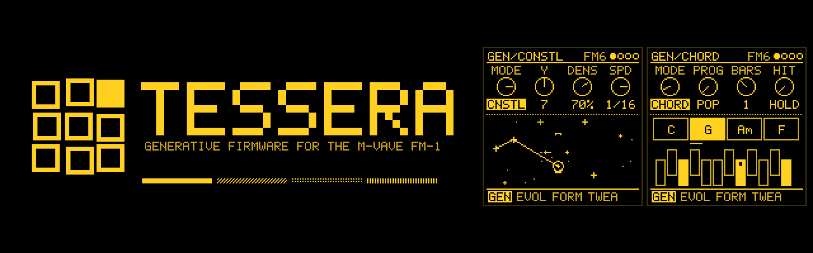

<b><a href="https://wiggismodular.github.io/tessera-moar/">Project page</a></b> ·
<b><a href="https://wiggismodular.github.io/tessera-moar/webapp/installer/">Install</a></b> ·
<b><a href="https://wiggismodular.github.io/tessera-moar/webapp/sim/">Try it in your browser</a></b> ·
<b><a href="https://wiggismodular.github.io/tessera-moar/webapp/editor/">Web editor</a></b> ·
<b><a href="MANUAL.md">Manual</a></b> ·
<b><a href="RECIPES.md">Recipes</a></b> ·
<b><a href="https://github.com/WiggisModular/tessera-moar/releases/latest">Releases</a></b>

**Tessera** is a generative firmware for the M-Vave FM-1. Each of the four tracks can play its own steps, an
arpeggio, or one of thirteen generators, and the pages around them evolve the phrases, build song forms, pass hits
between tracks and modulate anything from anything. GPL-3.0-only. **Status: Experimental.**
By **Theo Dainis** ([Rastapopolix](https://github.com/Rastapopolix)).

Tessera grew out of Melodee (Tess), a fork of [Melodee](https://github.com/keremimo/melodee) by **keremimo**,
itself built on *Felucca* by **Leo Kuroshita / Hügelton Instruments**. Releases up to 1.3.x were published as
Melodee (Tess).

*Tessera* (plural *tesserae*) is the Latin word for the small tile of stone or glass in a mosaic. Each generator
makes a short phrase; EVOLVE and FORM set mutated phrases side by side into sections, so a piece is built from small
tiles arranged into a larger pattern. The word also meant a die, which suits the chance-driven generators.

---

## Install

Flash it from your browser (Chrome or Edge, FM-1 connected directly by USB):
**[Web installer](https://wiggismodular.github.io/tessera-moar/webapp/installer/)**. Afterwards you can edit sounds
and sequences from the computer with the [web editor](https://wiggismodular.github.io/tessera-moar/webapp/editor/).

Each release has two builds: `tessera-X.Y.fwsc` (standard, dual core: start here) and
`tessera-X.Y-1core.fwsc` (single core, for FM-1s that crash with the standard build).

Do not unplug the FM-1 while it is writing. This is experimental firmware: use it at your own risk. The installer
page also has a way back to the official V15 firmware, with a backup first.

---

## What's inside

* **Thirteen generators** on SEQ > GEN: TURING, EUCLID, MARKOV, MORPH, ATLAS (with a fourth drum part), BOUNCE (and
  FALL), AWAKE, POLY, QUAD, CONSTELLATION, SERIES, CHORD and ANSWER, besides the step sequencer and the arpeggiator.
* **Shaping**: EVOLVE mutates a phrase every few bars, and **STEP EVOLVE** does the same to steps you wrote; FORM
  builds sections such as AABA; TWEAK shifts, drops, humanises or follows another track; TWEAK 2 branches hits
  to another track's sound, combines tracks with logic, and plays only on certain bars; LENGTH sets how long notes
  hold.
* **Harmony**: one key and scale for the whole project (**Key link**); a CHORD track plays a progression (or your
  own), and **QNT CHRD** makes the other tracks follow it.
* **Modulation**: 16 cords from any source to any destination on any track, generators included; slow organic
  sources (TIDE, SWARM); live marks on every knob a cord moves, and **MATRIX** to see the whole patch.
* **Print**: hold REC to turn what a generator played into ordinary steps.
* **Sounds**: FM6 (six-operator FM, three engine models), TRIO, ANALOG, PHASE, LOFI, GURDY and DRUM (808, 909, SID KIT).
* **MIDI OUT** of every track and the generators, each on a channel of its own (GLO > MIDI OUT), and **CLOCK OUT**,
  over USB.
* **Its own look**: the SMALTI palette, square tiles, Chakra Petch, and an animated mosaic splash.

The **[manual](MANUAL.md)** covers every page, knob and shortcut; **[RECIPES.md](RECIPES.md)** has step-by-step
patches and tips.

---

## Gallery

*The pages as the firmware draws them, rendered on the host from the firmware's own drawing code
(`tests/gallery_render.c`) in the default SMALTI palette, shown at 2x.*

<table>
<tr>
<td align="center" valign="top" width="33%">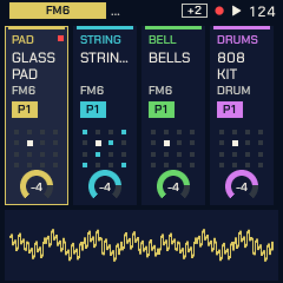 <b>HOME</b> The four tracks, their sounds and knobs.</td>
<td align="center" valign="top" width="33%">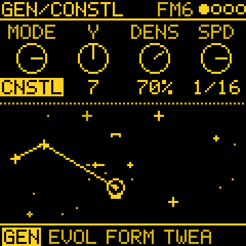 <b>CONSTELLATION</b> Stars play as they cross the ship's crosshair (after the norns script Constellation).</td>
<td align="center" valign="top" width="33%">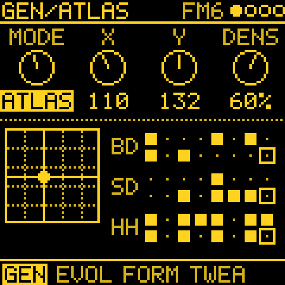 <b>ATLAS</b> Inspired by Émilie Gillet's Grids (Mutable Instruments): kick, snare, hat and a fourth part.</td>
</tr>
<tr>
<td align="center" valign="top">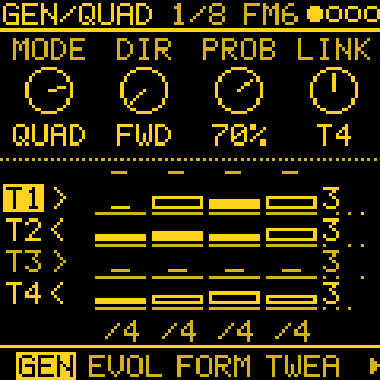 <b>QUAD</b> A 4 x 4 grid of notes the tracks share, a row each (after the norns script initenere).</td>
<td align="center" valign="top">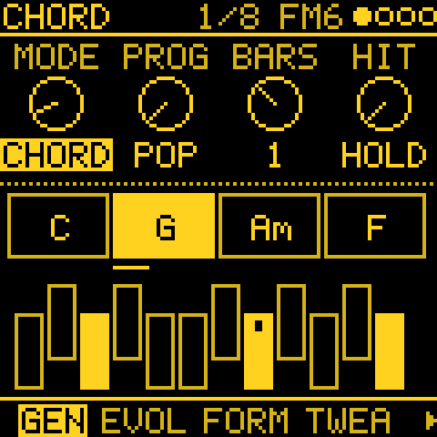 <b>CHORD</b> Progressions in the track's scale; QNT CHRD makes the others follow.</td>
<td align="center" valign="top">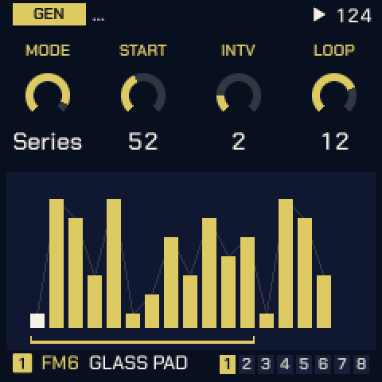 <b>SERIES</b> Per Nørgård's infinity series.</td>
</tr>
<tr>
<td align="center" valign="top">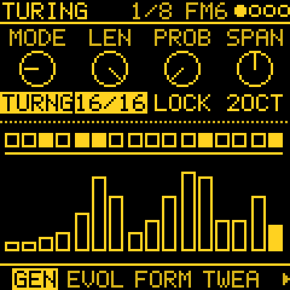 <b>TURING</b> A looping shift register.</td>
<td align="center" valign="top">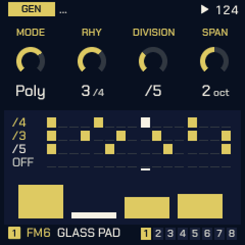 <b>POLY</b> Four notes on four rhythms.</td>
<td align="center" valign="top">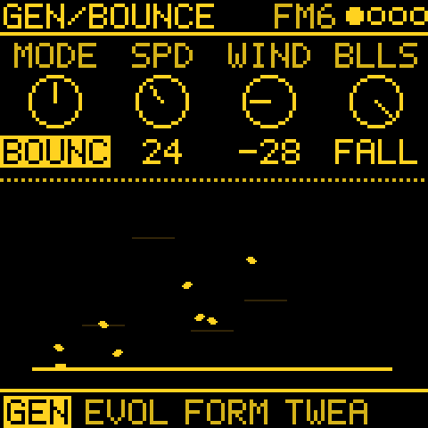 <b>FALL</b> Leaves in the wind, playing where they land (after the norns script Fall).</td>
</tr>
<tr>
<td align="center" valign="top">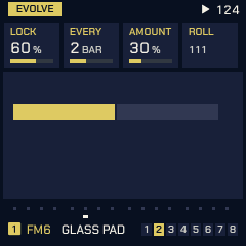 <b>EVOLVE</b> LOCK, EVERY, AMOUNT; ROLL picks the seed.</td>
<td align="center" valign="top">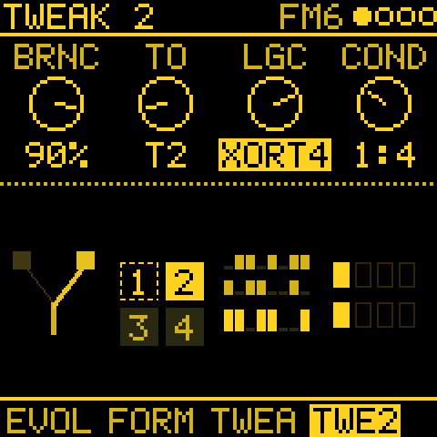 <b>TWEAK 2</b> BRANCH, LOGIC and COND.</td>
<td align="center" valign="top">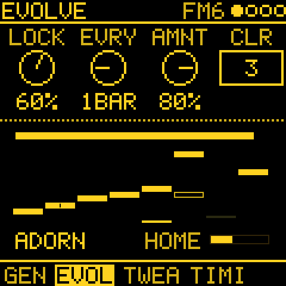 <b>STEP EVOLVE</b> Your steps, varied as they play.</td>
</tr>
<tr>
<td align="center" valign="top">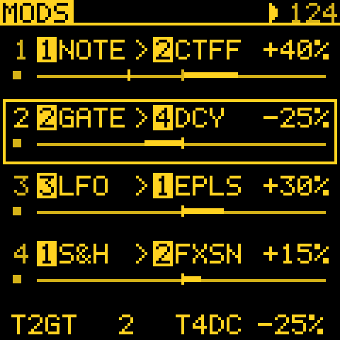 <b>MODS</b> 16 cords, any source to any destination.</td>
<td align="center" valign="top">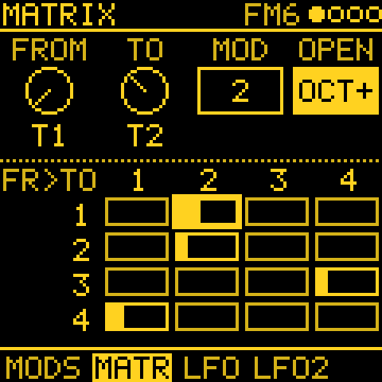 <b>MATRIX</b> The cords track by track, lit as they move.</td>
<td align="center" valign="top">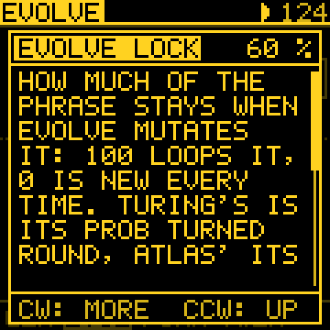 <b>Help card</b> Hold ARP and turn a knob.</td>
</tr>
<tr>
<td align="center" valign="top">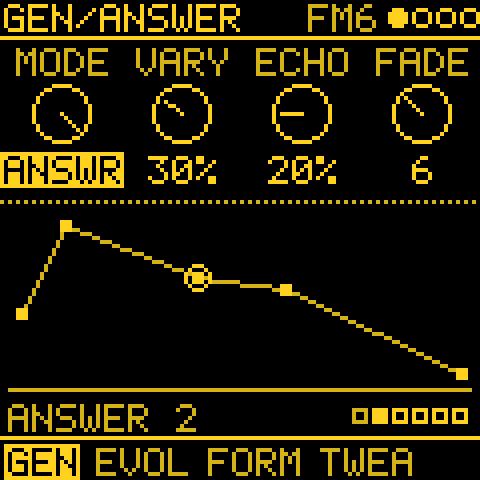 <b>ANSWER</b> Play a phrase; it answers, changing a little each time.</td>
<td align="center" valign="top">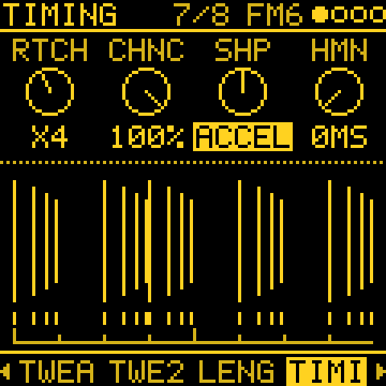 <b>TIMING</b> Ratchets x1 to x8, EVEN, ACCEL or DECEL.</td>
<td align="center" valign="top">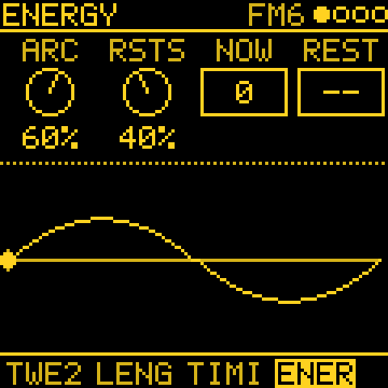 <b>ENERGY</b> A slow tide over minutes, and rests.</td>
</tr>
<tr>
<td align="center" valign="top">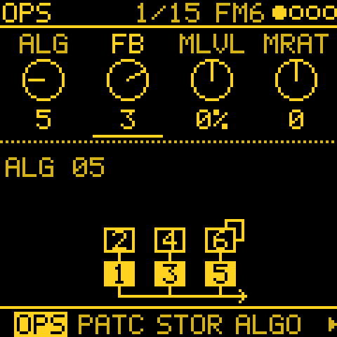 <b>FM6</b> Six-operator FM.</td>
<td align="center" valign="top">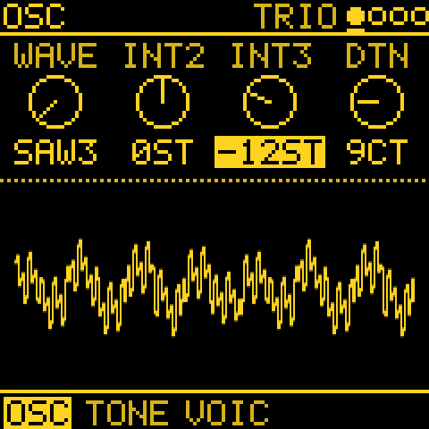 <b>TRIO</b> Three oscillators.</td>
<td align="center" valign="top">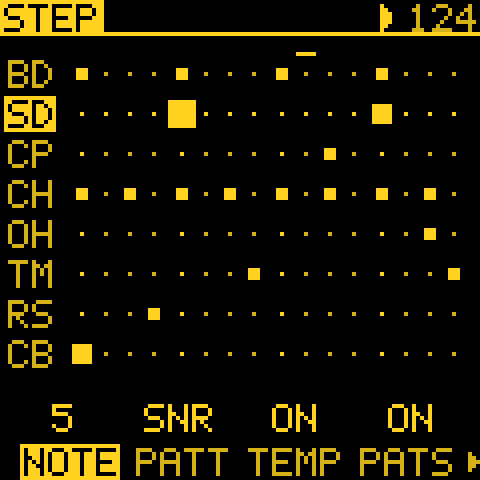 <b>DRUM</b> 808, 909 and SID kits.</td>
</tr>
</table>

More pages are in the [manual](MANUAL.md).

---

## Building

See [BUILDING.md](BUILDING.md). The host tests run with `tests/run_tests.sh`; the gallery renders with
`tests/gallery_render.c` (build line at its top) and the banner and social preview with `tools/gen_brand.py`.

---

## About me

I'm Theo Dainis, from New Zealand. I've been using and building synthesisers for the past 15 years, and I'm passionate about modular and open source. Elektron and Mutable Instruments are big influences on me. I love the DIY side: building things, and learning how music hardware works on the inside. Tessera is the sequencer I wanted on the FM-1: modular in a box, a small instrument that writes with you.

### Built with Claude Code

Tessera's code is written with [Claude Code](https://claude.com/claude-code), Anthropic's AI coding tool. I designed it, made the decisions, and test every release on my own FM-1 before it goes out. The source is open, so you can read every line and every change. Like any firmware, it comes with no warranty: save a **Complete backup** from the web editor before you flash.

---

## Credits and licence

Tessera is by **Theo Dainis (Rastapopolix)**. GPL-3.0-only, inherited from Melodee. Original copyright and SPDX headers are preserved. Melodee is by keremimo,
Felucca by Leo Kuroshita / Hügelton Instruments.

The ATLAS generator uses the drum map of **Grids** by Émilie Gillet / Mutable Instruments. Several generators are
inspired by **norns** scripts (ideas only, no code copied): **QUAD** by initenere, **FALL** by ambalek's Fall,
**CONSTELLATION** by timothy-taylor's Constellation, **AWAKE** by tehn's Awake and **SERIES** by nørgård. The
The TIDE and SWARM mod sources are inspired by **Triple Sloth** by Nonlinear Circuits (Andrew Fitch) and **ochd** by
Instruō and DivKid. See
[LICENSING.md](LICENSING.md) for every third-party part and its licence.
