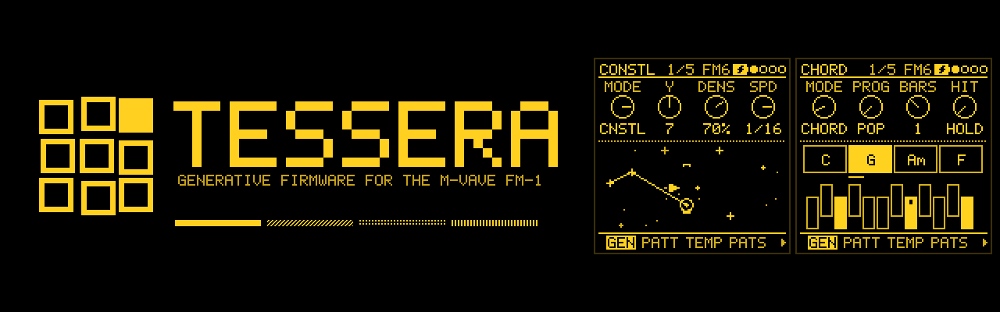
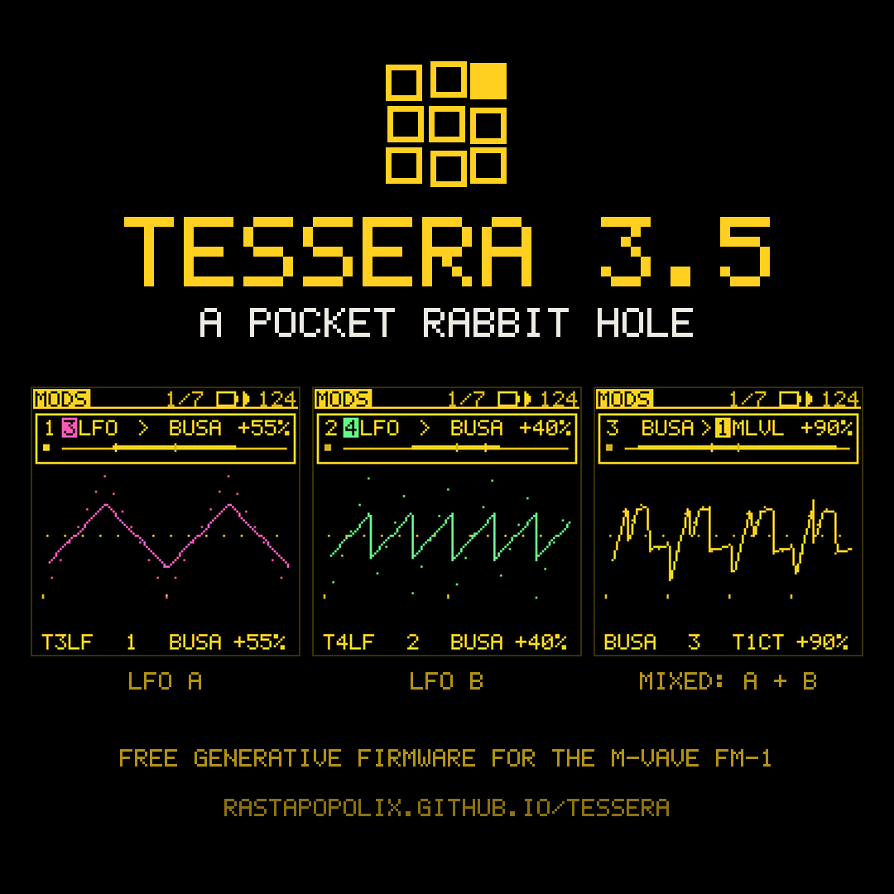
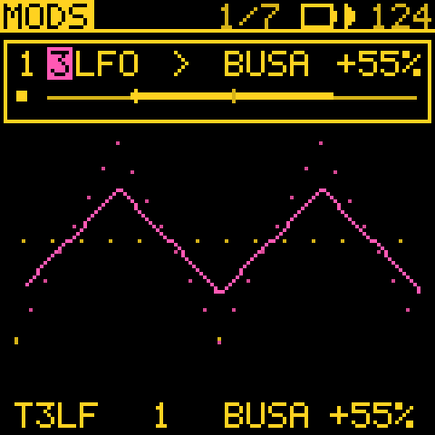
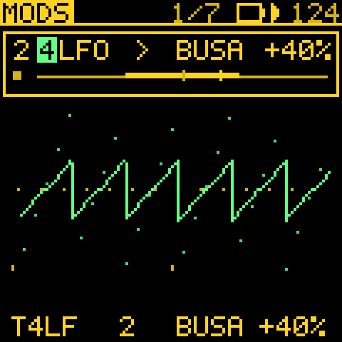
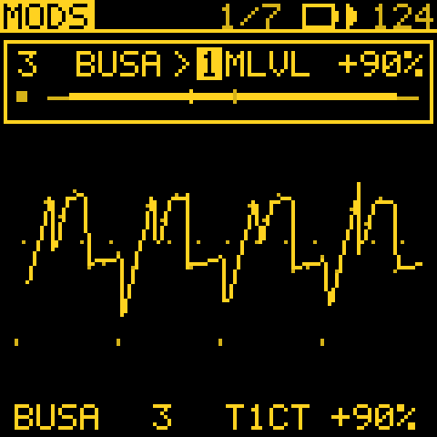
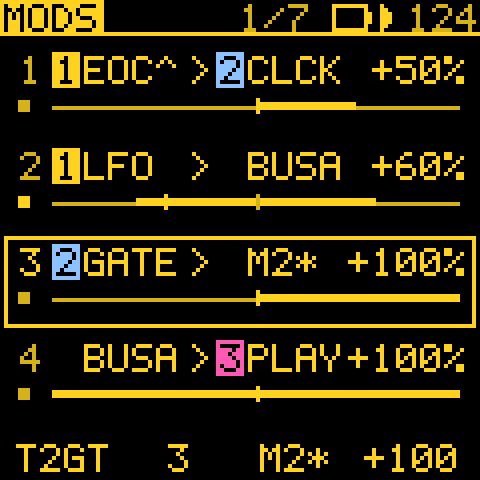
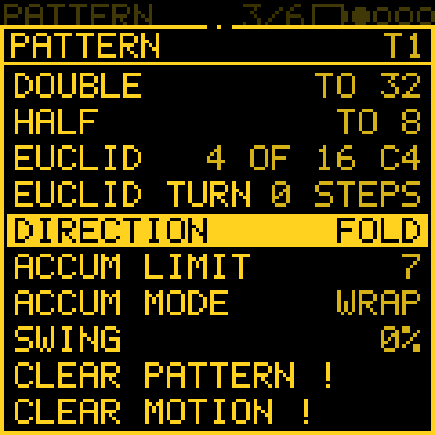
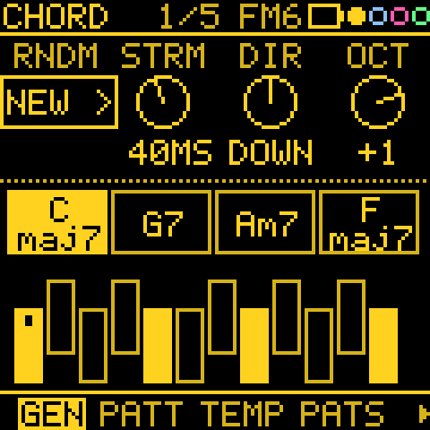
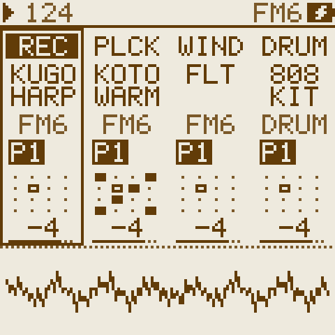

<b><a href="https://rastapopolix.github.io/tessera/">Project page</a></b> ·
<b><a href="https://rastapopolix.github.io/tessera/webapp/installer/">Install</a></b> ·
<b><a href="https://rastapopolix.github.io/tessera/webapp/sim/">Try it in your browser</a></b> ·
<b><a href="MANUAL.md">Manual</a></b> ·
<b><a href="RECIPES.md">Recipes</a></b> ·
<b><a href="GENERATIVE.md">Generative patching</a></b> ·
<b><a href="https://github.com/Rastapopolix/tessera/releases/latest">Releases</a></b>

<b>A pocket rabbit hole.</b>

**Tessera** is generative firmware for the M-Vave FM-1: an instrument for composing through systems. Instead of
programming every note, you set up how the music behaves, and it plays.

Each of the four tracks plays written steps or one of thirteen generators. The tracks listen to each other: a bass
follows a melody, a written line seeds a generator, a chord track keeps every part in key, and any source can move
almost any setting. And the music grows: phrases evolve, sections form, parts drop out and come back, and a whole
piece can follow a shape you choose over minutes or hours, or never stop.

It sits between a step-based groovebox and a self-playing ambient firmware. You build the system yourself, you can
reach into it at any level, from one note to the arc of a three-hour piece, and nothing runs unless you switch it on.
Every random choice comes from a seed, so PLAY replays a piece exactly and ROLL finds a new one.

GPL-3.0-only. **Status: Experimental.**
By **Theo Dainis** ([Rastapopolix](https://github.com/Rastapopolix)).

Tessera grew out of Melodee (Tess), a fork of [Melodee](https://github.com/keremimo/melodee) by **keremimo**,
itself built on *Felucca* by **Leo Kuroshita / Hügelton Instruments**. Releases up to 1.3.x were published as
Melodee (Tess).

*Tessera* (plural *tesserae*) is the Latin word for the small tile of stone or glass in a mosaic. Each generator
makes a short phrase; EVOLVE and FORM set mutated phrases side by side into sections, so a piece is built from small
tiles arranged into a larger pattern. The word also meant a die, which suits the chance-driven generators.
Tessera for FM-1 is not related to the Tessera plugins for VCV Rack.

## New in 3.5

- **Patch like a modular**: two MIX buses, EOC gates, CLOCK and PLAY destinations, mods that scale other mods, HOLD
  (sample and hold per bar or per note), and MOD DEPTH as one brake for the whole patch.
- **See your mods**: MOD SCOPE draws the picked mod over its source, and can be pinned.
- **More from the generators**: PAT GEN, ROLL ALL, RANDOM, CHORD STRUM, ENTRIES ORDER, USER scales, new chord kinds
  and ARP modes.
- **STEP direction**: FWD, BACK, PEND, FOLD, RAND, DRUNK, also as a mod destination.
- **GROUND LIGHT**: the whole screen on warm paper, with a LANDSCAPE by day.
- **Project files**: move songs between the web simulator and the FM-1 as `.tsp` files.
- **One key rule everywhere**: OCT+ goes in, OCT- goes back.

  

   

A project that uses MIX buses, EOC, CLOCK, PLAY or a mod onto MOD DEP does not load on 3.4.1. The full list:
[release notes](docs/RELEASE_3.5.md).

---

## Install

Flash it from your browser (Chrome or Edge, FM-1 connected directly by USB):
**[Web installer](https://rastapopolix.github.io/tessera/webapp/installer/)**. Afterwards you can edit sounds
and sequences from the computer with the [web editor](https://rastapopolix.github.io/tessera/webapp/editor/).

Each release has two builds: `tessera-X.Y.fwsc` (standard, dual core: start here) and
`tessera-X.Y-1core.fwsc` (single core, for FM-1s that crash with the standard build).

When a beta is out, the installer offers it as **Beta**: see [testing the beta](docs/BETA_TESTING.md) for what to check and how to report.

Do not unplug the FM-1 while it is writing. Tessera is experimental in every sense of the word: use it at your own risk. The installer
page also has a way back to the official firmware, with a backup first: V15 or V16, whichever the FM-1 had before
Tessera (its start-up part decides; the page says which one it needs). M-VAVE's own updater (M-UPGRADE 3.11 and
later) works with Tessera 3.3 and later only: earlier Tessera reports an identity it refuses.

---

## What's inside

* **Thirteen generators** on SEQ > GEN: TURING, EUCLID, MARKOV, MORPH, ATLAS (with a fourth drum part), BOUNCE (and
  FALL), AWAKE, POLY, QUAD, CONSTELLATION, SERIES, CHORD and ANSWER, besides the step sequencer and the arpeggiator.
* **Shaping**: EVOLVE mutates a phrase every few bars, and **STEP EVOLVE** does the same to steps you wrote; FORM
  builds sections such as AABA, and with **DEVELOP** each return varies a little; TWEAK shifts, drops, humanises or follows another track; TWEAK 2 branches hits
  to another track's sound, combines tracks with logic, and plays only on certain bars; LENGTH sets how long notes
  hold. **GRAVITY** lets a drifting line come back home.
* **Long form**: CHAIN plays the sections in an order, ENTRIES brings parts in and out in a musical order, ENERGY
  swings the whole piece between sparse and busy, and PIECE gives it a length and a shape over minutes or hours.
* **Your steps as a seed**: TURING, EUCLID, MARKOV and MORPH can play from a STEP pattern you wrote (SOURCE) and vary
  it, keeping its rhythm or its pitches as you choose.
* **Steps**: per step ratchets, nudges, conditions (1:2 to 8:8, FILL, FIRST) and a pitch accumulator that climbs each
  pass; the pattern's sheet doubles, halves or writes a Euclidean rhythm. Each pattern plays forwards, backwards,
  pendulum, folded, random or drunk (new in 3.5).
* **Harmony**: one key and scale for the whole project (**Key link**); a CHORD track plays a progression (or your
  own), and **QNT CHRD** makes the other tracks follow it. Four **USER scales** of your own and a strummed CHORD track
  (new in 3.5).
* **Modulation**: 16 cords from any source to any destination on any track, generators and effects included; slow organic
  sources (TIDE, SWARM); live marks on every knob a cord moves, and **MATRIX** to see the whole patch. New in 3.5:
  two **MIX buses**, EOC, CLOCK and PLAY for modular-style patching, MOD DEPTH as a brake for the whole patch, and the
  **MOD SCOPE** to watch a cord move.
* **Print**: hold REC to turn what a generator played into ordinary steps.
* **Sounds**: FM6 (six-operator FM, three engine models), **ORACLE** (two oscillators, POLY MOD and a four-pole
  filter: a classic polyphonic analogue voice), TRIO, PHYS (physical models: bars, bells, strings, drum heads) and
  DRUM (808, 909), with three insert effects a track and three send effects, a resonant FILTER among them.
* **MIDI OUT** of every track and the generators, each on a channel of its own (GLO > MIDI OUT), and **CLOCK OUT**,
  over USB.
* **USB audio**: stereo in and out with a computer, or the four tracks as separate stems (new in 3.5).
* **Its own look**: one ink on black and a 5 x 7 pixel font, as on a monochrome OLED; YELLOW by default, or
  WHITE, GREEN, BLUE, RED, or ORANGE, PINK, HOT PINK or LILAC as the FM-1's shells, or MOSAIC, SUNSET, OCEAN or NEON: a colour per
  track (MENU > COLOR). **GROUND LIGHT** puts it all on warm paper instead (new in 3.5).
* **Screen reader**: every page, knob and message spoken through your computer's screen reader.

The **[manual](MANUAL.md)** covers every page, knob and shortcut, with a glossary of the terms at the end;
**[RECIPES.md](RECIPES.md)** has step-by-step patches and tips. **[GENERATIVE.md](GENERATIVE.md)** explains the ideas
behind generative patching, from modular synths to norns, and where each generator comes from.

---

## Gallery

Screens of every generator, the inks and a four-minute demo video are on the
**[project page](https://rastapopolix.github.io/tessera/)**. More pages are in the [manual](MANUAL.md).

---

## Building

See [BUILDING.md](BUILDING.md). The host tests run with `tests/run_tests.sh`; the gallery renders with
`tests/gallery_render.c` (build line at its top) and the banner and social preview with `tools/gen_brand.py`.

---

## About me

I'm Theo Dainis, from New Zealand. I've been using and building synthesisers for the past 15 years, and I'm passionate about modular and open source. Elektron and Mutable Instruments are big influences on me. I love the DIY side: building things, and learning how music hardware works on the inside. Tessera is the sequencer I wanted on the FM-1: modular in a box, a small instrument that writes with you.

### Built with Claude Code

As much as I'd like to take the credit, Tessera's code is written with [Claude Code](https://claude.com/claude-code), Anthropic's AI coding tool. I designed it, made the decisions, and test every release on my own FM-1 before it goes out. The source is open, so you can read every line and every change. Like any firmware, it comes with no warranty: save a **Complete backup** from the web editor before you flash.

---

## Credits and licence

Tessera is by **Theo Dainis (Rastapopolix)**. GPL-3.0-only, inherited from Melodee. Original copyright and SPDX headers are preserved. Melodee is by keremimo,
Felucca by Leo Kuroshita / Hügelton Instruments.

The ATLAS generator uses the drum map of **Grids** by Émilie Gillet / Mutable Instruments. Several generators are
inspired by **norns** scripts (ideas only, no code copied): **QUAD** by initenere, **FALL** by ambalek's Fall,
**CONSTELLATION** by timothy-taylor's Constellation, **AWAKE** by tehn's Awake and **SERIES** by nørgård.
**ORACLE** is Melodee's Prophet engine (after the Prophet-5) under its own name, with its own sounds. The TIDE and SWARM mod sources are inspired by **Triple Sloth** by Nonlinear Circuits (Andrew Fitch) and **ochd** by
Instruō and DivKid.

Thanks to the testers and everyone who reported a bug or asked for a feature: BobFromson, pavig-coder, bambalaya,
alxantdroid, resocut, João Durães, tv-glotzer, il1893, fairplay, alexwlloyd, morgulbrut, @nrittamurti, Inputsignwave
Charles Vestal (FM-1 Screen Reader), and
@bitmap303 on YouTube, whose comment gave Tessera its tagline, "a pocket rabbit hole".

See
[LICENSING.md](LICENSING.md) for every third-party part and its licence.
