# Tessera recipes and tips

Short, tested ways to get somewhere with Tessera. Each uses only what the firmware has; the page and knob names
are the ones on the screen, and [MANUAL.md](MANUAL.md) explains each page in full. Where a step names a page, tap
the button in brackets until it shows: GEN, NOTES and PATTERN are under **SEQ**; EVOLVE, FORM, TWEAK, TWEAK 2, LENGTH, TIMING
and ENERGY under **ARP**; MODS, MATRIX
and ORGANIC under **LFO**, SCL and CHORD under **SCL**.

Recipes tagged **(3.5 beta)** need a feature that is not in 3.4.1 (the MIX buses, EOC, CLOCK, PLAY, MOD DEPTH,
scaling and HOLD mods, DIR, CHORD STRUM and the new chord kinds). Install the beta by picking **Beta** on the
[web installer](https://rastapopolix.github.io/tessera/webapp/installer/) (a project that uses them does not load on older firmware). Recipes
without a tag work on 3.4.1 too. The keys are the beta's: **OCT+ held** is the page's sheet, **OCT- held** its second
knobs. For the long patches that use these features (Krell, long gates, stepped chaos, the brake), see
[GENERATIVE.md](GENERATIVE.md).

**New here?** Start with [First steps: you have a loop, what next?](#first-steps-you-have-a-loop-what-next).

**Recipes**

- [A first generative patch in a minute](#a-first-generative-patch-in-a-minute)
- [A drone that breathes](#a-drone-that-breathes)
- [Chords that lead, melodies that follow (QNT CHRD)](#chords-that-lead-melodies-that-follow-qnt-chrd)
- [Your own progression (CHORD USER)](#your-own-progression-chord-user)
- [Two tracks answering each other (BRANCH)](#two-tracks-answering-each-other-branch)
- [A harmony line that follows (FOLLOW)](#a-harmony-line-that-follows-follow)
- [A harmony on your own melody (FOLLOW CHORD)](#a-harmony-on-your-own-melody-follow-chord)
- [Atlas: a groove with fills](#atlas-a-groove-with-fills)
- [Atlas: variations that repeat (FORM)](#atlas-variations-that-repeat-form)
- [Atlas: movement that repeats (an LFO on X or Y)](#atlas-movement-that-repeats-an-lfo-on-x-or-y)
- [Polyrhythms: POLY and QUAD](#polyrhythms-poly-and-quad)
- [Notes that travel between tracks (QUAD columns)](#notes-that-travel-between-tracks-quad-columns)
- [A melody you can come back to (CONSTELLATION)](#a-melody-you-can-come-back-to-constellation)
- [A slow lead from the infinity series (SERIES)](#a-slow-lead-from-the-infinity-series-series)
- [Leaves in the wind (FALL)](#leaves-in-the-wind-fall)
- [Pads from sparse notes (LENGTH HIT)](#pads-from-sparse-notes-length-hit)
- [Entries and arrangements (COND and FORM)](#entries-and-arrangements-cond-and-form)
- [From generator to pattern (print, then STEP EVOLVE)](#from-generator-to-pattern-print-then-step-evolve)
- [Movement over minutes (TIDE and SWARM)](#movement-over-minutes-tide-and-swarm)
- [Drift, then come home (GRAVITY on EVOLVE)](#drift-then-come-home-gravity-on-evolve)
- [A filter sweep on FM6 (the FILTER effect)](#a-filter-sweep-on-fm6-the-filter-effect)
- [A fill on the last bar (Condition and FILL)](#a-fill-on-the-last-bar-condition-and-fill)
- [A line that climbs (Accumulate)](#a-line-that-climbs-accumulate)
- [Returns that vary (FORM DEVELOP)](#returns-that-vary-form-develop)
- [A pad that opens slowly (ORACLE)](#a-pad-that-opens-slowly-oracle)
- [Mallets, bells and drums (PHYS)](#mallets-bells-and-drums-phys)
- [Play it in, layer by layer (REC)](#play-it-in-layer-by-layer-rec)
- [Your phrase, answered (ANSWER SOURCE)](#your-phrase-answered-answer-source)
- [Driving another synth (MIDI OUT)](#driving-another-synth-midi-out)
- [A piece that plays itself (PIECE, CHAIN and ENTRIES)](#a-piece-that-plays-itself-piece-chain-and-entries)
- [One knob for a big build (PERF macros)](#one-knob-for-a-big-build-perf-macros)
- [Drops that land on the bar (MUTES)](#drops-that-land-on-the-bar-mutes)
- [Your controller's knobs, kept (MIDI LEARN)](#your-controllers-knobs-kept-midi-learn)
- [An LFO for another synth's filter (mods out as CC)](#an-lfo-for-another-synths-filter-mods-out-as-cc)
- [A bass that takes a note a bar (FOLLOW HOLD)](#a-bass-that-takes-a-note-a-bar-follow-hold)
- [Loosen a 1/8 line (TIMING SPLIT)](#loosen-a-18-line-timing-split)
- [A pad that swells every cycle (a lagged bus, 3.5 beta)](#a-pad-that-swells-every-cycle-a-lagged-bus-35-beta)
- [A fill every four bars (EOC, 3.5 beta)](#a-fill-every-four-bars-eoc-35-beta)
- [A melody that steps on another track's notes (CLOCK, 3.5 beta)](#a-melody-that-steps-on-another-tracks-notes-clock-35-beta)
- [A part that comes and goes (PLAY, 3.5 beta)](#a-part-that-comes-and-goes-play-35-beta)
- [A pattern that turns round on a gate (DIR, 3.5 beta)](#a-pattern-that-turns-round-on-a-gate-dir-35-beta)
- [Steps, not sweeps (HOLD, 3.5 beta)](#steps-not-sweeps-hold-35-beta)
- [A cord that opens and closes (scaling a mod, 3.5 beta)](#a-cord-that-opens-and-closes-scaling-a-mod-35-beta)
- [A brake for the whole patch (MOD DEPTH, 3.5 beta)](#a-brake-for-the-whole-patch-mod-depth-35-beta)
- [A strummed chord pad (STRUM, 3.5 beta)](#a-strummed-chord-pad-strum-35-beta)

**[Tips](#tips)**

---

## First steps: you have a loop, what next?

A loop that sounds good is the best place to start. These moves turn it into music that develops, easiest first.
Stop after any of them: each one is optional, and everything automatic starts switched off. Keys: **OCT+** tap =
Enter, **OCT+ held** = the page's sheet, **OCT-** tap = Back, **OCT- held** = the page's second set of knobs.
Moves tagged **3.5 beta** need the beta.

### 1. Play with it live

Mutes, fills and one big knob make a loop a performance, and cost nothing to try.

- **GLO** opens the MIXER. The **black keys** (F#3 G#3 A#3 C#4) mute tracks 1 to 4; **C4** brings them all back.
  **E4** holds FILL.
- Hold **OCT+** on MIXER for its sheet, **Mutes: BAR**, so a mute lands on the next bar line (**3.5 beta**; on 3.4.1 use
  MENU > MUTES).
- **GLO > PERF** has four macros; they do something once a mod uses them (see [One knob for a big build](#one-knob-for-a-big-build-perf-macros)).

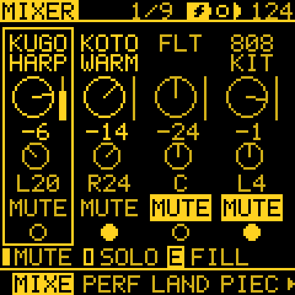 You should see MIXER: a level per track, and the mutes on the black keys.

**Try:** drop the drums on a bar line, then bring them back one bar later.

### 2. Let it change by itself

On a generator track, EVOLVE changes the phrase every few bars, so the loop never wears out.

- **ARP**, tap to EVOLVE. **EVERY 4**, **AMOUNT** about 30.
- **ROLL** (KNOB 4) is the track's seed: each click is a new line. Turn back to get the last one again.
- Hold **OCT-**, **KNOB 4** is **GRAVITY**: the line drifts and then comes home.

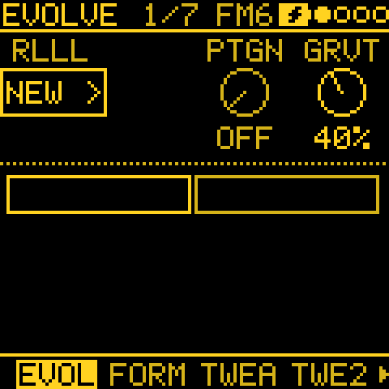 You should see EVOLVE with OCT- held: GRVT (GRAVITY) on KNOB 4.

**Try:** EVERY 4, AMOUNT 30, GRAVITY 50, and listen for a minute. See
[Drift, then come home](#drift-then-come-home-gravity-on-evolve).

### 3. Vary it with a second pattern, or a direction

Each track has 8 patterns. Copy yours, change a few notes, and you have an answer to the first.

- **SEQ** held opens PATTERNS: a cell per pattern. KNOB 1 to 4 pick the next pattern of tracks 1 to 4.
- **SEQ**, tap to SONG: put patterns in order, each with its repeats. **PLAY** plays the song.
- **3.5 beta:** hold **OCT+** on PATTERN or NOTES, and the **Direction** row plays the same notes
  FWD, BACK, PEND, FOLD, RAND or DRUNK.

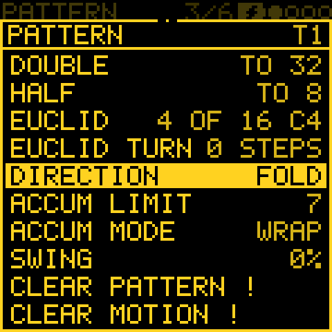 You should see PATTERN's sheet with Direction on FOLD (3.5 beta).

**Try:** set a STEP track's Direction to **FOLD**: the same notes, a new tune.

### 4. Give it an arc

ENERGY is the project's mood over minutes: sparse and soft, then busy and loud, then back.

- **ARP**, tap to ENERGY. Turn **ARC** up to about 50.
- A drone or a bass that should stay put: hold **OCT-** and set **DEPTH 0** on that track.

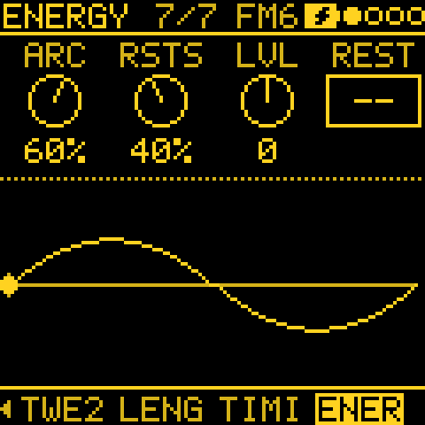 You should see ENERGY: the arc over minutes, and where the piece is on it.

**Try:** ARC 50, **RESTS** 20, and let it run for five minutes.

### 5. Bring tracks in and out

ENTRIES takes tracks out and back in on phrase lines, so a layered loop thins and fills without your hands.

- **GLO**, tap to ENTRIES. **ENTRIES** about 50, **STYLE FADE**.
- Hold **OCT-** to give each track a **ROLE**; set a pad to **ANCHOR** and it never leaves.

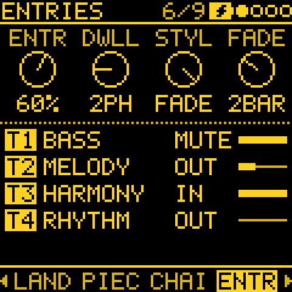 You should see ENTRIES: each track's role, and whether it is IN or OUT.

**Try:** ENTRIES 50, and watch the picture show which tracks are IN and OUT.

### 6. Build sections

FORM gives a track a verse and a chorus. CHAIN makes the whole project change section together, like a band
going into the chorus.

- **ARP**, tap to FORM: **FORM ABAC**, **CONTR** about 40.
- **GLO**, tap to CHAIN: **FORM ABAC**, **PHRASE 8**. Tracks whose own FORM is OFF follow it.

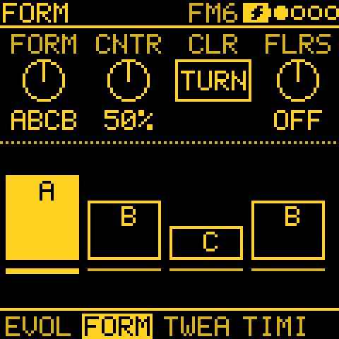 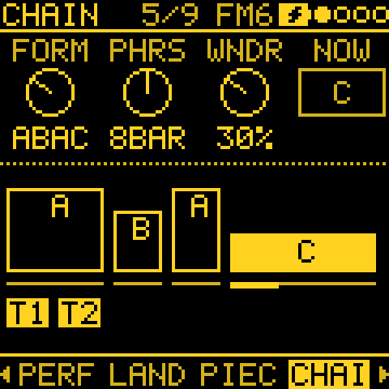 You should see FORM (a track's own sections) and CHAIN (the whole project's).

**Try:** CHAIN ABAC, PHRASE 8, then play for two minutes. See
[Returns that vary](#returns-that-vary-form-develop) to keep the returns from sounding the same.

### 7. Give it a length and an ending

PIECE plans the whole thing: a length, a shape and an end. It steers CHAIN, ENTRIES and ENERGY along the shape.

- **GLO**, tap to PIECE: **LENGTH 10 min**, **SHAPE ARCH**, **END STOP**.
- Press **PLAY**: it starts sparse, peaks, thins out and stops by itself. Try 5 min first to hear the whole shape.

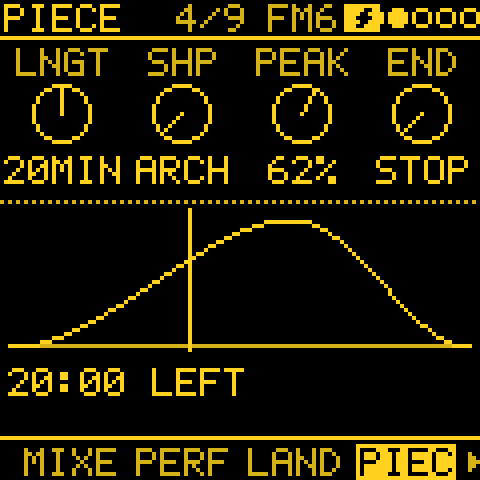 You should see PIECE: the shape, where you are on it and the time left.

**Try:** LENGTH 5 min, ARCH, END STOP. Full recipe: [A piece that plays itself](#a-piece-that-plays-itself-piece-chain-and-entries).

### 8. Add one moving part

One slow cord is enough to make a pad breathe.

- Hold **FX** and turn a knob (a cutoff, a level): a cord from the track's LFO to that knob, its amount set
  as you turn. Then set a slow RATE on **LFO**.
- **3.5 beta:** on **LFO > MODS**, hold **OCT-** to watch the picked mod move over time (MOD SCOPE). Let go and the
  rows come back.

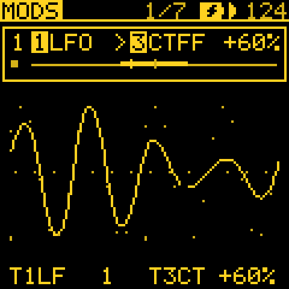 You should see MOD SCOPE (OCT- held on MODS): the picked mod over time.

**Try:** an LFO on cutoff at about +30 %, RATE slow, and watch it in MOD SCOPE.
(The filter on FM6 is an effect: [A filter sweep on FM6](#a-filter-sweep-on-fm6-the-filter-effect).)

### 9. Keep it

- Hold **REC** on a generator track to **print** what it played into STEP: ordinary notes, which never change unless
  you change them. **EDIT** held undoes it.
- Tap **REC** to record keys over the loop, pass after pass; tap again to stop.
- **SAVE + REC** (or hold **SAVE**) saves the project to its slot; playback stops first.

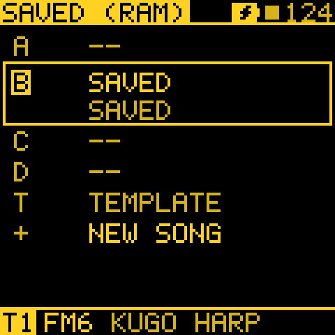 You should see the project's slots, with the one you saved.

**Try:** print a line you like, then save.

That is enough for a piece. For full patches see the recipes below, [GENERATIVE.md](GENERATIVE.md) for deeper
patching, and the [GLOSSARY](GLOSSARY.md) for any term that is new.

---

## A first generative patch in a minute

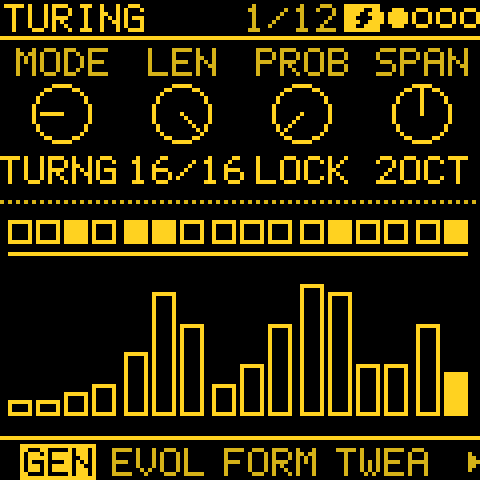

1. Power on. Track 1 is **KUGO HARP**, track 2 **KOTO WARM**, track 3 **FLUTE**, track 4 the **808 KIT**, in
   KUMOI on E.
2. Track 1 (KUGO HARP): **SEQ** for GEN, **MODE** to **TURING**. Press **PLAY**: a looping melody in the track's scale.
3. **PROB** at about 20: the loop changes a little each time round. At 0 (Lock) it holds.
4. Track 4: MODE **ATLAS**, **DENS** at 50. A drum groove under it.
5. Track 1 again, **EVOLVE**: turn **ROLL** a click at a time until you like the line. The number is its seed: write
   it down and you can always come back to it.
6. **SCL** on track 1 to change the scale; the generator follows at once.

## A drone that breathes

A held chord that changes slowly, for ambient beds.

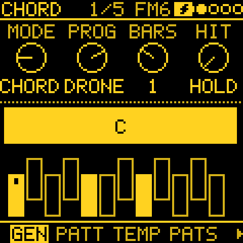

1. Track 1: **PRESETS**, **GLASS PAD** (an FM6 pad). GEN, MODE **CHORD**, **PROG DRONE** (the I chord alone), **BARS 4**, **HIT HOLD**.
2. Hold **OCT+** on GEN for its sheet: **Chord DIA7** (a seventh in the scale), **Voicing OPEN**. Then hold **OCT-**:
   **OCT −1** (KNOB 4) for weight.
3. **MODS**: a cord from **T1 TIDE 1** (TIDE's slowest circuit) to **T1 CUTOFF**, amount about +30 %.
4. A second cord from **T1 SWARM 2** to **T1 PAN**, about +20 %: the pad drifts across the stereo field.
5. For a drone that moves through the scale, set PROG to **WALK**: four chords from the seed, and EVOLVE (EVERY 8,
   AMOUNT 30) changes one now and then.

## Chords that lead, melodies that follow (QNT CHRD)

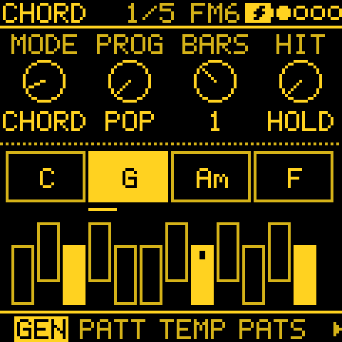

1. Track 2: **PRESETS**, **STRING MACH** (a TRIO pad). MODE **CHORD**, **PROG POP**, **BARS 1**, **HIT BEAT**.
2. Track 3 (FLUTE): MODE **MARKOV**, **LEAP 30**, **DENS 60**.
3. On track 3, **SCL**: **QNT** to **CHRD**. Its notes now snap to the chord track 2 plays, so the melody always
   fits the harmony. The keys and MIDI input snap too, so you can play along on track 3.
4. Try PROG **2-5-1** or **CIRCLE** for a jazzier walk; the melody follows every change.

## Your own progression (CHORD USER)

1. A CHORD track: **PROG USER**.
2. Hold **OCT-** on GEN and play the roots on the keys, one key a chord: for example C, A, F, G. The keys are silent
   while you enter. Notes outside the scale round down into it.
3. Let OCT- go. **Length** (the GEN sheet, OCT+ held) is now 4; shorten it to leave the last chords out.
4. The chords' kind comes from **Chord** on the same sheet: OFF for triads, **DIA7** for sevenths.

## Two tracks answering each other (BRANCH)

1. Two melodic tracks, for example track 1 KUGO HARP and track 3 FLUTE. Track 3: MODE **TURING**.
2. Track 3, **TWEAK 2**: **TO** to **T1 COIN**, **BRANCH 40 %**. About four hits in ten now play on the harp.
3. **TOGGLE** instead of COIN alternates: at 100 % every other hit goes across, a strict call and response.
4. **LATCH** tosses once a bar: whole bars swap between the two sounds.
5. The tosses replay with the seed. A cord from a **SWARM** to **BRANCH** sweeps how often hits cross over.

## A harmony line that follows (FOLLOW)

1. Track 3 plays a generator melody.
2. Track 2: any generator, then **TWEAK**: **FOLLOW T3**, **SHIFT +2**. Track 2 plays track 3's pitches two scale
   steps up, in its own scale and its own rhythm.
3. **SHIFT −7** for a line an octave below in a seven-note scale. **DROP 50** thins the harmony so it only answers
   now and then.
4. **3.5 beta:** mute track 3 on MIXER (the black key for it): track 2 keeps playing the harmony, so the melody can be
   a leader you never hear. On 3.4.1 a muted leader stops its followers; set its MIDI OUT to SOUND OFF instead.

## A harmony on your own melody (FOLLOW CHORD)

Write or play in a melody, and let another track harmonise it, note for note, without a wrong note.

1. Track 1 holds your melody: a STEP track with the notes written in on **NOTES**, or played in with **REC**.
2. Track 2: any generator (its own notes are not used; **EUCLID** is fine), in the same key on **SCL**. On
   **TWEAK**: **FOLLOW T1**.
3. Still on **TWEAK**, hold **OCT-**: **KNOB 2** sets **HOW** to **CHORD**, **KNOB 3** sets **RHYTHM** to **SOURCE**.
   Track 2 now plays with each note of your melody a third, fifth or seventh of the chord on it, the one nearest its
   last note, so the harmony moves smoothly.
4. Other ways to go: **HOW CONTRA** for a line that moves against yours, **CANON2** for your melody again two notes
   later (a round), **BASS** for a bass on beats 1 and 3. **RHYTHM BOTH** lets the generator add notes of its own in
   between.

Keep the melody on a lower track number than the harmony: the harmony then lands on the same step.

## Atlas: a groove with fills

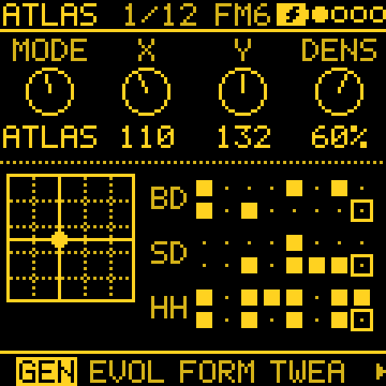

1. Track 4 (808 KIT): MODE **ATLAS**, **X** and **Y** where you like the groove, **DENS 60**.
2. Hold **OCT+** on GEN for its sheet: **Fourth part 40** brings in the hits the kick and snare only just miss, so
   fills follow the groove. Hold **OCT-** and press a **black key** to put that part on **CLAP**, **OPEN HAT**,
   **RIM** or **BELL** instead.
3. Still holding OCT-: **HAT 30** thins the hats (KNOB 4), **KICK 100** keeps the kick full (KNOB 2).
4. **TWEAK 2**: **COND 4:4** on a second ATLAS track, with the fourth part on CLAP and DENS high, gives a fill on
   every fourth bar only.

## Atlas: variations that repeat (FORM)

FORM turns an ATLAS track into a short song form: sections A, B and C, each a point on the Atlas map, played in an
order such as AABA. A section played again comes back exactly, so the variations repeat.

1. GEN: **MODE ATLAS**; set **X** and **Y** (where on the map) and **DENS** (how full). This is section A.
2. EVOLVE: **EVERY** sets how long each section lasts: 1, 2, 4, 8 or 16 bars. (Turning FORM on with EVERY OFF sets
   4 bars.)
3. FORM: **FORM** picks the order: AB, ABAC, ABCB, AABA, ABCA or AABC. The whole form lasts the sections times
   EVERY: AB at 2 bars repeats every 4 bars, AABA at 4 bars every 16.
4. FORM: **CONTR** (contrast) sets how far a new section moves from the one before: low, a small change of pattern;
   high, a different groove.
5. For exact repeats, take out the other randomness: EVOLVE **LOCK** at 100 (for ATLAS, LOCK is CHAOS turned round:
   100 is no chaos), and TWEAK **DROP** and **HUMAN** at 0. A lower LOCK brings back a little variation in every bar
   on top of the form.
6. FORM **FLRSH**, TWEAK **SHIFT** and **FOLLOW** do nothing on an ATLAS track (they would change which drum plays).

Shaping the sections by hand:

- While a section plays, turn **X** and **Y**: the section keeps where you leave them and plays from there every
  time it comes round. (DENS is one setting for the whole track, not per section.)
- FORM **CLEAR** forgets B and C: the section playing becomes A, and B and C are made again from it by CONTR when
  they are next reached.
- **ROLL** on EVOLVE picks the track's seed, which decides how B and C are pushed away from A.

EVOLVE without FORM (EVERY and AMOUNT set, FORM OFF) is the other way round: every EVERY bars X and Y take a random
step of up to AMOUNT, so the groove keeps wandering and does not come back.

## Atlas: movement that repeats (an LFO on X or Y)

A cord from an LFO synced to the bars moves the point across the map in a loop, the same every time. FORM can be on
as well: the sections set the point, the LFO moves around it.

1. On the ATLAS track, the LFO pages:
   - **LFO 2**: **SYNC** to **4BAR**, **2BAR** or **1/1** (the loop's length); **TRIG** to **FREE**. TRIG NOTE (the
     default) restarts the LFO with every note, and a drum track plays nearly every step, so the LFO would hardly
     move. FREE starts it on PLAY and keeps it in time with the bars.
   - **LFO**: **WAVE** SIN or TRI sweeps back and forth; SAW ramps and jumps back; SQR swaps between two points (an
     A/B change every half loop). **PHS** sets where in its loop it starts. **FADE** at 0.
   - **LFO DEST**: leave PIT, FLT, SHP and AMP at 0, so the LFO moves only the cord, not the drum sound.
2. **MODS**: a cord with source **LFO** (this track's), destination **AT X** (or **AT Y**, **AT DENS**, **AT TOMS**) on
   this track, and an amount: how far it moves X from the knob's setting.
3. For a figure on the map, move X and Y with two different loops: a second cord from another track's LFO (with its
   own SYNC, say 2BAR against 4BAR) to **AT Y**. With that track's LFO DEST at 0 its sound stays as it is.

Not for repeating: **DRIFT** wanders freely, and **RAND** and the LFO's **S&H** wave pick new values. They make a
groove that keeps changing, which is the other use.

## Polyrhythms: POLY and QUAD

**Inside one track (POLY):**

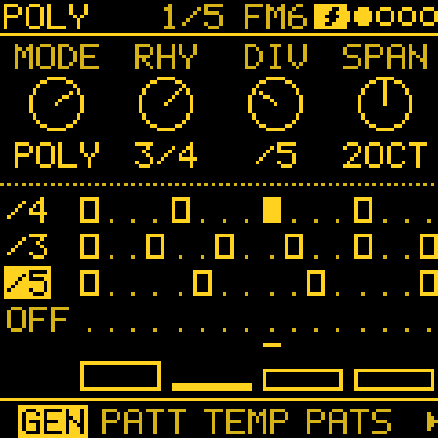 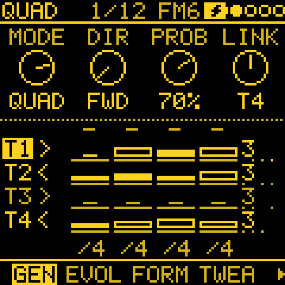

1. MODE **POLY**. Its four notes step on whenever one of its rhythms fires. By default rhythm 1 is **/4** and
   rhythm 2 **/3**: 4 against 3.
2. **RHY 3**, then **DIVISION /5**: a third rhythm against the other two. Where rhythms land together the note
   plays once, louder, so the accents show the pattern.
3. **SPAN 2** spreads the four notes over two octaves.

**Across tracks (QUAD):**

1. Tracks 1, 2 and 3: MODE **QUAD**. They share one 4 x 4 grid of notes, a row each.
2. Give each a different **DIV** on **PATTERN**: 1/16, 8T and 1/8. Each plays its row at its own speed, and the
   rows drift against each other.
3. Track 3: **DIR PEND** (back and forth) or **RAND**.

## Notes that travel between tracks (QUAD columns)

1. Two or more tracks in **QUAD**, as above.
2. Hold **OCT-** on GEN. KNOB 2 picks a column, KNOB 3 its **MOVE** (**DOWN**: each note moves a track down,
   track 4's to track 1), KNOB 4 its **EVERY** (/4: every four steps of the first QUAD track).
3. Set a different MOVE on another column (UP, or RAND). A phrase on one track now turns up on the next a few beats
   later, as a canon.
4. **Range** (the GEN sheet, OCT+ held) **1 OCT** folds every row into one octave from the root: tighter, more like a
   riff.
5. **LINK** on GEN: a fast QUAD track pulls slower ones along. With DIR **HOLD** a track plays only when the linked
   one moves it.

## A melody you can come back to (CONSTELLATION)

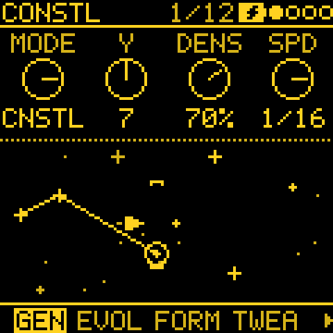

1. MODE **CONSTL**, **DENS 60**, **SPEED 1/16**. The stars that cross the crosshair play.
2. Hold **OCT+** for the GEN sheet: **Size 3** catches stars three rows either side, for wider leaps. Then hold
   **OCT-**: **LEN 8** and **LOCK 70**: most
   steps now play the eight-step loop of stars already caught, so a phrase forms and repeats with small changes.
3. **FILL ARP** fills the steps between stars with the last four stars, low to high and softer.
4. Let the ship steer itself: **MODS**, a cord with no source (`--`) to **C AUTO** on this track, offset to taste:
   low values wander slowly, **SEEK** flies to the next star.
5. **Y** sets where the melody sits; a slow LFO or SWARM on **C Y** moves it up and down the sky.

## A slow lead from the infinity series (SERIES)

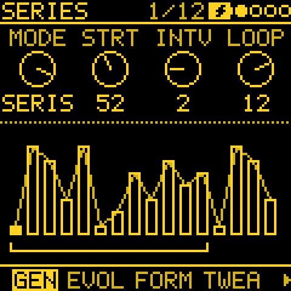

1. MODE **SERIES** on a lead sound (BELLS or an FM6 tine). PATTERN **DIV 1/8** or slower.
2. **INTV 1**: close, stepwise lines. **INTV 3** or **4**: wider leaps (folded back into two octaves).
3. **LOOP OFF** never repeats; **LOOP 8** repeats eight notes as a motif. EVOLVE (EVERY 8) picks new STARTs, so the
   motif moves on now and then.
4. **LENGTH** page: **HIT**, so each note rings until the next one.

## Leaves in the wind (FALL)

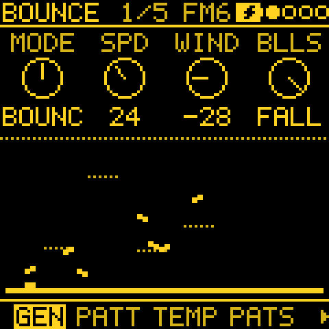

1. MODE **BOUNCE**, **BALLS** turned past 4 to **Fall**. Eight leaves fall and play where they land: left low, right
   high, one in seven an octave down.
2. **ANGLE** is now **WIND**: the middle is calm; turning it leans the melody low or high. Further out, gusts send the
   leaves down together, in bursts.
3. **MODS**: a cord from a **SWARM** (SWARM 3, about 25 s a turn) to **B ANGLE**: the wind rises and falls.
4. **SPEED** slower (10 to 20) for a sparse, rain-like part.

## Pads from sparse notes (LENGTH HIT)

1. Any generator on a pad sound (**PRESETS**: GLASS PAD, STRING MACH). Set **DENS** or **PROB** so it plays few notes.
2. **LENGTH** page: **LENGTH HIT**. Each note holds until the next hit, so rests let notes ring and the line turns
   into a slowly changing pad.
3. For plucks instead: **FIXED**, **LEN 1/16**, **KEYS 2**.

## Entries and arrangements (COND and FORM)

1. Give two tracks the same **EVERY** (EVOLVE) and turn **FORM** on both, for example AABA on the drums and ABAC on
   the bass. Their sections change together.
2. **TWEAK 2**, **COND**: **!FIRST** keeps a track silent for the first bar after PLAY (or each section start, with
   FORM on), so it enters late. **1:4** plays only on the first bar of every four; **4:4** only on the last, for a
   turnaround.
3. **CONTR** high on the bass and low on the drums: the bass moves a lot between sections, the groove only a little.
4. **FLRSH +7** on a melodic track moves the notes on the last beat of every phrase up a fifth, a small pickup into
   the next.

## From generator to pattern (print, then STEP EVOLVE)

1. Let a generator play until you hear a line you like.
2. Hold **REC**: its last bars go into the track's STEP pattern (PRINTED), and the track switches to STEP and plays
   on without a gap. Hold **EDIT** to undo, which brings the generator back.
3. Now it is ordinary steps: edit notes on **NOTES**, or the keys.
4. **EVOLVE** (STEP EVOLVE): **AMOUNT 30**, **EVERY 2**, **LOCK 50**. The steps you wrote are varied as they play:
   a note moved, one dropped, a ghost note. The steps themselves do not change.
5. Like a variation? Hold **REC** to keep it (KEPT n STEPS). **CLEAR** goes back to the steps as written.

## Movement over minutes (TIDE and SWARM)

1. **LFO** to **ORGANIC** on any track: **SPEED** and **RATE** at 50 to start.
2. **MODS**: **T1 TIDE 3** (about a minute a turn) to **T2 CUTOFF**; **T1 TIDE 2** (about 3 minutes) to **T3 FX
   SEND**; **T1 SWARM 5** (about 10 s) to **T4 AT DENS**.
3. Press **OCT+** on a mod to make it **+** (one way): it moves only up from the knob, never below, which is often what you
   want for FX SEND and density.
4. **MATRIX** shows the patch at a glance: rows are sources, columns destinations, lit as they move.
5. Because PLAY restarts TIDE and SWARM from the seed, the same project unfolds the same way each time.

## Drift, then come home (GRAVITY on EVOLVE)

1. Track 3 (BELLS): MODE **TURING**, **PROB 0** (Lock), and turn **ROLL** on EVOLVE until you like the loop.
2. **EVOLVE**: **EVERY 2**, **AMOUNT 40**. Every two bars the line changes a little, and keeps going further.
3. Hold **OCT-** on EVOLVE: **GRAVITY 30** (KNOB 4). Now about one round in three brings a changed note back instead, so the
   melody wanders and returns. At 70 it stays close to home; at 0 it wanders freely.
4. Home is the loop as you last set it: turn a knob or ROLL and that becomes the new home.

## A filter sweep on FM6 (the FILTER effect)

FM6 has no filter of its own; the FILTER effect gives it one.

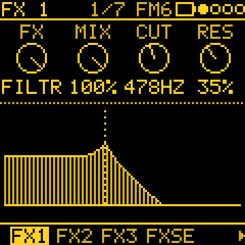

1. Track 1 (load **GLASS PAD** with **PRESETS**): **FX**, the **FX 1** page: **FX** to **FILTER**, **MIX** full, **CUT** about halfway,
   **RES** a third up.
2. Hold **FX** and turn **CUT** (KNOB 3) to the right: a cord from the track's LFO to the cutoff, its amount set
   as you turn.
3. On **LFO**, a slow RATE: the pad opens and closes. For a sweep over minutes, set the cord's source to
   **TIDE 2** or **DRIFT** on MODS instead.
4. For a dub-style echo that bends, put **ECHO** on FX 2 and a slow cord on its TIME (FX2 RTE): the repeats glide in
   pitch like a tape's.

## A fill on the last bar (Condition and FILL)

1. Track 4 (808 KIT) on STEP, a groove on the drum grid (**NOTES**).
2. Write a run of snare or tom hits on the last four steps. On each, **OCT+** for the hit's sheet: **Condition**
   **4:4**. They play on every fourth pass only.
3. For a fill on demand, set another few hits to **FILL** instead, and the kick on the last beat to **!FILL**.
   Hold **GLO** and **E4** (on MIXER, E4 alone) while the bar plays: the fill comes in and the kick drops out.
4. On the 3.5 beta a slow LFO can hold FILL for you:
   [A fill every four bars](#a-fill-every-four-bars-eoc-35-beta).

## A line that climbs (Accumulate)

1. A STEP track with a short pattern, four or five notes (**PATTERN**: **LEN 5**).
2. **NOTES**, **OCT+** on the first note: **Accumulate +2**. Each time round it plays two scale degrees higher.
3. Hold **OCT+** on NOTES for the pattern's sheet: **Accum limit 7**, **Accum mode Ping**: it climbs an octave,
   then comes back down. A second note at **−1** falls against it.
4. **PLAY** starts it again from the notes as written.

## Returns that vary (FORM DEVELOP)

FORM brings its sections back exactly; DEVELOP lets each return vary a little, so the piece keeps its shape but
never repeats itself note for note.

1. A melodic track: MODE **TURING**, **PROB 0** so the loop itself holds still.
2. **EVOLVE**: **EVERY 4**. **FORM**: **ABAC**, **CONTR 40**: four sections of four bars, A coming back every
   eight bars.
3. Hold **OCT-** on FORM: **DEVELOP 40**. Each time A comes back it is A varied by about that much: a note or two
   changed. The section itself is kept, so the next return starts from A again: after an hour
   it is still the same A, varied, not something that has drifted away.
4. Hold **OCT-** on EVOLVE: **GRAVITY 30** (KNOB 4). About one return in three is exact, so the original comes back now and
   then.
5. **DEVELOP 0** (the default) gives exact returns again. Between 30 and 50 the returns sound like a player
   ornamenting the same phrase; above 70 they wander further each time.

## A pad that opens slowly (ORACLE)

1. Track 1: **PRESETS**, **WARM PAD** (an ORACLE sound). MODE **CHORD**, **PROG DRONE**, **HIT HOLD**, **BARS 2**.
2. **EDIT** to **FILTER**: **CUTOFF** down to about 40, **ENV AMT** 60. On **FILT ENV**, **ATK** about 100: each
   chord starts dark and opens over a few seconds.
3. **CHARACTER**: **VINTAGE** 50. The voices drift apart a little in pitch and tone, like an old analogue synth.
4. **MACRO** (the first EDIT page): hold **FX** and turn **CUT** (KNOB 1) to the right: a cord from the track's LFO to the cutoff. On
   **LFO** a slow RATE, or on **MODS** set the cord's source to **TIDE 2** for a swell over minutes.
5. For a darker, rounder bass under it, track 2 on **SUB BASS** (ORACLE) and a slow TURING; ORACLE takes more of the
   FM-1 than an FM6 voice, so keep the bass sparse (DENS low) when two ORACLE tracks play.

## Mallets, bells and drums (PHYS)

1. Track 1: **PRESETS**, **MARIMBA** (a PHYS sound). MODE **MARKOV**, and **DIV 1/8** on PATTERN: a mallet line
   that wanders.
2. Track 2: **SINGING BOWL** or **GONG** on **CHORD**, **PROG DRONE**, **HIT HOLD**: a long metal swell under it.
3. Track 3: **HAND DRUM** on **ATLAS** for a groove struck rather than synthesized; **TOMS** or **TIMPANI** for
   deeper ones.
4. **EDIT** on a PHYS track: **STRC** changes the material (MODAL: a bar, a chime, a marimba's tuning), **BRIT** how
   bright it sounds, **DAMP** how long it rings. Every knob stays in its musical range, so turn freely.
5. For bowed sounds, try **BOWED METAL** or **BOWED STRING** on a slow TURING or a CHORD drone: they swell in, so
   give them long notes.

## Play it in, layer by layer (REC)

1. Track 1 on **STEP** (**SEQ**, GEN, KNOB 1). **NOTES** is the next page.
2. **PLAY**, then tap **REC**. It waits for the pattern's start (**WAIT FOR LOOP**), then records what you play on
   the keys.
3. Keep playing: every pass records on top of the last, so you can lay down a bass note first, then fill in. Tap
   **REC** again to stop.
4. Need another octave? **OCT-** / **OCT+** on NOTES while recording (both together: back to the middle).
5. Start over: **EDIT** + **REC** on NOTES, then **OCT+** for CLEAR PATTERN. REC stays on for a fresh take.
6. **QNT** (TEMPO) snaps the take to the grid when you stop.

## Your phrase, answered (ANSWER SOURCE)

1. Record a short line into track 1's STEP pattern (above), up to 8 notes.
2. Track 2: MODE **ANSWER**, a different sound (a PHYS bell answering an FM6 piano works well).
3. Hold **OCT-** on GEN and turn **KNOB 2** (SOURCE) to **T1**: track 1's pattern is now the call.
4. **VARY** about 40 %: each answer changes a little more. **FADE** sets how many answers before it rests; past 16
   (LOOPS) it keeps answering forever.
5. Change the STEP pattern and the answers change with it, as ANSWER reads it again before each answer.

## Driving another synth (MIDI OUT)

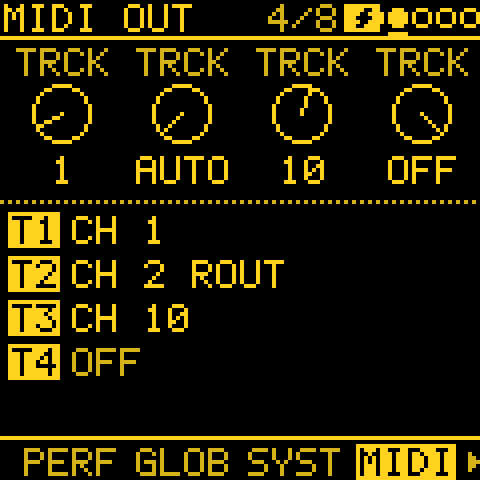 MIDI OUT" width="240">

1. Hold **HOME** for the menu: **NOTES OUT** to **ALL**. The steps, the ARP and every generator now go out over USB
   MIDI, each track on its own channel: AUTO gives 1 to 4 (GLO > SYSTEM ROUT at CH1-4; the drum track on its DRUM
   channel), or pick each track's channel, or OFF, on **GLO > MIDI OUT**.
2. **CLOCK OUT** on: the other synth or DAW follows Tessera's tempo, START and STOP included.
3. Turn the track's **LEVEL** down on the MIXER if you only want to hear the other synth.

---

## A piece that plays itself (PIECE, CHAIN and ENTRIES)

A piece with an intro, a build, a peak and an ending, that plays for half an hour with no hands on it. Three pages work
together: CHAIN gives the tracks shared sections, ENTRIES brings tracks in and out, and PIECE plans the whole shape.

  

1. Start from a few generator tracks playing together (the [first patch](#a-first-generative-patch-in-a-minute) is
   enough): a melody, a pad or chords, and ATLAS drums.
2. **GLO > CHAIN**: **FORM ABAC**, **PHRASE 8**, **WANDER** about 20 (now and then the next section is chosen rather
   than read). Tracks whose own FORM is OFF follow it.
3. On each generator track, **FORM**: **CONTR** about 40, so B and C sound different from A.
4. **GLO > ENTRIES**: **ENTRIES 50**, **STYLE FADE**. Hold **OCT-** and set the pad's ROLE to **ANCHOR** if it should
   never leave.
5. **ENERGY** (on any generator track's ARP pages): **ARC** about 60, so the shape is heard in how busy and loud the
   tracks play.
6. **GLO > PIECE**: **LENGTH 30 min**, **SHAPE ARCH**, **PEAK** about 60 %, **END STOP**. Press **PLAY**.

The piece starts sparse, layers in, peaks a little past the middle, thins and fades out at the end. It comes from the
tracks' seeds, so PLAY plays it again the same way; set END to **NEW** for a new piece each time (an installation that
never repeats), or **LOOP** for the same one again. To hear a whole shape quickly before you commit, try LENGTH 5 min
first.

## One knob for a big build (PERF macros)

A single knob that builds the whole track up: filters open, the reverb grows, the drums get busier and the tempo
pushes a little.

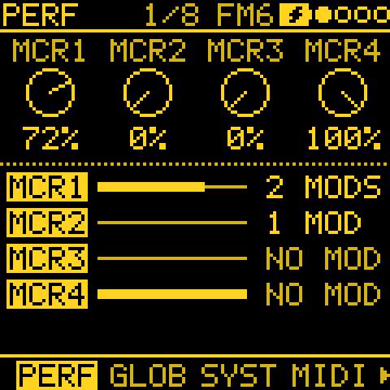

1. **LFO > MODS**, a free mod: **KNOB 1** (source) to **MACRO 1**, **KNOB 3** (destination) to **T1 CUTOFF**,
   **KNOB 4** about +60 %.
2. Another mod from **MACRO 1** to **T1 FX SEND**, about +40 %: more reverb or echo as it builds.
3. Another from **MACRO 1** to **T4 AT DENS** (an ATLAS drum track), about +40 %: the groove fills in.
4. One more from **MACRO 1** to **TEMPO**, about +5 %: a slight push (with CLK on INT).
5. **GLO > PERF**: turn **KNOB 1** up for the build, back down for the breakdown. The page shows how many mods each
   macro drives.

**3.5 beta:** one more mod, from **MACRO 1** to **MOD DEP** at -100 %, and the same knob also takes the whole patch to
dry (see [A brake for the whole patch](#a-brake-for-the-whole-patch-mod-depth-35-beta)).

Give **MACRO 2** the opposite job (negative amounts on levels and cutoffs) for a breakdown on another knob. The macros
are saved with the project, so the build is there next time.

## Drops that land on the bar (MUTES)

Mute and unmute by hand, and let Tessera put the change on the beat for you.

1. **MENU > MUTES**: **BAR** (or **PHRASE** for bigger moves, on the CHAIN's phrase lines).
2. While playing, hold **GLO** and press the black key for track 4 (or press it on MIXER). The key blinks quickly: the
   drums drop out on the next bar line.
3. Press it again on a later bar to bring them back on the line. Changed your mind before the line? Press it again
   while it blinks to call it off.
4. **3.5 beta:** hold **OCT+** on MIXER for its sheet, **Mutes**: the same setting as the menu's, at hand while you
   play the mute keys. A muted generator track still leads the tracks that follow it.

## Your controller's knobs, kept (MIDI LEARN)

Put Tessera's knobs on the knobs of your MIDI controller, once, and keep them through power-off.

1. Hold **HOME** for the menu, go to **MIDI LEARN** and turn **KNOB 2** right (or press **OCT+**). The screen says
   **LEARN: A KNOB**.
2. Turn a knob on any page, for example **CUTOFF** on track 1. The screen names it and asks **SEND A CC**.
3. Move a knob on your controller. The screen confirms it (**CC 21 =** then **T1 CUTOFF**).
4. Repeat for up to 16 knobs. While learning, the header says **MIDI LEARN ON**; press **OCT-** (or hold **HOME**
   for the menu) to end it.

The learned knobs work on any page and from any MIDI channel, and are the device's, not a project's: they stay
when you load another project and after power-off (they are saved once the music stops). To start again, turn
**KNOB 2** left on the MIDI LEARN row: it asks **FORGET? OCT+**, and OCT+ forgets them all (OCT- keeps them).

## An LFO for another synth's filter (mods out as CC)

Tessera's mods can move an outside synth's settings over USB MIDI: an LFO, a TIDE or a generator's CV becomes a
control change.

1. **MENU > NOTES OUT**: **KEYS** or **ALL** (anything but OFF).
2. **GLO > MIDI OUT**: set track 2's channel to the synth's channel. If the track should play nothing itself, hold
   **OCT-** and set it to SOUND OFF: it becomes a lane of CCs.
3. **LFO > MODS**, a free mod: source **T2 LFO** (or **T2 TIDE 2** for a slow, uneven sweep), destination **T2 CC**,
   amount 100 %. Set its CC number to the synth's filter (74 on many synths; the keys for it are in the manual's
   [CC out](MANUAL.md#mods-the-modulation-cords)). The destination shows it: **T2 CC 74**.
4. **LFO** on track 2: **RATE** for how fast it sweeps.

A value goes out only when it changes. Nothing is sent while the track is muted or its channel is OFF.

## A bass that takes a note a bar (FOLLOW HOLD)

A bass that follows the melody, but takes its note only once a bar, so it moves like a real bass line instead of
copying every note.

1. Track 3 plays a melody (TURING, say).
2. Track 2 is the bass: a generator for its rhythm (EUCLID, **STEPS 16**, **PULSE 4**), **TWEAK > FOLLOW T3**,
   **SHIFT −7** for an octave down (while following, SHIFT counts
   scale steps: −7 is an octave in a seven-note scale).
3. A track that plays once a bar decides when the bass takes a new note: track 1 as **EUCLID**, **STEPS 16**,
   **PULSE 1**, set to SOUND OFF with its channel OFF on **GLO > MIDI OUT** so it stays silent.
4. On track 2, hold **OCT-** on **TWEAK** and set **HOLD** to **T1** (KNOB 4).

The bass now plays its own rhythm on the note the melody had at the bar line. HOLD on a track with random hits (DROP,
BRANCH) samples at random moments instead.

## Loosen a 1/8 line (TIMING SPLIT)

A line on the grid, broken up now and then the way a player would: a quick pair of 1/16s here, a note pushed late there.

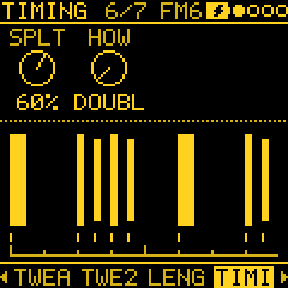

1. Any melodic track at **DIV 1/8**: a generator, or a STEP track with a line written in.
2. On **TIMING**, hold **OCT-**: **KNOB 1** sets **SPLIT 20 %**, **KNOB 2** sets **HOW** to **MIX**.
3. Too busy, or not enough? Turn SPLIT. **ROLL** on EVOLVE gives a new set of tosses, and the generator's notes stay.

The bar's first step stays on the grid. A mod on **SPLIT** (an LFO or TIDE) brings the looser bars in and out.

## A pad that swells every cycle (a lagged bus, 3.5 beta)

A bus with a Lag turns a short pulse into a soft rise and fall, and one bus can move several things. Here the pad's own
LFO cycle starts a swell (EOC, the end of the cycle, is a gate on every track).

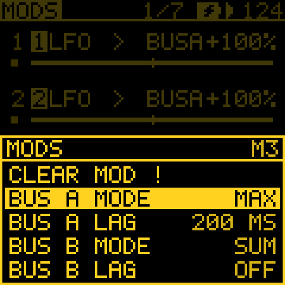

1. Track 1 with **PRESETS** on **GLASS PAD**, on a long pad (LENGTH HIT, or CHORD with HIT HOLD). **LFO 2**: **SYNC 2BAR**, **TRIG FREE**.
2. **MODS**: mod 1 from **T1 EOC** to **BUS A** (the end of KNOB 3's list), **+100**.
3. Hold **OCT+** on MODS for its sheet: **Bus A lag 500 ms** (KNOB 1 the row, KNOB 2 the value), **OCT-** to close.
4. Mod 2 from **BUS A** (the end of KNOB 1's list) to **T1 CUTOFF**, **+40**. Mod 3 from **BUS A** to **T1 FX SEND**,
   **+30**: the pad opens and gets wetter with every cycle, with one lag to set, not two.

A longer Lag is a slower, softer swell. Hold **OCT-** on mod 2 to watch the bus. The same bus fed by another track's
notes is in [GENERATIVE.md](GENERATIVE.md#an-envelope-from-another-tracks-notes).

## A fill every four bars (EOC, 3.5 beta)

EOC gives a gate once per LFO cycle. A slow LFO synced to the bars makes it a clock for fills, with no condition on
any step.

1. Track 4 (808 KIT) on a groove with some steps set to **FILL** (see [A fill on the last bar](#a-fill-on-the-last-bar-condition-and-fill)).
2. **LFO 2** on track 4: **SYNC 4BAR**, **TRIG FREE**.
3. **MODS**: a mod from **T4 EOC** to **FILL** (near the end of KNOB 3's list), **+100**. EOC is already a 0 to 1
   source, so the mod starts at **+**; tap **OCT+** once for **^**, a GATE.

FILL is held for the eighth of the cycle after each wrap (half a bar every four bars), and the GLO layer's FILL lights
while it is. SYNC **2BAR** for a fill every second bar. For a note on each cycle instead, send EOC to CLOCK: the Krell
in [GENERATIVE.md](GENERATIVE.md#an-envelope-that-plays-itself).

## A melody that steps on another track's notes (CLOCK, 3.5 beta)

A mod onto **CLOCK** makes a generator step on a gate's edges instead of its own DIV.

1. Track 1 plays a sparse generator. Track 3 plays a generator (TURING on BELLS).
2. **MODS**: a mod from **T1 GATE** to **T3 CLOCK**, **+50**. Track 3 now plays a step on every second note of track
   1, and never on its own.
3. **+100** is every note, **+33** every third. A **negative** amount steps when the note ends. DIV on PATTERN is
   still the step's length and the fastest it steps.

Two tracks that play together without sharing a grid: the melody follows the other player's hands. STOP and PLAY start
it again from the first step.

## A part that comes and goes (PLAY, 3.5 beta)

**PLAY** is a destination on each track: while the mods on it reach half, the track is heard; under half it plays on
unheard (so tracks that follow it keep their place). One GATE cord makes a gated voice.

1. Track 2 plays a generator (MARKOV).
2. **LFO** on track 2: **WAVE SQR**; **LFO 2**: **SYNC 2BAR**, **TRIG FREE**. Leave the LFO DEST depths at 0.
3. **MODS**: a mod from **T2 LFO** to **T2 PLAY** (near the end of track 2's destinations), **+100**; tap **OCT+**
   twice for **^**. Track 2 is heard for two bars, silent for two.

For a part that arrives on no schedule, use `T2 TIDE 2^ -> T2 PLAY` instead (tap OCT+ twice for ^): it comes in for a
few minutes and goes. More in [GENERATIVE.md](GENERATIVE.md#a-voice-that-comes-and-goes-with-the-tide).

## A pattern that turns round on a gate (DIR, 3.5 beta)

A STEP pattern has a direction (FWD, BACK, PEND, RAND, DRUNK) and a mod can move it.

1. Track 3 on **STEP** with a short line written on **NOTES** (LEN 8 on PATTERN).
2. Track 2 **LFO**: **WAVE SQR**; **LFO 2**: **SYNC 2BAR**, **TRIG FREE**.
3. **MODS**: a mod from **T2 LFO** to **T3 DIR**, **+20**; tap **OCT+** twice for **^**. Each 20 % of move is one
   direction along the list: while the gate is high the line plays BACK, then FWD again.

**+40** reaches PEND. Without the GATE, `T2 S&H -> T3 DIR` picks a new direction from the LFO's random values. DIR is
read at each step and never moves the playhead; a generator track does not use it. On 3.4.1 the direction is set on
the pattern's sheet, with no mod.

## Steps, not sweeps (HOLD, 3.5 beta)

A HOLD mod takes its source once and keeps it, as a sample and hold: a slow source turns into steps.

1. **MODS**: a mod from **T1 TIDE 3** to **T1 CUTOFF**, **+50**. Tap **OCT+** three times: **=**, HOLD. The cutoff is
   taken on the first step of each bar and stays.
2. Clock it by another voice instead: hold **OCT-** on the mod and turn **KNOB 1** to **HOLD ON T2 NOTES**. Now it
   takes a new place on every note track 2 plays.
3. Try `T3 DRIFT=` to **T3 PAN**, held on T2's notes too.

A held mod onto DIR or a generator's setting changes the line on the bar line. The long version:
[GENERATIVE.md](GENERATIVE.md#a-sample-and-hold-clocked-by-another-voice).

## A cord that opens and closes (scaling a mod, 3.5 beta)

A mod of mods normally adds to another mod's amount. Hold OCT- and it scales instead, like a VCA on the cord.

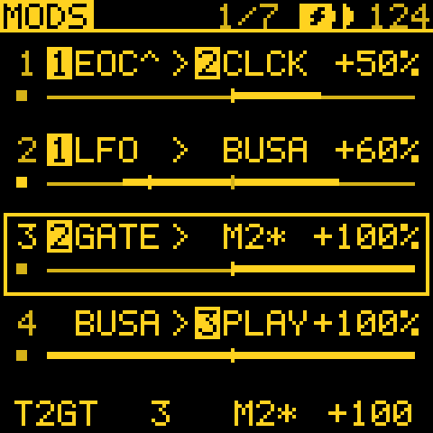

1. **MODS**: mod 3 from **T1 LFO** to **T1 CUTOFF**, **+60**: a plain filter sweep.
2. Mod 4 from **T2 GATE** to **M3 AMT** (after the send effects in KNOB 3's list), **+100**. Hold **OCT-** on mod 4
   and turn **KNOB 3** right: the row shows **M3\***.
3. Mod 3 now moves the filter only while track 2 plays; the sweep keeps its own amount. A **negative** amount closes it
   instead (a duck).

`T4 ENV` as the scaler shapes the sweep with each of track 4's notes. KNOB 3 left adds again. A gate on a mod is also
in [GENERATIVE.md](GENERATIVE.md#long-gates) (Try next). On 3.4.1 the same cords add instead.

## A brake for the whole patch (MOD DEPTH, 3.5 beta)

One control for how much of every mod plays, 0 to 100 %. At 0 the patch is dry; at 100 (the default) it is as you set it.

1. Any patch with a few cords, playing.
2. **GLO** for PERF (the page after MIXER); hold **OCT+** for PERF's sheet: **Mod depth**, **KNOB 2**. Turn it down to
   hear the patch settle.
3. To play it with a knob: **MODS**, a mod from **MACRO 1** to **MOD DEP** (the end of KNOB 3's list), **-100**. On
   PERF, **KNOB 1** up now takes the patch to dry.

Offsets and a GATE's threshold stay put; a cord onto MOD DEP is not scaled by it. A **GATE** onto FILL at 100 % stops
holding FILL once the depth is under 50 %. For the feedback version, see
[GENERATIVE.md](GENERATIVE.md#a-brake-for-any-feedback-patch).

## A strummed chord pad (STRUM, 3.5 beta)

A chord whose notes start a little apart, as a played one.

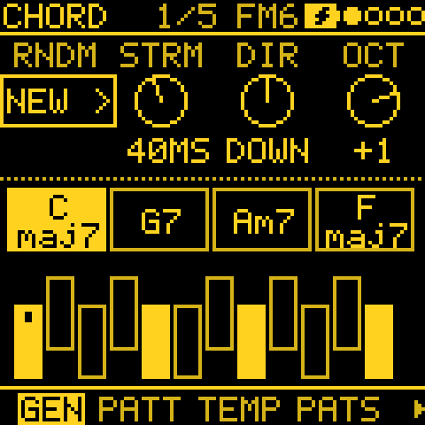

1. Track 1 (GLASS PAD): GEN, MODE **CHORD**, **PROG POP**, **BARS 1**, **HIT HOLD**.
2. Hold **OCT-** on GEN: **KNOB 2** **STRUM 100** (OFF, 1 to 250 ms: by 1 up to 10, by 5 up to 60, then by 10),
   **KNOB 3** **DIR UP** (DOWN or ALT as well).
3. Hold **OCT+** on GEN for its sheet: **Chord** **SUS2**, **ADD9**, **MAJ6** or **7SUS4**, fixed shapes on any
   note, in place of triads.
4. HIT **BEAT** or **STEP** with **STRUM 20** and **DIR ALT** gives guitar-like stabs. A short stab strums tighter, and
   all the notes end together.

MIDI OUT sends the notes spread too. On 3.4.x the chords play together, and SUS2, 7SUS4, ADD9 and MAJ6 as power chords.

## Tips

**Getting the most out of Tessera**

- Start small: one generator and one drum track. Add a layer only when the first ones sound right; four busy tracks
  at once are hard to judge.
- Pick the scale (**SCL**) early. Every generator plays in it, so it sets the mood more than any other setting.
- Keep what you like before you experiment: note the seed on **ROLL**, hold **REC** to print a line into steps, or
  save the project.
- Movement is more interesting when it is slow. A TIDE or a slow LFO on a filter or a send, at a small amount, keeps
  a loop alive for much longer than a fast one.
- When EVOLVE wanders too far, turn up **GRAVITY** (OCT- on EVOLVE) rather than turning EVOLVE off: it still moves,
  but comes home.
- A drone or a bass that should stay steady through ENERGY's tide: hold OCT- on ENERGY and set **DEPTH 0** on it.
- A track at SOUND OFF (OCT- held on GLO > MIDI OUT) is a free modulation lane: its generator's GATE, NOTE and CV
  still drive mods on the other tracks.
- For long pieces, try the plan on a short PIECE LENGTH first, to hear the whole shape, then make it longer.
- Crackles mean the FM-1 is out of breath: lower **BUDGET** (GLO > GLOBAL) or thin the busiest track.

**Finding your way**

- Every knob's job is in the [MANUAL](MANUAL.md) under its page, and every parameter in the
  [parameter reference](docs/PARAMETERS.md).
- **EDIT** on an EDIT page opens the map of the sound's pages: KNOB 1 across, KNOB 2 down, OCT+ opens. Any other
  page button leaves it for its own page.
- In lists (the menu, SCL, VOICE, sheets), **KNOB 1 picks the row and KNOB 2 changes it**.
- Prefer the left knob for picking tracks? MENU > **TRACK KNOB LEFT**.
- The large value at the foot of the screen covering what you want to watch, or too small to read from where you
  stand? MENU > **LARGE VALUE**: AUTO (the default) shows it only on pages without a picture, ON on every page, OFF
  never. The knob's own column always shows its value.
- Hold **GLO** and turn **PRESETS** to change the selected track's sound from any page. The sound's name shows large
  while GLO is held; let go to carry on where you were.

**Building up live**

- MENU > **MUTES BAR** (or PHRASE) puts your mutes on the beat, so you can press early and let it land.
- **MIDI LEARN** in the menu puts any knob on your controller, and remembers it after power-off.
- Add tracks while the others play: a generator you pick on another track **joins in time**, on the same beat and
  bar, so a drum groove dropped under a playing chord lands right.

**Seeds and repeatability**

- The small number on **ROLL** is the track's seed. Note the ones you like: the same seed with the same settings
  always plays the same line.
- **PLAY** restarts every generator's random choices, and TIDE and SWARM, from the top: with EVERY OFF a project
  sounds the same every time. Set EVERY to let it drift.
- On TURING, **PROB 0** (Lock) freezes the loop you are hearing; turn it up a little to let it evolve again.

**Mods**

- A **PERF** macro is a source for as many mods as you like: one knob on GLO > PERF can move a whole
  build.
- Hold **FX** and turn a knob for the quickest mod: it makes the cord for you. Turn SELECT while FX is held to pick
  another source.
- A cord with no source (`--`) is a fixed offset: use it to set things that have no knob, such as **C AUTO**.
- A knob with a mod on it shows a moving mark: you can see what the cords are doing without opening MODS.
- **OCT+** on MATRIX jumps straight to that cord in MODS.
- **3.5 beta:** hold **OCT-** on MODS to see what the picked mod does: its move over time (a line) over its source
  (faint dots), a GATE's threshold as a wedge at each edge. Let go and the rows come back. Turn **KNOB 4** while
  holding to move a threshold and watch the gate follow. Hold **OCT+** there for the MIX buses.
- **3.5 beta:** a bus (BUS A, BUS B) is a mixer of mods you can use as one source: send several cords in, or one
  envelope out to many places, and set the amounts once. Its **Mode** SUM, MAX, MIN or DIFF is OR, AND and XOR for gates.
- A mod's **+-** moves both ways from the knob, **+** only up; the bar shows which. It is the mod's own setting, not
  the LFO's POL. The lists name each source and destination with its track (**T2 GATE**).

**Saving and safety**

- **SAVE + REC** saves the project to its slot at once (stopping playback first).
- **EDIT held + OCT-** undoes, **+ OCT+** redoes.
- If your FM-1 crashes with the standard firmware, use the `-1core` build. After a crash, MENU > ABOUT shows what
  happened until power-off: please add a photo of it to a bug report.
